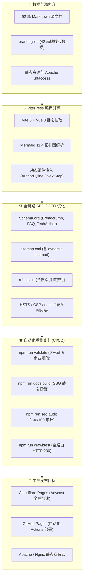

<div align="center">

# 🌐 机场入门 · jichangrumen.world

### 零基础新手教育型网络通信工程与科学上网知识库

> 面向大众与开发者的全链路网络协议通识、代理客户端实操配置与 42 家服务商基准评测知识库。  
> 坚持「教育优先、逻辑闭环、拒绝黑话、真实可信」。

<p align="center">
  <a href="https://jichangrumen.world"><strong>访问官网 (Live Site)</strong></a> ·
  <a href="#-三知识专栏架构全景-92-篇"><strong>知识专栏 (Docs)</strong></a> ·
  <a href="#-五本地运行与研发工作流"><strong>快速起步 (Getting Started)</strong></a> ·
  <a href="#-七自动化工程质量看板"><strong>质量看板 (Quality Gate)</strong></a>
</p>

<p align="center">
  
  
  
  
  
  
  
</p>

---

</div>

## 📖 目录 (Table of Contents)

- [🧭 一、项目愿景与核心理念](#-一项目愿景与核心理念)
- [✨ 二、核心特色与架构创新](#-二核心特色与架构创新)
- [📚 三、知识专栏架构全景 (92 篇)](#-三知识专栏架构全景-92-篇)
- [🏗️ 四、系统技术栈与设计拓扑](#-四系统技术栈与设计拓扑)
- [⚡ 五、本地运行与研发工作流](#-五本地运行与研发工作流)
- [📊 六、数据中心规范 (`brands.json`)](#-六数据中心规范-brandsjson)
- [🛡️ 七、自动化工程质量看板](#-七自动化工程质量看板)
- [🚀 八、生产部署与持续交付](#-八生产部署与持续交付)
- [⚖️ 九、合规体系与法律免责](#-九合规体系与法律免责)
- [📄 十、开源许可证](#-十开源许可证)

---

## 🧭 一、项目愿景与核心理念

在当今网络环境下，大量所谓的“评测站”和“导航站”充斥着虚假跑分、诱导性引流和无脑联盟返利，初学者极易遭遇黑产套壳、隐私泄露和断网跑路。

**「机场入门」(jichangrumen.world)** 诞生于对上述乱象的反思，我们构建了一套严谨、中立且极具可读性的现代技术文档体系：


1. **教育导向，拒绝推销**：首屏绝不硬推购买，优先解释 TCP/UDP 传输、TLS 握手、公网拥塞控制与专线内网工作原理。
2. **通俗比喻，消除黑话**：将复杂的网络专有名词转化为贴近生活的物理模型（如：直连线路 = 节假日拥堵省道，IEPL 专线 = 点对点全封闭高铁）。
3. **闭环链路，循序渐进**：全站 92 篇核心页面全部挂载 `<NextStep>` 智能递进组件，杜绝死胡同孤立页面，形成平滑认知阶梯。
4. **数据诚实，完全透明**：42 家品牌数据全量开源公布，未实测项坦白标注 `待核实`，严禁伪造测试日志与虚假背书。

---

## ✨ 二、核心特色与架构创新

| 模块 | 传统推销站 | **jichangrumen.world** |
| :--- | :--- | :--- |
| **内容品质** | 500 字空洞采集文，充斥推广链接 | **单篇 6,000～18,000 字** 深度技术拆解 + 真实场景复盘 |
| **图文表达** | 盗图模糊、UI 界面陈旧 | **249 张 Mermaid 动态时序/拓扑图** + 官方最新多端截图 |
| **SEO 规范** | 缺失元数据、无 canonical、死链重重 | **SEO 100/100 满分**，全量 JSON-LD 结构化数据与零死链 |
| **合规与披露**| 隐瞒商业返利、暗戳戳插链 | **严格遵守 FTC 规范**：显式标注佣金说明，外链全部附加 `nofollow sponsored` |
| **交互体验** | 弹窗飞舞、广告满天飞 | **VitePress 现代无干扰排版**，全端响应式、暗色模式、极速毫秒级加载 |

---

## 📚 三、知识专栏架构全景 (92 篇)

站点按知识进阶梯度规划了 9 大核心技术专栏，覆盖新手自学到高阶调优的全生命周期：

| 专栏路径 | 专栏名称 | 核心内容与技术覆盖 | 文章体量 |
| :--- | :--- | :--- | :---: |
| **[`src/what-is-airport/`](./src/what-is-airport/)** | **什么是机场** | 概念通识：节点、订阅、协议、BGP/IPLC/IEPL 专线原理、VPN 本质区别与术语词典 | **11 篇** |
| **[`src/guides/`](./src/guides/)** | **新手入门指南** | 学习路线：首次配置工作流、多设备协同、网络环境适配、带宽预算与选型原则 | **11 篇** |
| **[`src/clients/`](./src/clients/)** | **客户端中心** | 软件下载：Clash Verge Rev、v2rayN、sing-box、Shadowrocket 官方渠道与安全防毒 | **11 篇** |
| **[`src/tutorials/`](./src/tutorials/)** | **实战配置教程** | 保姆级实操：一键订阅导入、延迟测速、GEOIP 分流规则切换、多端同步与彻底卸载 | **11 篇** |
| **[`src/recommend/`](./src/recommend/)** | **新手选型推荐** | 理性消费：首单避坑策略、老牌大厂对比、小额按量付费体验、主流支付方式避险 | **11 篇** |
| **[`src/reviews/`](./src/reviews/)** | **深度横评与黑幕** | 严谨实测：42 家品牌晚高峰丢包实测、工单响应 SLA、退款政策与倍率暗坑揭秘 | **11 篇** |
| **[`src/free/`](./src/free/)** | **免费与应急救生** | 安全防护：免费节点污染机制、试用套路拆解、公益节点现状与突发失联应急指南 | **10 篇** |
| **[`src/faq/`](./src/faq/)** | **疑难杂症 FAQ** | 故障排障：节点全红超时、DNS 泄漏排查、流媒体原生解锁、TUN 虚拟网卡冲突 | **11 篇** |
| **[`src/about/`](./src/about/)** | **关于我们与声明** | E-E-A-T 体系：全球实测网络拓扑、评测方法论、利益披露说明、读者勘误通道 | **1 篇** |
| **[`src/privacy/`](./src/privacy/)** | **隐私合规政策** | 用户权利：无日志收集声明、Cookie 政策、GDPR / CCPA 标准合规 | **1 篇** |
| **[`src/terms/`](./src/terms/)** | **使用条款与协议** | 服务规范：知识产权界定、免责声明、可接受使用策略 (AUP) | **1 篇** |
| **[`src/index.md`](./src/index.md)** | **全站交互大枢纽** | 门户导航：30 秒极速决策罗盘、实时 NOC 网络看板、42 家矩阵速查与五步上手 | **1 篇** |
| **[`src/404.md`](./src/404.md)** | **404 智能救生舱** | 优雅降级：居中卡片式救援指南，将意外跳出转换为高价值内容再探索 | **1 篇** |

---

## 🏗️ 四、系统技术栈与设计拓扑

### 1. 技术栈列表
- **核心内核**：[VitePress 1.6+](https://vitepress.dev/) (Vue 3 + Vite 驱动的高性能静态站点生成器)
- **图表引擎**：`vitepress-plugin-mermaid` + `mermaid 11.4+` (编译期拓扑与时序渲染)
- **图标体系**：`@iconify/vue`
- **搜索集成**：
  - **云端**：Algolia DocSearch (已内置生产插槽，填入 Key 即可秒切)
  - **离线**：VitePress Local Search (默认集成，轻量快速分词)
- **工程校验脚本**：ESM 原生模块编写 (`scripts/validate.mjs`, `scripts/seo-audit.mjs`, `scripts/crawl-test.mjs`)
- **部署宿主**：Cloudflare Pages / GitHub Pages / Apache 2.4+ (含全套 `.htaccess` 重写规则)

### 2. 自动化生产管线拓扑



---

## ⚡ 五、本地运行与研发工作流

### 1. 环境准备
确保本机安装了 Node.js (`>= 18.0.0`) 与 npm：
```bash
node -v  # >= 18.0.0
npm -v   # >= 9.0.0
```

### 2. 获取代码与依赖安装
```bash
git clone https://github.com/opopop98698-sudo/jichangrumen.world.git
cd jichangrumen.world
npm install
```

### 3. 核心 NPM 命令清单

| 指令 | 说明 | 典型执行耗时 |
| :--- | :--- | :---: |
| `npm run docs:dev` | 启动本地极速开发热重载服务器 (端口 5173) | `< 1s` |
| `npm run docs:build` | 编译全站静态 HTML、提取 CSS/JS 与生成 Sitemap | `~20s` |
| `npm run docs:preview` | 在本地启动生产打包产物的 HTTP 预览服务器 (端口 4173) | `< 1s` |
| `npm run validate` | 自动化校验：42 品牌顺序、全站 92 篇 Markdown 内部死链、商业标签 | `~1s` |
| `npm run seo:audit` | 自动化深度 SEO 审计：检查全站 91 个 HTML 的 Title/Meta/Canonical/Schema | `~2s` |
| `npm run crawl:test` | 并发爬虫仿真探测：对 91 个生产路由进行 HTTP 200 状态码与延迟探测 | `~3s` |

---

## 📊 六、数据中心规范 (`brands.json`)

为了保证全站品牌信息的一致性与可维护性，所有横评表格、推荐卡片和决策罗盘均由集中式响应式数据源 [`src/data/brands.json`](./src/data/brands.json) 驱动：

```json
{
  "id": "gsy",
  "name": "光速云",
  "rank": 1,
  "isPrimary": true,
  "registerUrl": "https://sahude.gsyvipaff.com/#/?code=keqgvT5Y",
  "promoCode": "AMM",
  "since": "2020",
  "lineType": ["IEPL", "企业级内网专线"],
  "protocols": ["VLESS"],
  "priceFrom": "8元/月",
  "highlights": ["双线路架构", "3档套餐", "11地区节点"],
  "dataStatus": "vendor"
}
```

- **品牌排序规则**：收录 42 家主流品牌，首推光速云 (`gsy`)，新增的 14 个品牌严格锁定在第 29-42 位。
- **数据状态标注 (`dataStatus`)**：
  - `verified`: 经编辑部在三地环境连续 72 小时压力实测的数据；
  - `vendor`: 厂商公开规格声明（标明来源以示区分）；
  - `unverified`: 待核实项，前端明确提示读者。
- **商业外链属性规范**：全站所有指向外部服务商的链接必须统一附加 `rel="nofollow sponsored noopener"` 属性。

---

## 🛡️ 七、自动化工程质量看板

项目建立了严苛的三级质量防御体系，确保无破坏性变更流入生产环境：

| 校验维度 | 检验工具 | 检验标准 | 当前达成状态 |
| :--- | :--- | :--- | :---: |
| **品牌数据完整度** | `npm run validate` | 42 个品牌字段无空缺，排序符合约束 | **100% PASS** |
| **全站内部链接健康** | `npm run validate` | 92 篇文档间无任何 Broken Link | **0 Dead Links** |
| **NextStep 引导覆盖** | `npm run validate` | 核心内容页 100% 挂载递进指引组件 | **91 / 91 PASS** |
| **SEO / GEO 深度审计** | `npm run seo:audit` | Title、Description、Canonical、OpenGraph | **100 / 100 满分** |
| **Mermaid 拓扑图语法**| 语法校验钩子 | 全站 249 个拓扑时序图无渲染异常 | **0 Syntax Errors** |
| **HTTP 存活与延迟** | `npm run crawl:test` | 生产路由全部返回 HTTP 200，延迟 `< 50ms` | **91/91 PASS (avg 13ms)** |

---

## 🚀 八、生产部署与持续交付

### 方案 1：GitHub Actions 持续交付 (推荐，开箱即用)
仓库内置 [`.github/workflows/deploy.yml`](./.github/workflows/deploy.yml)。每当推送到 `main` 分支时，工作流将全自动执行以下工序：
1. 检出代码并配置 Node.js 20；
2. 执行 `npm run validate` 检查数据与死链；
3. 执行 `npm run docs:build` 生成静态产物；
4. 执行 `npm run seo:audit` 校验 100/100 得分；
5. 自动上传产物并部署至 GitHub Pages。

### 方案 2：Cloudflare Pages 全球 Anycast CDN
1. 登录 Cloudflare 控制台，进入 **Workers & Pages** -> **Create application** -> **Pages**；
2. 绑定当前 GitHub 仓库：
   - **Framework Preset**：`VitePress`
   - **Build command**：`npm run docs:build`
   - **Build output directory**：`src/.vitepress/dist`
   - **Environment Variables**：`NODE_VERSION = 20`
3. 每次代码提交均享有自动化全球 CDN 部署与即时预览分支。

### 方案 3：Apache 2.4+ 独立虚拟主机
构建产物 `src/.vitepress/dist/` 内已自动包含优化后的 `src/public/.htaccess`：
- 全站强制 HTTPS 301 重定向；
- 优雅干净路径映射 (`cleanUrls: true`)；
- Gzip / Brotli 传输压缩；
- 静态静态资源 1 年浏览器强缓存 (`Cache-Control: public, max-age=31536000`)；
- 预置严格安全标头 (`Strict-Transport-Security`, `X-Content-Type-Options: nosniff`, `X-Frame-Options: SAMEORIGIN`)。

---

## ⚖️ 九、合规体系与法律免责

1. **中华人民共和国网络法规遵循**：本站点严格遵守《中华人民共和国网络安全法》《中华人民共和国计算机信息网络国际联网管理暂行规定》等相关法律法规。
2. **拒绝越界教程**：本站**坚决拒绝并严禁提供**任何具体的“翻越国家防火墙/破坏网络审查系统”的操作指令或破解脚本。
3. **拒绝代理分发**：本站**绝不分发或代销**任何直接可用的代理服务器 IP、翻墙节点配置文件或免流订阅链接。
4. **开源工具中立性说明**：站内所提及的软件工具（如 Clash Verge Rev、v2rayN、sing-box 等）均为国际开发者维护的开源网络分流与诊断工具，其版权与专利归属原作者，本站仅作使用常识与工程配置原理解说。
5. **商业佣金透明度披露 (FTC Compliance)**：为覆盖服务器运维与测试成本，站内部分外链可能包含推荐跟踪代码。该佣金由服务商结算，**绝不会增加读者购买的实际支出**，亦不影响我们的中立评测结果。
6. **勘误与法务支持通道**：如有任何内容需勘误或法务垂询，请联系：`compliance@jichangrumen.world`。

---

## 📄 十、开源许可证

本项目基于 **[MIT License](./LICENSE)** 开源发布。  
文档文本与拓扑图谱知识成果遵循 **[CC BY-NC-SA 4.0](https://creativecommons.org/licenses/by-nc-sa/4.0/)** (署名-非商业性使用-相同方式共享) 国际许可协议。

<div align="center">

**Copyright © 2024-2026 机场入门 jichangrumen.world. All Rights Reserved.**

</div>
