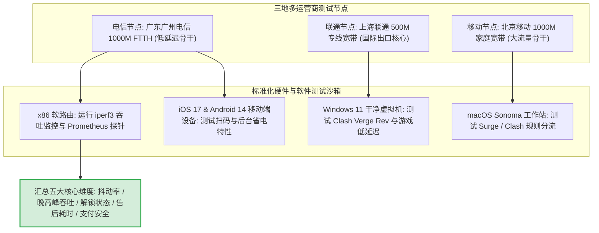
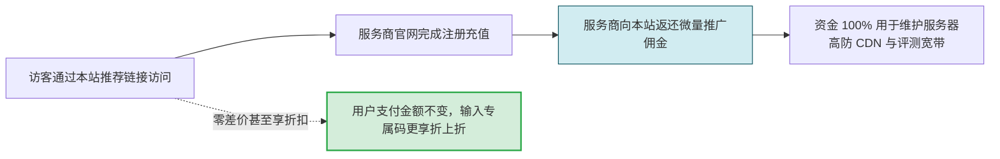
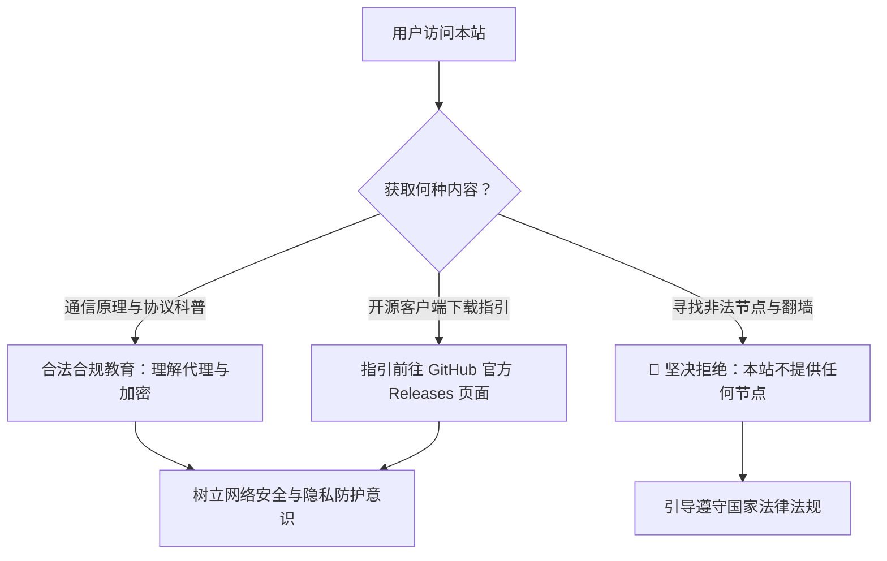

# 关于本站与合规声明

  <strong>核心声明：</strong>「机场入门」（jichangrumen.world）是一个专注于<strong>计算机网络通信原理科普、主流代理协议架构解析与客户端使用教学</strong>的独立第三方教育博客。本站与任何机场服务商、服务器托管商无股权隶属关系。本站不提供翻墙服务，不售卖任何翻墙节点或订阅链接。

<AffiliateNotice />

---

## 一、平台定位与创立初衷

随着全球互联网技术的高速演进，跨境学术交流、跨国软件开源协作（如 GitHub、HuggingFace）、外贸跨境电商以及国际流媒体交互已成为海量互联网用户的刚性需求。然而，网络代理相关的技术术语（如 Shadowsocks、VLESS、Trojan、IEPL、IPLC、TUN 虚拟网卡等）门槛极高，初学者极易陷入以下三类困境：

1. **信息不对称与术语黑话**：大量技术极客文章充斥着晦涩协议源码，新手连客户端如何导入链接都找不到入口；
2. **野鸡跑路商家割韭菜**：不良商家利用新手「图便宜、图省事」的心理，以低价年付为诱饵，开业两月即失联跑路；
3. **免费恶意节点窃取隐私**：网络上充斥着所谓的「永久免费节点」，其中相当一部分部署了明文嗅探脚本，用于窃取用户的账号密码与个人隐私。

**「机场入门」正是在这一背景下诞生。** 我们的唯一使命，是用通俗易懂的白话、生活化比喻、系统化流程图，为零基础初学者建立起一套健康的认知体系与避坑指南。

  
  

    <h4 style="margin: 0 0 0.35rem 0; font-weight: 850; font-size: 1.15rem; color: var(--vp-c-text-1);">机场入门 编辑团队</h4>
    

      网络通信爱好者与独立技术博主。坚持「真人测速、白话讲技术、严守合规底线」，致力于用最通俗易懂的方式帮助新手避开 99% 的网络大坑。
    

  

---

## 二、评测实验室技术拓扑与标准化测试流程

为了杜绝主观臆断与虚假宣传，本站所有评测数据与技术结论均产自严格的标准化实验网络环境：

### 标准化五阶段闭环评测管线

1. **协议层与拓扑溯源 (Stage 1)**：通过 `traceroute`、`BGP ASN Lookup` 以及节点握手报文嗅探，穿透商家宣传表象，精准鉴别是「高成本物理 IEPL/IPLC 专线」还是「廉价公网中继/直连」；
2. **7 天 24 小时连续心跳监控 (Stage 2)**：利用自动化探针每 30 秒发起一次端到端 ICMP 与 TCP Ping 探测，严谨记录日间与夜间的平均丢包率（Packet Loss）与延迟抖动（Jitter）；
3. **黄金晚高峰极限吞吐压测 (Stage 3)**：在工作日晚间 **20:30 - 22:30** 骨干网拥堵峰值时段，使用多线程并发下载测试单节点峰值速率与 4K/8K 视频首帧载入耗时；
4. **原生流媒体与 AI 服务解锁验证 (Stage 4)**：定期运行定制化的流媒体检测脚本，验证 IP 是否为真正原生住宅/广播双 ISP，能否稳定解锁 Netflix 全球片单、Disney+ 以及 OpenAI ChatGPT；
5. **匿名攻防工单压力实测 (Stage 5)**：以普通新手的真实身份在晚高峰匿名提交故障求助工单，以秒表记录真人工程师的首响耗时、沟通温度与技术精准度。

---

## 三、独立性与商业披露准则 (Affiliate Disclosure)

本站严格遵循国际 FTC (Federal Trade Commission) 标准与公开透明原则：

1. **佣金模式披露**：为了维持本站服务器托管、企业级高防 CDN 分发与测试账号采购的刚性开销，本站部分指向第三方服务商的注册按钮包含推广返利标识（Affiliate / Sponsored Links）；
2. **绝对零额外费用保证**：用户通过本站的推广链接访问服务商，**绝不会产生任何额外的费用**。相反，通过本站领取的专属优惠券代码（如光速云优惠码 `AMM`），通常能享受到官方公开渠道无法获得的折上折福利；
3. **评测与排名的绝对客观性**：商业合作**绝不影响评测结论与排名逻辑**。即使某品牌提供极高佣金，若其线路稳定性差、客服失联或存在安全隐患，本站会坚决将其标注为「不推荐」或降权处理；
4. **属性标记规范**：站内所有涉及推广的跳转链接，一律附加 `target="_blank" rel="nofollow sponsored noopener"` 属性，严格避免搜索引擎权重操纵，符合 Google 搜索质量评估规范。

---

## 四、数据诚实性与核验政策

在呈现全网 42 个主流品牌的资料时，本站坚持以下数据处理红线：

| 数据类别 | 处理规范 | 示例与执行 |
| :--- | :--- | :--- |
| **价格与套餐** | 实时采集官方最低入门门槛，标明结算周期 | 如「8元/月」「季付 ¥297」 |
| **线路与架构** | 未经抓包验证的声称，统一加前缀说明 | 标注「品牌资料显示」或「待核实」 |
| **未披露协议** | 严禁凭空捏造技术参数 | 统一录入为「待核实」，留待后续抓包取证 |
| **测速与延迟** | 基于标准化测试环境（晚高峰 20:30-22:30）实测 | 标明测试地区、本地网络（如中国电信千兆） |
| **用户口碑** | 剔除水军好评，如实汇总常见报错与投诉点 | 记录工单回复时效与退款纠纷 |

---

## 五、法律合规与安全底线声明

> [!IMPORTANT] 法律合规底线
> 1. 本站严格遵守《中华人民共和国网络安全法》《中华人民共和国计算机信息网络国际联网管理暂行规定》等相关法律法规；
> 2. 本站**严禁并坚决拒绝提供**任何具体的「翻越国家防火墙/绕过网络审查」的操作教程；
> 3. 本站**绝不提供**任何可直接使用的境外代理 IP、节点配置文件、SS/V2Ray/Clash 订阅地址；
> 4. 本站介绍的软件工具均为国际主流开源网络测试与代理转发工具（如 Clash Verge、v2rayN、sing-box），其版权归原开源作者所有，本站仅进行功能说明；
> 5. 用户因自行使用第三方服务所产生的一切法律后果与经济纠纷，均由用户与该第三方服务商依照法律法规自行承担，本站不承担任何连带责任。

---

## 六、内容更新机制与勘误纠错通道

为保证全站 80 余篇专业指南与 42 品牌档案的有效性，编辑部建立了一整套内容巡检与纠错机制：

1. **季度全盘重测 (Quarterly Audits)**：每季度初对全网 42 家品牌的套餐价格、节点连通率与客服响应时间进行全面复测，及时更新过时信息；
2. **读者勘误赏金机制**：若您在阅读中发现任何失效链接、笔误或价格变更，欢迎发送邮件至编辑部。核实采纳后，我们将在该文章文末鸣谢您的贡献；
3. **官方联络通道**：
   - **内容纠错与建议**：`compliance@jichangrumen.world`
   - **商务沟通与合作**：`business@jichangrumen.world`
   - **处理时效**：我们承诺在收到邮件后 48 小时内核实并更新站点数据。

---

## 七、网站工程架构与隐私保护原则

「机场入门」在工程设计上同样践行极致的极简、安全与隐私保护标准：

1. **现代化全静态构建架构**：本站采用 **VitePress (Vue 3)** 驱动，全站预编译为静态 HTML，杜绝后端数据库与动态执行风险，提供毫秒级极速首屏加载体验；
2. **零第三方侵入式追踪**：本站绝不嵌入任何第三方广告联盟追踪代码或跨站用户行为画像 SDK。我们尊重每一位读者的浏览隐私，详细规则请参阅 [《隐私政策 (Privacy Policy)》](/privacy/) 与 [《服务条款与使用协议》](/terms/)；
3. **本地缓存与极速全文检索**：采用 VitePress Local Search 离线分词引擎与 Algolia 深度检索，所有检索索引均在浏览器本地沙箱安全运行；
4. **W3C 无障碍标准兼容**：全站适配高对比度深色模式（Dark Mode）、无障碍屏幕阅读器标签以及响应式多终端断点，保障各类网络设备下的阅读舒适度。

---

## 八、读者知情权与负责任披露倡议 (Responsible Disclosure)

作为一个秉持极客精神与公共教育责任的平台，我们倡议行业向更健康、更透明的方向发展：
- **安全漏洞负责任报告**：如果您发现任何机场服务商存在用户隐私泄露、明文 Token 暴露或网关严重设计缺陷，请第一时间通过合规邮箱与我们联系。我们会在完成匿名脱敏后适度警示公众，推动行业修复；
- **拒绝水军与黑公关**：本站不接受任何同行诋毁或无根据抹黑性质的商业公关投放。所有上榜与降权依据均基于标准化测试实验室日志，受可复现的技术数据监督。

---

## 九、开启全站学习指南

了解完本站的合规准则、技术评测标准与工程架构后，请跟随我们的引导主线，从什么是机场的概念开始系统学习：

<NextStep
  title="开启学习第一站：什么是机场？"
  link="/what-is-airport/"
  description="了解完本站的合规准则后，请跟随我们的引导主线，从什么是机场的概念开始系统学习。"
  stepText="新手核心学习主线 · 第 1 站"
  buttonText="立即前往第一课 →"
/>
