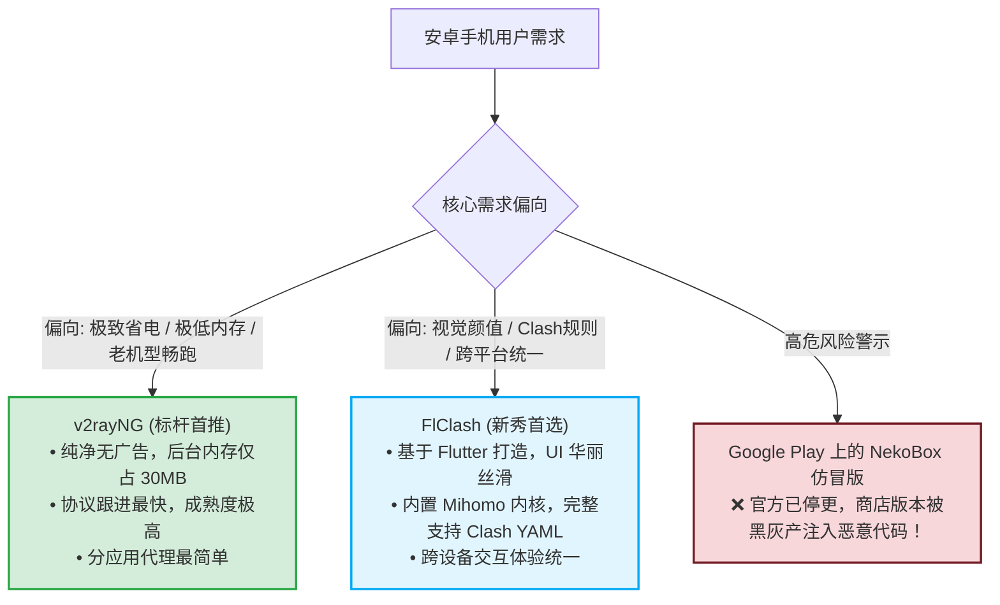
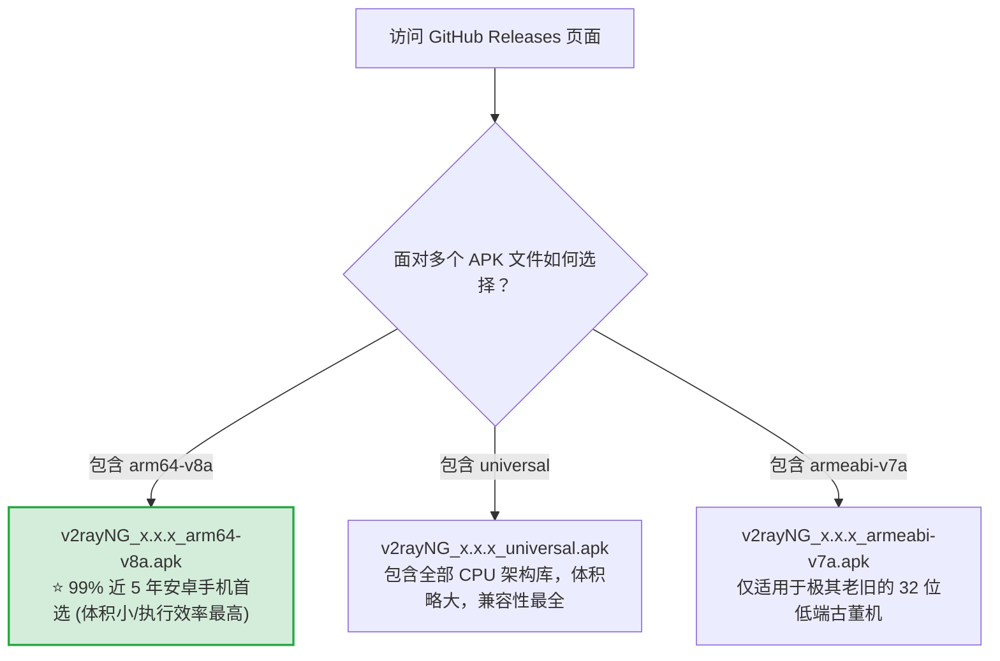
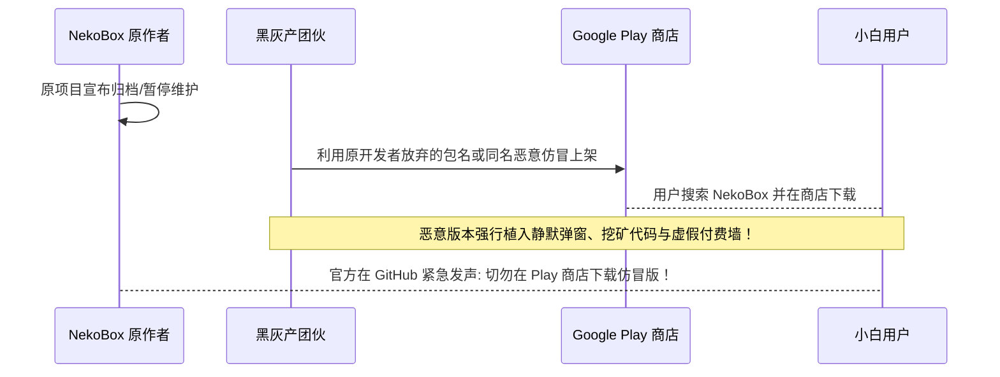
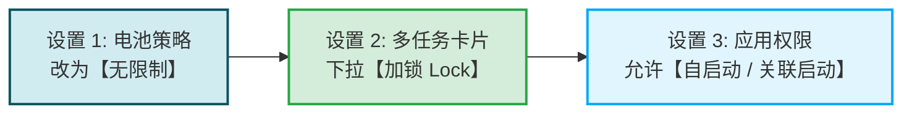
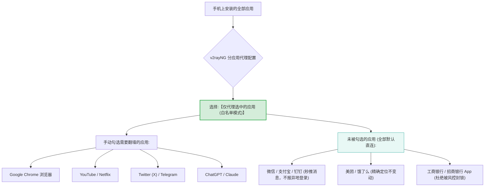
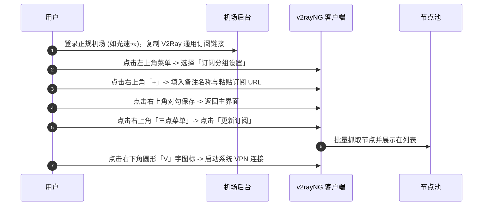

# Android 客户端安装指南：APK 下载、后台保活设置与 NekoBox 仿冒警示

  <strong>核心结论与快速指引：</strong>Android 安卓手机端综合体验最佳、资源消耗最低的标杆工具是 <strong>v2rayNG (开源免费)</strong>，追求现代精美 UI 的用户可选 <strong>FlClash</strong>。安卓端配置的核心痛点不在于软件本身，而在于<strong>国产定制系统对后台进程的激进查杀</strong>与<strong>第三方商店的木马篡改包</strong>。标准流程只需 4 步：<strong>① 从官方 GitHub 仓库下载 <code>arm64-v8a.apk</code> 正版安装包 → ② 在手机系统设置中为软件开启「自启动」并将电池优化调整为「无限制」 → ③ 开启「分应用代理」排除国内网银与社交软件 → ④ 导入机场订阅并开启连接。</strong>

<AffiliateNotice />

---

## 一、Android 客户端双雄选型：v2rayNG vs FlClash

在安卓平台上，由于系统底层开放了完整的 `VpnService` 权限，市面上涌现了许多客户端。对于普通用户，首选以下两款经过社区长期检验的开源工具：

---

## 二、官方 APK 安装包下载与架构鉴别

### 2.1 官方开源仓库地址
- **v2rayNG 官方项目地址**：[github.com/2dust/v2rayNG/releases](https://github.com/2dust/v2rayNG/releases)；
- **FlClash 官方项目地址**：[github.com/chen08209/FlClash/releases](https://github.com/chen08209/FlClash/releases)。

### 2.2 绕过安卓系统的安装报毒提示
在华为 (HarmonyOS)、小米 (HyperOS/MIUI) 或 vivo 上直接点击 APK 安装时，手机自带的「安全守护中心」往往会弹窗提示：**「该应用未在官方应用商店上架，可能存在安全风险」**，甚至诱导你安装应用商店里的流氓软件。
- **应对方法**：
  1. 勾选「已了解此应用未经安全检测」；
  2. 点击「继续安装」或「单次授权安装」；
  3. 输入锁屏密码完成安装。

---

## 三、重大安全曝光：Google Play 上的 NekoBox 仿冒木马陷阱

在网络交流圈中，部分技术老帖常推荐一款名为 **NekoBox** 的客户端。但 **2026 年的今天，新手必须对其保持高度警惕！**

> [!CAUTION] 官方安全警示
> NekoBox 官方项目组已在 GitHub 首页醒目标注：其项目维护资源极其有限，**从未授权任何第三方在应用商店收费或分发带有广告的衍生版本**。Google Play 上出现的 NekoBox 已被恶意主体接管，存在窃取用户隐私、偷跑流量和注入木马的高危风险。**安卓用户请认准官方 GitHub 维护活跃的 v2rayNG 或 FlClash！**

---

## 四、破解国产系统的头号死穴：防杀后台全套调优

很多安卓用户最头疼的问题莫过于：「刚刚连上代理，锁屏放进口袋 5 分钟，拿出来一看软件又被系统后台强制杀掉了！」这是因为国产定制系统（小米澎湃 HyperOS、华为鸿蒙 HarmonyOS、OPPO ColorOS、vivo OriginOS）具备极其激进的省电策略。

只需完成以下三项设置，即可让客户端像微信一样稳固常驻：

### 1. 电池管理策略调整为「无限制」
- 进入手机「设置」→「应用管理」→ 找到「v2rayNG」；
- 点击「省电策略 / 电池优化」；
- 将默认的「智能推荐 / 优化」切换为 **「无限制 / 允许后台高耗电」**。

### 2. 多任务任务栏卡片「加锁」
- 从屏幕底部向上滑动并悬停，呼出手机的多任务后台任务列表；
- 找到 v2rayNG 的预览卡片；
- 长按卡片或向下拉动卡片，点击出现的 **「小锁头」** 图标将其锁死。系统执行「一键清理内存」时将自动跳过被锁定的应用。

### 3. 开启自启动权限
- 在应用权限设置中，找到「自启动」与「后台关联启动」开关，手动将其打开。

---

## 五、安卓杀手级功能：开启「分应用代理」

「分应用代理 (Per-App Proxy)」是安卓客户端最优雅、最实用的特性。它能让你从操作系统底层精准指定哪些应用走代理，哪些应用彻底绕过：

### 实操配置步骤 (以 v2rayNG 为例)
1. 打开 v2rayNG，点击左上角「三道杠」菜单图标；
2. 进入 **「设置 (Settings)」**；
3. 找到 **「分应用代理 (Per-App Proxy)」**，勾选开启；
4. 点击进入应用列表，右上角选择「仅代理选中的应用」；
5. 在搜索框中搜索并仅勾选 Chrome、YouTube、Telegram 等海外软件；
6. 返回主界面重新连接。此时，国内网银和微信将完全走本地运营商网络，彻底告别误判和电量损耗！

---

## 六、安卓端订阅导入与连接四步法

---

## 七、安卓端高性价比专线推荐

安卓手机作为日常全天候随身设备，对节点的**延迟稳定性与重连容灾能力**要求极高：

| 推荐品牌 | 月付门槛 | 线路类型 | 安卓适配评级 | 特色与优势 | 快速传送门 |
| :--- | :--- | :--- | :--- | :--- | :--- |
| **[光速云 (GSY)](/reviews/#brand-gsy)** | **约 8 元/月** | **企业级 IEPL 专线** | **⭐⭐⭐⭐⭐ (首推)** | 双线路冗余，安卓休眠唤醒 0 秒重连，全流媒体解锁 | [直达评测与折扣](/reviews/#brand-gsy) |
| **[飞猫云](/reviews/#brand-feimao)** | 7 元/月 | IEPL 专线 | ⭐⭐⭐⭐☆ | 7 元档高性价比，轻量刷推利器 | [直达评测与折扣](/reviews/#brand-feimao) |
| **[大佬云](/reviews/#brand-dalaoyun)** | 5.6 元/月 | IEPL 专线 | ⭐⭐⭐⭐☆ | 季付超低门槛，适合备用安卓机长期挂机 | [直达评测与折扣](/reviews/#brand-dalaoyun) |

> [!TIP] 选型小结
> 选用 [光速云 (GSY)](/reviews/#brand-gsy) 搭配 v2rayNG 的分应用代理，在结账时输入优惠码 `AMM` 享受优惠，每月只需一杯奶茶钱，就能让你的安卓手机全天候流畅稳定冲浪。

---

## 八、本章小结与进阶路线

搞定了 Android 端的正版安装、防杀后台与分应用代理，安卓设备已经可以极其省心安稳地工作。

但如果你使用的是苹果 iPhone 或 iPad：**由于国区 App Store 无法搜索到代理软件，没有海外 Apple ID 到底该怎么办？如何不用信用卡 5 分钟免费注册一个美区账号？**

**下一篇，我们将进入 iOS 用户的专属下载与美区账号获取指南！**

<NextStep
  title="下一篇：iOS 客户端下载与美区账号获取"
  link="/clients/ios-install"
  description="零海外信用卡免费注册美区 Apple ID，下载正版 Shadowrocket (小火箭)。"
  stepText="客户端实操主线 · 第 4 站"
  buttonText="阅读 iOS 美区账号与安装指引 →"
/>
