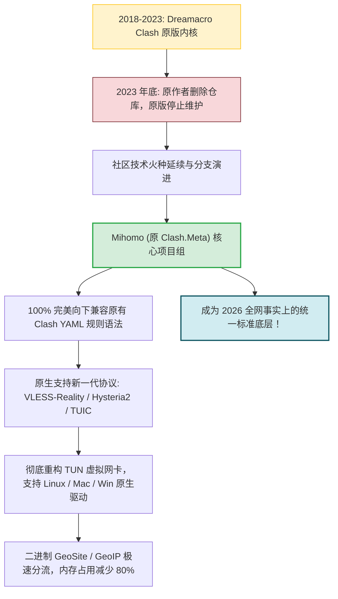
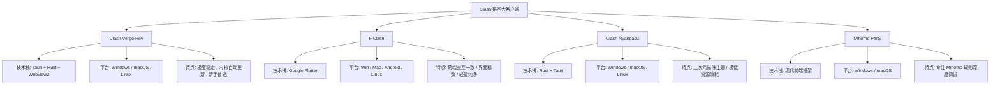
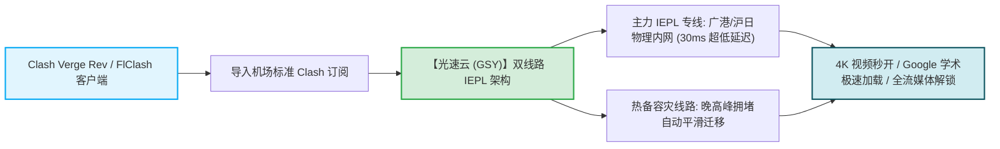

# Clash 系列客户端推荐：Clash Verge Rev、FlClash 与 Mihomo 生态全景

  <strong>核心结论与全景选型：</strong>2023 年底原版 Clash 停更后，整个开源社区不仅没有消亡，反而在 <strong>Mihomo (原名 Clash.Meta)</strong> 高性能内核的引领下迎来了黄金发展期。目前 Clash 衍生客户端梯队格局明确：<strong>① Windows 与 macOS 桌面首选【Clash Verge Rev】（Tauri+Rust 现代架构，内存暴降 60%，内置 Wintun 虚拟网卡一键开关）；② 跨手机与电脑的多端用户首选【FlClash】（基于 Flutter 打造，UI 华丽丝滑，全平台交互高度统一）；③ 追求极致个性化外观的用户可选二次元主题的【Clash Nyanpasu】。</strong>

<AffiliateNotice />

---

## 一、Clash 的涅槃重生：从 Dreamacro 到 Mihomo (Clash.Meta)

许多新手在网络教程中看到「Clash 已死」「Clash 跑路」的传闻，往往产生困惑。理解内核演进历程，能让你对当下的技术格局了如指掌：

### 为什么说 Mihomo 彻底超越了原版？
1. **协议支持全面飞跃**：原版 Clash 仅支持传统的 Shadowsocks、VMess 和 Trojan；而 Mihomo 原生支持抗封锁能力极强的 **VLESS-Reality** 以及基于 UDP 单边加速的 **Hysteria 2** 与 **TUIC v5**；
2. **规则加载性能暴增**：原版加载几万行文本规则集时容易出现界面假死；Mihomo 引入了二进制编译的 `geosite.dat` 和规则集缓存池，数十万条规则毫秒级完成索引匹配；
3. **TUN 驱动原生化**：在 Windows 上深度集成由 WireGuard 团队研发的高性能 `wintun.dll`，在 macOS 上原生适配 Network Extension，实现了无需第三方复杂虚拟网卡的高速转发。

---

## 二、四大主流 Clash 系 GUI 客户端深度横评

内核只负责底层的网络路由，而日常与我们打交道的是图形用户界面（GUI 客户端）。以下是目前社区中最具代表性的四大桌面/跨端工具：

---

### 1. Clash Verge Rev (全网桌面端绝对统治者)

作为原版 Clash Verge 停更后的正统复兴版，**Clash Verge Rev** 已经成为当前 Windows 与 Mac 用户的默认装机标配。

- **官方仓库**：[github.com/clash-verge-rev/clash-verge-rev](https://github.com/clash-verge-rev/clash-verge-rev)；
- **核心优势**：
  - **Tauri 现代轻量化**：摒弃了老版 Electron 动辄占用 300MB 内存的弊病，后台静默内存仅 40-70MB；
  - **内置内核热更新**：允许用户在界面中一键升级最新的 Mihomo Alpha/Stable 内核，无需重新安装软件；
  - **TUN 虚拟网卡保姆级集成**：点击安装服务，滑动开关即可一键开启接管全系统所有流量；
  - **扩展配置支持**：支持注入自定义 YAML 片段或使用 JavaScript 脚本动态改写远程订阅规则。
- **推荐指数**：⭐⭐⭐⭐⭐（新手闭眼入）

---

### 2. FlClash (新一代全平台跨端先锋)

由开发者 **chen08209** 主导开发的 FlClash，采用 Google 的跨平台 UI 框架 **Flutter** 深度重塑。

- **官方仓库**：[github.com/chen08209/FlClash](https://github.com/chen08209/FlClash)；
- **核心优势**：
  - **极致统一的跨端体验**：无论你在 Windows 电脑、MacBook 还是安卓手机上，操作逻辑、按键布局和交互动画完全一致，无需重复学习；
  - **视觉体验拉满**：支持 Material You 动态取色、极度流畅的高帧率平滑过渡动画；
  - **极简清爽**：剔除了绝大多数复杂的极客参数面板，仅保留对日常用户最重要的节点选择与开关。
- **推荐指数**：⭐⭐⭐⭐⭐（多设备统一党首选）

---

### 3. Clash Nyanpasu (高颜值二次元猫咪主题)

由社区二次元开发者打造的轻量桌面客户端，基于 Rust 与 Tauri 深度构建。

- **官方仓库**：[github.com/libnyanpasu/clash-nyanpasu](https://github.com/libnyanpasu/clash-nyanpasu)；
- **核心优势**：
  - 深度融入可爱的猫咪动画与二次元粉色/紫色视觉主题；
  - 底层基于 Rust 编写，资源开销极其克制，CPU 占用极低；
  - 完全兼容原版 Clash 与 Mihomo 双核心自由切换。
- **推荐指数**：⭐⭐⭐⭐☆（二次元与颜值党首推）

---

### 4. Mihomo Party 维护状态特别关注

社区中还有一款名为 **Mihomo Party** 的客户端，主打可视化策略组管理。

> [!NOTE] 维护活跃度客观提示
> 评测团队持续追踪发现：Mihomo Party 的代码提交频率与长期维护活跃度波动较大。在没有官方核心持续发版的前提下，**建议日常使用仍以维护活跃度极其稳定、每周修复 bug 的 Clash Verge Rev 或 FlClash 为主力**，避免因客户端长期未修补底层依赖库而带来未知兼容性故障。

---

## 三、四大 Clash 客户端全景对比大表

| 软件名称 | 主力平台 | GUI 框架底层 | 内存占用 (空载) | TUN 网卡支持 | 内核热更新 | 推荐评级与人群 |
| :--- | :--- | :--- | :--- | :--- | :--- | :--- |
| **Clash Verge Rev** | Win / Mac / Linux | Tauri (Rust) | ~50 MB | **原生支持 (一键启动)** | **支持 (图形化切换)** | **99 分 (全平台首选)** |
| **FlClash** | Win / Mac / Android / Linux | Flutter | ~65 MB | **原生支持** | 随版本集成 | **96 分 (跨端极简首选)** |
| **Clash Nyanpasu** | Win / Mac / Linux | Tauri (Rust) | ~45 MB | **支持** | 支持双核心 | **94 分 (二次元主题党)** |
| **Clash Mi** | Win / Mac / Android / iOS | 原生/通用 | ~35 MB | 支持 | 随版本更新 | **90 分 (轻量备选)** |
| **Mihomo Party** | Win / Mac | 前端多框架 | ~120 MB | 支持 | 深度绑定 | **85 分 (进阶测试)** |

---

## 四、Clash 日常进阶实用技巧

掌握以下三项技巧，能让你的 Clash 体验再上一个台阶：

### 1. 订阅自动定时更新 (防断网必做)
在「订阅」列表中右键卡片，进入编辑设置：
- 将 **「更新间隔」** 设置为 `1440`（分钟），即每 24 小时自动更新；
- 这样，当机场后端增加新线路、节点维护换 IP 或临时扩容专线时，你的客户端会在后台静默同步，彻底杜绝「好好的突然某天所有节点全红」的尴尬。

### 2. 正确认识「自动测速选择 (URL-Test)」策略组
绝大多数机场订阅会提供一个名为 `Auto` 或 `自动选择` 的节点组：
- 它的工作原理是内核每隔一段时间向指定网址（如 `http://www.gstatic.com/generate_204`）发送心跳包，**自动将流量导向延迟最低的节点**；
- **注意**：如果在玩游戏或需要保持登录 IP 不变的场景（如 ChatGPT），建议手动固定在单个香港或日本节点上，避免因自动切换节点导致网页刷新或异地重新登录。

---

## 五、Clash 标杆专线搭配推荐

Clash 系列强大的分流引擎，必须搭配具备优质专线架构的机场才能释放出全部潜能：

在 42 家主流品牌中，[光速云 (GSY)](/reviews/#brand-gsy) 是 Clash 生态适配的标杆代表：
- **原生 Clash 格式**：后台直接提供标准 YAML 订阅与一键唤醒导入，规则分流精准无误；
- **双线路专线保障**：采用企业级 IEPL 双线路架构，晚高峰 0 丢包，4K/8K 视频拖拽零缓冲；
- **亲民门槛**：月付折合约 8 元起步，结算输入优惠码 `AMM` 享受折上折。

---

## 六、本章小结与进阶路线

搞清了 Clash 与 Mihomo 的前世今生，你已经掌握了现代科学上网的核心主流工具。

然而在网络代理的发展史中，**还有一个更古老、基石般的存在——V2Ray 家族与 Xray 核心**。**v2rayN 为何历经数年依然受老鸟推崇？v2rayNG 是如何称霸安卓的？无桌面 Linux 与 NAS 为什么必装 v2rayA？**

**下一篇，我们将进入 V2Ray / Xray 系列经典客户端深度解析！**

<NextStep
  title="下一篇：V2Ray 系列客户端深度解析"
  link="/clients/v2ray-series"
  description="经典老牌 v2rayN、安卓标配 v2rayNG 与 Linux/NAS 专用 v2rayA 全景横评。"
  stepText="客户端实操主线 · 第 7 站"
  buttonText="阅读 V2Ray 系列客户端解析 →"
/>
