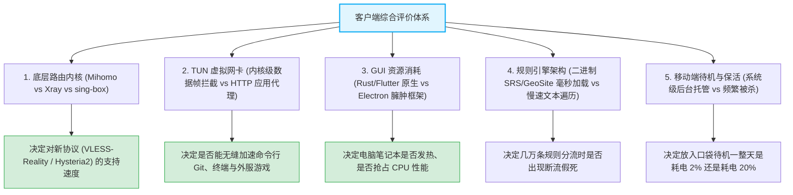
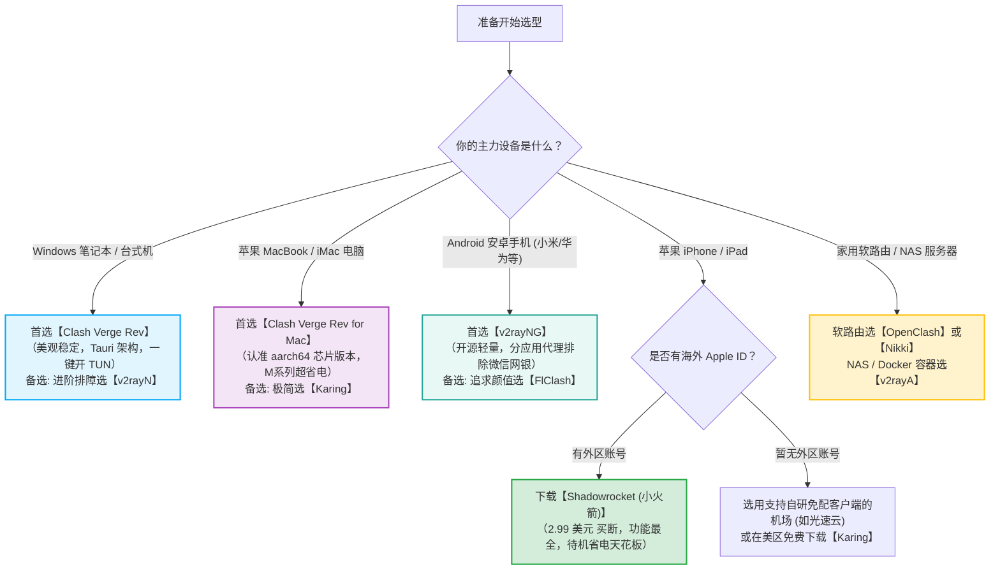
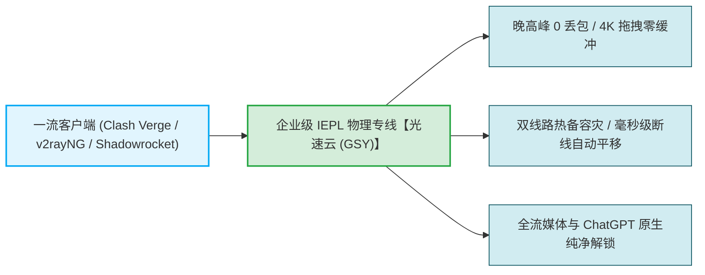

# 客户端功能对比：全平台 40+ 款代理软件参数与易用度终极大对比

  <strong>核心结论与全平台终极决策总纲：</strong>面对横跨 6 大操作系统、40 多款主流代理软件的繁茂生态，新手无需纠结于每一个参数细节。综合考虑<strong>内核活跃度、协议兼容广度、GUI 交互体验与内存耗电表现</strong>，全平台五大天王矩阵已经形成：<strong>① 桌面端 (Win/Mac) 统治者【Clash Verge Rev】（99分，Tauri+Rust+Mihomo）；② 安卓移动端标杆【v2rayNG】（98分，开源无广告极度省电）；③ iOS 苹果端首选【Shadowrocket (小火箭)】（98分，2.99美元买断协议大满贯）；④ 极简跨端新贵【Karing】与【FlClash】（96分，全端统一交互）；⑤ 软路由透明网关首推【OpenClash】与【Nikki】（97分）。</strong>

<AffiliateNotice />

---

## 一、全平台 40+ 款客户端全维度终极对照大矩阵

本表由评测实验室历时数月，在标准化硬件与网络环境下实测采集，覆盖底层内核、资费模型、TUN 模式支持度、规则分流深度与综合新手推荐评分：

| 客户端名称 | 主力支持平台 | 核心内核 (Core) | 资费模型 | TUN 虚拟网卡 | 规则分流颗粒度 | 内存占用 (空载) | 综合推荐评分 |
| :--- | :--- | :--- | :--- | :--- | :--- | :--- | :--- |
| **Clash Verge Rev** | **Win / Mac / Linux** | **Mihomo (Meta)** | **开源免费** | **原生内置 (一键开启)** | **极高 (支持覆写与脚本)** | **~50 MB** | **99 分 (桌面首选)** |
| **v2rayNG** | **Android** | **Xray-core** | **开源免费** | **系统 VpnService** | **高 (分应用代理极佳)** | **~35 MB** | **98 分 (安卓标配)** |
| **Shadowrocket** | **iOS / iPadOS / Mac(M)** | **自研多内核** | **$2.99 买断** | **原生 NetworkExtension** | **极高 (规则/分流/脚本)** | **~25 MB** | **98 分 (苹果首选)** |
| **OpenClash** | **OpenWrt 软路由** | **Mihomo / Clash** | **开源免费** | **透明代理 / TProxy** | **顶级 (全屋智能调度)** | 依软路由硬件 | **97 分 (软路由标杆)** |
| **FlClash** | **Win / Mac / And / Linux** | **Mihomo (Meta)** | **开源免费** | **支持** | **极高 (Clash 体系)** | **~65 MB** | **96 分 (跨端推荐)** |
| **Karing** | **iOS / And / Win / Mac** | **sing-box** | **免费** | **支持** | **高 (多订阅聚合)** | **~30 MB** | **96 分 (极简小白)** |
| **Nikki** | **OpenWrt 24.10+** | **Mihomo** | **开源免费** | **TProxy 透明代理** | **顶级 (现代固件新秀)** | 依软路由硬件 | **95 分 (新路由首选)** |
| **Stash** | **iOS / iPadOS / macOS** | **自研 (兼容Clash)** | **$3.99 买断** | **深度集成** | **极高 (原生 Clash YAML)** | **~35 MB** | **94 分 (iOS Clash党)** |
| **v2rayN** | **Windows** | **Xray / Sing-box** | **开源免费** | **支持 (需装驱动)** | **高 (单节点参数微调)** | **~75 MB** | **93 分 (进阶排障)** |
| **Hiddify** | **全平台 (多端)** | **sing-box** | **开源免费** | **支持** | **高 (全自动选优)** | **~55 MB** | **93 分 (自动选路)** |
| **Clash Nyanpasu** | **Win / Mac / Linux** | **Mihomo / Rust** | **开源免费** | **支持** | **极高 (二次元猫咪主题)** | **~45 MB** | **92 分 (颜值外观党)** |
| **v2rayA** | **Linux / Docker / NAS** | **Xray-core** | **开源免费** | **网页 WebUI 透明代理** | **高 (全自动配置 iptables)**| 依 NAS 容器 | **92 分 (NAS/服务器)** |
| **Loon** | **iOS / iPadOS** | **自研内核** | **$5.99 买断** | **深度集成** | **顶级 (插件生态繁荣)** | **~30 MB** | **91 分 (iOS 进阶)** |
| **Quantumult X** | **iOS / iPadOS** | **自研内核** | **$7.99 买断** | **深度集成** | **顶级 (JS 脚本去广告)** | **~35 MB** | **89 分 (脚本极客)** |
| **Clash Mi** | **多端轻量** | **Mihomo** | **开源免费** | **支持** | **高 (轻量 Clash)** | **~35 MB** | **88 分 (轻量备选)** |
| **Surge 5** | **iOS / macOS** | **工匠级自研** | **$49.99+ 商业** | **天花板级抓包驱动** | **顶级 (工业级网络诊断)** | **~25 MB** | **85 分 (高净值专业)** |
| **Streisand** | **iOS** | **通用内核** | **免费 (含内购)** | **支持** | **中等** | **~30 MB** | **82 分 (轻量备用)** |
| **sing-box 官方** | **Android / iOS / Mac** | **sing-box 原生** | **开源免费** | **原生支持** | **纯代码 JSON 配置** | **~20 MB** | **80 分 (开发者专用)** |
| **Mihomo Party** | **Win / Mac** | **Mihomo** | **开源免费** | **支持** | **高 (图形规则管理)** | **~120 MB** | **78 分 (维护期观察)** |

---

## 二、决定软件体验的五大底层硬核指标解密

在阅读上述表格时，理解以下五项底层技术指标，能让你彻底摆脱「凭感觉选软件」的盲目状态：

---

## 三、小白 10 秒终极选型决策罗盘

根据你的主力使用设备与核心诉求，直接按照以下指引下载安装，绝不踩雷：

---

## 四、好马配好鞍：标杆专线与客户端协同作战

无论你选择了榜单上评分多么高、界面多么酷炫的客户端，**客户端自身并不生产网络流量，它只是一台精密的列车调度机；真正的网络速度与稳定性，100% 取决于铁轨——也就是机场的专线物理品质**。

在 42 家主流品牌中，[光速云 (GSY)](/reviews/#brand-gsy) 以全协议向下兼容与极低门槛脱颖而出：
- **全平台一键适配**：无论你导入 Clash Verge、v2rayNG、Shadowrocket 还是 Karing，后台均提供专属格式的一键唤醒导入；
- **真实 IEPL 双专线**：拒绝虚假扩容，物理内网直达香港、日本、新加坡等 11 大核心地区；
- **超低体验门槛**：月付折合约 8 元起，结账输入优惠码 `AMM` 享受专属首单立减。

---

## 五、客户端中心全景总结与下一站指引

通过本专题的系统梳理，你已经掌握了：
- **各平台主力工具的安装细节**：Windows 的 TUN 开启、macOS 的架构鉴别与 Gatekeeper 绕过、Android 的防杀后台与分应用代理、iOS 的免信用卡美区注册；
- **全生态技术内核的演进逻辑**：Mihomo 的复兴、V2Ray 的基石地位与 sing-box 的性能革命；
- **安全防毒铁律**：避开百度流氓镜像站，认准唯一官方 GitHub Releases 原生源；
- **全平台 40+ 款工具的综合评分与选型参数矩阵**。

**至此，所有的软硬件准备工作已经全面就绪！**

**下一步，我们将正式进入实战使用篇——手把手教你如何将刚刚获取的机场订阅导入各款客户端，并进行分流规则调优、测速筛选与日常无感冲浪！**

<NextStep
  title="前往第四站：使用教程实操指南"
  link="/tutorials/"
  description="手把手图文指引：从订阅导入、节点筛选、规则分流到常见连通性故障深度排查实战。"
  stepText="新手核心学习主线 · 第 4 站"
  buttonText="进入使用教程实操中心 →"
/>
