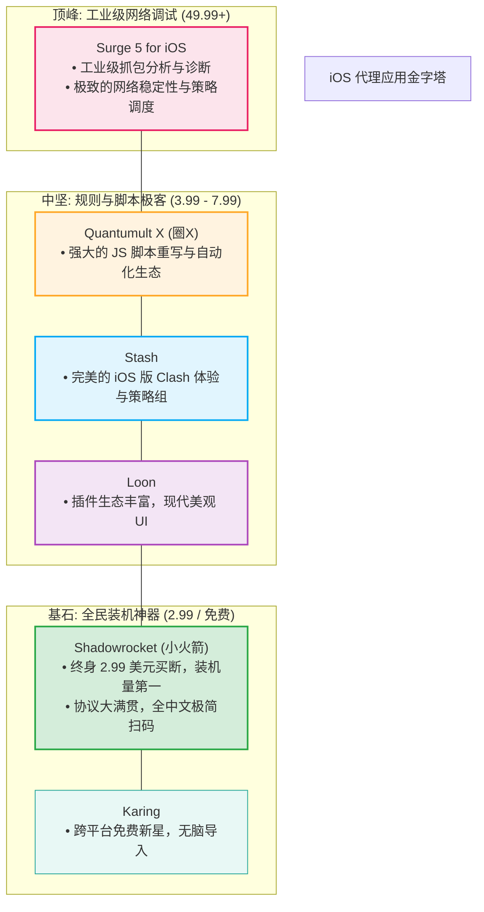
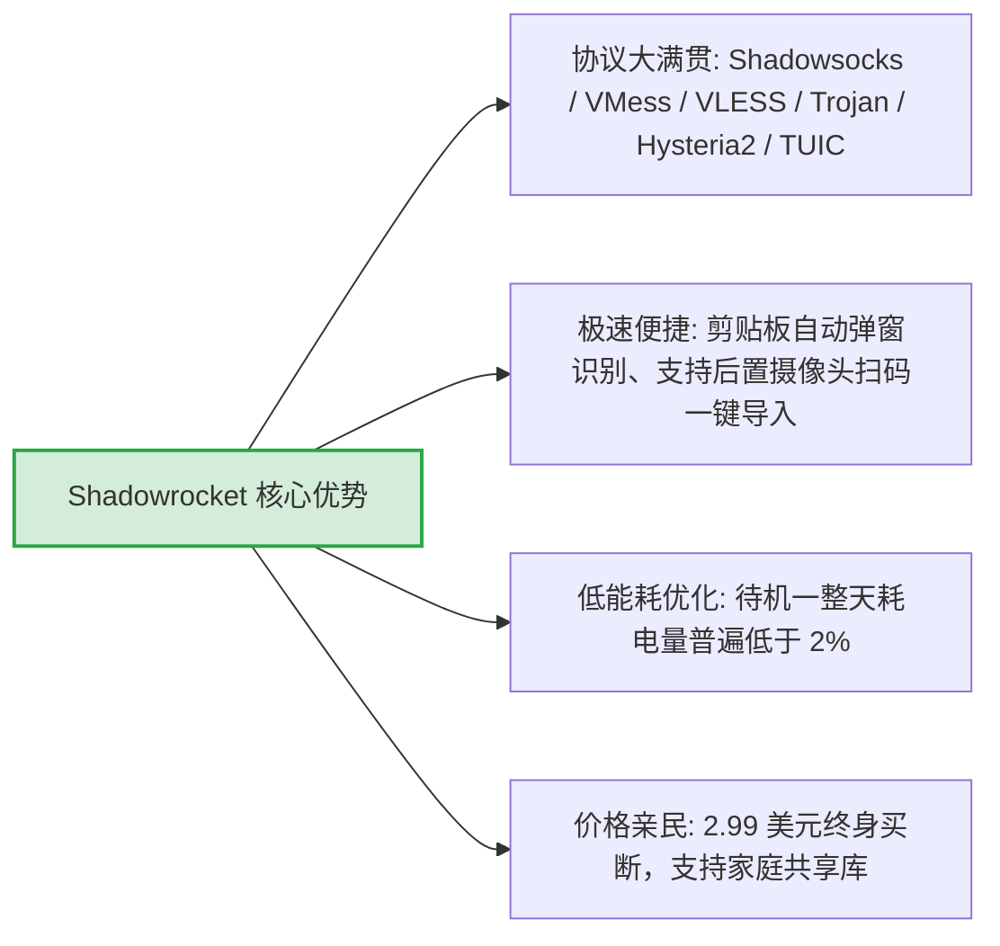
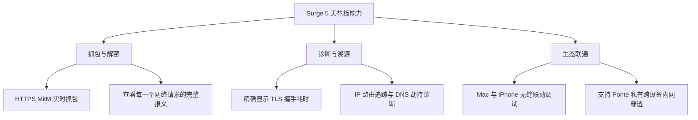
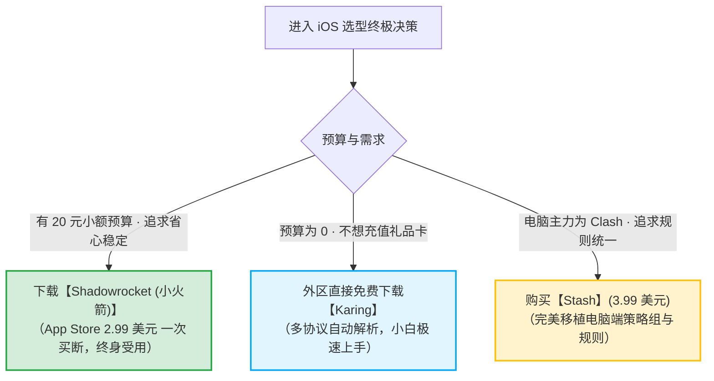

# iOS 代理软件指南：Shadowrocket、Stash、Quantumult X 与 Surge 5 权威横评

  <strong>核心结论与快速选型矩阵：</strong>在苹果 iOS 平台上，代理软件生态呈现出清晰的金字塔格局：<strong>① 95% 新手与日常主力机首选【Shadowrocket (小火箭)】（2.99 美元买断，协议大满贯，扫码即用，极度省电）；② 习惯电脑端 Clash 规则逻辑的用户选【Stash】（3.99 美元买断，原生兼容 Clash YAML 配置与覆写）；③ 热衷去广告、自定义 JS 脚本与自动化签到的极客选【Quantumult X (圈X)】（7.99 美元买断）；④ 追求极致网络抓包分析与异常排障的高净值工程师选【Surge 5】（$49.99 起商业授权）。</strong>

<AffiliateNotice />

---

## 一、iOS 代理软件金字塔架构全景透视

苹果对后台应用的运行限制极为严苛，所有合规的 iOS 代理软件均构建在官方底层的 **Network Extension (网络扩展)** 框架之上。

---

## 二、四大主力神器深度剖析

---

### 1. Shadowrocket (小火箭) —— iOS 生态无可替代的常青树

由开发者 **PanGuoJu** 独立维护的 Shadowrocket，是全球华人圈认知度最高、装机量最大的网络工具。

- **资费模型**：美区 App Store 售价 **2.99 美元**（一次购买，终身免费更新，支持 iOS / iPadOS / Apple M 系列芯片 Mac）；
- **核心优点**：
  - **协议兼容之王**：几乎市面上所有机场支持的任何协议，小火箭都在第一时间完成适配；
  - **按需连接 (On-Demand)**：可设置当连接蜂窝网络时自动启动，连上特定家庭 Wi-Fi 时自动关闭；
  - **教程极其丰厚**：全网所有机场和技术论坛的 iOS 指引，95% 均以小火箭作为标准范本撰写。
- **缺点与不足**：自定义复杂规则分流界面的层级较深，策略组逻辑不如 Stash 直观。
- **推荐人群**：**95% 的 iPhone 普通用户第一首选**。

---

### 2. Stash —— 移动端的纯正 Clash 体验

如果你在 Windows 或 Mac 电脑上使用 Clash，并习惯了 Clash 的策略组（Proxy Groups）、规则覆写和 YAML 配置体系，那么 Stash 是你的最佳平替。

- **资费模型**：美区 App Store 售价 **3.99 美元**（买断制）；
- **核心优点**：
  - **原生 Clash 兼容**：可以直接导入任意机场的 Clash YAML 订阅链接，无需任何格式转换；
  - **精美仪表盘**：直观展示上行下行实时速率、策略组分流流向、DNS 缓存击中率；
  - **支持覆写 (Override)**：允许用户在远程订阅之上覆盖本地自定义规则，例如强制为特定网站指定出口节点。
- **缺点与不足**：相比小火箭，在极低端旧款 iPhone（如 iPhone 8/X）上后台内存占用略高。
- **推荐人群**：Clash 重度用户、追求统一策略组逻辑的多设备党。

---

### 3. Quantumult X (圈 X) —— 脚本扩展与重写极客的乐园

由 CrossUtility 开发的 Quantumult X（常被社区简称为「圈 X」），是网络深度玩家探索去广告与自动化任务的神器。

- **资费模型**：美区 App Store 售价 **7.99 美元**（买断制）；
- **核心优点**：
  - **JavaScript 引擎支撑**：支持在数据包经过时执行本地或远程 JS 脚本，能够实现复杂的网站签到、接口数据提取与个性化通知；
  - **深层 URL 重写 (Rewrite)**：能够精准修改 HTTP/HTTPS 请求与响应头，结合 MitM 解密实现强大的去广告效果；
  - **高颜值深色质感**：极具科技感的交互界面与节点测速矩阵。
- **缺点与不足**：配置语法极其硬核，没有可视化的容错向导，小白用户误配一行参数极易导致全网断网。
- **推荐人群**：具备编程与正则基础、热衷于折腾脚本与去广告的进阶技术玩家。

---

### 4. Surge 5 for iOS —— 工业级网络调试工具天花板

由国内知名开发者 Blank/Yachen 打造的 Surge，被公认为苹果平台网络协议分析与抓包领域的工业级标杆。

- **资费模型**：采用商业授权订阅制，**单设备授权售价通常为 $49.99 美元起**；
- **核心优点**：
  - 稳定性登峰造极，内存管理和内核调度堪称教科书级别；
  - 提供了全网最细致的网络可视化监控，能清晰展示每一个 App 到底向海外发起了哪些网络请求；
- **缺点与不足**：价格极其昂贵，对于仅需看网页、看流媒体的日常用户而言，属于严重的「性能与资金过剩」。
- **推荐人群**：企业网络工程师、移动应用开发者、不差钱的高净值用户。

---

## 三、其他 7 款免费及轻量备选工具一览

如果你的预算有限，或者暂时不想折腾付费买断，外区商店还存在以下值得关注的补充梯队：

| 客户端名称 | 资费类型 | 核心内核 | 优缺点深度简评 |
| :--- | :--- | :--- | :--- |
| **Karing** | **免费** | sing-box | 跨平台开源新贵，界面极其现代清爽，多订阅自动聚合，极度适合新手 |
| **Loon** | **$5.99 买断** | 自研内核 | 颜值极高，插件与脚本生态极其繁荣，是圈 X 强有力的现代竞争对手 |
| **Streisand** | 免费 (含内购) | 多内核 | 界面小巧纯净，支持常见的裸协议导入，适合轻量备用 |
| **Potatso** | 免费 | Shadowsocks | 极简老牌工具，仅适合基础 Shadowsocks 协议，功能较为单一 |
| **Hiddify iOS** | 免费开源 | sing-box | 多协议全兼容，具备全自动路由选择能力 |
| **OneClick** | 免费 (含内购) | 多内核 | 扫码极快，适合无脑一键轻度连接 |
| **Sing-box (SFI)** | 免费开源 | sing-box 原生 | 开发者专用的极客测试端，支持加载原生 JSON 配置 |

---

## 四、全景 8 维度综合对比大矩阵

| 评估维度 | Shadowrocket (小火箭) | Stash | Quantumult X | Surge 5 | Karing |
| :--- | :--- | :--- | :--- | :--- | :--- |
| **官方售价** | **$2.99 买断** | **$3.99 买断** | **$7.99 买断** | **$49.99+ 商业授权** | **完全免费** |
| **协议兼容广度** | **顶级 (全协议大满贯)** | 高 (主流 Clash 协议) | 高 (主流协议) | 专注标准协议 (无混淆) | 极高 (sing-box 系) |
| **Clash 规则兼容** | 需规则转换 | **100% 原生兼容** | 需语法转换 | 独立专属语法 | 支持订阅导入 |
| **JS 脚本与重写** | 支持基础脚本 | 支持部分重写 | **顶级 (生态极繁荣)** | 顶级 (功能极强) | 不支持复杂脚本 |
| **抓包分析与诊断** | 基础抓包 | 基础连接日志 | 中级抓包分析 | **天花板级抓包** | 基础日志 |
| **省电与待机性能** | **极度优异** | 优异 | 优异 (视脚本复杂度) | **极致工业级调优** | 优异 |
| **新手上手难度** | **★☆☆☆☆ (极易)** | ★★☆☆☆ (容易) | ★★★★☆ (较难) | ★★★★★ (极复杂) | **★☆☆☆☆ (极易)** |
| **综合新手推荐度** | **100 分 (必买)** | **92 分 (备选)** | **85 分 (极客)** | **75 分 (专业专用)** | **90 分 (免费首选)** |

---

## 五、iOS 新手 3 秒选型指南与标杆专线搭配

无论你选择小火箭还是 Karing，后端的线路质量决定了最终的流畅度。以 [光速云 (GSY)](/reviews/#brand-gsy) 为例：
- 原生提供针对 Shadowrocket 的一键托管配置，无需手动复制长链接，点击网页按钮直接唤醒小火箭写入节点；
- 部署双线路 IEPL 企业专线，无论在 5G 蜂窝网络还是家庭 Wi-Fi 下，均能保证毫秒级握手与 4K 零抖动体验；
- 月付折合约 8 元起，结算输入优惠码 `AMM` 享受折上折。

---

## 六、本章小结与进阶路线

至关重要的移动端工具对比已经全景呈现，你已经清楚了小火箭、Stash 与圈 X 各自的定位。

在主流桌面与软路由生态中，**Clash 这一名称始终占据着半壁江山**。原版 CFW 停更后，**Mihomo (Clash.Meta) 是如何扛起大旗的？Clash Verge Rev、FlClash 与 Clash Nyanpasu 到底有何不同？**

**下一篇，我们将深度解密 Clash 系列客户端的演进图谱与生态全景！**

<NextStep
  title="下一篇：Clash 系列客户端深度推荐"
  link="/clients/clash-series"
  description="Mihomo 内核演进、Clash Verge Rev、FlClash 与二次元 Nyanpasu 生态全景。"
  stepText="客户端实操主线 · 第 6 站"
  buttonText="阅读 Clash 系列生态全景 →"
/>
