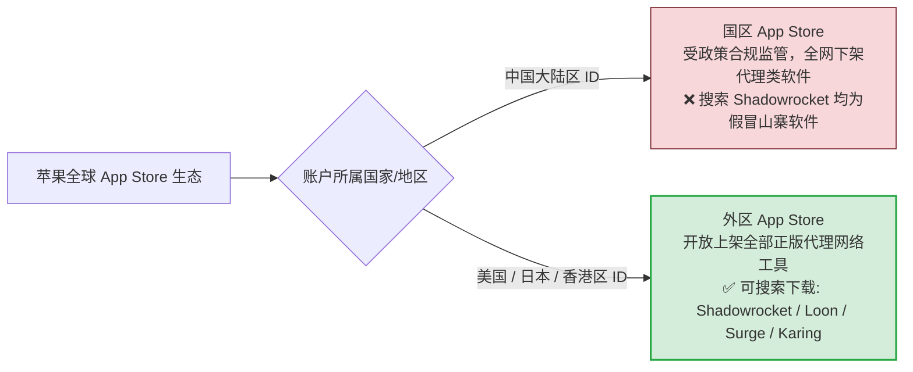
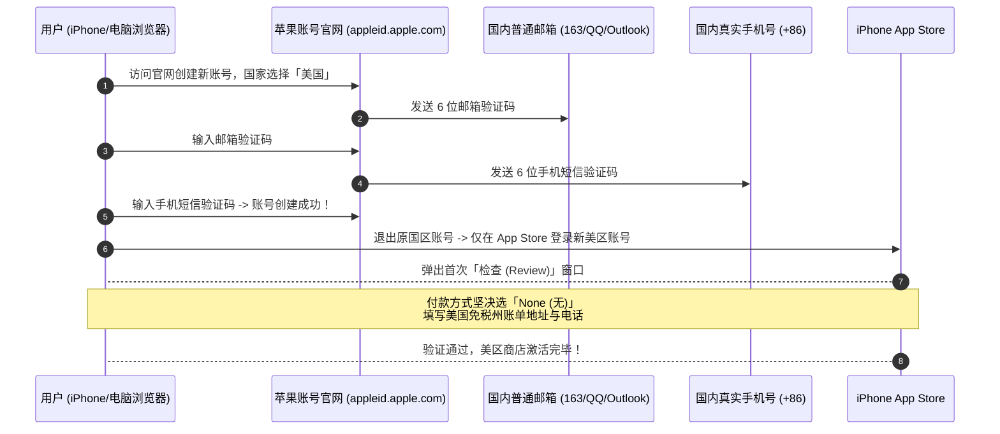
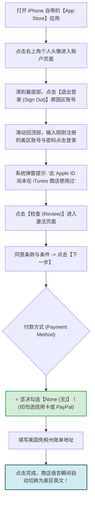
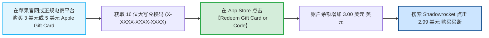
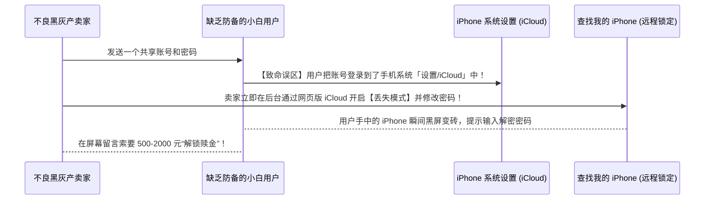

# iOS 客户端安装指南：免海外信用卡注册美区 Apple ID 与购买指引

  <strong>核心结论与快速指引：</strong>由于苹果 App Store 的严格区域限制，中国大陆区应用商店无法上架代理类软件。iOS 用户拥有两大高性价比解决方案：<strong>① 首选长治久安路线：花费 5 分钟在苹果官网免费注册一个美区 Apple ID（无需任何海外信用卡，付款方式选「None」），通过苹果官方礼品卡充值 2.99 美元买断【Shadowrocket (小火箭)】，终身正版免费更新；② 极速免折腾路线：选用支持免外区账号自研客户端的正规机场（如光速云），直接扫码一键安装使用。</strong> 

<AffiliateNotice />

---

## 一、为什么 iOS 必须使用海外 Apple ID？

苹果 iOS 系统的安全性建立在其封闭的 App Store 审核体系之上：

> [!WARNING] 国区假冒山寨小火箭警告
> 在中国大陆区 App Store 搜索「Shadowrocket」，会出现大量图标类似、名称带「小火箭加速器」的欺诈软件。这些软件通常诱导用户按周高额扣费（每周 38-68 元），实则是劣质公网直连甚至无法使用。正版 Shadowrocket 仅在外区商店上架，原作者为 **PanGuoJu**，售价仅为 2.99 美元买断制。

---

## 二、5 分钟免信用卡自建美区 Apple ID (2026 最新官方实操)

很多小白以为注册美区账号必须拥有一张美国本地信用卡，其实苹果官方一直留有面向全球用户的**零门槛免信用卡注册通道**。

---

### 第一步：准备基础注册材料
- **一个从未注册过 Apple ID 的邮箱**：国内的 163、QQ 邮箱、126 邮箱、Outlook 均可；
- **一个能正常接收短信的中国大陆手机号 (+86)**：哪怕该手机号已经绑定了你的国区主账号，也**完全可以重复用于注册美区新账号**，苹果官方完全允许一人拥有多个地区账号。

---

### 第二步：在浏览器完成账号基础创建
1. 打开电脑或手机浏览器，访问苹果官方账号注册地址：`https://appleid.apple.com`；
2. 点击右上角或页面下方的 **「创建您的 Apple ID」**；
3. **关键信息填写规范**：
   - **姓名**：可随意填写拼音（如 San Zhang）；
   - **国家或地区**：**必须选择「美国 (United States)」**；
   - **出生日期**：填写真实出生日期（确保年龄大于 18 岁）；
   - **邮箱与密码**：输入准备好的新邮箱并设置高强度密码；
   - **手机号码**：国家区号选择 `中国大陆 (+86)`，填入你的日常手机号；
4. 依次输入邮箱收到的 6 位验证码以及手机收到的短信验证码，点击继续，账号基础框架即注册完毕。

---

### 第三步：在 iPhone App Store 激活并设置「免信用卡」账单

这是最关键的一步。此时账号虽然创建成功，但尚未激活 App Store 的下载权限。

#### 美国免税州账单地址速填模板 (免消费税)
在填写账单地址时，建议选择美国五大免税州之一（如俄勒冈州 Oregon 或特拉华州 Delaware），后续充值购买软件时不会被额外加收 8%-10% 的消费税：

| 字段名称 (英文) | 推荐填写内容 (参考模板) | 说明 |
| :--- | :--- | :--- |
| **Street (街道地址)** | `1200 NW Naito Pkwy` | 俄勒冈州波特兰真实街道 |
| **City (城市)** | `Portland` | 城市名 |
| **State (州)** | `OR - Oregon` | 下拉菜单中选中俄勒冈州 |
| **Zip Code (邮编)** | `97209` | 必须与波特兰对应严格一致 |
| **Phone (电话号码)** | `(503) 222-1234` | 前三位区号填 503，后填任意 7 位数字 |

填写完毕后点击右上角「完成 (Done)」，恭喜你，一个完全独立自主、终身可用的正版美区 Apple ID 已经大功告成！

---

## 三、如何安全充值并购买 2.99 美元 Shadowrocket？

既然付款方式选了「None」，怎么向账号里付钱购买小火箭呢？

### 1. 获取正规苹果礼品卡 (Apple Gift Card)
- **途径 A：苹果美国官网**：如果有 Visa/Mastercard 外币卡，可直接在苹果美国官网 (`apple.com/shop/buy-giftcard/giftcard`) 购买电子礼品卡，面额自定义填 $3，收件人填你自己的邮箱，几分钟内即可收到兑换码；
- **途径 B：正规电商平台**：在主流电商平台（如淘宝、京东全球购、支付宝出境服务）搜索「美区苹果礼品卡」，购买小面额（如 3 美元或 5 美元兑换码），通常花费约 22-38 元人民币。

### 2. 在 App Store 兑换并购买
1. 打开 App Store，点击右上角头像；
2. 点击 **「Redeem Gift Card or Code (兑换礼品卡或代码)」**；
3. 选择「Enter Code Manually (手动输入代码)」，粘贴获取到的 16 位礼品卡字符，点击右上角 Redeem；
4. 兑换成功后，头像下方会显示你的账户余额（如 `Store Credit: $3.00`）；
5. 在搜索栏输入 `Shadowrocket`，认准原作者 **PanGuoJu**，点击购买即可完成下载！

---

## 四、最高安全戒律：严防「共享账号锁机」勒索陷阱

很多新手图便宜，在网上购买 2 块钱的「公共共享账号」下载小火箭，这隐藏着极其凶险的黑灰产陷阱：

> [!CAUTION] iOS 双重红线铁律
> 1. **铁律一：第三方账号【绝对禁止】登录手机系统「设置 (Settings) / iCloud」！** 任何下载需求，**仅允许在「App Store」商店内登录**。App Store 登录绝不会触发手机设备锁定；
> 2. **铁律二：下载完成后立即退出**：软件下载完毕后，建议立即在 App Store 滑到最底端退出该外区账号，重新登录回你的国区日常账号。**已下载的 Shadowrocket 会一直保留在手机桌面上正常使用与更新，国内日常使用不受任何影响！**

---

## 五、iOS 极速免折腾方案：机场自研免配客户端

如果你实在不想折腾海外账号注册和礼品卡兑换，也可以选择具备**自研免外区 ID 客户端**的正规专线机场：

| 方案 | 操作步骤 | 优势 | 适合人群 |
| :--- | :--- | :--- | :--- |
| **自建美区 ID + 小火箭** | 注册账号 → 礼品卡充值 → App Store 下载 | 终身正版属于自己、功能天花板、支持换任意机场 | 追求长期稳定、多端协同的用户 |
| **机场自研客户端** | 登录后台 → 扫描二维码安装信任描述文件 | **无需海外 Apple ID**、0 门槛、自动同步节点与测速 | 极度怕麻烦、只想立即连上的小白 |

以标杆品牌 [光速云 (GSY)](/reviews/#brand-gsy) 为例，既提供全兼容的标准 Shadowrocket 一键导入订阅，又针对 iOS 新手提供了免海外账号的轻量连接方案，月付门槛折合约 8 元起，结账输入优惠码 `AMM` 享受专属折扣。

---

## 六、本章小结与进阶路线

现在你已经扫清了 iOS 下载的全部障碍，手头已经拥有了功能强大的 Shadowrocket。

但在苹果 App Store 的高阶生态中，除了小火箭之外，还有许多声名显赫的名字：**支持 Clash 语法的 Stash、脚本重写神器 Quantumult X、以及售价高达 49.99 美元的工业级网络工匠 Surge 5。它们之间有何本质区别？哪一款才是你的终极归宿？**

**下一篇，我们将进入 iOS 代理软件全家桶权威深度横评！**

<NextStep
  title="下一篇：iOS 代理软件全家桶推荐"
  link="/clients/ios-apps"
  description="Shadowrocket、Stash、Quantumult X 与 Surge 5 功能与资费深度权威横评。"
  stepText="客户端实操主线 · 第 5 站"
  buttonText="阅读 iOS 代理软件权威横评 →"
/>
