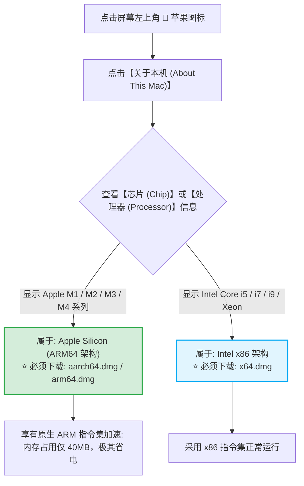
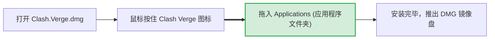
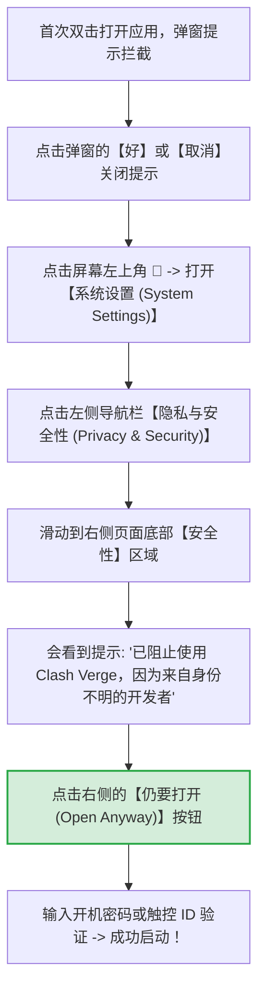
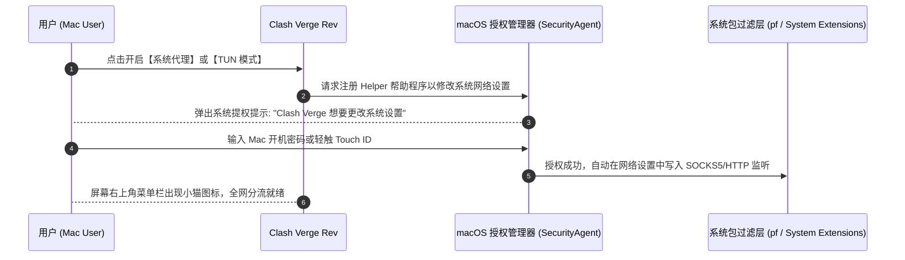
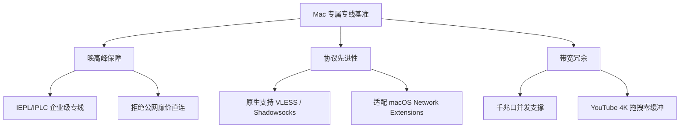

# macOS 客户端安装指南：苹果 M 系列芯片 (Apple Silicon) 与 Intel 架构正确选型

<div class="answer-first-lead">
  <strong>核心结论与快速指引：</strong>Mac 苹果电脑用户首选 <strong>Clash Verge Rev for Mac (基于 Mihomo 内核)</strong>。安装的核心关键在于<strong>认准硬件芯片架构</strong>：<strong>搭载苹果自研 M 系列芯片 (M1/M2/M3/M4) 的 Mac 必须下载包含 <code>aarch64</code> 或 <code>arm64</code> 标识的 DMG 安装包；老款 Intel 芯片的 Mac 下载包含 <code>x64</code> 的安装包。</strong> 如遇到 macOS 提示「应用已损坏」或「无法验证开发者」，只需在「系统设置 → 隐私与安全性」中点击「仍要打开」即可秒级解除拦截。
</div>

<AffiliateNotice />

---

## 一、动手前第一步：10 秒确认你的 Mac 芯片架构

macOS 生态正处于从 Intel x86 架构向 Apple Silicon ARM 架构的迁移期。在下载任何安装包前，请务必查看自己的芯片类型：



> [!WARNING] 为什么严禁混用架构？
> 如果在 M 系列芯片的 Mac 上错误安装了 x64 版本的客户端，macOS 必须调用 Rosetta 2 转译层进行动态指令翻译。这不仅会导致**内存占用飙升 2-3 倍**，还会导致笔记本发热耗电加剧，甚至在调用底层 TUN 虚拟网卡驱动时发生崩溃报错。

---

## 二、官方安装包安全获取与安装拖拽

1. **官方 Release 发布页面**：直接访问 Clash Verge Rev 官方项目仓库：[github.com/clash-verge-rev/clash-verge-rev/releases](https://github.com/clash-verge-rev/clash-verge-rev/releases)；
2. **下载匹配的 DMG 镜像文件**：
   - **M 系列芯片用户**：下载 `Clash.Verge_x.x.x_aarch64.dmg`（注意看清是 `aarch64`）；
   - **Intel 芯片用户**：下载 `Clash.Verge_x.x.x_x64.dmg`；
3. **安装步骤**：
   - 双击打开下载的 `.dmg` 镜像文件；
   - 在弹出的窗口中，将 **Clash Verge** 图标按住，拖拽到右侧的 **Applications (应用程序)** 文件夹中；
   - 拖拽完成后，在访达 (Finder) 侧边栏的「应用程序」中找到它即可启动。



---

## 三、化解 macOS 独有的两大安全拦截与权限门槛

macOS 以严苛的沙盒机制与安全防护著称。首次打开第三方开源工具时，90% 的用户会遇到以下两道坎：

---

### 拦截一：提示「无法打开，因为 Apple 无法检查其是否包含恶意软件」



### 拦截二：极端情况下提示「应用已损坏，您应该将它移到废纸篓」
如果从浏览器下载时被 macOS 强制打上了隔离标记（Quarantine Tag），可能会遇到所谓的「已损坏」报错。这**不是软件真的坏了，而是苹果 Gatekeeper 的误报**。

- **终端一行命令终极修复法**：
  1. 打开 Mac 的「终端 (Terminal)」应用（按快捷键 `Command + 空格` 呼出聚焦搜索，输入 `Terminal` 回车）；
  2. 复制并粘贴以下命令，然后按下回车键：
     ```bash
     sudo xattr -r -d com.apple.quarantine /Applications/Clash\ Verge.app
     ```
  3. 终端会提示你输入开机密码（输入密码时屏幕不会显示任何星号或字符，这是正常的安全保护，直接盲输完毕按回车即可）；
  4. 再次打开软件，即可直接秒开！

---

## 四、macOS 独有：系统代理授权与 Helper 工具部署

当你在 Clash Verge Rev 中第一次开启「系统代理」或「TUN 模式」时，macOS 系统会要求安装后台帮助程序 (Helper Tool)：



---

## 五、macOS 平台日常调优三部曲

为了获得如同原生 macOS 应用般丝滑的优雅体验，建议完成以下三项设置：

### 1. 菜单栏优雅常驻与主窗口隐藏
- 在 Clash Verge 的「设置」中：
  - 勾选 **「登录时启动 (Launch at Login)」**；
  - 勾选 **「静默启动 (Silent Start)」**；
- 这样，每次打开 MacBook 屏幕盖子唤醒时，软件都在后台安静运行，你可以随时点击屏幕顶部右上角菜单栏的小图标切换节点，无需让庞大的主界面常驻 Dock 栏。

### 2. 导入订阅与批量测速
- 在「订阅 (Profiles)」界面粘贴机场通用订阅链接（推荐使用 [光速云 (GSY)](/reviews/#brand-gsy) 的 Clash 订阅）；
- 导入成功后，在「代理 (Proxies)」界面点击「批量测速」；
- 选择绿色香港、日本或新加坡低延迟专线节点；
- 代理模式务必保持在 **「规则 (Rule)」**，保证访问飞书、微信、国内视频网站不走代理。

### 3. macOS 终端 (Terminal / zsh) 命令行代理快速配置
对于需要使用 Homebrew、Git 拉取代码或 npm 安装依赖的开发者用户，macOS 终端默认不走系统代理。只需在终端配置文件 `~/.zshrc` 中添加快速别名即可实现一键开关：
```bash
# 打开终端配置文件进行编辑
echo 'alias setproxy="export http_proxy=http://127.0.0.1:7890; export https_proxy=http://127.0.0.1:7890; export all_proxy=socks5://127.0.0.1:7890; echo 终端代理已开启"' >> ~/.zshrc
echo 'alias unsetproxy="unset http_proxy; unset https_proxy; unset all_proxy; echo 终端代理已关闭"' >> ~/.zshrc
source ~/.zshrc
```
配置完成后，在任意终端窗口输入 `setproxy` 即可让 `git clone` 与 `brew install` 满速起飞，输入 `unsetproxy` 即可恢复直连。

---

## 六、macOS 平台主流代理工具横向测评

| 客户端名称 | 芯片架构原生度 | 资费 | 核心优势 | 缺点与不足 | 适合人群 |
| :--- | :--- | :--- | :--- | :--- | :--- |
| **Clash Verge Rev for Mac** | **Apple Silicon 原生** | **开源免费** | 颜值极高、内存占用低、TUN 模式无缝、社区维护最频繁 | 高级规则扩展需熟悉 YAML | **95% Mac 用户首推** |
| **Surge for Mac** | **原生 Universal** | **商业收费 ($49.99 起)** | 工业级网络调试、MITM 抓包、网络异常诊断天花板、极度稳定 | 价格极其昂贵，对小白功能过剩 | 网络工程师、高级开发者 |
| **Karing for Mac** | **Apple Silicon 原生** | **免费** | 界面极简、多协议自动解析兼容 | 颗粒度分流调优不如 Clash 丰富 | 极度追求无脑小白 |
| **FlClash for Mac** | **Apple Silicon 原生** | **开源免费** | Flutter 精致动画，跨平台统一交互 | 安装包体积略大 | 颜值党、多端统一党 |

---

## 七、macOS 标杆专线搭配推荐

苹果电脑以高分辨率视网膜屏 (Retina) 著称，配合 4K/8K 视频播放与跨国工程依赖拉取，需要高质量专线提供充沛底座：



在 42 家品牌实测中，[光速云 (GSY)](/reviews/#brand-gsy) 在 macOS 环境下的兼容度与稳定性表现尤为出色：
- **原生兼容**：订阅完美适配 Clash Verge Rev for Mac，解析零报错；
- **双线路容灾**：晚高峰自动切换最优专线，视频加载码率全程稳定；
- **高性价比**：入门门槛折合约 8 元/月，输入优惠码 `AMM` 享受专属折扣。

---

## 八、本章小结与进阶路线

搞定了 macOS 的安装与权限授权，你的苹果电脑已经具备了强大的网络生产力。但如果出门在外，手头的核心移动设备往往是 Android 手机：**安卓平台如何避开假冒恶意 APK？如何防止后台进程被杀？**

**下一篇，我们将进入 Android 客户端的深度安装与省电保活实战！**

<NextStep
  title="下一篇：Android 客户端安装指南"
  link="/clients/android-install"
  description="APK 安全下载渠道、防杀后台保活设置与 NekoBox 仿冒陷阱警示。"
  stepText="客户端实操主线 · 第 3 站"
  buttonText="阅读 Android 客户端安装指南 →"
/>
