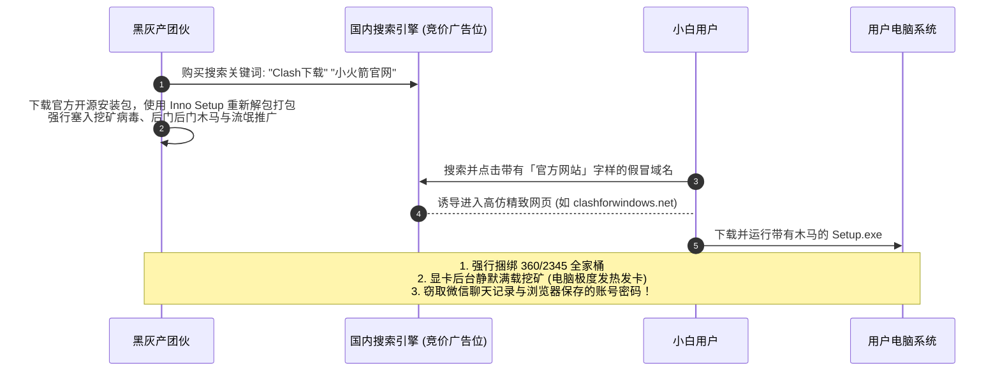
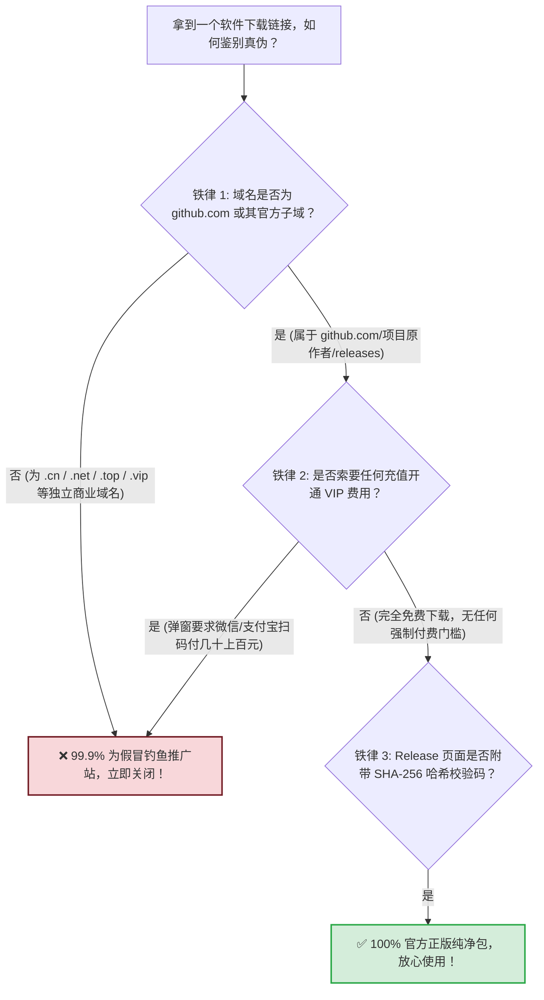
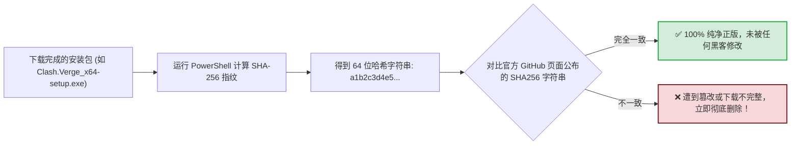

# 客户端安全下载防毒指南：官方 GitHub 仓库合集与避坑流氓镜像站

<div class="answer-first-lead">
  <strong>核心结论与防骗最高警示：</strong>在科学上网领域，小白遭遇木马病毒和财产损失的头号渠道，<strong>正是通过百度、搜狗、360 等国内搜索引擎直接搜索「Clash 下载」或「小火箭官网」！</strong>黑灰产团伙买下排名前列的竞价广告位，将开源软件二次解包植入<strong>静默挖矿代码、剪贴板窃密木马与弹窗勒索广告</strong>，甚至骗取数百元虚假会员费。<strong>请牢记铁律：所有正规开源工具（Clash Verge、v2rayN、v2rayNG、Karing、Hiddify 等）100% 完全免费，且其唯一官方发行渠道只有【GitHub Releases】！</strong>
</div>

<AffiliateNotice />

---

## 一、百度/搜狗假冒「Clash 官网」四大黑灰产收割套路大起底

很多新手纳闷：「我明明是在正规搜索引擎里搜到的排第一名的官网，怎么会是病毒？」



---

### 套路 1：精美高仿界面 + 恶意二次解包捆绑
黑灰产团伙注册包含 `clash`、`v2ray`、`shadowrocket` 拼音的域名，扒下原版软件的图标和 UI，制作极其逼真的假冒「官方首页」。他们将官方纯净的 exe 安装包解压，把恶意木马与推广软件植入安装流程中。用户安装后，电脑右下角会频繁弹出擦边广告，CPU 占用率常年 100%。

### 套路 2：剪贴板劫持与虚拟币/凭证调包 (Clipboard Hijacking)
最隐蔽也是危害最大的病毒：木马常驻后台监听系统的剪贴板。当你复制加密货币钱包地址、或者复制刚刚购买的机场私有订阅 Token 时，木马程序在毫秒级内将剪贴板内容替换为黑客自己的地址。结果不仅转账丢失，你购买的付费流量还会被黑客直接转卖盗刷。

### 套路 3：为原本完全免费的开源软件设置「虚假 VIP 付费墙」
在开源社区中，Clash Verge、v2rayN、FlClash 的作者均是无偿开源奉献。而假冒网站会在安装向导的最后一步强行弹窗：**「体验期已结束，请扫描微信二维码支付 98 元开通终身 VIP 才能使用」**。许多不明真相的小白误以为软件本身要收费，白白交了智商税。

### 套路 4：苹果假冒小火箭按周扣费陷阱
在国区 App Store 搜索出现的山寨加速器，利用苹果的自动订阅机制，表面上写着「免费试用 3 天」，三天一过立即悄悄按周扣除 38-68 元人民币。许多用户几个月后才发现银行卡被扣掉了几百元冤枉钱。

---

## 二、如何一眼鉴别真假官方下载站？三大黄金铁律



---

## 三、全平台 40+ 款正版客户端官方 GitHub Releases 仓库直达目录

为方便小白用户彻底避开搜索引擎雷区，本站技术团队整理并持续校验了全平台主流正版开源软件的**唯一官方 GitHub 仓库直达地址**：

### 1. Windows / macOS 桌面核心主力

| 客户端名称 | 核心内核 | 适用平台 | 官方 GitHub Releases 仓库地址 (请认准官方原址) |
| :--- | :--- | :--- | :--- |
| **Clash Verge Rev** | **Mihomo (Meta)** | Win / Mac / Linux | [github.com/clash-verge-rev/clash-verge-rev/releases](https://github.com/clash-verge-rev/clash-verge-rev/releases) |
| **FlClash** | **Mihomo (Meta)** | Win / Mac / Linux | [github.com/chen08209/FlClash/releases](https://github.com/chen08209/FlClash/releases) |
| **v2rayN** | **Xray / Sing-box** | Windows | [github.com/2dust/v2rayN/releases](https://github.com/2dust/v2rayN/releases) |
| **Karing** | **sing-box** | Win / Mac | [github.com/KaringX/karing/releases](https://github.com/KaringX/karing/releases) |
| **Hiddify** | **sing-box** | Win / Mac / Linux | [github.com/hiddify/hiddify-next/releases](https://github.com/hiddify/hiddify-next/releases) |
| **Clash Nyanpasu** | **Mihomo / Rust** | Win / Mac / Linux | [github.com/libnyanpasu/clash-nyanpasu/releases](https://github.com/libnyanpasu/clash-nyanpasu/releases) |
| **Clash Mi** | **Mihomo** | Win / Mac | [github.com/Clash-Mi/Clash-Mi/releases](https://github.com/Clash-Mi/Clash-Mi/releases) |

### 2. Android 安卓移动端标杆

| 客户端名称 | 核心内核 | 官方 GitHub Releases 仓库地址 | 安装包选型建议 |
| :--- | :--- | :--- | :--- |
| **v2rayNG** | **Xray-core** | [github.com/2dust/v2rayNG/releases](https://github.com/2dust/v2rayNG/releases) | 认准 `v2rayNG_x.x.x_arm64-v8a.apk` |
| **FlClash Android** | **Mihomo** | [github.com/chen08209/FlClash/releases](https://github.com/chen08209/FlClash/releases) | 认准 `flclash-android-arm64-v8a.apk` |
| **Karing Android** | **sing-box** | [github.com/KaringX/karing/releases](https://github.com/KaringX/karing/releases) | 认准 `karing_x.x.x_android_arm64.apk` |
| **Hiddify Android** | **sing-box** | [github.com/hiddify/hiddify-next/releases](https://github.com/hiddify/hiddify-next/releases) | 认准 `Hiddify-Android-arm64.apk` |
| **sing-box (SFA)** | **sing-box 原生** | [github.com/SagerNet/sing-box/releases](https://github.com/SagerNet/sing-box/releases) | 开发者专用原生版 |

### 3. iOS 苹果移动端 (外区 App Store 认准开发者)

iOS 平台请务必通过外区（如美区）官方 App Store 搜索下载，认准官方开发者署名：
- **Shadowrocket**：开发者署名必须为 **PanGuoJu**（$2.99 买断）；
- **Stash**：开发者署名必须为 **LianGou Inc.**（$3.99 买断）；
- **Quantumult X**：开发者署名必须为 **CrossUtility**（$7.99 买断）；
- **Surge 5**：开发者署名必须为 **Surge Networks Inc.**；
- **Loon**：开发者署名必须为 **Loon Networks**。

### 4. Linux / NAS / OpenWrt 软路由透明代理

| 客户端名称 | 适用硬件环境 | 官方 GitHub Releases 仓库地址 |
| :--- | :--- | :--- |
| **v2rayA** | Linux 物理机 / Docker / 群晖/威联通 NAS | [github.com/v2rayA/v2rayA/releases](https://github.com/v2rayA/v2rayA/releases) |
| **OpenClash** | OpenWrt 路由器固件 (全系支持) | [github.com/vernesong/OpenClash/releases](https://github.com/vernesong/OpenClash/releases) |
| **Nikki** | 现代 OpenWrt 24.10+ / 内核原生 | [github.com/nikkinikki-org/OpenWrt-nikki/releases](https://github.com/nikkinikki-org/OpenWrt-nikki/releases) |
| **Mihomo 内核原生** | Linux 命令行无头环境 | [github.com/MetaCubeX/mihomo/releases](https://github.com/MetaCubeX/mihomo/releases) |

---

## 四、高阶安全实战：使用 PowerShell 校验 SHA-256 防篡改哈希

如果你下载了安装包，想 100% 验证它是否被中间人或局域网篡改，可以使用 Windows 自带的 PowerShell 命令行进行数字指纹校验：



### 30 秒实操命令
1. 打开存放下载安装包的文件夹；
2. 键盘按住 `Shift` 键的同时，在文件夹空白处**单击鼠标右键**；
3. 选择 **「在此处打开 PowerShell 窗口」**（或在 Windows 11 选择「在终端中打开」）；
4. 输入以下命令并按回车（文件名替换为你实际下载的文件名）：
   ```powershell
   Get-FileHash .\Clash.Verge_1.7.7_x64-setup.exe -Algorithm SHA256
   ```
5. 窗口会返回一串由 64 个字母和数字组成的哈希值；将其与 GitHub Release 页面下方注明的 Hash 进行肉眼或复制比对，完全吻合即可绝对放心安装！

---

## 五、标杆服务商的安全下载直通保障

对于极度害怕在网上乱找链接的新手，选择靠谱的大型服务商也是避坑的良策。像 [光速云 (GSY)](/reviews/#brand-gsy) 等成熟品牌：
- 在用户后台直接提供经过安全哈希校验的官方客户端纯净安装包内网加速镜像，下载不走公网广告重定向；
- 支持全平台一键托管导入，避免用户在手动转换 API 时泄露私有 Token；
- 入门门槛折合约 8 元/月，结算输入优惠码 `AMM` 享受专属立减。

---

## 六、本章小结与进阶路线

建立起坚固的安全下载防线后，你手头的软件已经确保了 100% 的纯净与正版。

但面对我们梳理的这 40+ 款工具：**它们各自的内核、资费类型、TUN 模式支持程度与适用场景到底该如何横向对比？有没有一张能一眼看尽全平台的总决算对比大表？**

**下一篇，我们将进入客户端生态的终极大收官——全平台客户端功能与参数终极大对比！**

<NextStep
  title="下一篇：40+ 客户端全维度功能横评"
  link="/clients/comparison"
  description="内核、分流、内存占用、资费与上手度全矩阵参数终极大对比。"
  stepText="客户端实操主线 · 第 10 站"
  buttonText="阅读 40+ 客户端终极大对比 →"
/>
