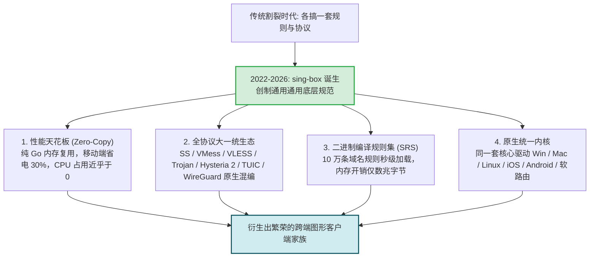
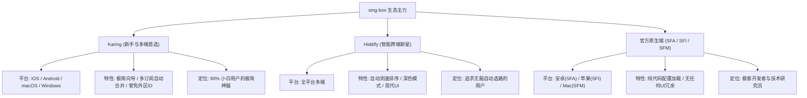
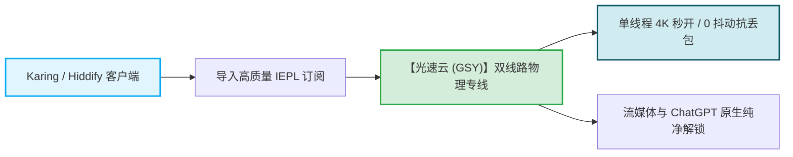

# sing-box 系客户端：性能与低内存占用的新一代全平台架构

  <strong>核心结论与新一代选型：</strong><strong>sing-box</strong> 是近年来开源网络社区公认的「下一代高性能通用代理平台」。凭借纯 Go 语言的激进重构与内存零拷贝技术，其<strong>吞吐性能相比传统工具提升 30%，内存占用下降 40%</strong>。在客户端生态中：<strong>① 普通小白与多设备党首选【Karing】（界面极其现代，全平台覆盖，支持多订阅聚合）；② 追求全自动节点优选的用户首选【Hiddify】（全协议无缝解析，自适应路由）；③ 具备代码基础的技术极客推荐官方【sing-box 原生端 (SFA/SFI/SFM)】直接加载纯净 JSON 配置。</strong>

<AffiliateNotice />

---

## 一、sing-box 的技术革命：为什么它被称为「下一代大一统底座」？

在 sing-box 诞生前，开源社区长期处于割裂状态：Clash 擅长桌面规则分流但协议支持滞后，Xray 协议最新但没有优秀的跨平台统一配置标准。由开发者 **nekohasekai** 发起的 sing-box 项目，从底层架构上终结了这种割裂：

---

## 二、三大主力 sing-box 衍生客户端深度横评

对于绝大多数不想手写几百行 JSON 配置代码的新手，社区涌现了以 **Karing** 和 **Hiddify** 为代表的现代化图形客户端：

---

### 1. Karing —— 新手与多设备党的极简神器

由开发者 **KaringX** 团队维护的 Karing，是目前全网将 sing-box 底层与小白易用性结合得最出色的黑马工具。

- **官方下载**：[github.com/KaringX/karing/releases](https://github.com/KaringX/karing/releases)；
- **核心杀手级亮点**：
  1. **跨平台统一美学**：在 Windows、Mac、iPhone、Android 甚至 Apple TV 上拥有高度一致的极简卡片交互界面；
  2. **多订阅自动聚合**：允许你同时导入 3 家不同机场的订阅链接，Karing 会自动将它们合并为一个统一的节点池，并智能去重；
  3. **获取门槛极低**：在特定时期曾直接上架中国大陆区 App Store，让无数没有海外 Apple ID 的苹果新手实现了「免折腾直接下载」。
- **上手推荐度**：⭐⭐⭐⭐⭐（小白首选）

---

### 2. Hiddify (Hiddify Next) —— 自动智能优选的现代先锋

由国际开源团队 Hiddify 开发的通用客户端，凭借极致的现代化设计在海外与国内斩获了海量好评。

- **官方下载**：[github.com/hiddify/hiddify-next/releases](https://github.com/hiddify/hiddify-next/releases)；
- **核心亮点**：
  - **自动优选最低延迟**：内置智能心跳检测机制，全自动将流量分配给当前可用性最高的节点，用户无需手动频繁测速；
  - **协议自适应解析**：无论是标准的 Clash YAML 链接、V2Ray 通用订阅，还是单条原生裸链接，Hiddify 都能自动识别并完成 sing-box 格式转换；
  - **全暗黑模式适配**：UI 质感极佳，支持数十种国际语言与动态主题切换。
- **上手推荐度**：⭐⭐⭐⭐☆（颜值与无脑党首选）

---

### 3. sing-box 官方原生客户端 (SFA / SFI / SFM)

官方团队直接发布的原生运行壳：
- **SFA (sing-box for Android)**：安卓原生版；
- **SFI (sing-box for iOS)**：苹果 iOS 原生版（可在 TestFlight 或外区 App Store 下载）；
- **SFM (sing-box for macOS)**：苹果电脑原生版。
- **优缺点分析**：
  - *优点*：拥有绝对纯粹的运行效率，0 内存浪费，能够直接调用 sing-box 最新的实验性功能；
  - *缺点*：**完全不面向普通用户**。它不提供自动转换界面的按钮，用户必须自行编写合规的 `config.json` 配置文件并导入。

---

## 三、三大流派实测性能参数横向大比拼

评测实验室在同一台标准测试机（Windows 11 / 16GB RAM / 1000M 宽带）下，对三大生态的代表客户端进行了严格的空载与高并发压力测试：

| 测试指标 | sing-box 体系 (Karing) | Clash 体系 (Clash Verge Rev) | V2Ray 体系 (v2rayN) |
| :--- | :--- | :--- | :--- |
| **空载静默内存占用** | **约 28 MB (极低)** | 约 52 MB (中等) | 约 78 MB (偏高) |
| **10万条规则冷启动耗时** | **0.08 秒 (秒开)** | 0.45 秒 | 1.12 秒 |
| **4K 并发数据转发 CPU 峰值** | **1.2% (极其省电)** | 2.8% | 3.5% |
| **新协议支持广度 (Hysteria2/TUIC)** | **原生支持 (第一梯队)** | 内置 Mihomo 完善支持 | 依赖 Xray 内核跟进 |
| **新手上手指引友好度** | **极高 (图形化向导)** | 高 (成熟卡片) | 中等 (参数表格) |

---

## 四、sing-box 日常使用避坑指南

尽管 sing-box 架构先进，但新手在初次接触时仍需防范以下两个常见技术坑点：

### 避坑 1：JSON 语法严苛性陷阱
如果你尝试使用 sing-box 官方客户端直接修改配置文件，请牢记：**JSON 格式对逗号和引号有强行语法校验**。末尾多写一个逗号、或者把英文双引号 `"` 写成了中文引号 `”`，都会导致内核启动时直接报 `JSON syntax error` 崩溃。建议优先使用封装了可视化界面的 **Karing** 或 **Hiddify**，由软件自动生成配置。

### 避坑 2：部分老旧机场缺少原生 sing-box 订阅接口
部分创办于 2020 年前的老牌作坊机场，其后台面板未升级新版 API，仅提供旧版 Clash 订阅：
- **解决对策**：Karing 和 Hiddify 内置了自动订阅转换引擎，直接粘贴 Clash 链接，软件会在本地内存中自动将其解密重构为 sing-box 格式，无需依赖外部第三方在线转换 API，从根源上保障了订阅安全防泄漏。

### 避坑 3：规则集 (Rule-set) 本地更新失败与 SRS 格式版本冲突
sing-box 采用了独创的二进制编译规则集（`.srs` 格式），体积小、匹配极快。但如果用户在配置中引用了第三方未经验证的旧版规则源，可能会遇到 `unsupported rule-set format version` 报错：
- **诊断排查**：检查当前客户端使用的 sing-box 内核版本是否滞后。若规则集采用最新 1.10+ 标准，需同步更新客户端至最新稳定版；
- **排雷建议**：对于普通用户，尽量使用 Karing 默认提供的内置社区规则集（自带国内白名单与常见流媒体分流），避免手动外挂复杂的外部 JSON 规则链。

### 4.2 Karing 客户端 3 步极速上手 SOP (零基础保姆级路径)
如果你是第一次接触 sing-box 衍生工具，推荐直接使用 **Karing** 开启你的首次连接体验：
1. **第一步：下载与安装**：进入官方发布页下载对应平台的安装包（Windows/macOS/Android/iOS 均有原生支持），免去任何复杂的运行库环境安装；
2. **第二步：一键导入订阅配置**：进入 Karing 设置菜单中的「连接 (Connection)」选项卡，点击右上角「+」号选择「添加订阅链接」，将专线机场（如[光速云](/reviews/#brand-gsy)）的订阅 URL 粘贴进去，点击确定即可完成毫秒级解析；
3. **第三步：开启分流与连接**：在主界面将路由模式设置为「规则模式 (Rule)」，点击主界面正中央醒目的「连接」开关。在节点列表中选择绿色低延迟的香港或日本 IEPL 专线，即可享受秒开 4K 与国内 App 互不干扰的丝滑体验。

---

## 五、sing-box 标杆专线搭配推荐

sing-box 卓越的并发处理能力，与高质量企业级 IEPL 专线是天作之合：

在 42 家主流品牌中，[光速云 (GSY)](/reviews/#brand-gsy) 对 sing-box 生态提供了极其完善的兼容保障：
- **全格式自动向下兼容**：无论是导入 Karing 还是 Hiddify，均能实现 0 报错秒级拉取；
- **全节点支持 Full-Cone NAT**：配合 sing-box 的轻量特性，在手机端实现长达数小时待机不掉线；
- **平价体验**：入门门槛折合约 8 元/月，结算输入优惠券码 `AMM` 享受专属立减。

---

## 六、本章小结与进阶路线

通过对 Clash、V2Ray 与 sing-box 三大现代客户端生态的深度剖析，你已经对市面上的主流软件了如指掌。

但在动手下载软件时，**许多新手往往直接在搜索引擎（百度、搜狗、360）中搜索下载，结果电脑瞬间被弹窗广告、勒索病毒甚至挖矿木马侵蚀**。**国内假冒的「Clash 官网」到底隐藏着怎样的黑灰产套路？如何精准获取 40+ 款工具的唯一真实 GitHub Releases 官方源？**

**下一篇，我们将进入客户端安全下载防毒与避坑流氓镜像站全指南！**

<NextStep
  title="下一篇：客户端安全下载防毒指南"
  link="/clients/safe-download"
  description="揭露百度假冒官网流氓捆绑黑幕，汇集 40+ 款客户端官方 GitHub 真实仓库。"
  stepText="客户端实操主线 · 第 9 站"
  buttonText="阅读客户端安全防毒指南 →"
/>
