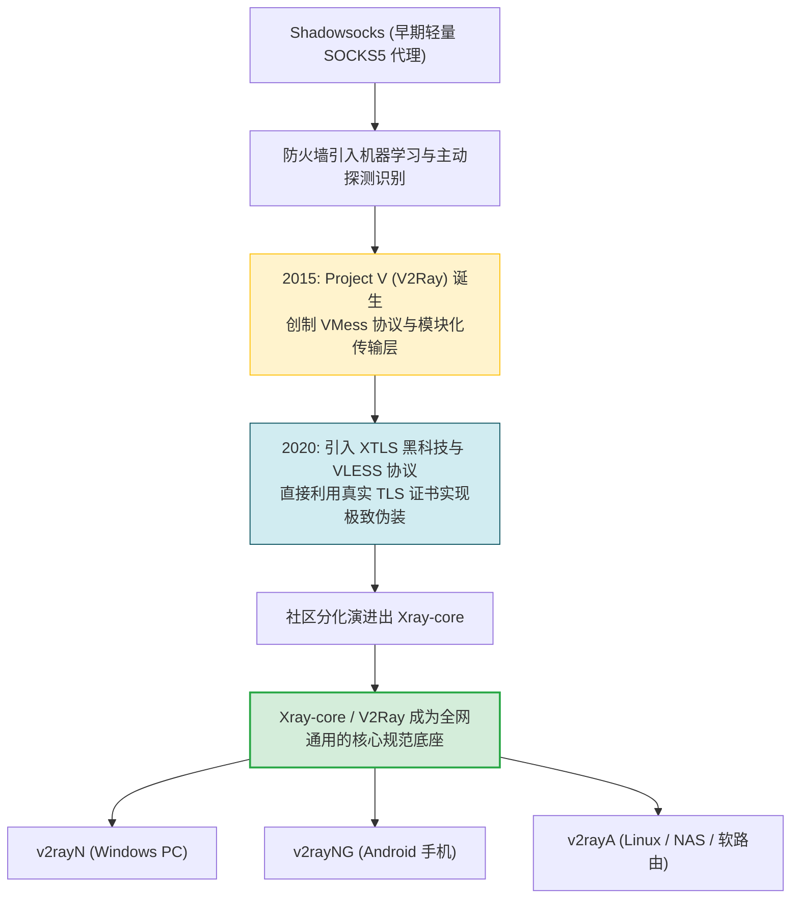
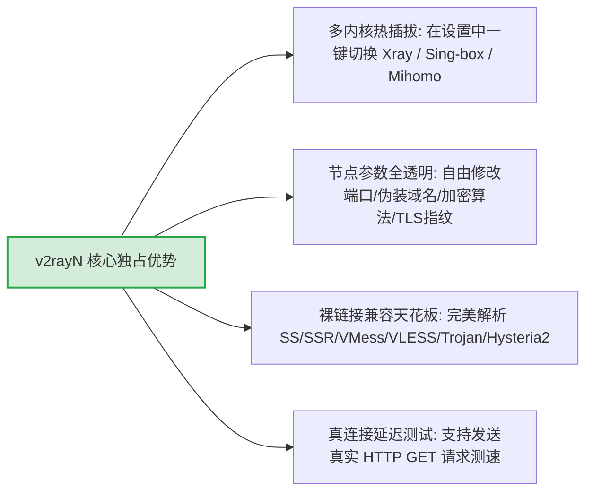
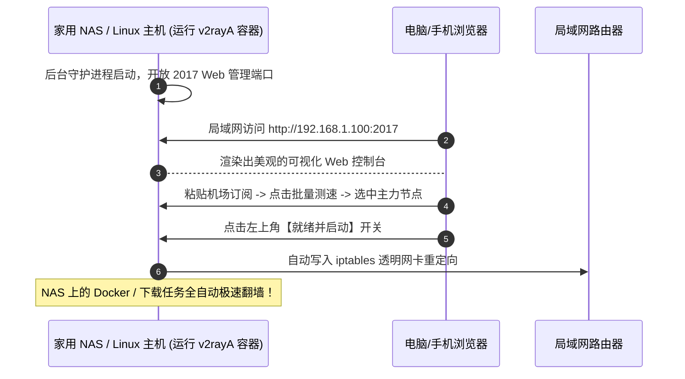
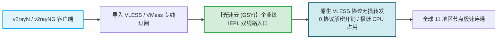

# V2Ray 系列客户端推荐：v2rayN、v2rayNG 与 v2rayA 经典工具深度解析

<div class="answer-first-lead">
  <strong>核心结论与三剑客定位：</strong>在现代网络代理的技术基石中，以 <strong>V2Ray (Project V) 与 Xray-core</strong> 为核心的生态历经多年淬炼，依然是兼容性最高、容错能力最强的常青树。家族三大家族成员分工极其明确：<strong>① Windows 平台【v2rayN】是功能最全的调试瑞士军刀（支持多内核热插拔与单节点深度微调）；② Android 手机平台【v2rayNG】是内存占用仅 30MB 的无广告开源标杆；③ 无显示器的 Linux 服务器、群晖/威联通 NAS 与旁路由首选【v2rayA】（提供强大的独立 Web 浏览器控制台）。</strong>
</div>

<AffiliateNotice />

---

## 一、V2Ray 与 Xray-core 的技术渊源与协议基石

要理解 V2Ray 系列软件，首先要看清它在网络代理发展史中的划时代地位：



### 为什么说 V2Ray 协议是行业的硬通货？
1. **VMess 与 VLESS 协议的统治力**：彻底抛弃了传统 Socks 代理的明文特征，利用动态 UUID 鉴权与时间戳校验，配合 WebSocket + TLS 或 gRPC 伪装成正常的企业 HTTPS 流量；
2. **单节点裸链接的通用性**：每一个 V2Ray 节点都能被精简压缩为一行以 `vless://` 或 `vmess://` 开头的加密字符串。无论使用何种平台，一键复制粘贴即可立即连通，无视任何复杂的规则限制。

---

## 二、三剑客深度横评与实战场景

---

### 1. v2rayN (Windows 桌面进阶利器)

由开发者 **2dust** 主导开发的 v2rayN，是 Windows 生态中最老牌、技术细节暴露最充分的工具。



- **官方下载**：[github.com/2dust/v2rayN/releases](https://github.com/2dust/v2rayN/releases)（认准 `v2rayN-With-Core.zip`，内置完整内核，解压即用）；
- **实操要领**：
  - 启动后点击顶部「服务器」→「从剪贴板导入批量 URL」，即可导入节点；
  - 底部状态栏点击「核心路由」，选择 **「绕过大陆 (Bypass mainland)」**；
  - 右下角托盘图标右键 → **「自动配置系统代理」**，图标变红即代表代理成功启动。
- **优缺点分析**：
  - *优点*：协议更新速度全网第一，排查网络故障时信息最全面；
  - *缺点*：界面依然保留经典的表格风，缺少新手向导。

---

### 2. v2rayNG (Android 手机端的开源标杆)

同样由 **2dust** 团队打造的安卓客户端，是安卓开源生态的常青树。

- **官方下载**：[github.com/2dust/v2rayNG/releases](https://github.com/2dust/v2rayNG/releases)（下载 `arm64-v8a.apk`）；
- **三大核心杀手级特性**：
  1. **极轻量运行**：无任何内置广告或跟踪代码，后台静默内存消耗仅 30-50MB；
  2. **分应用代理 (Per-App Proxy)**：支持一键将国内银行、微信、钉钉排除在代理之外，杜绝账号异地报警与额外耗电；
  3. **扫码一秒导入**：电脑屏幕上的节点二维码，手机打开 v2rayNG 右上角扫一扫，0.5 秒完成添加。

---

### 3. v2rayA (无桌面 Linux / NAS / 旁路由救星)

对于家里组装了群晖 (Synology)、威联通 (QNAP)、绿联 NAS，或者运行着 Debian/Ubuntu 软路由的用户，没有显示器和 Windows 桌面，如何给这些设备挂载代理？**v2rayA 是无可挑剔的最佳答案。**



- **官方项目**：[github.com/v2rayA/v2rayA](https://github.com/v2rayA/v2rayA)；
- **一键 Docker 部署命令**：
  ```bash
  docker run -d \
    --name v2raya \
    --restart=always \
    --privileged \
    --network=host \
    -v /lib/modules:/lib/modules \
    -v /etc/v2raya:/etc/v2raya \
    mzz2017/v2raya
  ```
- 部署完成后，在任意局域网设备输入 `http://主机IP:2017`，即可在浏览器中优雅管理节点与透明路由。

---

## 三、V2Ray 系列 vs Clash 系列核心哲学对比

很多用户常问：「既然 Clash 这么火，为什么还要用 V2Ray？」两者的底层设计哲学截然不同：

| 评估维度 | V2Ray 家族 (v2rayN / v2rayNG) | Clash 家族 (Clash Verge Rev / FlClash) |
| :--- | :--- | :--- |
| **核心设计哲学** | **以「节点」为核心**，注重单一协议的纯粹性与底层透明度 | **以「分流策略组」为核心**，注重自动化多节点智能路由 |
| **配置导入方式** | 既支持订阅，又原生支持一键导入单条 `vless://` 裸链接 | 强依赖 YAML 格式的完整订阅配置文件 |
| **多内核切换** | **极强**（可在 Xray/Sing-box/Mihomo 间自由切换） | 深度绑定 Mihomo 或单一专属内核 |
| **界面风格** | 传统工程表格风，参数直接可见 | 现代化卡片 Fluent / Flutter 扁平设计 |
| **适用核心场景** | 技术调试、节点单独排障、安卓极低功耗日常、无桌面 NAS | 桌面主力日常办公、全自动内外网分流、4K 视频娱乐 |

---

## 四、常见 V2Ray 报错与排障手册

在使用 v2rayN 或 v2rayNG 时，如果底部控制台抛出红字报错，对照以下表格排障：

| 典型错误提示 | 底层物理诱因 | 10秒急救对策 |
| :--- | :--- | :--- |
| **`io: read/write on closed pipe`** | 本地发起的 TCP 会话被意外重置切断 | 检查本地网络是否突发断网，或切换其他专线节点 |
| **`failed to find an available destination`** | 节点配置中的目标端口或 IP 不可达 | 更新一次机场订阅，确认服务商是否临时维护调整了入口 IP |
| **`handshake: certificate verified failed`** | TLS 握手证书校验失败 | **检查本地电脑/手机时间是否与北京时间一致**（误差必须小于 60 秒） |
| **`socks server: connection refused`** | 本地监听端口被其他软件占用 | 在 v2rayN 设置中修改本地监听端口（如将 10808 改为 20808） |

---

## 五、V2Ray 标杆专线搭配推荐

Xray 强大的抗封锁能力与低开销，必须配合源头直连的 IEPL 物理专线才能展现其满血实力：



在 42 家主流品牌中，[光速云 (GSY)](/reviews/#brand-gsy) 对 V2Ray / Xray 生态的支持堪称行业典范：
- **原生全协议直通**：全面支持 VLESS 现代协议，握手延时低至 30ms；
- **智能节点分组**：后台一键提供标准 V2Ray 通用订阅与二维码，扫码即连；
- **月付亲民**：入门门槛折合约 8 元/月，输入专属优惠码 `AMM` 享受首单减免。

---

## 六、本章小结与进阶路线

掌握了 V2Ray 家族的基石利器，你已经拥有了应对各种复杂网络环境与特殊硬件（如 NAS、Linux）的终极底牌。

但在最近两年，开源社区杀出了一匹性能怪兽——**sing-box**。**为什么有人说它是「下一代全能网络底座」？Hiddify 与 Karing 是如何借助 sing-box 崛起并横扫新手的？**

**下一篇，我们将进入新一代 sing-box 客户端生态深度解密！**

<NextStep
  title="下一篇：sing-box 新一代客户端生态"
  link="/clients/sing-box-series"
  description="性能怪兽 sing-box 底层架构、Hiddify 极简跨端与 Karing 新手神器全景测评。"
  stepText="客户端实操主线 · 第 8 站"
  buttonText="阅读 sing-box 生态全景测评 →"
/>
