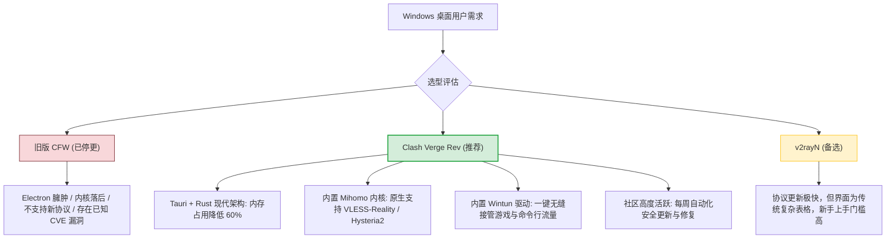
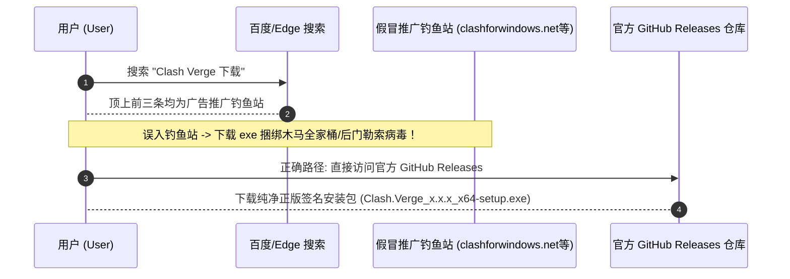
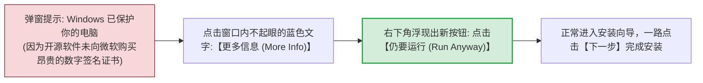
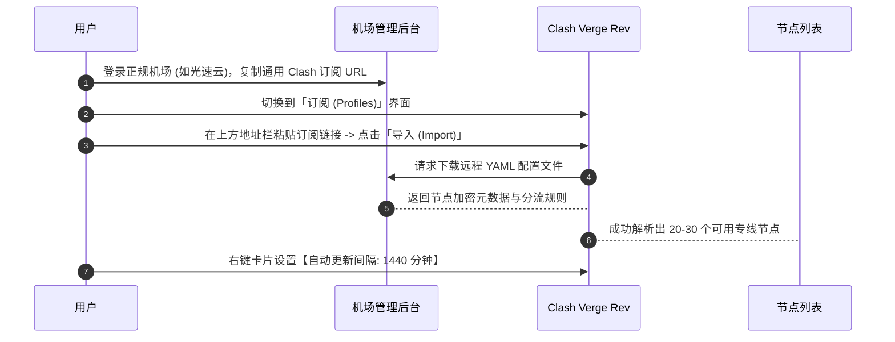
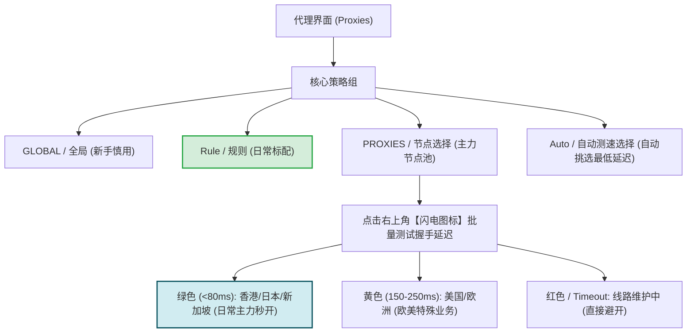
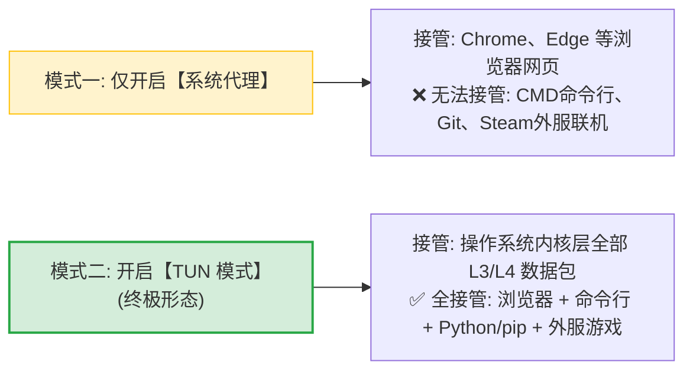

# Windows 客户端安装教程：Clash Verge Rev 下载、配置与 TUN 模式开启

  <strong>核心结论与快速指引：</strong>对于 Windows 10 和 Windows 11 用户，<strong>Clash Verge Rev (基于 Mihomo 内核) 是目前综合体验最佳的绝对首选</strong>。完成从零安装到流畅上网的标准路径只需 4 步：<strong>① 从官方 GitHub 仓库下载 <code>Clash.Verge_x.x.x_x64-setup.exe</code> 安装包（绕过 Windows SmartScreen 拦截）→ ② 导入机场订阅链接并设置每 24 小时自动更新 → ③ 在「代理」面板点击延迟测速并选择绿色香港/日本节点 → ④ 开启「系统代理」开关（如需游戏或终端加速，进一步开启「TUN 模式」）。</strong>

<AffiliateNotice />

---

## 一、为什么 Windows 平台首推 Clash Verge Rev？

原版由 Fndroid 开发的 Clash for Windows (CFW) 早在 2023 年 11 月停止维护。在群雄并起的后 CFW 时代，Clash Verge Rev 凭借其卓越的工程架构脱颖而出：

---

## 二、第一阶段：正规安装包安全获取与安装避坑

在 Windows 上安装代理软件，第一大杀手不是配置错误，而是**在搜索引擎中下载到了捆绑流氓病毒的伪造包**。

### 2.1 官方安全下载规范
- **官方 GitHub 仓库唯一发布地址**：[github.com/clash-verge-rev/clash-verge-rev/releases](https://github.com/clash-verge-rev/clash-verge-rev/releases)；
- **安装包版本选型指引**：
  - `Clash.Verge_x.x.x_x64-setup.exe`：**绝大多数 64 位 Windows 电脑首推**，自带完整安装向导；
  - `Clash.Verge_x.x.x_x64_portable.zip`：便携免安装版，适合不想写入注册表或放在 U 盘随身携带的用户；
  - `Clash.Verge_x.x.x_arm64-setup.exe`：仅适用于骁龙处理器 (如 Surface Pro ARM 版) 的 Windows 设备。

### 2.2 绕过 Windows Defender / SmartScreen 拦截弹窗
当运行下载好的安装程序时，Windows 经常会弹出一个深蓝色警告窗口：**「Windows 已保护你的电脑，Microsoft Defender SmartScreen 阻止了未经认可的应用启动」**。

> [!NOTE] 为什么开源工具会被报毒？
> 开源软件由于完全免费且社区协作开发，通常不会每年向微软商业认证中心支付数千美元购买数字签名证书；加之网络代理软件涉及底层虚拟网卡与网络分流操作，杀毒软件默认会以最严格的未知威胁标准发出误报。只要从官方 Releases 下载，即可安全忽略。

---

## 三、第二阶段：订阅导入与全自动运维配置

客户端安装完成后，桌面或开始菜单会出现一个小猫图标。双击打开进入主界面。

### 3.1 详细导入实操 4 步走
1. **复制订阅**：登录你购买的机场后台（如 [光速云 (GSY)](/reviews/#brand-gsy) 控制面板），在订阅信息中找到「复制 Clash 订阅链接」；
2. **导入配置文件**：
   - 打开 Clash Verge Rev，在左侧导航栏点击 **「订阅 (Profiles)」**；
   - 在顶部的输入框中按下快捷键 `Ctrl + V` 粘贴刚刚复制的链接；
   - 点击右侧的 **「导入 (Import)」** 按钮；
3. **设置自动更新**：
   - 很多新手经常几个月不更新订阅，导致机场线路扩容或更换 IP 时发生断网；
   - 在刚刚导入的订阅卡片上**右键** → 选择 **「编辑信息」**；
   - 找到 **「更新间隔 (分钟)」**，建议填写 `1440`（即每 24 小时后台静默拉取一次最新节点）；
4. **选中激活配置**：
   - 鼠标左键单击该配置卡片，卡片边缘高亮变色（出现小对勾或蓝色外框），即代表该配置已被设为当前主力。

---

## 四、第三阶段：节点选择与测速技巧

点击左侧导航栏的 **「代理 (Proxies)」**，进入核心路由调度界面：

### 4.1 节点选择四大实战黄金守则
1. **日常工作娱乐首选近端**：中国香港（HK）、日本（JP）、新加坡（SG）节点因物理光缆距离极短，延迟通常仅为 30ms-60ms，网页秒开、YouTube 4K 拖拽无缓冲；
2. **账号注册与防风控首选远端**：美国（US）、英国（UK）原生 IP 节点适合用来注册 PayPal、海外银行账号或特定流媒体；
3. **善用「Auto 自动选择」组**：现代专线机场（如光速云）提供健康状态检测组，内核每隔 10 分钟自动对节点发起探测，一旦当前节点遭遇网络抖动，0.1 秒内无感热备平移至备用专线。

---

## 四、第四阶段：开启「系统代理」与「TUN 全局虚拟网卡」

这是决定哪些软件能走代理的最关键一步。

### 4.1 普通网页用户：开启「系统代理」
- 在 Clash Verge Rev 主界面，找到 **「系统代理 (System Proxy)」** 开关，向右滑动开启；
- 此时打开浏览器访问 `google.com` 或 `youtube.com`，能够正常打开即代表配置成功。

### 4.2 游戏玩家与程序员必开：开启「TUN 模式」
如果你需要玩外服游戏（如 Apex、使命召唤、暗黑4）、或者在终端开发（运行 `git clone`、`npm install`、`docker pull`），仅开系统代理是不起作用的。必须开启 TUN 模式：

1. **进入设置界面**：点击左侧 **「设置 (Settings)」**；
2. **安装服务模式 (Service Mode)**：
   - 找到 **「服务模式 (Service Mode)」** 项，点击右侧的「安装 (Install)」按钮；
   - 弹出的 Windows 用户账户控制 (UAC) 窗口点击「是」，此时服务图标会显示为**绿色小盾牌**；
3. **开启 TUN 开关**：
   - 找到 **「TUN 模式 (Tun Mode)」**，滑动开关开启；
   - 此时在 Windows 设备管理器中，会看到一个名为 `Wintun Userspace Tunnel` 的虚拟网卡；
   - 所有非代理软件的所有网络流量，均会被操作系统底层强制送入 Clash 内核分流，实现真正的全系统无感极速加速！

---

## 五、Windows 日常实用设置与排障手册

为了让软件在日常生活中安安静静工作、不打扰你，建议完成以下三项基线设置：

| 设置项名称 | 建议开启状态 | 功能与价值 |
| :--- | :--- | :--- |
| **开机自启动 (Auto Run)** | **开启** | 电脑开机后自动在后台拉起，无需每次手动打开 |
| **静默启动 (Silent Start)** | **开启** | 开机时不弹出庞大的主窗口，直接最小化到系统右下角托盘 |
| **允许局域网连接 (Allow LAN)** | **按需开启** | 开启后可为同一 Wi-Fi 下的 iPad、Switch 提供代理服务 |
| **内核切换 (Core)** | **保持 Mihomo** | 默认采用高性能 Mihomo 内核，切勿随意换回旧版内核 |

### 常见 Windows 专属报错排障

#### 报错 1：打开网页提示 `ERR_PROXY_CONNECTION_FAILED`
- **原因**：之前异常关机或直接强制结束进程，导致 Windows 注册表残留代理开关。
- **解法**：在 Windows 搜索框输入「代理」→ 进入系统代理设置 → 将「使用代理服务器」手动关掉，或者重新打开 Clash Verge 正常退出一次。

#### 报错 2：启动软件报错 `start service error`
- **原因**：电脑上安装了 360 安全卫士、火绒等第三方安全软件，拦截了虚拟网卡服务的注册。
- **解法**：在安全软件的弹窗中点击「允许本次操作并记住选择」，或者在安装 TUN 服务时暂时退出杀毒软件。

---

## 六、Windows 标杆专线搭配推荐

工具是桥梁，专线是地基。好马配好鞍，在 Windows 上搭配一条高带宽、低抖动的专线套餐才能发挥出满分体验：

| 推荐品牌 | 月付门槛 | 线路类型 | Windows 适配评级 | 快速传送门 |
| :--- | :--- | :--- | :--- | :--- |
| **[光速云 (GSY)](/reviews/#brand-gsy)** | **约 8 元/月** | **企业级 IEPL 专线 (双线路架构)** | **⭐⭐⭐⭐⭐ (极度推荐)** · 支持一键导入，TUN 模式秒连 4K | [直达评测与折扣](/reviews/#brand-gsy) |
| **[飞猫云](/reviews/#brand-feimao)** | 7 元/月 | IEPL 专线 | ⭐⭐⭐⭐☆ · 性价比突出，学生党友好 | [直达评测与折扣](/reviews/#brand-feimao) |
| **[WgetCloud](/reviews/#brand-wgetcloud)** | 49 元/月 | 华为云 BGP 顶级专线 | ⭐⭐⭐⭐⭐ · 商务跨国办公与超大工程依赖下载标杆 | [直达评测与折扣](/reviews/#brand-wgetcloud) |

> [!TIP] 选型小结
> Windows 新手首推选用 [光速云 (GSY)](/reviews/#brand-gsy)，在结算页输入优惠码 `AMM` 即可享受首单折扣，搭配 Clash Verge Rev 开启 TUN 模式，即可彻底告别卡顿与断流。

---

## 七、本章小结与进阶路线

掌握了 Windows 端的终极配置后，如果你手中还拥有一台苹果 MacBook 或 Mac 桌面电脑：**M1/M2/M3 芯片与传统 Intel 芯片的安装包该如何区分？macOS 独有的 Gatekeeper 安全拦截该如何化解？**

**下一篇，我们将进入苹果电脑用户的专属世界，手把手带你玩转 macOS 客户端！**

<NextStep
  title="下一篇：macOS 客户端安装指南"
  link="/clients/macos-install"
  description="苹果 M 系列芯片 (Apple Silicon) 与 Intel 架构安装包选型与安全性授权实战。"
  stepText="客户端实操主线 · 第 2 站"
  buttonText="阅读 macOS 客户端安装指南 →"
/>
