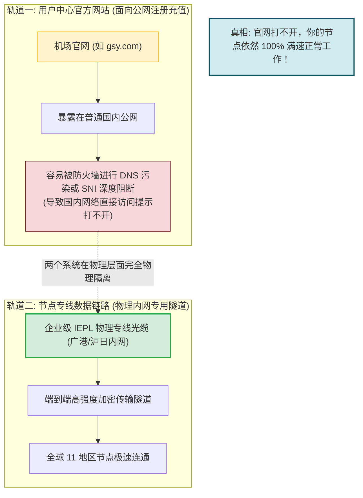
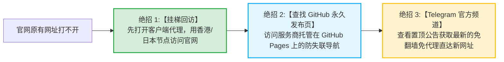
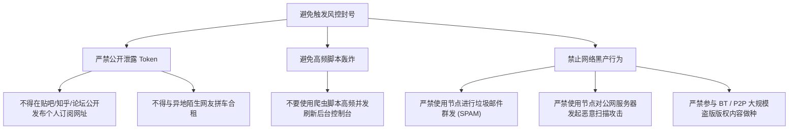

# 账号问题：官网域名被墙打不开、登录异常与密码找回

<div class="answer-first-lead">
  <strong>核心结论与防失联核心认知：</strong>很多新手在使用一段时间后，突然发现机场的登录网址打不开了，往往惊慌失措误以为「老板卷款跑路了」。请牢记网络架构的底层物理真相：<strong>机场的【官方网站 (用户中心)】与【节点专线服务器】在物理上是完全独立的两个隔离系统！</strong> 官网域名由于暴露在国内公网，极易被防火墙针对性实施 DNS 污染或 SNI 阻断，但这完全不代表节点出现断网故障。遇到官网打不开，最简单的解法是：<strong>① 开启客户端代理，直接在翻墙状态下「挂梯访问」官网；② 查看服务商的 GitHub 防失联发布页或官方 Telegram 通知频道获取最新免翻直达域名。</strong>
</div>

<AffiliateNotice />

---

## 一、为什么官网经常打不开？官网与节点的物理双轨隔离架构

要理解域名打不开的现象，首先必须看清正规机场背后的双轨架构设计：



### 1.1 两种不同的阻断机理深度剖析
- **DNS 域名投毒污染 (DNS Poisoning)**：当你在国内宽带直接解析官网域名时，防火墙在旁路伪造了一条错误的 IP（如 `0.0.0.0` 或境外不可达地址）抢先返回给你的电脑；
- **HTTPS SNI 握手阻断 (SNI Reset)**：当你通过 HTTPS 访问时，TLS ClientHello 数据包中明文携带了官网域名（Server Name Indication），防火墙检测到黑名单关键字后立即向两端连续发送 TCP RST 报文暴力拆线；
- **专线节点不受影响的原因**：你日常刷推看视频走的是另外一套**完全内网传输的企业物理专用光缆 (IEPL)**，传输的是高强度加密二进制数据流，绝不走容易被阻断的公网通道。

---

## 二、官网打不开时的三大破局绝招 (防失联指南)

当你需要登录后台续费或查流量，却发现原有的收藏夹网址打不开时，请依次使用以下三大绝招：



### 2.1 绝招 1：用「魔法打败魔法」——开启代理后再访问官网
大多数被封锁的机场官网，仅仅是被中国大陆的防火墙墙掉了。如果你电脑或手机上的客户端原本就能正常翻墙，**只需先打开 Clash 或小火箭连上节点，然后再在浏览器中输入官网地址**，往往瞬间就能顺畅打开！

### 2.2 绝招 2：收藏官方永久 GitHub 防失联发布页
成熟的正规机场通常会在微软旗下的 GitHub 上建立一个公开仓库或博客（例如 `username.github.io`）。由于 GitHub 在国内绝大部分地区均可直接直连，访问该项目主页即可看到官方实时更新的**免翻墙国内直连镜像域名**。

### 2.3 绝招 3：关注官方 Telegram (电报) 广播频道
大型机场（如光速云、WgetCloud）均拥有官方认证的 Telegram 频道。每当国内访问域名遭到污染，系统自动化脚本会在 5 分钟内向频道推送最新的备用直连入口。

---

## 三、登录异常与密码找回实操全攻略

---

### 3.1 忘记登录密码怎么办？
1. 在机场登录页面，点击输入框下方的 **「忘记密码 (Forgot Password)」**；
2. 输入你最初注册时绑定的邮箱地址，点击「发送重置链接」；
3. **查收邮件排坑技巧**：
   - 如果 5 分钟内收件箱没有收到邮件，请务必查看 **「垃圾箱 (Spam / 垃圾邮件)」** 或「订阅邮件」分类，部分邮箱服务商（如 QQ 邮箱、网易 163）容易将此类重置邮件误判为营销邮件；
   - **SPF 与 DKIM 拒信排查**：部分严苛的企业邮箱会因为机场邮件服务器的 SPF 验证不通过直接拒信，建议向客服反馈提供订单截图找回；
4. 点击邮件中的专属重置链接，重新设定包含大小写字母与数字的高强度新密码即可。

---

### 3.2 绑定的两步验证 (TOTP / 2FA / Google 验证码) 丢失怎么办？
为了账户安全，很多进阶用户开启了 Google Authenticator 或 Microsoft Authenticator。但如果手机刷机、丢失导致无法生成 6 位动态验证码：
- **工程级急救方案**：
  1. 使用你最初注册的邮箱，直接向机场官方客服邮箱发送申诉邮件，或者在官网登录页寻找应急工单入口；
  2. 提供你最近一次支付的**支付宝商户订单号或微信支付账单交易号截图**作为核心第一凭证；
  3. 官方管理员核实交易凭据与注册邮箱一致后，会在数据库后台手动为你重置解绑 2FA 验证，让你恢复正常登录。

### 3.3 临时接码邮箱注册的「永久丢号惨案」
许多新手为了所谓的绝对隐私，去注册「10分钟临时临时邮箱」或小众一次性域名注册机场。
- **致命陷阱**：一旦浏览器 Cookie 清理或密码遗忘，由于临时邮箱早已销毁，你将**永远无法接收重置密码邮件**；
- **防丢号守则**：务必使用稳定可长期访问的个人二级邮箱（如 Outlook 或常用 163/Gmail）。

### 3.4 两步验证 (TOTP 2FA) 绑定与恢复码备份规范
为了从根本上杜绝账号被黑客暴力破解或撞库，建议在注册后第一时间开启两步验证：
1. 登录机场后台，点击「个人资料 / 安全设置」；
2. 找到「两步验证 (2FA)」并点击开启，屏幕上会展示一个动态二维码及一串 16 位的**纯文本紧急密钥 (Backup Secret Key)**；
3. **关键动作**：用手机 Authenticator 扫码前，**先将这串 16 位文本密钥手抄在纸质笔记本或离线密码管理器中**；
4. 即使日后手机丢失或换新机，只需在任意新手机的验证器中手动输入该 16 位密钥，即可在 5 秒内恢复 6 位动态验证码，免去繁琐的人工客服申诉流程。

---

## 四、自律防封号准则与会话安全加固

机场为了防范网络灰产黑客盗刷，其自动化风控系统设置了严格的安全规则，请避免以下违规行为：



### 4.1 异常登录与一键吊销所有活动会话 (Session Revocation)
如果你怀疑自己的账号在异地被他人盗用：
1. 登录机场后台「个人中心」→ 找到「安全设置」；
2. 点击 **「重置订阅信息 (Reset Token)」**：所有旧设备中的订阅配置将在 1 秒内彻底失效，他人无法再盗跑你的流量；
3. 点击 **「吊销所有登录会话 (Revoke All Sessions)」**：强制下线所有已登录网页的浏览器，要求重新输入新密码。

### 4.2 登录界面人机验证 (Cloudflare Turnstile) 死锁破解
在登录机场官网时，偶尔会遇到人机验证拼图一直打转、或者提示「Verification Failed」无法提交：
- **诱因**：当前浏览器所处的 IP 欺诈分过高，或者浏览器开启了过激的屏蔽脚本插件（如 uBlock Origin / Privacy Badger）；
- **对策**：在无痕窗口中打开登录页，临时停用去脚本扩展，或者切换为手机移动热点获取干净 IP 即可秒过验证。

---

## 五、客服工单高效提报规范 (附标准排障模板)

当遇到无法自行化解的复杂账号故障时，提交一份高质量的工单能将响应处理时间从几小时缩短到 5 分钟：

```markdown
【工单标题】：[账号申诉] 2FA验证丢失请求解绑 / 充值未到账处理
【注册账号】：your_email@outlook.com
【故障描述】：手机意外刷机导致 Google Authenticator 丢失，现无法登录后台。
【证明材料】：附上最近一次支付宝付款订单截图（包含商户订单流水号：20261020220014...）。
【诉求】：请求管理员在数据库后台核实流水后重置两步验证。
```

### 5.1 密码管理器自动化凭证托管最佳实践
推荐使用开源跨平台的密码管理工具（如 Bitwarden 或 1Password）：
- **自动生成高强度随机密码**：采用 18 位混合大小写、数字与特殊字符的口令；
- **整合 TOTP 动态码**：直接在密码条目中保存 2FA 种子密钥，每次登录时自动填充 6 位动态验证码，既能享受最高安全防护，又无需每次掏出手机找验证器。

---

## 六、标杆服务商的防失联与售后保障体系

服务商的技术底蕴与履约诚意，在防失联体系上体现得淋漓尽致：

| 评估指标 | 劣质小作坊 | [光速云 (GSY)](/reviews/#brand-gsy) 企业级专线 |
| :--- | :--- | :--- |
| **防失联多域名轮询** | 单一域名被墙后立即彻底失联跑路 | **拥有多重智能 Anycast 备用域名池，自动无感跳转** |
| **官方通知矩阵** | 无任何通知渠道，客服长期装死 | **官方 Telegram 频道 + 邮件群发实时同步最新域名** |
| **工单响应时效** | 几天不回工单甚至直接删除账号 | **专业客服团队 7x24 小时工单守候，平均响应 < 15 分钟** |
| **密码与 2FA 申诉** | 无法处理，必须重新买号 | **人工财务凭单对账快速解绑，资产 100% 留存** |

> [!TIP] 选型小结
> 选用 [光速云 (GSY)](/reviews/#brand-gsy)，在结账输入优惠码 `AMM` 享受专属折扣。其后台不仅常年提供防失联直连备用发布页，且支持通过原有节点随时访问用户中心，彻底消除小白对「网址失效跑路」的恐慌。

---

## 七、本章小结与进阶路线

搞定了官网域名访问、密码找回与防封号红线，你的机场账户已经具备了极强的抗风险能力。

但在日常购买与续费过程中，**许多用户有时会遇到支付环节的意外：支付宝扫码后扣了钱，但后台订单却迟迟显示「未支付」！** **钱被扣了怎么办？如何申请工单快速补发？退款政策通常是怎样的？**

**下一篇，我们将进入支付超时、未到账处理与工单退款全流程指南！**

<NextStep
  title="下一篇：支付超时与未到账处理"
  link="/faq/payment-issues"
  description="深度攻克扫码扣款后未到账、重复扣款与工单人工快速补发实战。"
  stepText="常见问题排障主线 · 第 8 站"
  buttonText="阅读支付与未到账排障指南 →"
/>
