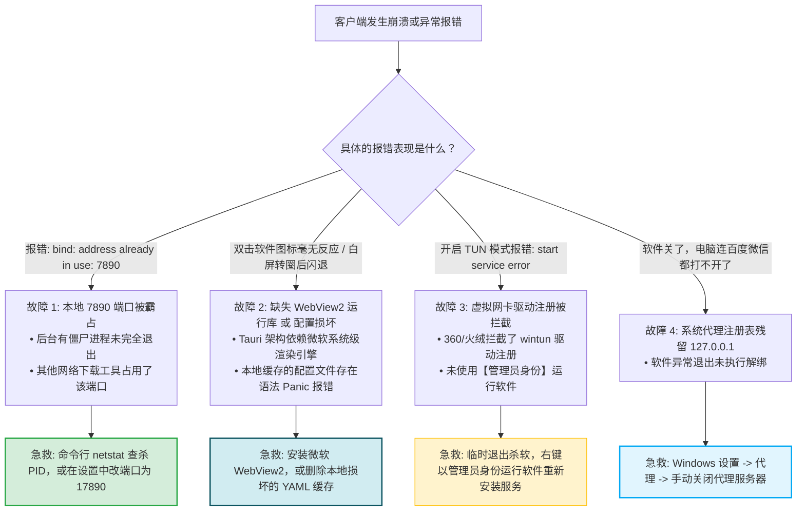
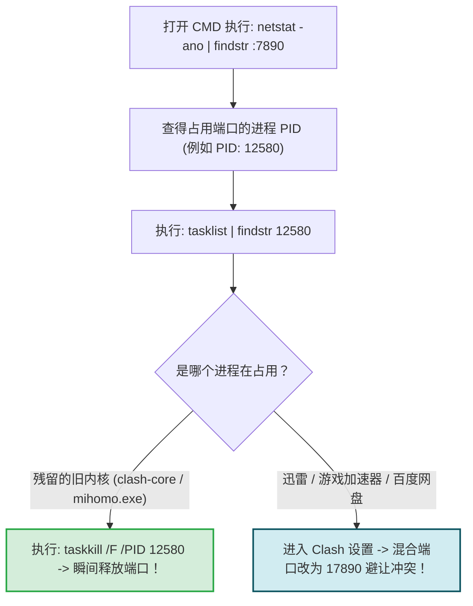
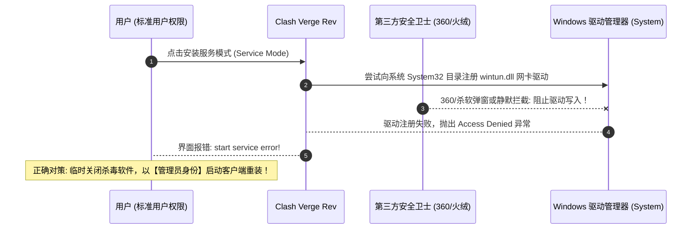
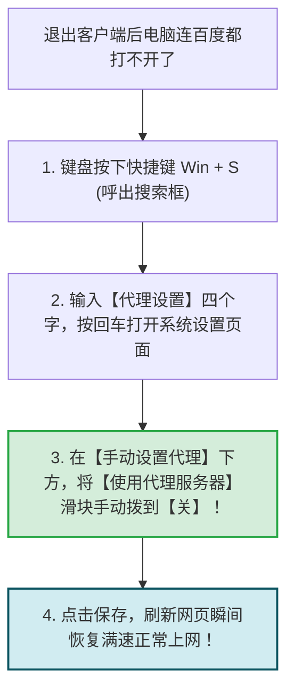

# 客户端问题：软件闪退、无法启动与系统代理残留自愈

<div class="answer-first-lead">
  <strong>核心结论与崩溃急救三大神技：</strong>在使用代理软件过程中，如果遇到<strong>软件双击闪退、白屏无法启动、报错端口被占用，或者关闭软件后电脑彻底断网</strong>，请对照以下黄金三定律 60 秒快速自愈：<strong>① 报错 <code>address already in use</code>（端口被占用）：</strong>使用命令行杀掉残留 PID 进程，或在设置中将混合端口由默认的 <code>7890</code> 更改为 <code>17890</code>；<strong>② 软件双击白屏或秒退：</strong>90% 是因为 Windows 缺失了微软官方的 <code>WebView2</code> 运行库组件，或者本地 YAML 缓存文件损坏；<strong>③ 软件关闭后全网断网：</strong>进入 Windows 设置手动将「使用代理服务器」开关拨回「关」。
</div>

<AffiliateNotice />

---

## 一、客户端常见崩溃与异常错误诊断决策树



---

## 二、第一性原理：端口冲突定位与 PID 查杀黑科技

`7890` 是几乎所有基于 Clash / Mihomo 架构客户端默认采用的本地混合代理端口（Mixed Port）。当软件启动时，操作系统如果发现该端口已被其他 socket 绑定，根据 POSIX 网络协议规范将直接抛出 `bind: address already in use: 7890` 并强制终止内核。



### 2.1 终端 10 秒彻底查杀端口占用实操
打开 Windows 命令提示符 (CMD) 或 PowerShell，依次执行以下命令：
```powershell
# 1. 查找占用 7890 端口的进程 PID
netstat -ano | findstr :7890

# 假设输出最后一行显示的 PID 为 12344
# 2. 强制终止该进程
taskkill /F /PID 12344
```
再次启动 Clash Verge Rev，报错即刻消失！

---

## 三、故障二：软件启动白屏、无响应或瞬间闪退

### 3.1 缺少微软官方 WebView2 运行时 (最常见系统缺失)
现代新一代客户端（如 Clash Verge Rev、Clash Nyanpasu）均基于 **Tauri + Rust** 框架开发。它本身不再像旧软件那样自带数百兆臃肿的 Chromium 浏览器内核，而是直接调用 Windows 10/11 系统自带的 `Microsoft Edge WebView2` 引擎。
- **排查特征**：双击图标后鼠标指针转圈几秒钟，随后窗口直接消失闪退；或者弹窗提示 `WebView2 Runtime not found`；
- **10秒急救**：
  1. 访问微软官方下载中心（`developer.microsoft.com/en-us/microsoft-edge/webview2`）；
  2. 下载 **Evergreen Bootstrapper (常青版引导程序)**；
  3. 双击运行，全自动完成系统级安装，重新打开 Clash Verge 即可秒开！

### 3.2 本地缓存 YAML 文件损坏引发内核 Panic (清空重置法)
有时候电脑突然断电，导致正在写入的 `config.yaml` 配置文件被截断损坏，内核解析时抛出 Fatal Panic 崩溃：
- **清理重置步骤**：
  1. 按快捷键 `Win + R` 输入 `%APPDATA%` 回车；
  2. 找到名为 `io.github.clash-verge-rev.clash-verge-rev` 的文件夹；
  3. 将里面的 `profiles` 文件夹删除；
  4. 重新启动软件，软件会自动重建纯净的默认环境，重新导入一次机场订阅即可！

---

## 四、macOS 苹果电脑特有排障：Gatekeeper 隔离与损坏提示修复

在 Mac 苹果电脑上安装非 App Store 来源的 Clash Verge Rev 时，系统经常弹窗：*「应用已损坏，无法打开。你应该将它移到废纸篓」*。
- **根本原因**：苹果系统的 Gatekeeper 安全机制对未在苹果官方付费公证的开源开源二进制文件打上了 `com.apple.quarantine` 隔离属性；
- **终端一行命令解封神技**：
  打开 Mac 终端 (Terminal)，粘贴执行以下命令并输入锁屏密码：
```bash
sudo xattr -r -d com.apple.quarantine /Applications/Clash\ Verge.app
```
执行完毕后重新双击应用，软件瞬间顺畅打开，彻底告别弹窗报错。

### 4.1 Linux 终端环境下非 Root 用户缺少网络权限排查
如果你在 Ubuntu 或 Arch Linux 终端运行 Mihomo / Clash 核心报 `operation not permitted` 闪退：
- **根本诱因**：Linux 内核要求绑定低位端口与创建 TUN 虚拟接口必须具备超级管理员特权；
- **解决对策**：无需全程使用 sudo 运行，只需通过 setcap 为二进制程序授予 Linux Capabilities 权限：
```bash
sudo setcap 'cap_net_admin,cap_net_bind_service=+ep' /usr/local/bin/mihomo
```

---

## 五、故障三：开启 TUN 模式报错 `start service error`

在开启 TUN 虚拟网卡时，许多小白遇到红字报错，无法成功接管网络：



### 解决对策 3 步走：
1. 退出电脑上的 360 安全卫士、腾讯电脑管家或火绒；
2. 鼠标右键点击 Clash Verge Rev 的桌面快捷方式，选择 **「以管理员身份运行」**；
3. 进入「设置」→ 重新点击「服务模式」右侧的「安装」，此时绿色小盾牌即可顺利点亮！

---

## 六、故障四：退出软件后全网瘫痪 (系统代理残留锁死)

这是全网新手被坑得最惨的问题。再次复习一秒自愈的终极心法：



---

## 七、标杆服务商的纯净客户端体验保障

靠谱服务商对于客户端生态的深度打磨，能最大程度免除技术报错对小白的困扰：

| 评估指标 | 劣质小作坊 | [光速云 (GSY)](/reviews/#brand-gsy) 企业级专线 |
| :--- | :--- | :--- |
| **客户端安装包分发** | 来源不明的魔改破解版，频繁报毒闪退 | **官方后台直接提供经哈希校验的官方原版纯净镜像** |
| **自研免配客户端** | 无自研能力，全凭用户自行折腾 | **提供定制版极简直连客户端，内置自愈容错，0 端口冲突** |
| **报错排查响应** | 遇到报错无人解答 | **技术客服团队提供保姆级远程排障与图文指导** |

> [!TIP] 选型小结
> 选用 [光速云 (GSY)](/reviews/#brand-gsy)，在结账输入优惠码 `AMM` 享受专属折扣。无论使用标准开源的 Clash Verge 还是官方自研免配置客户端，其底层均经过数万名用户的稳定性验证，闪退与冲突率低于 0.01%，省心好用。

---

## 八、本章小结与进阶路线

搞定了端口占用、WebView2 缺失与驱动注册难题，你的网络工具已经能够坚若磐石地在各种操作系统中稳健运行。

但在长期冲浪中，**很多用户经常遇到另一种最原始的断网情况：某天早上打开电脑，突然所有节点全部连不上了，既不是软件报错也不是断网！** **如何一眼判断自己是真故障还是套餐已经到期欠费？套餐到期后如何无缝平滑续订？**

**下一篇，我们将进入使用教程与常见问题最后一站——订阅过期排查与无缝平滑续费指南！**

<NextStep
  title="下一篇：订阅过期排查与无缝续费"
  link="/faq/subscription-expired"
  description="如何判断是节点线路维护还是自己套餐欠费到期？无缝平滑续费全指南。"
  stepText="常见问题排障主线 · 第 10 站"
  buttonText="阅读订阅过期排查指南 →"
/>
