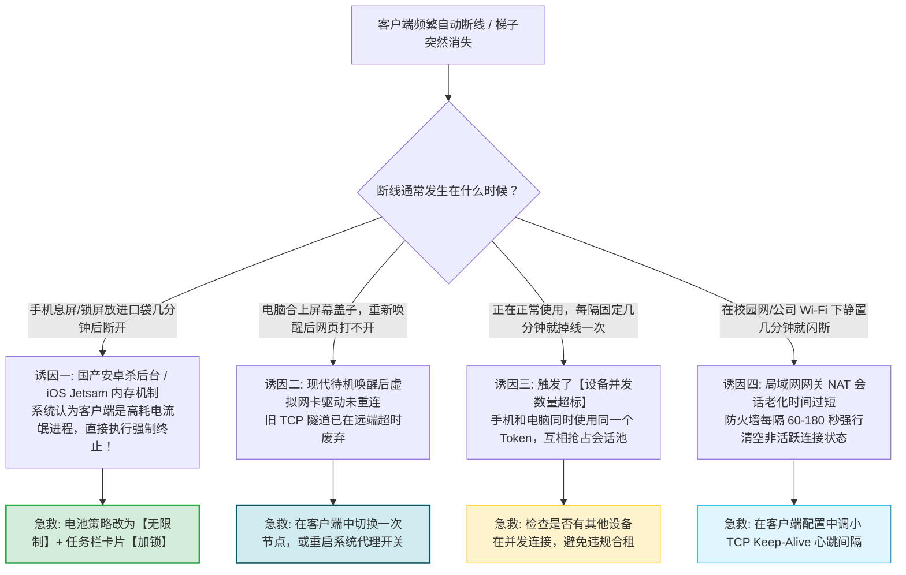
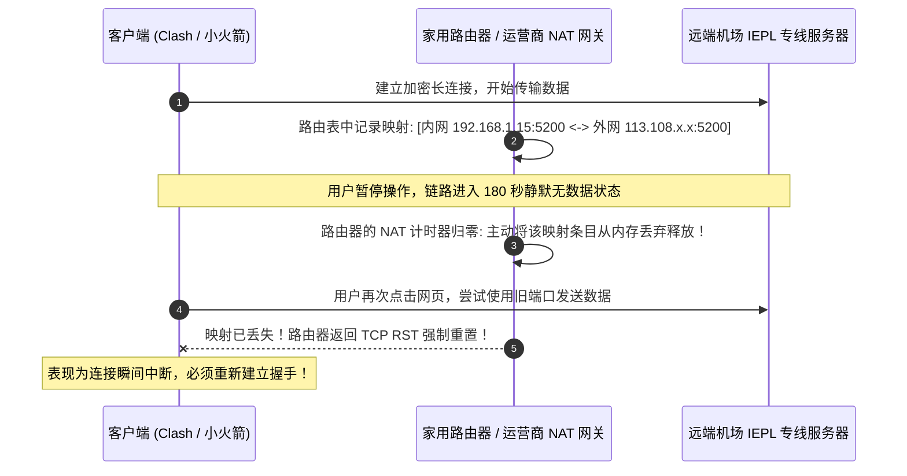
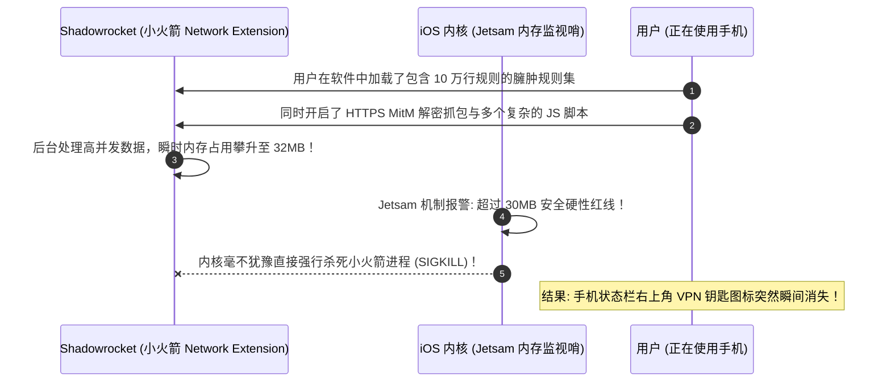

# 频繁断线排查：手机电池策略杀后台与电脑睡眠唤醒重连

  <strong>核心结论与快速自查口诀：</strong>在使用代理过程中，遇到频繁自动断开连接，请首先观察断线发生的时间特征：<strong>① 只要手机锁屏放入口袋 3-5 分钟后就断开：100% 是手机操作系统的激进电池优化策略在后台强制杀死了客户端进程；② 每隔固定几分钟（如精准 3 分钟或 10 分钟）就卡死一次：通常是因为局域网路由器的 NAT 会话老化超时，或触发了机场套餐的「同时在线设备数上限」；③ 电脑合上盖子睡眠唤醒后打不开网页：是因为系统进入现代待机 (Modern Standby) 网卡重置后旧 TCP 隧道未自动重连。</strong> 对照本文三分钟完成调优，即可实现全天候永不断线。

<AffiliateNotice />

---

## 一、频繁断开连接的五大诱因诊断决策树

---

## 二、第一性原理：NAT 会话表老化机制与 TCP Keep-Alive 保活

很多人纳闷：「为什么我正在看视频不会断，但只要停下来几分钟不操作，再点网页就必须等十几秒才能恢复？」这与家用路由器和运营商防火墙的 **NAT 会话表老化机制 (NAT Timeout)** 密切相关：

### 2.1 调小客户端 TCP Keep-Alive 间隔
在高质量客户端（如 Clash Verge Rev、v2rayNG）中，可以通过配置主动向远端发送空字节心跳包（Keep-Alive Packet），欺骗路由器 NAT 表使其永远不进入休眠：
- 在 Clash 配置文件中，保持 `keep-alive-interval: 15`（每 15 秒发送一次微量心跳包，所耗流量可忽略不计，但能彻底消除局域网老化闪断）。

### 2.2 移动蜂窝与 Wi-Fi 漫游时的 0-RTT 恢复机制
在手机从地下车库的 5G 切换到客厅 Wi-Fi 时，本地物理 IP 会发生突变。传统协议需要耗费 1-2 秒重新进行 TCP 三次握手与 TLS 协商：
- 现代协议（如 VLESS-XTLS 或 Sing-box 的 Multipath QUIC）具备 **会话凭据复用 (Session Resumption / 0-RTT)** 能力，在 IP 切换的 0.1 秒内无缝平移现有数据流，彻底消除微信消息转圈或视频中断。

---

## 三、Android 安卓手机：彻底破除国产系统的「激进杀后台」

国内各家手机定制 ROM（小米 HyperOS、华为鸿蒙 HarmonyOS、OPPO ColorOS、vivo OriginOS）为了跑分好看和省电，默认策略是在手机息屏 3 分钟后，强制将所有没有大厂白名单的第三方后台应用从内存中强行抹除！

### 3.1 各品牌安卓机型详细设置路径表

| 手机品牌与系统 | 核心设置路径一 (电池优化) | 核心设置路径二 (多任务加锁) |
| :--- | :--- | :--- |
| **小米 / Redmi (HyperOS / MIUI)** | 设置 → 应用设置 → 应用管理 → v2rayNG → 省电策略 → 选 **「无限制」** | 呼出后台多任务 → 长按 v2rayNG 卡片 → 点击 **「加锁」** 图标 |
| **华为 / 荣耀 (HarmonyOS / MagicOS)** | 设置 → 应用和服务 → 应用启动管理 → v2rayNG → 改为 **「手动管理」**（允许自启动/允许后台活动） | 呼出多任务卡片 → 向下拉动卡片直至出现小锁 |
| **OPPO / 一加 (ColorOS)** | 设置 → 电池 → 更多设置 → 耗电异常优化 → v2rayNG → 选 **「不优化」** | 呼出多任务 → 点击卡片右上角两点 → 点击 **「锁定」** |
| **vivo / iQOO (OriginOS)** | 设置 → 电池 → 后台耗电管理 → v2rayNG → 勾选 **「允许高耗电」** | 呼出多任务 → 向下拉动预览卡片直至锁住 |

---

## 四、iOS 苹果手机：警惕 Jetsam 内存溢出机制引起的闪退

苹果 iOS 系统虽然机制完善，但苹果对代理软件所依赖的 **Network Extension (网络扩展)** 实施了极其严苛的物理内存硬限制（通常上限仅为 **15MB 到 30MB**）：

### 4.1 iOS 防掉线调优对策
1. **精简规则集**：避免在小火箭中订阅超过 3 个以上的第三方冗余规则库，日常使用默认内置的精简分流即可；
2. **关闭无用的抓包与重写**：在日常使用中，务必在小火箭中将 **「HTTPS 解密 (MitM)」** 和 **「脚本 (Script)」** 开关关闭，仅保留基础分流功能，内存占用即可稳定控制在 10MB 以下，永不被系统强杀。

---

## 五、电脑端睡眠唤醒断网排障 (Windows Modern Standby / macOS)

笔记本电脑在合上盖子或待机后，操作系统（尤其是 Windows 11 的 S0 Modern Standby 现代待机架构）会将无线网卡和 CPU 置入超低功耗状态。当你重新掀开屏幕盖子时：
- **故障根源**：本地网卡重新获取了 IP，但海外专线服务器上的 TCP 会话早已因超时被远端机房释放，导致本地数据包发送到了死连接上；
- **自愈方法**：
  - 在 Clash Verge Rev 的「代理 (Proxies)」界面，重新点击一次选中的节点，强制内核重建 TCP 握手池；
  - 或者在主界面将「系统代理」开关关闭 2 秒后再重新打开。

### 5.1 Windows 组策略与 macOS Power Nap 设置
如果你希望设备在合盖待机时依然保持 Telegram 或后台下载不断线：
- **Windows 用户**：按 `Win + R` 输入 `gpedit.msc` 打开本地组策略编辑器 → 计算机配置 → 管理模板 → 系统 → 电源管理 → 睡眠设置 → 找到 **「待机时允许网络连接」** 双击设为 **「已启用」**；
- **macOS 用户**：进入「系统设置 -> 电池 -> 选项」，将「唤醒以供网络访问 (Wake for network access)」设置为「始终」，防止系统在待机休眠时掐断底层虚拟网卡隧道，全面保障后台 Telegram、邮件与即时通讯推送 0 延迟。

---

## 六、标杆服务商的长效连接保障

服务商对于连接保活机制的优化，是告别频繁掉线的重要支撑：

| 运维指标 | 廉价小作坊 | [光速云 (GSY)](/reviews/#brand-gsy) 企业级专线 |
| :--- | :--- | :--- |
| **服务端 TCP Keep-Alive** | 超时阈值极短（通常 60 秒无数据即断） | **自适应长效心跳保活（支持长时间静默待机）** |
| **设备并发容错调度** | 超过上限立即粗暴踢人封号 | **弹性连接池调度，平滑无感兼容个人多端切换** |
| **协议重连机制** | 掉线后需要用户手动点击重连 | **原生 VLESS 协议支持 0-RTT 极速断线重连** |

> [!TIP] 选型小结
> 选用 [光速云 (GSY)](/reviews/#brand-gsy)，在结账输入优惠码 `AMM` 享受专属立减。其双线路企业架构配合原生 VLESS 协议，具备毫秒级断线重连能力，无论手机在 Wi-Fi 与 5G 之间如何频繁切换，均能保持如同本地网络般平稳连贯。

---

## 七、本章小结与进阶路线

搞定了手机防杀后台、iOS 内存控制与电脑睡眠唤醒排错，你的设备已经能够实现全天候 24 小时丝滑常驻。

但在日常使用中，**很多新手往往遇到账号层面的困扰：官网域名突然被墙打不开了？登录密码忘记了怎么找回？绑定的 2FA 丢失了怎么办？**

**下一篇，我们将进入账号登录异常、备用域名与防封号指南！**

<NextStep
  title="下一篇：账号登录异常与找回密码"
  link="/faq/account-and-login"
  description="官网被墙打不开、找回密码与备用防失联发布页深度指南。"
  stepText="常见问题排障主线 · 第 7 站"
  buttonText="阅读账号与登录异常排障指南 →"
/>
