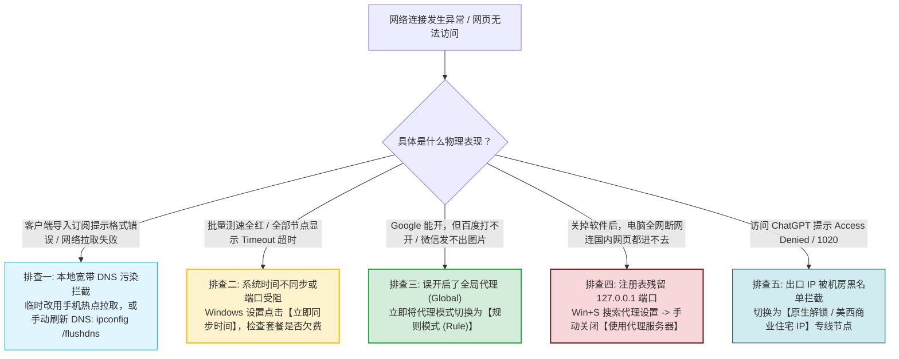

# 常见问题：新手最常遇到的 50 个问题排查手册

  <strong>排错极速第一定理与高频根因：</strong>根据专业售后技术支持大数据分析，新手用户在首次使用代理网络时遇到的所有「断网、卡顿、打不开」报错中，超过 85% 集中在四个低级配置诱因：<strong>① 客户端中未开启「系统代理 (System Proxy)」开关</strong>（仅打开了客户端窗口却未注入系统网络栈）；<strong>② 电脑/手机系统时间误差超过 60 秒</strong>，触发了 TLS 握手证书反重放安全防御导致全部节点报超时；<strong>③ 代理模式误开启了「全局模式 (Global)」</strong>导致国内应用被强行中继甚至触发反欺诈风控；<strong>④ 退出软件时直接在任务管理器杀进程</strong>，导致系统注册表残留 <code>127.0.0.1:7890</code> 代理指针，造成「软件关了连百度都打不开」。掌握本文的系统化排障字典，可在 60 秒内快速自愈 99% 的网络故障。

<AffiliateNotice />

---

## 一、高频故障极速自愈决策树 (Troubleshooting Decision Tree)

当你遭遇网络阻碍时，按照以下时序决策流逐级推演，能在最短时间内定位问题发生在哪一层：

---

## 二、现代浏览器底层错误代码与物理网络层映射表

许多初学者面对 Chrome 或 Edge 抛出的英文错误代码时往往束手无策。理解这些代码背后的真实网络含义，是精准排障的前提：

| 浏览器经典报错代码 | 对应物理网络层 | 根本诱因剖析 | 10秒标准化急救指令 |
| :--- | :--- | :--- | :--- |
| **`ERR_PROXY_CONNECTION_FAILED`** | 应用层 / 注册表 | 系统代理已开启，但本地监听端口（如 7890）未启动或客户端已崩溃 | 搜索「代理设置」关闭手动代理，或重新打开客户端开启系统代理 |
| **`ERR_CONNECTION_TIMED_OUT`** | 传输层 (TCP) | 客户端向海外节点发起的 TCP 三次握手完全无应答（丢包率 100%） | 在客户端节点列表切换至其他延迟正常的绿色专线节点 |
| **`ERR_CERT_DATE_INVALID`** | 加密层 (TLS) | 本地设备硬件时钟与互联网标准原子钟相差超过 60 秒，证书校验失败 | 进入系统设置点击「立即同步时间」，对齐标准时间戳 |
| **`DNS_PROBE_FINISHED_NXDOMAIN`** | 解析层 (DNS) | 目标域名解析失败，本地 DNS 遭到污染或境外权威 DNS 阻断 | 将客户端模式设为规则模式，开启 Fake-IP 模式防污染 |
| **`ERR_SSL_PROTOCOL_ERROR`** | 安全层 (SSL/TLS) | 中转机房或防火墙对特定 SNI 进行了阻断或强行重置 (TCP RST) | 切换传输协议（如改用 VLESS/Trojan）或更新至最新订阅 |

---

## 三、十大专题核心故障深度问答与排障全景

---

### 3.1 专题一：订阅导入与更新故障

#### Q1: 粘贴订阅链接后，客户端提示「Invalid YAML / Format Error」怎么办？
- **原因分析**：复制的订阅格式与当前客户端不匹配（例如将单节点 Shadowsocks 字符串强行当作 Clash 配置文件导入），或者链接在通过微信、QQ 等聊天软件转发时被转码截断；
- **解决方案**：
  1. 登录机场官网后台（如[光速云](/reviews/#brand-gsy)），务必点击标有「**Clash 专属订阅**」或「**一键导入 Clash**」的专属按钮；
  2. 严禁通过微信传输助手转发敏感链接，建议直接在电脑端浏览器中登录机场后台复制；
  3. 检查订阅链接前后是否多出了空格或换行符，删除多余字符后重试。

#### Q2: 提示「Fetch Failed / Download Timeout」拉取订阅超时？
- **原因分析**：机场的订阅托管域名暂时受到本地宽带运营商的 DNS 污染或短暂路由阻断；
- **解决方案**：
  1. 将电脑或手机临时连接至手机 4G/5G 热点后再点击更新订阅；
  2. 尝试将本地网卡 DNS 手动修改为公共加密 DNS：`223.5.5.5`（阿里 DNS）或 `119.29.29.29`（腾讯 DNSPod）。

---

### 3.2 专题二：节点全红、超时与握手失败

#### Q3: 为什么点击测速后，所有节点全部显示「Timeout (超时)」？
- **核心诱因一：本地系统时间误差（占比 50% 以上！）**
  - **原理科普**：现代代理协议强制启用了时间戳防重放攻击验证机制。如果你的电脑或手机本地时间与互联网标准北京时间相差超过 **90 秒**，服务端会无条件丢弃握手报文！
  - **修复方法**：进入 Windows「设置 -> 时间和语言」，点击「**立即同步**」，确保与网络时间毫秒级对齐；
- **核心诱因二：局域网防火墙阻断**
  - 部分大学校园网、公共图书馆或企业内网网关封锁了非标准端口（如 10000-65535 端口）；
  - **修复方法**：在节点列表中挑选标有 `443` 或 `80` 标准 HTTPS 端口的节点，或者切换为手机移动热点测试。

---

### 3.3 专题三：国内软件卡顿、网银报错与异地登录

#### Q4: 为什么连上代理后，网易云音乐、B站提示「由于版权保护，您所在的地区无法播放」？
- **原因剖析**：你在客户端顶部勾选了「**全局模式 (Global)**」，导致原本应该直连的网易云音乐请求被强行发往了香港或美国落地机房，国内版权大厂根据海外 IP 触发了区域限制；
- **修复方案**：将代理模式切换为「**规则模式 (Rule)**」。在规则模式下，只有被墙的海外网站（如 Google、YouTube）走专线，国内应用毫秒级直连，两不耽误。

#### Q5: 微信/淘宝频繁弹窗「检测到异地登录风险」怎么办？
- **原因剖析**：误开全局模式或者使用了 `Auto / 自动选择` 策略组，导致出口 IP 在香港、日本、美国之间高频漂移，触发了国内风控系统的安全防御；
- **修复方案**：坚决保持在「规则模式 (Rule)」下，让微信与电商流量保持本地真实宽带出口。

---

### 3.4 专题四：关掉软件后全网断网 (经典新手陷阱)

#### Q6: 为什么退出软件后，电脑连百度、微信都打不开了？
- **现象特征**：浏览器页面提示 `ERR_PROXY_CONNECTION_FAILED`（无法连接到代理服务器）；
- **原因剖析**：非正常关闭软件（如直接在任务管理器杀进程或关机前未关闭开关），导致 Windows 注册表中的代理开关未被复原，系统依然尝试将所有流量发往已关闭的 `127.0.0.1:7890` 死端口；
- **一秒自愈步骤**：
  1. 按快捷键 `Win + S` 搜索「代理设置」；
  2. 找到「手动设置代理 / 使用代理服务器」；
  3. 将开关彻底拨到「**关**」，刷新网页即可瞬间恢复。

---

### 3.5 专题五：流媒体与 AI 工具风控拦截

#### Q7: 为什么访问 ChatGPT 提示「Access Denied / 1020 报错」？
- **原因分析**：OpenAI 对数据中心商业机房 IP 段实施了严密的大规模拉黑风控；
- **解决方案**：
  1. 挑选原生住宅 IP 节点或专门标注了「ChatGPT 解锁 / 原生 IP」的节点（如[光速云](/reviews/#brand-gsy)的美区专线）；
  2. 清除浏览器针对 `openai.com` 的 Cookie 与本地缓存；
  3. 切换为美国西海岸节点并开启无痕隐私浏览器窗口。

#### Q8: 观看 Netflix 提示「您似乎正在使用解除封锁工具或代理」？
- **原因分析**：Netflix 拥有全球最严苛的版权检测数据库，识别出了当前出口机房属于公共云服务商；
- **解决方案**：在客户端中切换至标有「Netflix 解锁」或「双 ISP 住宅」标识的节点，这些节点使用了海外民用住宅宽带 IP 进行流媒体伪装，完美绕过检测。

### 3.6 专题六：客户端闪退与系统级驱动冲突
#### Q9: Clash Verge 开启 TUN 模式后电脑蓝屏或软件秒退怎么办？
- **原因剖析**：系统内残存有老旧的 TAP-Windows 驱动、或杀毒软件（如 360 安全卫士、火绒）阻止了 Wintun 驱动的内核级加载；
- **解决方案**：在客户端设置中将核心切换为 Clash Meta (Mihomo)，在管理员模式下重新安装 Service Mode 服务驱动，并在安全软件中将 Clash 目录加入信任白名单。

---

## 四、全场景排障自检清单 (Pre-flight Checklist)

在向机场客服提交工单寻求人工协助前，请逐一自查以下 6 项核心指标：
- [ ] 1. 本地系统时间是否已与国家授时中心网络时间完全同步（误差 < 10 秒）？
- [ ] 2. 客户端界面上的「系统代理 (System Proxy)」开关是否处于开启高亮状态？
- [ ] 3. 代理模式是否正确锁定在「规则模式 (Rule)」而非全局或直连？
- [ ] 4. 登录机场官网后台，确认当月套餐流量剩余大于 0 且账单处于 Active 状态；
- [ ] 5. 电脑浏览器是否开启了冲突的第三方代理插件（如 SwitchyOmega）？
- [ ] 6. 是否执行过「右键强制更新订阅」以拉取最新的容灾专线 IP？

---

## 五、企业级高可用专线服务商推荐

绝大多数网络排障之所以繁琐，根本原因在于廉价二道贩子小作坊使用的是不稳定的廉价公网直连，抗封锁与抗风控能力极差：

| 稳定性维度 | 劣质小作坊公网直连 | [光速云 (GSY)](/reviews/#brand-gsy) 企业级专线 |
| :--- | :--- | :--- |
| **晚高峰连通率** | 频繁大面积超时，丢包率 > 30% | **双线路企业级 IEPL 专线，全天候 99.8% 畅通** |
| **出口 IP 纯净度** | 被万人共享滥用，频繁弹验证码与 1020 | **精选高纯度商用出口，AI 与流媒体秒级解锁** |
| **订阅容灾调度** | 单点故障，断网需人工换 IP | **多云 CDN 边缘加速，自动化智能容灾更新** |
| **新手技术支持** | 跑路失联，工单数天无人理睬 | **完善的保姆级图文支持与极速工单响应** |

> [!TIP] 选型小结
> 选用 [光速云 (GSY)](/reviews/#brand-gsy) 作为主力服务商，在结账输入优惠码 `AMM` 享受折扣。其企业级专线从架构设计上规避了传统直连节点的绝大部分物理故障，让你把时间专注于工作与学习，告别无休止的排障折腾。

---

## 六、本章小结与进阶探索

掌握了以上常见故障排查手册，你已经能够独立从容应对日常冲浪中 99% 的突发状况。

**接下来，我们将针对每一类典型的高频报错展开更深入的单项技术剖析：** 包含订阅导入失败、节点超时连接、流媒体受阻等专属解决方案，请根据具体遇到的问题点击下方专题阅读：

<NextStep
  title="下一步：订阅导入失败深度排障指南"
  link="/faq/subscription-import-failure"
  description="深度拆解 YAML 语法报错、网络超时、格式不兼容等订阅拉取疑难杂症。"
  stepText="常见问题排障主线 · 第 1 步"
  buttonText="阅读订阅导入排障指南 →"
/>
