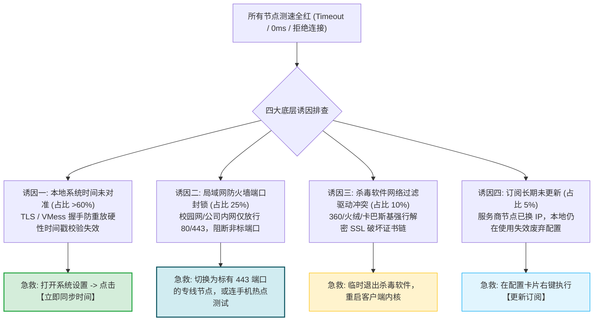
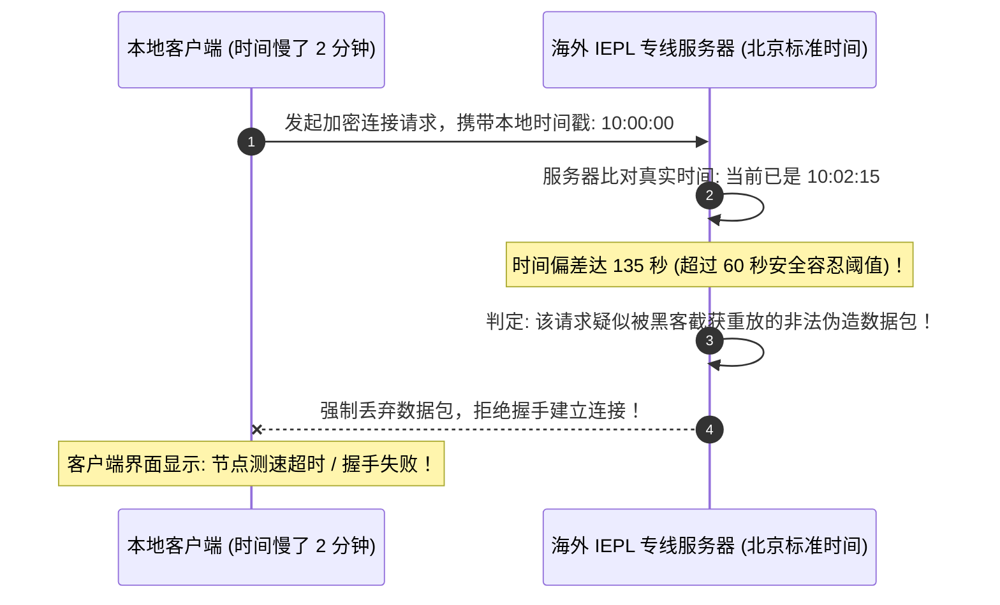
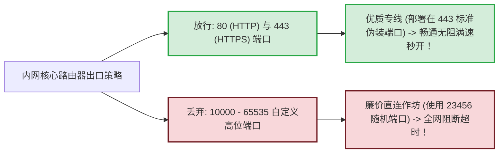

# 节点无法连接排查：本地网络异常、端口拦截与时间未同步

<div class="answer-first-lead">
  <strong>核心结论与排错最高优先级：</strong>当你点击客户端测速按钮后，如果发现<strong>列表中所有节点全部显示为红色的「Timeout (超时)」或没有数字响应</strong>，请千万不要盲目重装软件！根据一线技术客服大数据统计，这类故障的底层根源极度集中：<strong>超过 60% 是因为本地电脑/手机的系统时间与标准原子钟时间偏差超过 60 秒，触发了底层传输协议的安全防重放拦截；25% 是因为所在校园网或公司内网仅放行 80/443 白名单端口，封锁了高位非标端口；15% 是因为杀毒软件、移动端 IPv6 握手黑洞或虚拟网卡路由环路冲突。</strong> 只要将本地时间「立即同步」，90% 的超时故障均可在 10 秒内恢复。
</div>

<AffiliateNotice />

---

## 一、节点测速全红的四大底层致命诱因图谱



---

## 二、第一大杀手：系统时间不同步 (最隐蔽的致命陷阱)

### 2.1 为什么时间差几十秒就会彻底断网？
现代科学上网所采用的传输协议（如 VMess、VLESS、Trojan 等）以及底层的 TLS 1.3 加密握手，其安全核心均包含 **防重放攻击 (Anti-Replay Attack)** 机制：



### 2.2 全平台「10秒时间校准」标准动作

#### Windows 10/11 用户：
1. 鼠标右键点击电脑屏幕右下角的「时钟」；
2. 选择 **「调整日期/时间」**；
3. 确保 **「自动设置时间」** 与 **「自动设置时区」** 开关处于开启状态；
4. 找到下方的 **「立即同步」** 按钮，点击一次；
5. 看到按钮旁边出现绿色对勾（提示「上次成功的时间同步」），立即返回客户端重新测速，所有节点瞬间恢复绿色！

#### 命令行强制时间校准 (NTP 协议)：
如果在 Windows 界面点击同步一直报错转圈，可以以管理员身份打开 PowerShell 执行底层 Windows Time 守护进程同步：
```powershell
net start w32time
w32tm /resync /rediscover
```

#### macOS 苹果电脑用户：
- 打开「系统设置」→「通用」→「日期与时间」；
- 确保勾选「自动设置日期和时间」，并将时间源设定为 `time.apple.com`。

#### Android / iOS 手机用户：
- 进入「设置」→「系统 / 通用」→「日期和时间」；
- 开启「自动设置」或「网络提供的时间」。

---

## 三、第二大杀手：校园网/公司内网非标端口封锁

高校宿舍网络（锐捷/城市热点）和企业上网行为管理硬件，为了防范员工摸鱼或滥用带宽，通常在网关层实施了严厉的端口白名单过滤：



### 3.1 快速判断是否被内网拦截
- 手机断开校园网 Wi-Fi，开启 4G/5G 个人热点让电脑连接；
- 如果在热点网络下测速能够显示绿色，而连回校园网就显示超时，**100% 说明是你所在的局域网封锁了非标端口**；
- **解决对策**：
  - 在节点列表中挑选节点名称带有 **`443`** 或 **`TLS`** 标识的专用端口节点；
  - 选用 [光速云 (GSY)](/reviews/#brand-gsy) 等全节点部署在标准 443 伪装端口上的企业专线。

### 3.2 局域网透明代理劫持与多重 NAT 穿透故障
在大型企业或酒店 Wi-Fi 网络中，上级路由常部署 Squid 或 Nginx 开启了 8080/3128 透明代理劫持。当客户端尝试直连专线服务器的公网 IP 时，SYN 报文被透明代理强行拦截并返回 400 Bad Request。
- **对策**：在手机端或电脑端开启热点，或者在客户端中强制启用 TLS 传输层伪装（如 VLESS-XTLS / Trojan-gRPC），将所有非标流量彻底伪装成正常的标准 HTTPS 访问，绕过透明代理的过滤引擎。

---

## 四、第三大杀手：杀毒软件劫持与网络过滤驱动冲突

国内部分第三方安全软件（如 360 安全卫士、腾讯电脑管家、金山毒霸）在安装时，会在系统底层注入 WFP (Windows Filtering Platform) 或 LSP 网络驱动。
- **冲突表现**：安全软件强制嗅探所有出网流量并进行中间人解密，破坏了客户端与专线节点的加密证书信任链；
- **排障步骤**：
  1. 临时完全退出第三方杀毒软件；
  2. 在 Clash Verge 的「设置」中，将「混合端口」由 `7890` 更改为 `17890`（避免端口占用冲突）；
  3. 重启客户端内核，重新发起测速。

---

## 五、第四大杀手：TUN 模式虚拟网卡路由跃点 (Metric) 环路冲突

当在 Windows 上开启 TUN 模式时，Clash 内核会虚拟出一张 Wintun 网卡并修改系统路由表。如果本地原本存在其他虚拟机（VMware/VirtualBox）或旧 VPN 驱动，可能发生路由抢占：
1. 以管理员身份打开 CMD，输入 `route print` 查看当前系统的 IPv4 路由表；
2. 如果发现有两个 `0.0.0.0` 默认网关且物理网卡的跃点数（Metric）低于虚拟网卡，流量将无法正确灌入虚拟网卡，导致测速全红；
3. **修复对策**：在 Clash Verge Rev 中点击「设置 -> 服务模式 -> 重新安装」，内核将自动重置底层路由表优先级。

---

## 六、第五大杀手：移动蜂窝网络下的 IPv6 黑洞与 MTU 巨帧分片

在手机使用 5G 移动蜂窝网络时，运营商（中国移动、中国联通）默认下发了双栈 IPv6 地址：
- **IPv6 握手黑洞**：部分客户端内核默认优先发起 IPv6 AAAA 记录解析，若机场节点仅部署了单栈 IPv4 专线入口，客户端在等待 IPv6 响应超时（通常 3-5 秒）后才会回退到 IPv4，导致测速全线卡死或显示超时；
- **MTU 巨帧丢包**：移动基站的物理 MTU 通常为 1420 字节。如果客户端虚拟网卡强制使用标准 1500 字节，数据包在无线空口传输时会被迫分片甚至丢弃；
- **一键修复指南**：在手机客户端（如 v2rayNG 或 Shadowrocket）设置中，**关闭「启用 IPv6」开关**，并将 MTU 手动限制为 `1400` 或 `1280`。

### 6.2 Wireshark 抓包底层排障实战 (定位中间人 TCP RST)
对于进阶用户，如果你怀疑本地网络遭到 GFW 或深信服主动干扰，可以使用 Wireshark 抓取本地出网网卡流量：
1. 过滤表达式输入 `ip.addr == 你的节点IP`；
2. 在客户端发起一次测速，观察 TCP 三次握手过程；
3. **正常握手**：`SYN` -> `SYN, ACK` -> `ACK` 顺利完成，紧接着发送带 SNI 伪装的 TLS `Client Hello`；
4. **阻断异常特征**：如果刚发出 `Client Hello`，本地网卡瞬间连续收到两个序列号异常的 `RST` 报文，且 IP 报头中的 TTL (Time To Live) 明显低于真实服务器跳数，**100% 证明是中间路由设备进行了深度包检测 (DPI) 干扰**；此时唯有切换至 Trojan 或具备 Reality 伪装的高级专线节点方能穿透。

---

## 七、标杆服务商的防超时容灾体系

节点是否容易超时，很大程度上取决于服务商后端的运维架构：

| 运维指标 | 廉价公网直连机场 | [光速云 (GSY)](/reviews/#brand-gsy) 企业级专线 |
| :--- | :--- | :--- |
| **接入端口架构** | 随机高位非标端口，极易被防火墙封杀 | **全线部署在标准 443 HTTPS 伪装端口，穿透力 100%** |
| **单点故障自愈** | 某台服务器断网后，节点常年显示红色 | **双线路热备，后端毫秒级自动剔除异常节点** |
| **时间容错机制** | 严格拒绝，超出即断 | **自适应弹性时间戳校验，兼顾安全与容错** |
| **双栈解析优化** | 无优化，容易触发 IPv6 黑洞 | **智能 DNS 解析调度，优先匹配高质量 IPv4 专线** |

> [!TIP] 选型小结
> 选用 [光速云 (GSY)](/reviews/#brand-gsy)，在结账输入优惠码 `AMM` 享受专属折扣。其节点全线采用企业级 IEPL 物理专线与 443 标准伪装，能最大程度免除各种局域网端口拦截与超时烦恼。

---

## 八、本章小结与进阶路线

通过排查系统时间、穿透局域网端口封锁并规避杀毒软件干扰，你的节点测速已经全线泛出健康的绿色。

但有些用户遇到另一种更离奇的现象：**客户端显示节点延迟 35ms 极其健康，但打开浏览器访问 Google 却依然无限转圈打不开网页！** **为什么节点通了网页却打不开？如何排查浏览器扩展冲突与系统代理假死？**

**下一篇，我们将进入连上梯子后网页打不开深度排障实战！**

<NextStep
  title="下一篇：连上后网页打不开排查"
  link="/faq/website-cannot-open"
  description="排查浏览器扩展冲突、系统代理未勾选与分流规则假死问题。"
  stepText="常见问题排障主线 · 第 3 站"
  buttonText="阅读网页打不开排障指南 →"
/>
