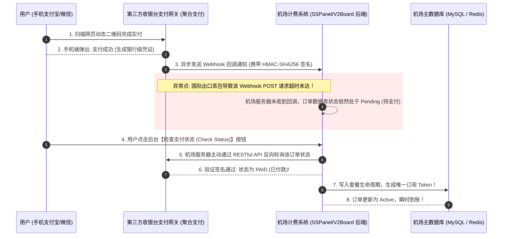
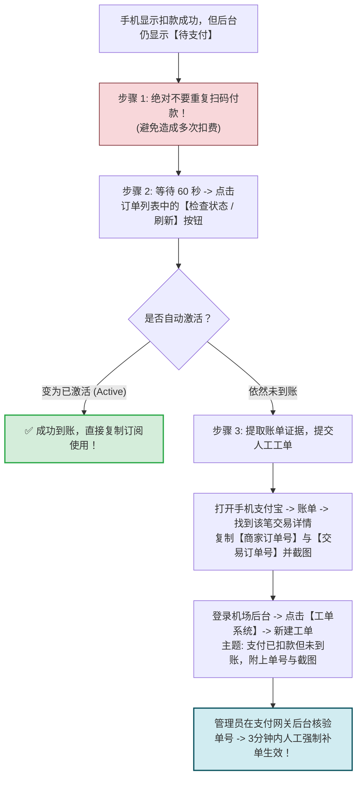
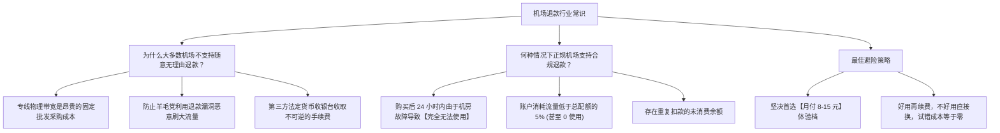

# 支付问题：支付宝微信扫码超时、未到账处理与工单退款

<div class="answer-first-lead">
  <strong>核心结论与资金安全定心丸：</strong>在机场官网进行支付宝或微信充值时，最令人恐慌的问题莫过于<strong>「手机上明明扣了款，但网页订单却一直停留在『未支付』状态」</strong>。请牢记底层真相：<strong>只要你的银行卡或支付宝产生了真实扣款流水，钱绝不会凭空蒸发！</strong> 这类故障 95% 是因为第三方支付收银台向机场服务器发送的<strong>异步回调通知 (Webhook) 遭遇了国际网络抖动或丢包</strong>。标准自愈姿势是：<strong>切勿盲目重复扫码！在后台订单页点击一次「检查支付状态」，若仍未到账，携带支付宝账单中的「商家订单号」提交工单，客服核实后 100% 会为你人工补发激活。</strong>
</div>

<AffiliateNotice />

---

## 一、第一性原理：支付扣款到账底层技术链路大揭秘

要解决未到账问题，首先看清你的资金流与数据信令是如何跨系统异步流转的：



### 1.1 Webhook 异步回调与签名校验 (HMAC Signature)
正规计费系统（如 V2Board 或 SSPanel-Uim）在接收第三方支付通知时，会对请求体中的商户 ID、订单金额和时间戳进行哈希散列签名计算：
- **幂等性保障 (Idempotency)**：即使支付网关由于网络重试连续发送了 3 次成功通知，系统依据唯一的交易流水号（Out Trade No）仅会执行一次入账，绝对不会导致配额发生错误叠加；
- **网络重试机制**：大部分支付网关具备指数退避重试能力（例如 5 秒、15 秒、1 分钟、5 分钟后再次推送），因此扫码后往往只需耐心等待 1-2 分钟即可自动入账。

---

## 二、扫码扣款后「未到账」标准 3 步自愈流水线

当遇到手机扣款成功但网页没有反应时，请严格按以下步骤操作：



### 2.1 提取核心排错证据 (非常关键)
向客服反馈时，不要只发一句苍白的「我付钱了怎么没到账」。请打开手机支付宝，点击「我的」→「账单」→ 找到刚才那笔扣款记录，复制以下两个核心参数：
- **商家订单号 (Out Trade No)**：这是机场计费系统与支付网关对接的唯一凭据（通常是一串英文字母加数字）；
- **扣款时间与金额**：精确到具体分秒与实付金额；
- **账单截图**：截取包含上述信息的完整账单页面。

### 2.2 未到账客服工单标准提报模板 (复制即用)
为了让客服在 3 分钟内为你手动补发入账，建议按照以下结构提交工单：
```markdown
【工单主题】：[财务核验] 支付宝扫码扣款成功但订单未激活
【账号邮箱】：your_account@domain.com
【下单时间】：2026-10-20 18:35:20
【购买套餐】：轻量入门月付版 (实付 8.00 元)
【商家订单号】：20261020220014589230148
【支付宝交易号】：20261020220014123456789
【状态说明】：手机已提示扣款成功，但在用户中心订单仍显示「待支付」，手动点击刷新未生效，附件已上传扣款明细截图，烦请技术人员核实补发。
```

### 2.3 待审核期间的临时网络应急自救
如果遭遇半夜充值未到账且急需查询学术文献或外贸交单：
- **切勿焦虑**：正规机场通常在「商店」中提供 0 元或 1 元的「临时应急试用包」；
- 亦可参考本站的[《免费试用机场指南》](/free/trial-airports)，先领取 2-5GB 应急试用配额维持基本通讯，待白天财务客服上班后即可无缝对接已购套餐。

---

## 三、支付风控报警与二维码过期排障

在扫码过程中，很多新手常会遭遇支付 App 的安全弹窗：

### 3.1 支付宝提示「防欺诈风险提醒 / 交易已被拦截」
- **诱因**：由于聚合支付通道在短时间内处理了大量异地跨省的小额转账，触发了支付宝或微信的反洗钱与防电信诈骗大数据风控；
- **对策**：
  1. 在收银台页面刷新更换另一种支付通道（例如改选微信扫码或备用的支付宝通道 B）；
  2. 尝试使用支付宝绑定的余额宝或储蓄卡支付，避开容易触发风控的信用卡通道。

### 3.2 二维码过期后扫码了怎么办？
收银台二维码通常设置了严格的 **5 分钟有效期**。如果你在倒计时归零后才扫码付款：
- 支付网关系统可能已经将该订单标记为「超时关闭 (Expired)」；
- 此时资金已到达网关商户账户，但系统不会自动回调机场数据库；
- **解决对策**：携带该笔扣款的「商家订单号」，直接在机场后台发起工单，客服管理员可在管理后台通过对账手工为你的账户充值等额余额。

### 3.3 USDT (TRC20) 加密货币充值防丢币指南
对于注重高度隐私或海外信用卡受限的用户，部分机场支持 USDT 结算：
- **核对网络主链**：务必确认收款地址是 **TRC20 (波场网络)** 还是 ERC20 (以太坊网络)，错转主链将导致资产永久灭失；
- **链上确认数 (Block Confirmations)**：波场转账通常需要 1-3 分钟（19 个区块确认）后网关方能捕获交易哈希 (TxID) 并自动上分；
- **转账手续费预留**：交易所提币通常扣除 1-2 USDT 网络能量费，确保实际到账金额必须**严格等于或大于**收银台显示的应付金额（少 0.01 USDT 均会导致系统不触发自动入账）。

---

## 四、不小心「重复付款」了怎么办？

有时候网页卡顿，用户一着急连续扫了两次码，导致银行卡扣了两次钱：
- **资金去向**：成熟的正规机场计费系统具备完善的账务逻辑。重复支付的金额**绝对不会被商家没收**；
- **处理方式**：
  1. 系统通常会自动将第二次扣款的金额，自动转化为你的 **「账户余额 (Credit / Balance)」**；
  2. 这笔余额会安静地躺在你的个人中心，当你下个月套餐到期时，系统会自动优先扣除该余额进行续费，相当于提前预存了下月的网费；
  3. 如果你确实资金紧张需要退回，可提交工单向客服申请原路退回多扣的部分。

---

## 五、海外信用卡跨境结算与 DCC 动态货币转换避坑

如果你身处海外使用 Visa / MasterCard 信用卡支付：
1. **3D Secure 短信验证码**：确保发卡行开通了境外线上支付授权与短信动态验证码功能；
2. **拒绝 DCC (Dynamic Currency Conversion) 货币转换陷阱**：在结算页面如果询问是否以本国货币（如港币/美元）结算人民币账单，**坚决选择人民币 (CNY) 结算**，让发卡行自行按实时汇率记账，避免被第三方网关强制收取高达 3.5%-5% 的动态货币转换黑心汇率差。

---

## 六、商业机场的「退款政策 (Refund Policy)」真相

很多新手购买后如果发现不合心意，会询问是否可以全额退款。理解数字虚拟商品的行业商业常识非常重要：



> [!IMPORTANT] 消费避险第一原则
> **任何时候，切勿在初次尝试某家机场时直接购买几百元的大额年付套餐！** 哪怕商家宣传「3天无理由退款」，退款流程也往往需要扣除第三方支付通道费（通常为 5%-10% 手续费）。**坚持月付，进退自如，永远把主动权握在自己手里。**

---

## 七、标杆服务商的支付体验与履约保障

支付网关的稳定性直接体现了服务商的资金流水合规度与技术团队实力：

| 评估指标 | 劣质小作坊 | [光速云 (GSY)](/reviews/#brand-gsy) 企业级专线 |
| :--- | :--- | :--- |
| **支付通道秒级回调率** | 通道劣质，经常卡单甚至频繁掉线 | **采用主流合规企业级支付收银台，99.9% 扫码秒级自动激活** |
| **重复支付保护** | 重复付款直接被作坊老板私吞 | **全自动充值到用户账户余额，可随时抵扣续费** |
| **工单补发响应时效** | 几天没人理，甚至直接封禁工单账号 | **专业客服 7x24 小时在线守候，未到账工单平均 5 分钟内核实补发** |
| **多通道冗余备用** | 仅单通道，风控后无法充值 | **同时部署支付宝、微信双通道与海外备用通道** |

> [!TIP] 选型小结
> 选用 [光速云 (GSY)](/reviews/#brand-gsy)，在结账输入优惠码 `AMM` 享受专属立减。其支付系统支持支付宝与微信极速结算，订单激活率高达 99.9%，并提供全天候工单保障，让每一笔消费都清清楚楚、安全无忧。

---

## 八、本章小结与进阶路线

掌握了支付流程的底层逻辑与未到账工单补发技巧，你的充值与账单安全已经得到了坚实兜底。

但有些电脑用户在客户端运行期间，**偶尔会遭遇更深层的系统报错：软件突然闪退报错崩溃、或者打开时弹出端口被占用的系统提示！** **如何排查客户端闪退故障？如何彻底解决残留代理问题？**

**下一篇，我们将进入客户端闪退、端口占用与崩溃自愈全指南！**

<NextStep
  title="下一篇：客户端闪退与系统代理残留"
  link="/faq/client-crash-issues"
  description="深度攻克端口被占用、软件报错闪退与系统代理残留锁死 60 秒自愈法。"
  stepText="常见问题排障主线 · 第 9 站"
  buttonText="阅读客户端闪退与排障指南 →"
/>
