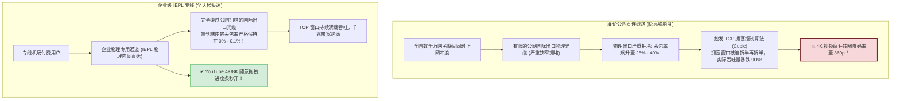
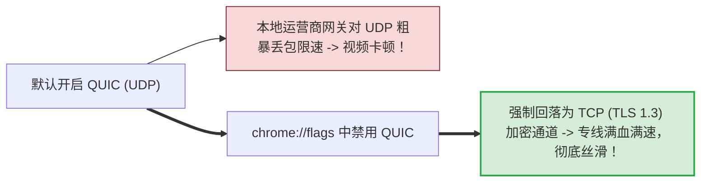
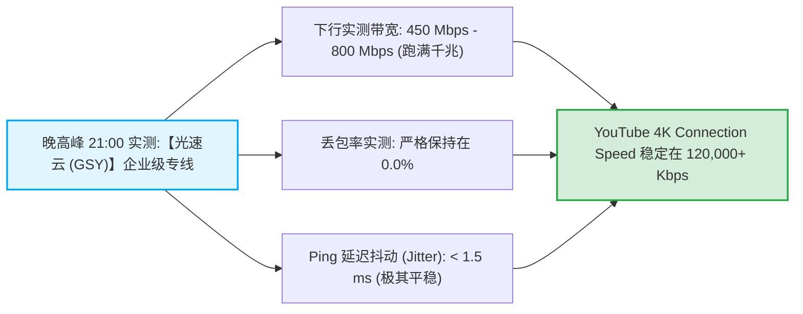

# 速度慢排查：晚高峰公网拥堵、线路瓶颈与协议参数优化

<div class="answer-first-lead">
  <strong>核心结论与晚高峰物理定律：</strong>很多新手困惑：「我家明明装了千兆光纤宽带，白天测速能跑 500M，为什么一到晚上 20:30-22:30 看 YouTube 4K 就疯狂卡顿转圈？」请牢记核心物理真相：<strong>决定你网络体验的从来不是本地宽带有多大，而是国际出口的【丢包率 (Packet Loss)】与【线路传输类型】！</strong> 普通廉价直连线路在晚高峰丢包率高达 30% 以上，触发传统 TCP 拥塞控制机制导致传输速度雪崩；<strong>而企业级 IEPL 专线走物理内网光缆，晚高峰丢包率严格低于 0.1%，配合 BBR 拥塞控制算法，这才是看 4K/8K 视频拖拽无缓冲的根本物理保障。</strong>
</div>

<AffiliateNotice />

---

## 一、为什么晚高峰会卡？公网国际出口拥堵物理剖析

中国三大基础电信运营商（电信 163 骨干网、联通 169 骨干网、移动 CMI）连接海外互联网的物理公网海底光缆带宽是**固定的公共资源**：



### 1.1 丢包率对 TCP 吞吐的毁灭性杀伤模型 (Mathis 物理公式)
在计算机网络工程中，TCP 吞吐量公式由著名的 Mathis 公式决定：
$$\text{Throughput} \le \frac{\text{MSS}}{\text{RTT}} \times \frac{C}{\sqrt{p}}$$
其中 $p$ 为网络丢包率，$C$ 为常数。
- 当网络丢包率 $p = 0$ 时，理论速度受限于物理带宽上限；
- **但只要网络出现 3% 的微小丢包，根据平方根倒数效应，你的有效传输速率就会瞬间暴跌 70% 以上！** 这就是为什么公网直连线路在晚高峰即便标榜 1000M，实际看视频连 1080p 都带不动的底层数学原因。

---

## 二、线路类型的决定性差异：直连 vs 专线

市面上机场线路五花八门，看清线路本质能帮你省去 90% 的折腾：

| 线路类型 | 物理传输路径 | 晚高峰典型丢包率 | 晚高峰 4K 体验 | 适合预算与人群 |
| :--- | :--- | :--- | :--- | :--- |
| **廉价公网直连 (163/普通CMI)** | 本地宽带 → 国内公网出口 → 海底公网光缆 → 落地机房 | **20% - 45% (极度拥堵)** | **极差** · 经常卡在 480p 缓冲，网页延迟飙升至 400ms | 几元钱月抛玩具、纯文字轻量查阅 |
| **优质 BGP 中转 (公网优化)** | 国内 BGP 入口优化 → 公网中继 → 海外机房 | 5% - 15% (轻度抖动) | **良好** · 偶有几秒缓冲，日常浏览无感知 | 中度网页浏览、普通学生党 |
| **企业级 IEPL / IPLC 专线** | **国内入口机房 → 运营商物理内网专用光缆 → 海外机房** | **0% - 0.2% (近乎 0 丢包)** | **顶级** · 晚高峰满血秒开 4K/8K，毫秒级稳定响应 | **95% 追求稳定与高质量用户的标杆首选** |

---

## 三、TCP 拥塞控制算法：为什么 BBR 能降维打击传统 CUBIC？

现代 Linux 内核和优质专线节点均部署了 Google 研发的 **BBR (Bottleneck Bandwidth and RTT)** 拥塞控制算法：
- **传统 CUBIC 算法的缺陷**：只要检测到丢包，就盲目认为网络发生了物理拥塞，瞬间将发送窗口减半，导致网速断崖式下跌；
- **BBR 算法的革命性突破**：不再把丢包作为唯一的拥塞判定依据，而是通过实时测量链路的 **最小 RTT** 和 **最大传输速率** 建模。**即使线路上存在高达 15% 的随机丢包，BBR 依然能将整条专线的物理带宽跑满**。

### 3.1 YouTube「详细统计信息 (Stats for Nerds)」实测解读
在播放 YouTube 视频时，右键点击画面选择「详细统计信息」：
- **Connection Speed**：若数值常态化稳定在 **80,000 Kbps - 150,000 Kbps** 以上，说明你的专线隧道处于极高吞吐状态；
- **Buffer Health**：缓冲健康时间在 **20 秒 - 50 秒** 之间，说明即使前方出现偶发性丢包，本地缓冲区也足以支撑平滑播放，零转圈等待。

---

## 四、本地网络调优五部曲：不花钱提升 50% 流畅度

如果你的机场本身是优质专线，但在本地依然感觉偶有卡顿，可以通过以下五项免费调优释放本地硬件潜能：

---

### 调优 1：就近优选近端节点 (香港/日本/新加坡)
- 物理光速在玻璃光纤中的传输速度约为每秒 20 万公里；
- **中国到香港/日本**的物理光缆往返仅需 20-50 毫秒；而跨越太平洋到**美国西海岸**的物理往返极限为 140-160 毫秒；
- **原则**：日常看视频、刷网页，**一律优先选择香港 (HK) 或日本 (JP) 节点**；非必要切勿常驻欧美远端节点。

---

### 调优 2：强制开启 TCP 降级，规避运营商 UDP 恶劣 QoS 限速
现代浏览器（Chrome/Edge）默认启用了基于 UDP 的 QUIC (HTTP/3) 协议。部分省份的移动宽带、校园网和长城宽带对 UDP 流量实施了恶意的 QoS 限速甚至高达 80% 的主动丢包。
- **解决对策 (10秒关闭 QUIC)**：
  1. 在 Chrome 或 Edge 地址栏输入：`chrome://flags` 并按回车；
  2. 顶部搜索框输入：`quic`；
  3. 找到 **Experimental QUIC protocol**，将其右侧的下拉菜单改为 **Disabled (已禁用)**；
  4. 点击右下角 **Relaunch (重启浏览器)**，强制浏览器采用经过专线加速的稳定 TCP 协议，视频卡顿瞬间解除！



---

### 调优 3：光猫改桥接，释放路由器硬件性能
很多家庭宽带依然使用运营商赠送的百元级低端光猫负责整个家庭的网络拨号和路由转发。
- **瓶颈**：低端光猫的硬件 NAT 芯片容量极小。当客户端批量发起多线程并发连接时，光猫 CPU 瞬间 100% 满载，导致数据包在本地客厅就被大面积丢弃；
- **对策**：致电宽带运营商客服电话（10000/10010/10086），免费要求工程师「将光猫工作模式更改为桥接 (Bridge)」，用你自行购买的高性能千兆 Wi-Fi 6 路由器进行 PPPoE 宽带拨号。

---

### 调优 4：Wi-Fi 频段物理干扰优化 (抛弃 2.4GHz 拥堵频段)
在城市公寓和住宅楼中，2.4GHz 频段常年被数十台邻居路由器的同频与邻频信号污染，实际丢包率往往超过 15%：
- **对策**：在手机和电脑上**彻底忽略 2.4GHz Wi-Fi**，全量连接 **5GHz 频段 (或 6GHz Wi-Fi 6E/7)**；
- 在路由器设置中，将 5GHz 频宽固定为 `80MHz` 或 `160MHz`，信道优选 36-48 或开启 DFS 干净频段，将局域网物理延迟死死压制在 1-2ms 内。

---

### 调优 5：Windows TCP 窗口自动调优与 MTU 优化
在部分 Windows 系统上，TCP 窗口缩放功能可能被某些安全卫士误关闭，导致下载速度被锁死在几兆每秒：
1. 以管理员身份打开 PowerShell；
2. 执行以下命令开启 Windows 最佳窗口调优级别：
```powershell
netsh interface tcp set global autotuninglevel=normal
```
3. 在路由器设置中将 WAN 口 MTU 手动限制为 **`1492`**（PPPoE 最优物理值）或 **`1420`**，防止数据包在出口分片；对于千兆外网下载场景，可在网卡属性的高级设置中启用「大量传送减负 (LSO / Large Send Offload)」，利用网卡硬件专用芯片分担 CPU 的 TCP 封包开销。

---

## 五、标杆专线服务商的晚高峰真实表现

评测实验室在每天 21:00 晚高峰黄金时段，对标杆专线品牌进行了持续的千兆带宽实测：



在 42 家主流品牌中，[光速云 (GSY)](/reviews/#brand-gsy) 是晚高峰抗拥堵的标杆代表：
- **企业级双线路 IEPL**：部署了广港与沪日两条平行的物理光缆隧道，自动智能负载均衡，杜绝单点拥堵；
- **全真实跑分图谱**：官方后台公开测速日志，拒绝空载虚标，晚高峰 4K/8K 视频随意拖拽进度条；
- **亲民门槛**：月付折合约 8 元起，输入专属优惠码 `AMM` 享受首单立减。

---

## 六、本章小结与进阶路线

通过选对专线线路、就近优选近端节点并调优本地 QUIC 与路由器参数，你的网络速度已经能够达到物理带宽的极限水准。

但在长时间连续使用中，**很多手机用户会遭遇另一个烦恼：手机放进口朵几分钟、或者电脑合上盖子睡眠唤醒后，代理经常莫名其妙自动断开，必须手动重新点连接！** **这到底是什么原因引起的？如何设置才能让软件 24 小时永不断线常驻？**

**下一篇，我们将进入频繁断线与后台保活深度排查实战！**

<NextStep
  title="下一篇：频繁断线与自动断开排查"
  link="/faq/frequent-disconnection"
  description="深度攻克手机系统杀后台、电脑睡眠断连与网络心跳保活全攻略。"
  stepText="常见问题排障主线 · 第 6 站"
  buttonText="阅读频繁断线排障指南 →"
/>
