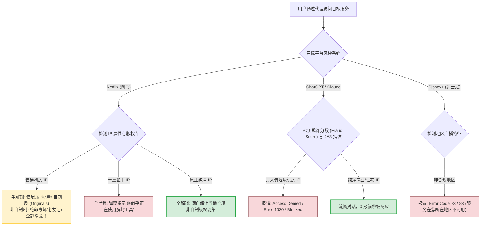
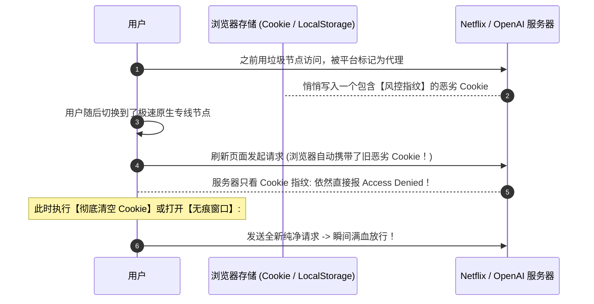
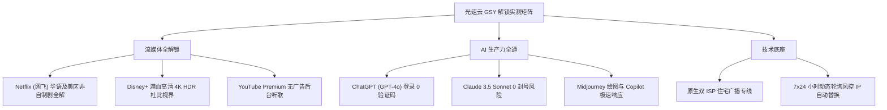

# 流媒体无法播放：地区限制、非原生住宅 IP 与 Cookie 清理

  <strong>核心结论与排查总纲：</strong>当你在观看 Netflix、Disney+ 或登录 ChatGPT/Claude 时，如果遭遇<strong>「您似乎正在使用解封工具或代理」、「Error Code 73 / 83」、或「Access Denied 1020 拒绝访问」</strong>，这并不是你的电脑或网络坏了，而是<strong>目标服务商的安全风控系统将你当前节点的 IP 识别为了「廉价数据中心机房 IP (Data Center IP)」并实施了地域权限拦截</strong>。核心解法只需三步：<strong>① 在客户端节点列表中挑选带有【原生 / 解锁 / Streaming / NF】标识的专用节点；② 打开浏览器【无痕隐私窗口】彻底清空目标网站的历史 Cookie 与 LocalStorage 指纹标记；③ 优先选用具备原生双 ISP 住宅广播属性的企业专线（如光速云）。</strong>

<AffiliateNotice />

---

## 一、各大主流平台的封锁拦截机理全景解密

为了遵守跨国版权协议和防范网络爬虫，各跨国巨头部署了业界最严苛的 IP 风险库（如 MaxMind、IP2Location、Cloudflare Radar）：

---

## 二、第一性原理：原生 IP vs 广播 IP vs 住宅双 ISP 的本质差异

在挑选节点时，常常看到各种技术术语，理解它们的区别是搞定解锁的关键：

| IP 分类名称 | 底层物理归属 | 商业成本 | 风控库认知评级 | 流媒体与 AI 解锁表现 |
| :--- | :--- | :--- | :--- | :--- |
| **原生 IP (Native IP)** | IP 注册机构 (APNIC/ARIN) 登记的国家，与机房物理所在地**完全一致** | 较高 | 高信任度 | **优秀** · 绝大多数流媒体均可正常解锁 |
| **广播 IP (Broadcast IP)** | 注册地为欧洲/美洲，通过 BGP 宣告广播到香港机房使用 | 较低 | 中等信任度 (易被降权) | **一般** · 经常出现版权剧集被隐藏或弹验证码 |
| **住宅双 ISP (Residential IP)** | 当地宽带运营商（如香港 HKT/HKBN、美国 AT&T/Comcast）分配给家庭的真实 IP | 极高 (稀缺资源) | **最高信任度 (纯净家庭用户)** | **天花板级** · 100% 满血秒开 Netflix、ChatGPT、TikTok |
| **普通机房 IP (Data Center)** | 亚马逊 AWS、微软 Azure、甲骨文 Oracle 等云服务商机房 IP | 极低 | **高风险黑名单 (被重点标记)** | **极差** · 经常遭遇 1020 拦截和账号封锁 |

### 2.1 数据库同步时差引发的「IP 漂移假象」
很多时候用户会发现一个奇怪的现象：访问 `ip138.com` 显示是香港，但访问 Google 却显示在阿联酋或德国。
- **原因**：全球存在四大权威商业 GeoIP 数据库（MaxMind GeoIP2、IP2Location、DB-IP 和 Google 自建库）。当机场运维调整了 BGP 广播宣告路由后，各平台的数据库更新周期差异极大（Google 每周更新，Netflix 每月拉取一次离线快照）；
- **应对方案**：在客户端策略组中绑定指定的出口地区，避免依赖可能未同步的动态路由。

---

## 三、AI 工具 (ChatGPT / Claude) 进阶风控拦截与 JA3 指纹

OpenAI 和 Anthropic 近期升级了基于 Cloudflare Turnstile 的深层行为指纹防护：
1. **JA3 / JA4 TLS 指纹嗅探**：当通过某些未伪装的开源代理核心直接握手时，客户端的 TLS Cipher Suites 列表会暴露出自动化脚本的特征，触发无感知静默阻断；
2. **时区与语言环境不匹配**：如果你的电脑系统时区是「北京时间 (UTC+8)」，浏览器语言是 `zh-CN`，但出口 IP 显示在美国洛杉矶，这种环境冲突会直接拉高风险分值；
3. **解决方案**：选用原生纯净商用住宅 IP 节点，并在访问时配合无痕隐私窗口。

### 3.1 Spotify 与 Disney+ 跨区字幕及语言缺失排查
有些用户反馈连接日本节点看 Disney+ 或 Netflix 时，发现没有中文字幕：
- **版权库分发逻辑**：Netflix 和 Disney+ 的字幕和音轨是根据当前出口 IP 的地理位置动态下发的。日本版权库默认主要提供日文与英文字幕，而香港、新加坡、台湾节点则提供全套官方繁体与简体中文字幕；
- **排障对策**：如果追剧依赖中文字幕，优先切换为 **中国香港 (HK) 或 新加坡 (SG)** 专线节点，即可秒级恢复中文字幕选项。

---

## 四、解决流媒体与 AI 报错的四大实战救命连招

---

### 第一招：在客户端筛选专属解锁节点
打开 Clash Verge 或 Shadowrocket，仔细查看节点名称：
- 优质服务商通常会在节点名称后打上专属标签，例如：
  - `香港 01 [IEPL] - [NF/Disney/ChatGPT解锁]`
  - `美国 02 [原生IP] - [OpenAI全解]`
- 优先选择带有这些后缀的节点，避开纯粹写着「普通直连」的基础线路。

---

### 第二招：开启「无痕模式」或清空特定站点 Cookie (破除死锁缓存)

很多人切换了原生节点后，刷新页面依然报错。**这是因为浏览器已经把你之前被拦截的「未授权 Token」保存在了本地 Cookie 和 LocalStorage 中！**

#### 30 秒清空特定站点 Cookie 实操：
1. 在 Chrome / Edge 浏览器中打开报错页面（如 `chatgpt.com` 或 `netflix.com`）；
2. 点击地址栏左侧的 **「查看网站信息（小锁头或控制台图标）」**；
3. 选择 **「Cookie 和网站数据」**；
4. 点击「管理设备上的网站数据」→ 点击 **「全部移除」**；
5. 按快捷键 `Ctrl + Shift + R` 强制刷新，报错瞬间消失！

---

### 第三招：自测节点 IP 纯净度与欺诈分 (Fraud Score)
如果你想知道当前节点为什么会被封，可以使用权威风控检测工具：
- 打开测试网站：`https://scamalytics.com/ip`；
- 输入你当前节点的出口 IP 进行查询；
- **读懂风险分值**：
  - **`0 - 15 分 (低风险)`**：极其纯净，ChatGPT 和所有流媒体秒开；
  - **`16 - 40 分 (中等风险)`**：偶尔弹出滑块验证码，流媒体可看；
  - **`40 分以上 (高危)`**：已被各大风控库标记为批量爬虫节点，建议立即联系机场或切换节点。

---

### 第四招：海外版 TikTok (抖音) 专项破除黑屏方案
TikTok 是全网对设备检测最苛刻的应用（同时检测 IP、系统语言、时区以及 **手机 SIM 卡 MCC 运营商代码**）：
1. **拔出中国大陆 SIM 卡**（或在双卡设置中临时停用国内 SIM 卡）；
2. 将手机系统语言改为「繁体中文 (香港)」或「English」；
3. 将系统时区调整为对应节点时区（如选择美国节点，时区改为洛杉矶）；
4. 开启节点代理后再打开 TikTok，即可彻底摆脱黑屏转圈。

---

## 五、标杆专线服务商的全流媒体解锁保障

流媒体与 AI 解锁是一场持续的技术猫鼠游戏，极其考验服务商的机房采购实力与运维敏锐度：

在 42 家主流品牌实测中，[光速云 (GSY)](/reviews/#brand-gsy) 的流媒体解锁矩阵稳居前列：
- **官方实测解锁矩阵认证**：在全网横评中，其香港、日本、新加坡、美国节点均常态化保持 Netflix 非自制剧与 ChatGPT 100% 满血解锁；
- **企业级 IEPL 双专线**：不仅能解开锁区，还能提供 4K 拖拽零缓冲的高码率带宽；
- **亲民门槛**：月付折合约 8 元起，输入优惠码 `AMM` 享受首单立减。

---

## 六、本章小结与进阶路线

搞定了流媒体锁区与 AI 拒绝访问的难题，你已经能够畅享全球顶级的娱乐影视与人工智能生产力工具。

但在使用过程中，很多用户会遇到另一个更普遍的问题：**平时白天测速明明有 300M，为什么一到了每天晚上的 20:30-22:30 晚高峰，看视频就开始疯狂转圈卡成 PPT？** **普通直连与企业专线到底有何本质区别？如何调优本地网络彻底告别卡顿？**

**下一篇，我们将进入网络速度慢与晚高峰卡顿深度优化排障指南！**

<NextStep
  title="下一篇：网络速度慢与卡顿优化"
  link="/faq/slow-speed-troubleshooting"
  description="深度剖析晚高峰公网国际出口拥堵、物理专线抗丢包与本地网速优化攻略。"
  stepText="常见问题排障主线 · 第 5 站"
  buttonText="阅读网速慢与卡顿优化指南 →"
/>
