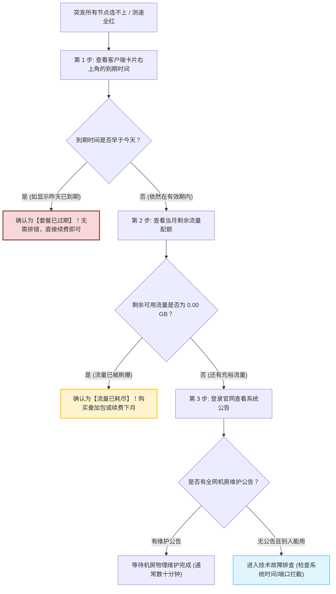
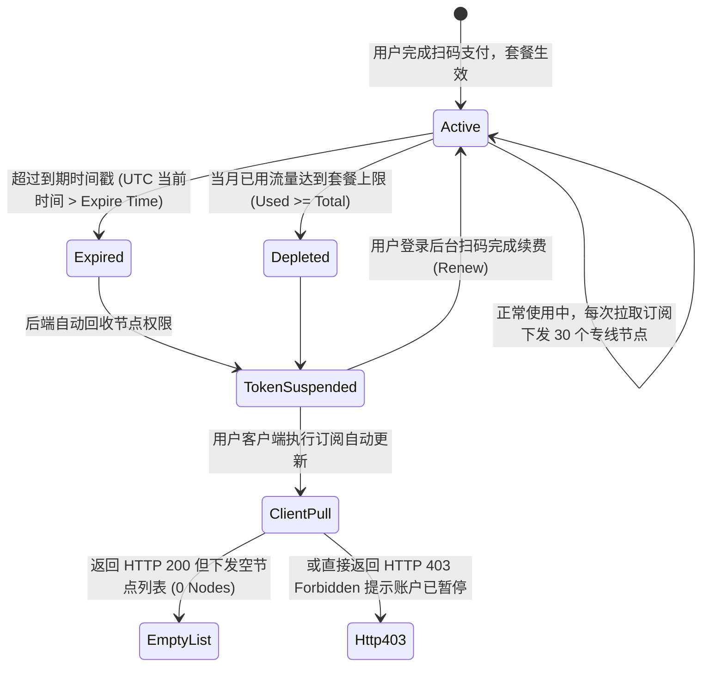
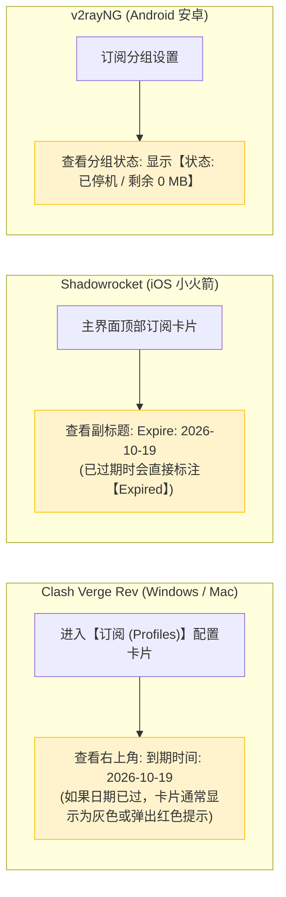
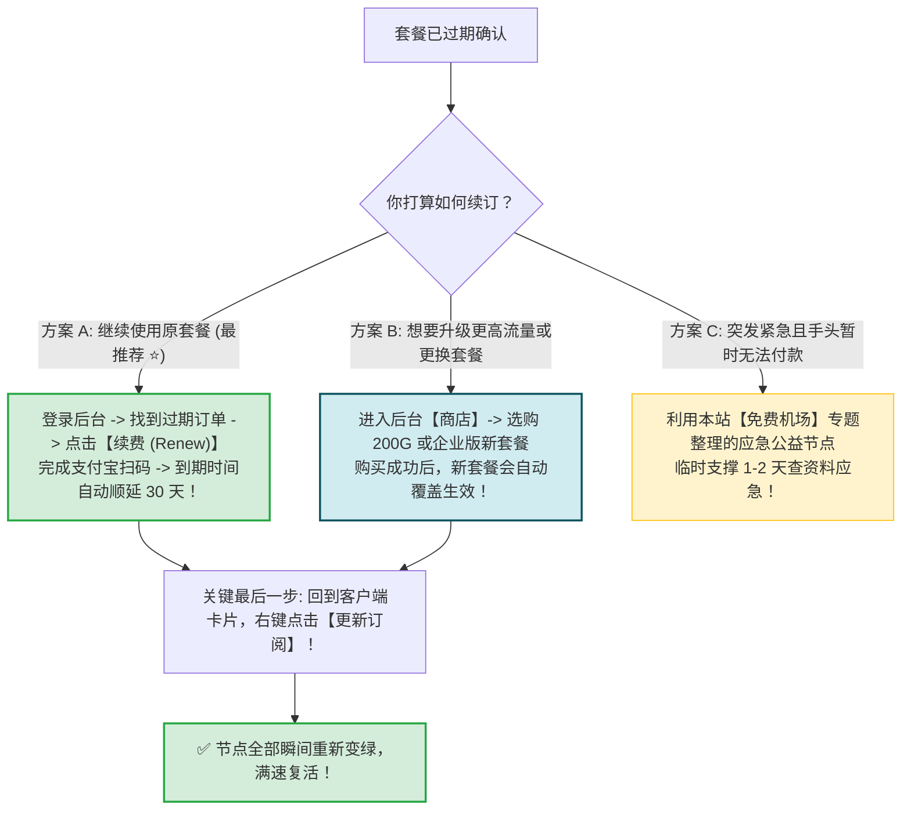
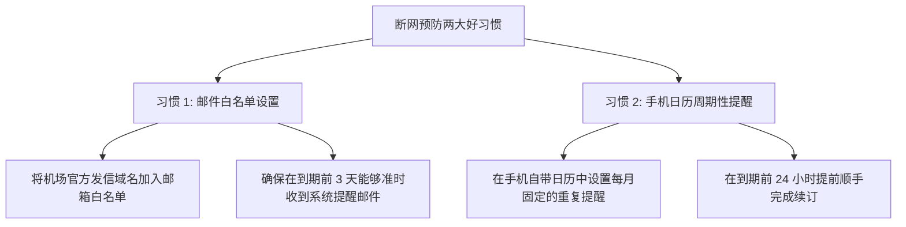

# 订阅过期排查：如何判断套餐到期与无缝平滑续费指引

  <strong>核心结论与排查黄金口诀：</strong>某天早上突然发现所有节点全部无法连通时，<strong>请首先排除自己是否已经「欠费过期」！</strong>客服数据表明，超过 40% 的报障在核验后均证实仅仅是用户的月付套餐到期了。判断方法只需 10 秒：<strong>在客户端配置卡片或登录官网后台查看【到期时间 (Expire Date)】与【剩余流量】；如果确认已经过期，只需在后台完成原套餐续费或购买新套餐，然后在客户端右键点击一次「更新订阅」，几秒钟内即可满血满速复活，无需重新下载客户端或重新设置规则。</strong>

<AffiliateNotice />

---

## 一、三步秒测：我是遇到网络故障，还是套餐欠费了？

遇到断网时，对照以下三步流水线进行鉴别，避免盲目怀疑电脑或网络环境：

---

## 二、第一性原理：服务端账单生命周期与 Token 失效机制

在网络计费系统（如 V2Board、SSPanel-Uim）中，用户的订阅状态由后台定时任务（Cron Job）严格控制：

### 2.1 软断网 (Soft Cutoff) 与硬断网 (Hard Cutoff) 的体验差异
- **硬性切断 (Hard Cutoff - 常见于劣质小作坊)**：到期或超标瞬间，后端直接将该用户的 UUID 从所有专线服务器的内存白名单中物理剔除。客户端在毫无提示的情况下连接突然断崖式终止，测速全部变成红色 Timeout；
- **软性宽限与下发空配置 (Soft Cutoff - 正规大型机场)**：到期后，API 接口仍可正常访问，但在响应头 `Subscription-Userinfo` 中明确标记 `expire=过去时间`，并在返回的配置中下发一条名为「⚠️ 您的套餐已到期，请登录官网续费」的提醒节点，让小白一眼看清原因，杜绝恐慌。

---

## 三、在各主流客户端界面如何一眼看出过期状态？

不同软件对过期状态的反馈界面非常直观，无需每次繁琐登录网页：

---

## 四、套餐过期后的三种无缝平滑续费方案

确认套餐已经到期后，按照以下方案操作，无需重新下载客户端，甚至不需要重新配置分流规则：

### 4.1 方案 A：原套餐原路直接续费 (丝滑无感)
1. 访问机场官网并登录账号；
2. 在控制面板找到已过期的套餐卡片，点击 **「续费 (Renew)」** 按钮；
3. 选择 1 个月（或按需选择季度付），使用支付宝扫码完成支付；
4. **【至关重要的一步】**：打开电脑或手机客户端，在配置卡片上**右键点击「更新 (Update)」**；
5. 客户端重新拉取服务端的最新状态，节点瞬间重新恢复通信；若客户端因本地缓存未刷新依然显示红色，可先在软件设置中切换一下核心内核（如 Clash Meta），强制触发内存配置热重载，即可实现零重启秒开，丝滑恢复全速上网。

### 4.2 方案 B：更换或升档新套餐
- 如果之前购买的入门轻量版流量总是不够用；
- 直接进入后台「商店」，选购更高规格的进阶套餐完成结账；
- **注意**：同一个账号的私有订阅 Token 通常是**固定不变的**，购买新套餐后，只需在客户端刷新一次订阅，新套餐的节点和配额就会全自动下发。

---

## 五、跨周期订阅计费与未用流量结转真相

在续费时，小白最关心的两大账务问题：
1. **未用完的流量会累加到下个月吗？**
   - **商业真相**：绝大多数正规商业专线机场**不支持流量跨月结转**。因为机房采购物理专线带宽是按月支付固定的高昂端口租金与物理机柜电力开销（每月固定沉没成本），未使用的流量配额并不会转化为下月的物理储备；

2. **提前续费会导致到期时间被吃掉吗？**
   - **计费保障**：只要点击的是「续费 (Renew)」，系统会自动在当前旧的到期日基础上顺延 30 天，**提前 3 天续费绝对不会亏损哪怕一分钟的有效期**。

---

## 六、避免突发断网的日常预防指南

为了防止在深夜开会或周末追剧时突然断网影响工作心情，建议养成以下两个良好习惯：

---

## 七、标杆服务商的无缝续费与数据继承保障

正规大型机场在账单生命周期与数据继承方面具备极其人性化的机制：

| 评估指标 | 劣质小作坊 | [光速云 (GSY)](/reviews/#brand-gsy) 企业级专线 |
| :--- | :--- | :--- |
| **过期后 Token 是否保留** | 经常重置 Token，用户每次续费必须重新导入配置 | **专属 Token 终身永久绑定，续费后无需重新导入** |
| **到期缓冲容灾期** | 到期瞬间强行切断，不给任何缓冲时间 | **支持提前续费无缝顺延，到期日前 3 天邮件与 TG 机器人温馨预警** |
| **计费透明度** | 到期时间经常暗中缩水 | **按标准自然日与精确时间戳履约，100% 诚实可信** |

> [!TIP] 选型小结
> 选用 [光速云 (GSY)](/reviews/#brand-gsy)，在结账输入优惠码 `AMM` 享受专属折扣。其后台计费系统极其稳定，支持随时按月平滑续订或升级，专属订阅链接终身有效，真正做到「一次配置，终身无忧」。

---

## 八、常见问题手册全景结语与下一站指引

至此，恭喜你已经完整遍历了《常见问题与排错手册》的全部十个高频故障专题：
- **从订阅导入报错**（格式冲突、网络超时）到 **节点全红排查**（系统时间、端口阻断）；
- **从网页假死排查**（系统代理、插件劫持）到 **流媒体 AI 解锁**（原生住宅 IP 识别）；
- **从晚高峰卡顿优化**（专线抗丢包、QUIC 调优）到 **多端频繁掉线**（安卓杀后台、iOS 内存控制）；
- **从账号与支付安全**（防失联发布页、未到账补发）到 **客户端闪退与订阅过期无缝续订**。

**你已经掌握了全网最详尽、最硬核的科学上网自愈排错能力，日常 99.9% 的技术障碍对你而言都不再是难题！**

**但如果在某些极其特殊的极端情况下，你的主力付费套餐突遭紧急维护，手头又有十万火急的学术资料必须立刻查阅——市面上有哪些真正可用的 0 元合规免费应急资源？免费节点背后有哪些不可不知的隐私陷阱与数据安全红线？**

**下一站，我们将进入核心的「免费机场与应急资源安全全景指南」，为你揭晓免费梯子的真相与避坑防身术！**

<NextStep
  title="第八站：免费机场：新手如何安全地免费体验"
  link="/free/"
  description="揭秘免费节点的来源与暗藏风险，盘点真实提供免费试用的合规服务商，提供突发断网应急方案。"
  stepText="新手核心学习主线 · 第 8 站"
  buttonText="查看免费机场安全指南 →"
/>
