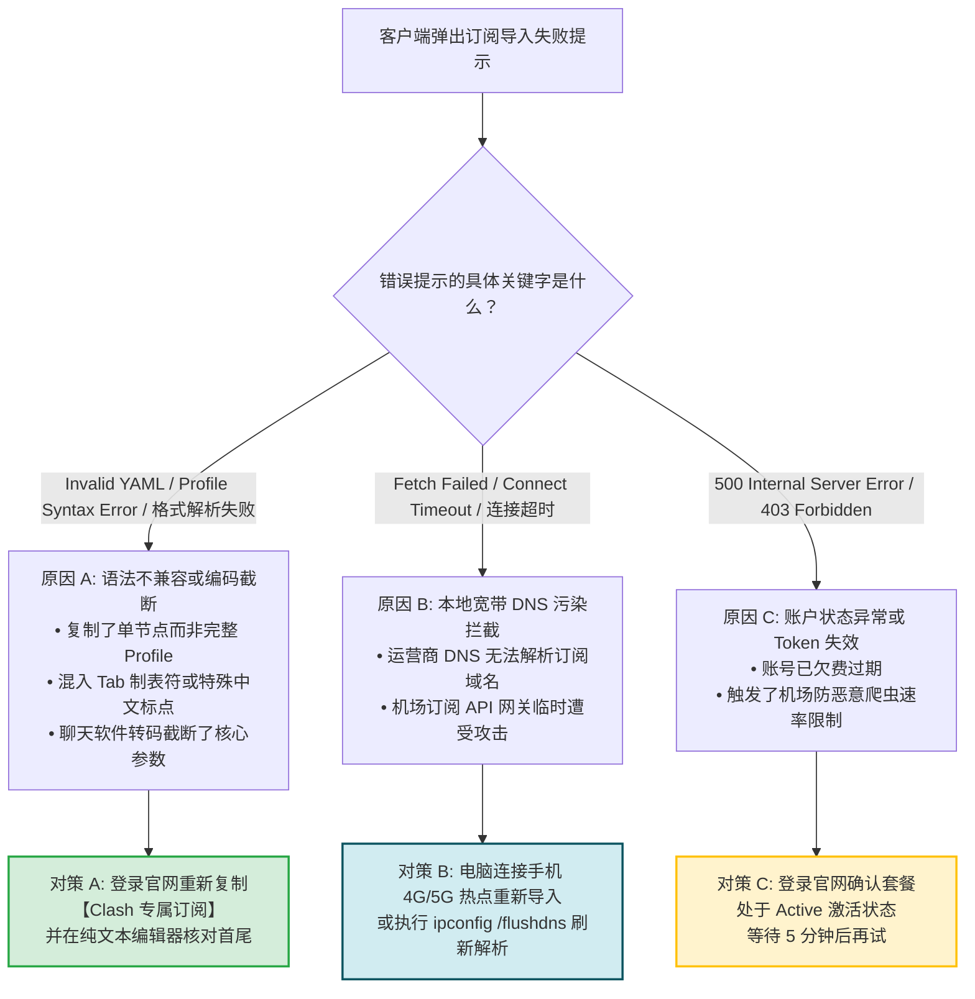
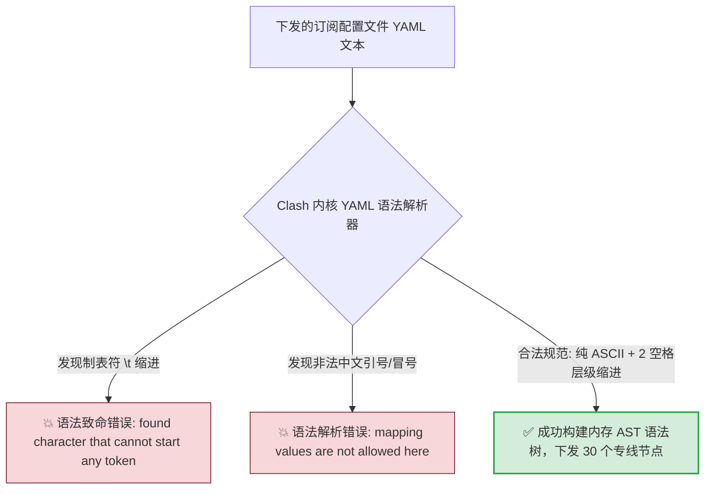
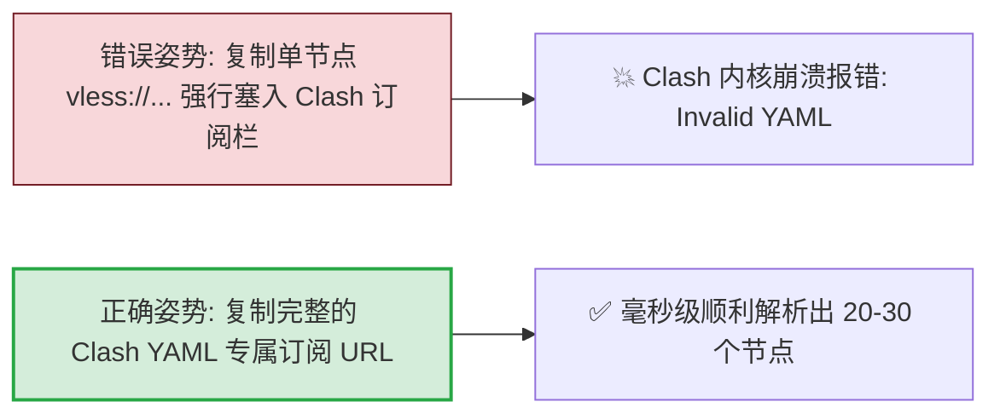
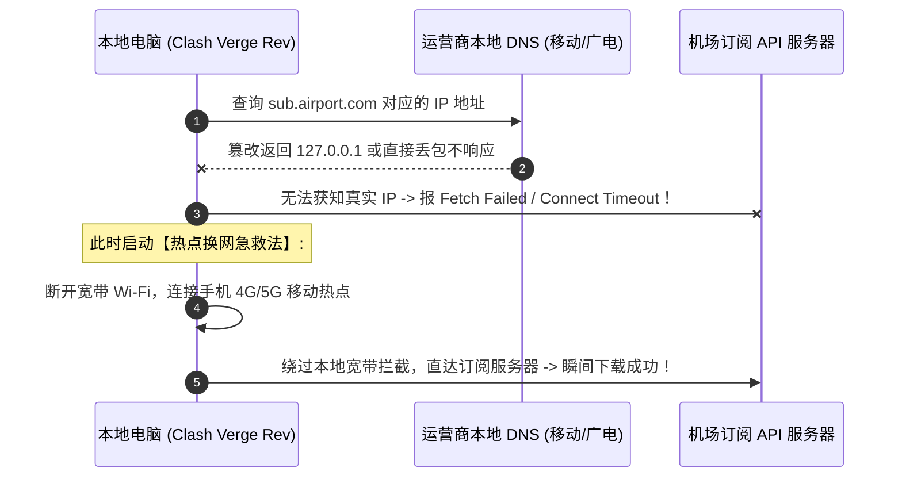

# 订阅导入失败排查：Invalid YAML、网络超时与编码报错修复

<div class="answer-first-lead">
  <strong>核心结论与快速自愈手册：</strong>在客户端导入机场订阅时，如果弹出错误提示，<strong>90% 的原因集中在两类工程问题：① 格式与语法编码冲突（如 Invalid YAML / Profile Syntax Error / illegal base64）：</strong>通常是因为把单节点 SS/VLESS 链接强行当做完整 Clash Profile 导入，或者在复制过程中混入了 Tab 制表符与空格截断；<strong>② 网络与解析超时（如 Fetch Failed / Connect Timeout）：</strong>通常是因为本地宽带运营商的局域网 DNS 污染拦截了机场的订阅托管域名。遇到导入失败，首选<strong>开启手机 4G/5G 个人热点让电脑连接拉取</strong>，或登录官网改用<strong>通用订阅链接</strong>，即可秒级自愈。
</div>

<AffiliateNotice />

---

## 一、订阅导入失败全场景故障诊断决策树

遇到导入报错时，请对照以下逻辑树 30 秒定位故障根源：



---

## 二、第一性原理：YAML 语法树解析与 Tab 制表符致命陷阱

Clash 系列客户端（Clash Verge Rev、Mihomo）的核心配置引擎使用标准的 YAML 1.2 解析器。理解 YAML 的语法约束能让你秒懂报错根源：



### 2.1 常见语法崩溃原因剖析
1. **致命混淆（单节点 vs 完整配置 Profile）**：
   - 很多新手把形如 `vless://8a2b3c...#香港IEPL` 的单节点链接，直接粘贴到 Clash Verge 的「订阅 URL」输入框中；
   - Clash 期待的是一个包含 `port`、`mode`、`proxies`、`rules` 的完整配置文件，面对单行纯文本必然抛出 `Invalid YAML` 报错；
2. **微信/QQ 传输导致参数转义截断**：
   - 当你把订阅 URL 发送给微信文件传输助手时，微信内置的浏览器重定向保护往往会截断 URL 中包含的 `&` 符号（如 `&clash=1&token=xxx` 丢失了后续参数），导致服务器仅返回了 Base64 编码而非 YAML 配置文件；
3. **Base64 末尾 Padding 缺失（Android v2rayNG 常见）**：
   - 在 Base64 编码规范中，如果字符长度不是 4 的倍数，末尾必须补齐 `=` 占位符。部分劣质面板后端在拼接字符串时漏掉了末尾 `=`，导致安卓客户端报错 `illegal base64 data at input byte`。

---

## 三、故障一：`Invalid YAML / Profile Format Error` (格式解析报错) 10秒修复



### 3.1 彻底自愈实操三步法：
1. **纯净复制**：在电脑浏览器（Chrome 或 Edge）中直接打开机场官网后台，切勿通过手机第三方聊天软件转发；
2. **认准专属按钮**：在后台「便捷导入」模块，寻找 **「复制 Clash 订阅」** 或 **「一键导入 Clash」**；
3. **记事本排查法**：将复制的链接先粘贴在 Windows 自带的「记事本」或 macOS「备忘录」中，肉眼确认链接以 `https://` 开头，末尾没有任何多余的换行符或空格，再复制进客户端。

---

## 四、故障二：`Fetch Failed / Connect Timeout` (网络拉取超时)

### 4.1 底层网络诱因剖析
- 许多机场为了防止订阅入口被高频封锁，其订阅 API 通常部署在 Cloudflare Anycast 边缘网络或海外高防 CDN 上；
- 部分国内本地宽带运营商（尤其是移动宽带、长城宽带或广电网络）开启了严苛的局域网 DNS 拦截，导致本地电脑根本无法向订阅服务器发起 TCP 三次握手。



### 4.2 终极自愈神技：热点换网法
1. 打开手机「个人热点」；
2. 电脑断开原本的家庭宽带或校园网 Wi-Fi，连接手机热点；
3. 回到客户端的「订阅」界面，重新点击「导入」或「更新」；
4. **验证成功后**：即可断开手机热点，重新连回家用宽带正常使用（因为节点配置已经成功保存在本地硬盘中，后续日常节点通信走的是物理专线，不再受订阅域名拦截影响！）。

### 4.3 企业办公网络下的 PAC 脚本冲突与证书阻断
如果你在公司办公电脑上拉取订阅失败，常见诱因是公司 IT 部门配置了域控全局代理（PAC 自动代理脚本）或开启了深信服/天融信 SSL 深度包检测。这会导致客户端在请求订阅时抛出 `x509: certificate signed by unknown authority` 证书错误。
- **对策**：在拉取订阅时暂时关闭公司的内网准入安全助手，或将订阅链接复制到个人手机端导入，再通过局域网二维码或本地文件导入电脑，完全绕过内网证书劫持；对于进阶开发者，亦可通过本地 Docker 搭建轻量级私有 subconverter 服务（绑定 `127.0.0.1:25500`），实现安全私密转换而绝不经过公网第三方服务器。

---

## 五、终端命令行连通性底层自检 (面向高级用户)

如果你在客户端反复提示拉取超时，可以使用 Windows PowerShell 或 macOS Terminal 发起端到端诊断，精确定位到底是本地客户端问题还是网络层拦截：

```powershell
# 在 PowerShell 中查看 HTTP 握手响应状态码
curl.exe -Iv "你的订阅链接" -A "ClashMeta" --connect-timeout 10
```
- **如果返回 `HTTP/1.1 200 OK`**：说明网络层完全畅通，问题出在客户端软件自身缺少写入配置文件的磁盘权限（可以尝试以管理员身份运行客户端）；
- **如果返回 `Could not resolve host`**：说明遭遇了纯粹的本地 DNS 污染，可在命令行执行 `ipconfig /flushdns` 刷新缓存，或将网卡 DNS 临时更改为 `223.5.5.5`；
- **如果返回 `HTTP/1.1 403 Forbidden`**：说明本地公网 IP 触发了机场的 WAF 防恶意爬虫限流，等待 5 分钟后重试即可。

---

## 六、标杆专线服务商的订阅稳定性保障

服务商对于订阅分发基础设施的投入，直接决定了用户的导入体验：

| 评估指标 | 劣质小作坊 | [光速云 (GSY)](/reviews/#brand-gsy) 企业级专线 |
| :--- | :--- | :--- |
| **订阅 API 容灾架构** | 单一便宜 VPS，经常被阻断超时 | **全球 Anycast 边缘多节点分发，可用率 99.9%** |
| **格式向下兼容度** | 格式错漏百出，经常报 Invalid YAML | **全平台格式自适应下发，Clash/小火箭/v2rayNG 秒级兼容** |
| **一键唤醒支持** | 仅提供长链接，无一键调用支持 | **支持全平台客户端一键唤醒，0 粘贴门槛** |

> [!TIP] 选型小结
> 选用 [光速云 (GSY)](/reviews/#brand-gsy)，在结账输入优惠码 `AMM` 享受专属折扣。其后台部署了完备的订阅防截断机制，导入成功率高达 99.9%，让新手彻底告别报错弹窗的折磨。

---

## 七、本章小结与进阶路线

排除订阅导入的格式与网络拦截故障后，你的配置卡片已经成功更新，节点列表整齐就绪。

但有些用户在导入节点后，点击批量测速却发现**所有节点全部显示为红色的「Timeout (超时)」！** **为什么节点明明显示绿色专线，测速却一个都连不上？如何解决最隐蔽的时间不同步与端口拦截？**

**下一篇，我们将进入节点超时与连接失败深度排障实战！**

<NextStep
  title="下一篇：节点超时与无法连接排查"
  link="/faq/node-connection-failure"
  description="深度排查测速全红、时间未同步与端口拦截导致的无法连接故障。"
  stepText="常见问题排障主线 · 第 2 站"
  buttonText="阅读节点超时排查指南 →"
/>
