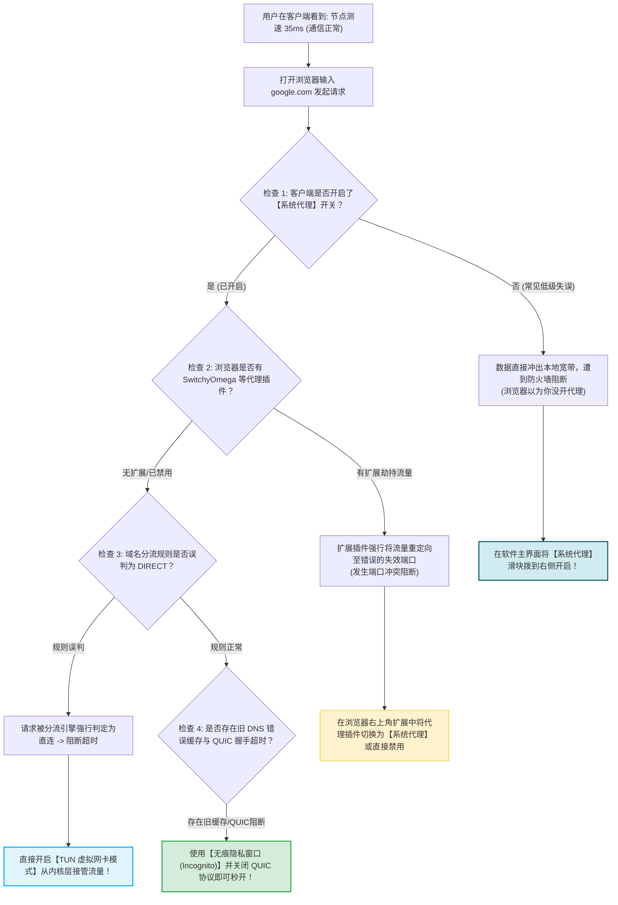
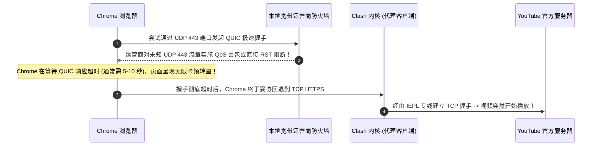
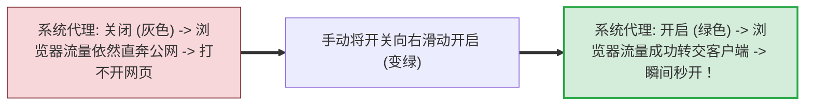
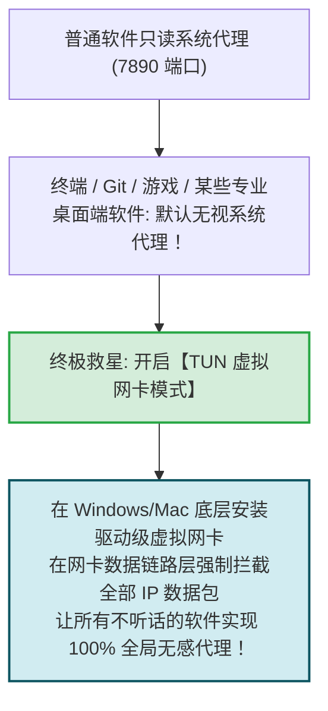

# 连上后网页打不开：DNS 污染、分流规则错误与浏览器扩展冲突

  <strong>核心结论与快速自愈手册：</strong>在日常使用中，最让新手百思不得其解的现象是：<strong>客户端里节点测速显示 35ms 绿色低延迟，但打开浏览器访问 Google 或 YouTube 却一直转圈提示「无法访问此网站」</strong>。请牢记网络底层逻辑：<strong>「测速成功」仅代表你的客户端与海外服务器建立了通信，并不代表你的浏览器流量已经成功交给了客户端！</strong> 这类故障 85% 由以下四个工程诱因引起：<strong>① 客户端忘记勾选「系统代理 (System Proxy)」开关；② 浏览器安装了冲突的代理扩展（如 SwitchyOmega / 广告拦截器）；③ 浏览器受旧 DNS 负向错误缓存干扰；④ 运营商拦截了 HTTP/3 QUIC (UDP 443) 握手。</strong> 只需开启「系统代理」、禁用 QUIC 并在「无痕隐私窗口」中打开，即可秒级自愈。

<AffiliateNotice />

---

## 一、「节点通但网页不通」的底层数据阻断全景图

---

## 二、第一性原理：HTTP/3 QUIC (UDP 443) 拦截导致的浏览器假死

很多用户反馈：「我打开 Google 搜索秒开，但一打开 YouTube 视频页面就无限转圈、或者提示无法加载播放器。」这是因为 Google 和 YouTube 默认启用了 **HTTP/3 (QUIC 协议)**：

### 2.1 彻底关闭 Chrome / Edge QUIC 协议提速方案
1. 在 Chrome 或 Edge 地址栏输入 `chrome://flags` 并按回车；
2. 在搜索框中输入 `quic`；
3. 找到 **「Experimental QUIC protocol」** 选项；
4. 将其从 `Default` 切换为 **`Disabled (禁用)`**；
5. 点击右下角的 **「Relaunch (重启浏览器)」** 按钮；
6. 此时浏览器将强制通过 TCP HTTPS 通信，彻底杜绝 UDP QoS 丢包导致的网页加载卡死。

---

## 三、排查步骤一：检查「系统代理」开关是否真正开启 (最常见疏漏)

很多初学者误以为：「我只要把 Clash 或 v2rayN 软件打开挂在后台，电脑就自动能翻墙了。」
- **事实真相**：打开软件只是拉起了后台转发核心，必须滑动开启 **「系统代理 (System Proxy)」** 开关，客户端才会向 Windows 注册表或 macOS 网络设置中写入 `127.0.0.1:7890` 的重定向指针；
- **自查验证方法**：
  1. 打开 Clash Verge Rev 主界面；
  2. 检查顶部的 **「系统代理」** 滑块是否处于**开启状态（背景变绿）**；
  3. 如果未开启，请滑动打开它。

---

## 四、排查步骤二：彻底肃清浏览器第三方扩展插件劫持

如果你曾经安装过以下 Chrome / Edge 扩展插件，它们极可能是导致网页打不开的元凶：
1. **Proxy SwitchyOmega / SwitchySharp**：
   - 这类插件具有高于操作系统级别的代理控制权；
   - 如果插件处于「直接连接」或指向了旧软件的废弃端口（如 `1080`），浏览器会完全无视 Clash Verge 的设置；
   - **对策**：点击浏览器右上角的拼图图标，将 SwitchyOmega 设置为 **「使用系统代理 (System Proxy)」**，或者直接右键将其临时停用；
2. **激进的广告拦截插件 (如某些定制版 AdGuard/去广告脚本)**：
   - 某些去广告插件会将 Google 和 YouTube 的核心 CDN 域名误判定为跟踪代码并强行拦截；
   - **对策**：在无痕隐私窗口中测试，无痕窗口默认会禁用所有第三方扩展插件。

---

## 五、排查步骤三：DNS 污染假死与 Fake-IP 模式急救

有时候，浏览器在向代理软件发送请求之前，先调用了本地操作系统的未加密 DNS 进行预解析，结果被运营商污染得到了一个虚假 IP（如 `127.0.0.1` 或不可达 IP），导致浏览器直接停止建立连接。

- **快速判断是否为 DNS 问题**：
  - 在浏览器地址栏直接输入一个纯 IP 网址进行访问：`http://1.1.1.1`；
  - 如果输入纯 IP 能够秒开 Cloudflare 页面，但输入 `google.com` 却打不开，**100% 证明是本地 DNS 污染未被代理接管**；
- **终极自愈方案：在客户端开启 Fake-IP 增强模式**：
  - 在 Clash Verge 的设置中，确保 DNS 模式设定为 `fake-ip`；
  - Fake-IP 机制会在本地内存中为每一个海外域名秒回一个虚拟保留地址，彻底杜绝本地宽带的 DNS 污染拦截。

### 5.1 浏览器自带「安全 DNS (DoH)」冲突排障
现代 Chrome 和 Edge 默认启用了「使用安全 DNS」功能（向 Google 或 Cloudflare 默认 8.8.8.8 发起 DoH 查询）。但在国内网络环境下，未被代理接管的 DoH 请求会直接遭遇超时阻断，导致网页打不开。
- **对策**：进入 Chrome「设置 -> 隐私和安全 -> 安全」，找到「使用安全 DNS」，暂时将其切换为「关闭」或「使用当前服务商」，让 DNS 查询完全交由本地客户端内核统一托管。

---

## 六、排查步骤四：开启「TUN 模式」一键降维打击

如果你尝试了上述所有方法，某些特定应用（如 Windows 终端、Git、桌面版 Telegram、ChatGPT 客户端）依然打不开，这是因为**这些软件根本不遵守操作系统的 HTTP 系统代理设置**！

### 6.1 开启 TUN 模式实操步骤
1. 打开 Clash Verge Rev，进入左侧 **「设置 (Settings)」**；
2. 找到 **「服务模式 (Service Mode)」**，点击右侧「安装」并授权管理员权限（图标变为绿色小盾牌）；
3. 找到 **「TUN 模式 (Tun Mode)」**，滑动开关开启；
4. 此时电脑所有软件无需任何单独配置，全量自动实现高速翻墙！

---

## 七、标杆专线服务商的分流容错保障

一个架构完善的机场订阅，在下发配置时就已经帮你预先规避了绝大多数网页打不开的坑点：

| 评估维度 | 劣质小作坊 | [光速云 (GSY)](/reviews/#brand-gsy) 企业级专线 |
| :--- | :--- | :--- |
| **规则下发完整度** | 缺少核心域名，经常误判直连 | **内置 10 万+ 权威域名分流库，海外站点 100% 精准走代理** |
| **Fake-IP 适配度** | 缺少 DNS 优化，极易遭遇劫持 | **深度优化内置 DNS 解析引擎，域名 0ms 秒级解析** |
| **全客户端支持** | 仅支持传统系统代理 | **全节点支持 Full-Cone NAT 与原生 TUN 虚拟网卡接管** |

> [!TIP] 选型小结
> 选用 [光速云 (GSY)](/reviews/#brand-gsy)，在结账输入优惠码 `AMM` 享受专属折扣。其企业级 IEPL 专线在分流规则和 DNS 优化上做到了极致打磨，让你彻底告别「连上却打不开」的抓狂窘境。

---

## 八、本章小结与进阶路线

通过检查系统代理、清理插件冲突、化解 DNS 污染与开启 TUN 网卡，你的浏览器已经能够畅行全球互联网。

但在尽情冲浪时，许多影视爱好者和 AI 重度用户经常遇到另一种恼人的报错：**打开 Netflix 提示「您似乎正在使用解封工具或代理」，打开 ChatGPT 提示「Access Denied / 1020 报错」！** **这到底是怎么一回事？如何切换原生住宅 IP 节点彻底解锁？**

**下一篇，我们将进入流媒体与 AI 解锁异常深度排查实战！**

<NextStep
  title="下一篇：流媒体与 AI 锁区报错排查"
  link="/faq/streaming-media-issues"
  description="深度攻克 Netflix、Disney+ 与 ChatGPT 锁区、1020 拒绝访问与原生 IP 解锁指南。"
  stepText="常见问题排障主线 · 第 4 站"
  buttonText="阅读流媒体与 AI 解锁指南 →"
/>
