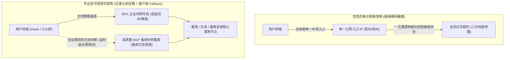

# 突发断网应急自救指南：主力机场维护时的 2 分钟安全复活 SOP (2026 深度实操)

<div class="answer-first-lead">
  <strong>核心结论与先验建议 (Answer-First)：</strong>在高度动态变化的跨境互联网中，<strong>没有任何单一服务商或机房能够保证 365 天“绝对零维护、零故障”</strong>。海底地震光缆断裂、上游运营商机房割接维护、特定入口 IP 遭受大流量攻击，都是不可避免的物理客观规律。对于高度依赖网络的科研人员、外贸业务员与出海从业者而言，<strong>避免断网事故的关键从来不是寻找“100% 永不断线的神仙机场”，而是建立自身的「高可用多层容灾防线」</strong>。突发断网时的**「三级应急自愈 SOP」**：① 一级秒级自愈 (0~10秒)：在客户端内切换至主机场提供的<strong>「备用线路 / 备用入口节点」</strong>；② 二级快速自救 (30秒内)：调出客户端内平时配置好的<strong>「廉价备用机场订阅（如 5.6 元档）」</strong>，实现异构平台热备；③ 三级终极兜底 (2分钟内)：使用手机 4G/5G 个人热点，在<strong>[光速云 (GSY)](/reviews/#brand-gsy)</strong>使用新邮箱注册，利用系统赠送的纯净专线流量快速一键导入，完成核心紧急业务。
</div>

<AffiliateNotice />

---

## 一、高可用容灾的第一性原理：为什么大厂永远遵循“冗余架构”？

在云计算架构设计中，亚马逊 AWS 与谷歌云之所以能为全球数亿用户提供高可用服务，核心就在于坚决践行**「故障隔离（Fault Isolation）与冗余（Redundancy）」**原则：



### 1.1 为什么很多廉价小机场一出事就全员抓瞎？
* 廉价小作坊为了压缩成本，通常只租用了一条入口公网光缆和一个极其廉价的海外出口机房。一旦该机房突发电信割接施工，整个机场所有节点在几秒内集体变红。
* **专业级品牌的设计思维**：像[光速云](/reviews/#brand-gsy)这样的成熟服务商，在底层天然部署了**「双线路冗余企业级物理架构」**。主通道走深圳/上海的 IEPL 物理企业专线，同时常年配备了一套独立部署的高质量中转容灾集群。当主干物理光缆发生不可抗力突发事件时，系统探针会自动触发 BGP 路由漂移，将流量静默引导至备用通道。

---

## 二、突发断网 2 分钟安全自救标准化 SOP (手把手教学)

当你的网络在关键时刻（如正在进行跨国面试、提交学术论文或进行外贸商务签约）突发中断时，切勿慌乱病急乱投医去下载网盘木马软件。请严格按照以下标准三步法从容应对：

### 2.1 步骤 1：排查本地系统基础环境（排除 80% 的乌龙问题）
在断定机场宕机之前，先花 10 秒钟快速排除本地设置冲突：
1. **核对系统时间**：Windows / Mac 系统时间是否比真实北京时间快/慢了超过 60 秒？现代加密协议（VLESS / VMess）具有严格的时间戳握手校验，时间不准会导致全节点连接握手失败；
2. **检查系统代理开关**：确认客户端界面的“系统代理（System Proxy）”是否不小心被误触关闭；
3. **切换移动手机热点**：电脑如果连着公司局域网或校园网，临时用手机开启 4G/5G 个人热点连接电脑，排除校园网锐捷认证或内网防火墙的拦截；若电脑无线网卡故障，可使用手机 USB 数据线连接电脑，并在手机网络共享中开启「USB 网络共享」，直接模拟千兆有线网卡接入移动蜂窝网络，硬件级绕过局域网冲突。

### 2.2 步骤 2：切换至主机场的“备用中转 / 容灾节点”
打开客户端（以 Clash Verge Rev 或 Shadowrocket 为例）：
1. 在节点分组中，向下翻动找到带有 **「备用」**、**「中转-备选」** 或 **「BGP-备」** 字样的节点；
2. 点击切换至该节点，并在浏览器中刷新网页。正规大厂（如光速云）通常会保证备用通道的 7×24 小时独立在线。

### 2.3 步骤 3：紧急调用正规专线试水包（零成本 2 分钟复活）
如果主力服务商遭遇百年一遇的全网机房维护，请按照以下绝对安全的“免费应急法”：
1. 使用手机蜂窝网络打开[光速云官网后台](/reviews/#brand-gsy)；
2. 使用一个新的常用邮箱花费 20 秒完成快速注册；
3. 领取系统赠送的 **1GB 真实 IEPL 专线体验流量**；
4. 点击“一键导入”，调起手机端小火箭或电脑端 Clash，即可在 2 分钟内满血恢复高速网络，解燃眉之急！

---

## 三、进阶技巧：在 Clash 中配置“全自动故障转移 (Fallback) 策略组”

对于不想手动切换节点的进阶用户，可以在 Clash Verge Rev 中配置自动健康检查组。当主力节点发生超时的瞬间，软件会在后台自动为你无缝切换至备用节点，实现**真正的“零感知断网自愈”**：

```yaml
# 在 Clash 扩展配置 (Script/Merge) 中添加如下策略组示例：
proxy-groups:
  - name: "⚡ 智能自动容灾故障转移"
    type: fallback
    url: "http://cp.cloudflare.com/generate_204"
    interval: 180  # 每 3 分钟自动探测一次节点存活状态
    tolerance: 50  # 延迟容忍波动阈值 (ms)
    proxies:
      - "光速云-香港IEPL专线 01"  # 主用第一顺位高速节点
      - "光速云-香港IEPL专线 02"  # 主用第二顺位冗余节点
      - "光速云-香港备选中转 01"  # 容灾备用中转通道
      - "备用机场-香港节点 01"    # 异构备用机场兜底节点
```

> [!TIP] 策略组工作逻辑
> 当客户端检测到第一顺位的专线节点在 5 秒内未返回 HTTP 204 成功代码时，内核算法会在毫秒内将出站流量自动顺延至下一顺位的备选节点，全过程你的浏览器、海外视频流或后台 Git 下载工具甚至察觉不到任何中断，真正实现无缝热备！

### 3.1 Fallback 与 URL-Test 及 Load-Balance 策略对比

| 策略组类型 | 路由决策机制 | 适用业务场景 | 潜在缺点与风控考量 |
| :--- | :--- | :--- | :--- |
| **Fallback (故障转移)** ⭐ | 严格按列表物理顺序优先，首选挂掉才切备用 | **高价值核心业务** · ChatGPT、跨国网银、考级提交 | 备选节点平时闲置，不分担主力节点带宽 |
| **URL-Test (自动优选)** | 周期探测所有节点，始终把流量引向延迟最低者 | 网页浏览、YouTube 追剧、轻量社交 | 出口 IP 动态漂移，容易导致账号被风控要求重新登录 |
| **Load-Balance (负载均衡)** | 采用轮询 (Round-Robin) 或一致性哈希多节点并发分摊 | 批量下载大文件、Git 多线程拉取镜像 | TCP 长连接可能由于出口频繁变动导致下载中断 |

---

## 四、Telegram 官方原生 MTProto 紧急备用隧道配置

当你的代理软件发生全局端口崩溃或驱动异常时，连客服网站都进不去，该如何向机场客服寻求帮助？
- **原理**：Telegram 官方客户端内置了独立的 **MTProto 代理通道**，直接在应用层与系统网络解耦；
- **配置方法**：
  1. 打开 Telegram 设置 → 「数据与存储」→ 「代理设置」；
  2. 点击「添加代理」→ 选择 **MTProto 代理**；
  3. 输入机场官方频道常年公开的备用代理服务器域名、端口与专属 32 位十六进制 Secret 密钥；
  4. 开启开关后，即使你的电脑完全没有运行 Clash 或系统代理发生崩溃，Telegram 聊天窗口依然能够秒级连通官方技术客服群组，实现无障碍一对一故障报修与备用节点获取。

---

## 五、真实小白突发断网自救实录 (1:1 案例库)

### 案例 1：海外线上英语考级中途断连，应急备用 90 秒力挽狂澜
* **学员档案**：准备申请留学的大学生小刘，参加多邻国（Duolingo English Test）线上远程英语考试。
* **惊魂时刻**：考试进行到口语测试核心环节时，平时使用的低价小机场突然因上游光纤故障全线泛红。由于该考试系统对网络中断有严格的时限要求（网络中断超过 3 分钟即判定考试作废并没收 3000 元考试费）。
* **自救实录**：小刘此前认真研读过本站指南，电脑客户端内早已预先导入了[光速云](/reviews/#brand-gsy)的月付订阅。小刘仅用 3 秒钟在客户端任务栏右键将节点切换为光速云香港专线，网络瞬间满血复活，口语测试顺利上传，最终成功拿到 125 分优异成绩。
* **实战结论**：**永远不要等到断网瘫痪的那一刻才去想办法，平时的“双备份意识”是化解一切危机的盾牌**。

---

## 六、痛点心流驱动：选择自带“双保险”的省心主力专线

很多小作坊之所以让你整天提心吊胆，是因为他们把“单点故障”的全部风险都转嫁到了用户头上。

而在[光速云 (GSY)](/reviews/#brand-gsy)的产品哲学中，容灾保障是刻在系统底层的基础配置：

<BrandCard brandId="gsy" />

<div class="metaphor-box">
  <div class="metaphor-title">💡 为什么光速云能给你带来永不失联的安全感？</div>
  <ul>
    <li><strong>原生双专线物理冗余</strong>：核心骨干网由两条物理路由完全隔离的 IEPL 企业专线组成，一条光缆施工检修，另一条毫秒级无缝承载。</li>
    <li><strong>多地 BGP 入口智能宣告</strong>：华南深圳、华东上海、华北北京三大多线 BGP 入口协同，即使某个省份的运营商公网出口出现异常，智能调度探针也能瞬间将你分流至健康机房。</li>
    <li><strong>平民化超低资费门槛</strong>：起步套餐折合仅需 <strong>8元/月</strong>，在结账收银台输入官方专属优惠码 <code>AMM</code> 更享立减优惠，用一杯奶茶的钱为你的学习与事业构筑永不断电的网络护城河。</li>
  </ul>
</div>

<PromoCard brandId="gsy" />

---

## 七、第二栏目全景总结与下一栏目学习路线

至此，你已经完整掌握了第二栏目【免费机场与应急资源】的全部核心知识。你不仅认清了免费背后的黑灰产链条与物理极限，更掌握了正规试用白嫖与突发自救的高级技巧。

接下来，我们将正式踏入系统化认知的基石栏目——**第三一级栏目【什么是机场 `/what-is-airport/`】**，从第一性原理彻底搞懂节点、订阅、协议与 VPN 的本质区别：

1. **什么是机场概念认知总览**：阅读 [`/what-is-airport/`](/what-is-airport/) 建立全景知识通识；
2. **机场与传统 VPN 的本质区别**：阅读 [`/what-is-airport/vs-vpn`](/what-is-airport/vs-vpn) 搞懂为什么普通 VPN 早已无法顺畅出海；
3. **节点与订阅链接深层原理**：阅读 [`/what-is-airport/nodes-explained`](/what-is-airport/nodes-explained) 了解配置文件背后的数据交换逻辑。

---

<NextStep
  title="下一步：开启第三栏目学习 · 什么是机场？(零基础认知通识)"
  link="/what-is-airport/"
  description="告别一知半解！从计算机网络通信本质出发，用生活化生动比喻彻底搞懂机场、节点、订阅链接与传统 VPN 的底层区别。"
  stepText="新手进阶 · 下一步"
  buttonText="进入『什么是机场』认知大厅 →"
/>
