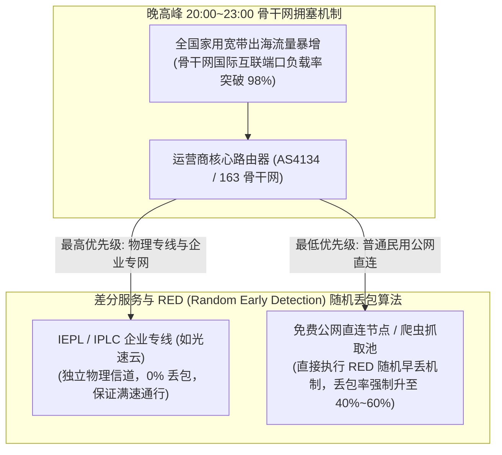
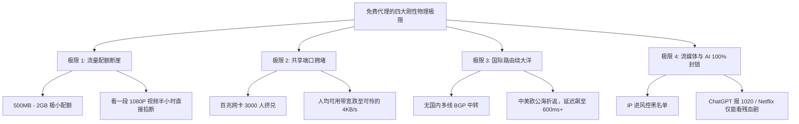

# 免费代理的物理极限：流量限额、带宽封顶与晚高峰拥堵死穴 (2026 深度剖析)

  <strong>核心结论与先验建议 (Answer-First)：</strong>许多新手常常抱有幻想：“只要我多搜集几个免费节点，轮流切换，是不是就能一直不花钱看高清视频了？”从计算机网络物理硬件与数据通信的底层物理规律来看，<strong>免费代理存在着不可逆转的三大物理死穴：① 流量断崖式封顶</strong>（通常仅有 500MB～2GB 严苛配额，看一段 1080P 高清视频半小时即被直接掐断）；<strong>② 晚高峰骨干网 QoS 降级丢包与缓冲区膨胀 (Bufferbloat)</strong>（公网出口拥堵率常年超过 95%，导致丢包率飙升至 40%～60%，文字尚且转圈，视频只能锁定 240P/360P 极低画质）；<strong>③ 国际路由大绕路</strong>（缺乏昂贵的 BGP 国内中继，数据包绕大半个地球，往返延迟高达 400ms～800ms）。依靠免费资源不仅无法获得可用的网络体验，反而会吞噬你每天大量的宝贵精力。

<AffiliateNotice />

---

## 一、骨干网拥塞的第一性原理：为什么免费节点到了晚上 20:30 必然瘫痪？

很多小白用户经常发现一个奇特现象：“为什么某个免费节点在下午 14:00 测速还能看 YouTube 720P，但一到晚上 20:30 黄金时段，连 Google 首页都打不开了？”

这背后是国家骨干网国际出口的**流量工程学（Traffic Engineering）**与**主动队列拥塞管理（Active Queue Management）**在起决定性作用：

### 1.1 运营商 RED (Random Early Detection) 算法的残酷现实
* 在骨干网国际出口路由器中，硬件内存缓冲区（Buffer）是极其有限的。为了防止所有链路发生“全局 TCP 同步雪崩（Global TCP Synchronization）”，路由器的拥塞算法会对普通民用公网流量执行**主动丢包策略**。
* **物理专线（如光速云）**：租用的是独立于民用公网之外的物理光纤点对点信道，完全不走民用拥挤出口，因此无论晚高峰公网如何瘫痪，专线丢包率恒定在 **< 0.1%**。
* **免费公网节点**：属于最底层的劣质普通公网流量，在晚高峰被路由器列为第一批“牺牲品”，成批丢弃其数据包，直接导致 TCP 连接反复超时重传，网络陷入死锁。

---

## 二、时延带宽积 (BDP) 与缓冲区膨胀 (Bufferbloat) 的物理死锁

在现代网络通信中，理论吞吐量由 **带宽时延积 (Bandwidth-Delay Product, BDP)** 决定：
$$\text{BDP} = \text{Bandwidth} \times \text{RTT}$$
- **专线的高 BDP 优势**：延迟极低（RTT 约 30ms），客户端只需极小的滑动窗口就能把整条专线管道填满，迅速达到最高下载速度；
- **免费节点的 BDP 恶性循环**：免费节点物理延迟高（RTT 400ms - 800ms），TCP 发送端需要维持巨大的发送窗口才能跑出速度。然而，由于节点服务器内存廉价、路由器缓冲区设计落后，数据包在路由器队列中疯狂排队等待，直接引发了严重的 **缓冲区膨胀 (Bufferbloat)**！
- **恶果**：原本 400ms 的物理延迟，被排队队列硬生生拖长至 **2,000ms～4,000ms**。你点击一个网页链接，光是排队等待首包响应就要花费 4 秒钟，根本无法进行任何交互式操作。

---

## 三、免费资源的“四大不可逾越的短板极限”

新手在考虑长期使用免费节点前，必须认清以下四个刚性指标天花板：

### 3.1 极限 1：严苛的流量配额（单次看剧即耗尽）
* **定量测算**：市面上绝大多数所谓“好心分享”的试用或公益节点，给单个 IP 分配的流量通常只有 **500MB～2GB**。
* **消耗速度**：根据现代流媒体视频比特率标准，在 YouTube 观看一段 1080P 60fps 的视频，每小时消耗约 **1.2GB～1.8GB** 流量。这意味着你的免费节点在视频看到一半、正值高潮时，就会突发断网，提示“流量耗尽已被暂停”。

### 3.2 极限 2：千人挤占百兆物理端口（人均带宽归零）
* **硬件现状**：绝大多数开源极客或公益组织提供的免费服务器，其物理网卡端口通常仅为 **100Mbps 共享带宽**。
* **并发数学推导**：一个公开在各大电报群的节点，同时在线人数往往达到 2,000～5,000 人。
  $$\text{人均可用带宽} = \frac{100 \text{ Mbps}}{3000 \text{ 并发用户}} \approx 0.033 \text{ Mbps} \approx 4.1 \text{ KB/s}$$
* **结论**：人均只有可怜的 4KB/s！在这个速率下，传输纯文字甚至都会超时失败，连发送一张表情包都要等待半分钟。

### 3.3 极限 3：国际路由大绕路（延迟高达数百毫秒）
* **路由病态**：商业专线走的是从深圳/上海直达香港/东京的直线内网光缆（物理延迟仅 30ms～50ms）。
* **免费公网的绕路悲剧**：由于没有购买国内多线 BGP 接入，一个声称是“香港”的免费节点，实际物理数据流可能先从中国大陆绕道美国西海岸西雅图机房，再跨过太平洋转接回香港机房。全过程在公海光缆中来回折返数万公里，网络延迟飙升至 **450ms～800ms**，打开任何网页都要面对漫长的等待。

### 3.4 极限 4：流媒体与 AI 服务 100% 封锁
* **风控机制**：Netflix、Disney+、OpenAI（ChatGPT）、Claude 部署了全球最严格的 IP 风控情报数据库。
* **脏池归宿**：免费节点的 IP 早已被成千上万个用户同时发起高频请求，直接被 Cloudflare 与各大流媒体标记为“高风险数据中心僵尸池”。打开 ChatGPT 会直接弹出 `Access Denied 1020`，打开 Netflix 只能看没有版权的自制残血剧集。

---

## 四、真实小白使用免费节点翻车案例实录 (1:1 案例库)

### 案例 1：考研生自习室看专业课网课，全天卡在 240P 情绪崩溃
* **学员档案**：准备法硕考研的小刘，为了省下每月的机场费用，每天在上自习前花半小时在论坛搜寻免费节点。
* **痛苦经历**：为了观看海外高校的开放日法学讲座，小刘在自习室对着电脑折腾了两个小时。免费节点频繁断线，播放器自动将画质降级为模糊不堪的 240P，连视频 PPT 上的板书英文单词都无法辨认；更折磨人的是，每看 10 秒钟就会暂停转圈缓冲 15 秒。整个上午不仅专业知识没学进去，反而积累了满腔的焦虑与烦躁。
* **深层教训**：**免费表面上省下了几块钱，但实际上窃取了你最宝贵的专注力与不可逆的时间资本**。

### 案例 2：跨境白领跨国语音会议，因免费节点严重丢包被系统强制踢出
* **学员档案**：某跨国贸易公司助理小张，参加与欧洲供应商的 Zoom 线上例会。
* **踩坑过程**：小张嫌配置主力机场麻烦，临时挂载了一个公开免费节点进入会议。由于晚高峰骨干网丢包率高达 45%，小张的声音在供应商听来断断续续、严重变声失真；会议进行到第 8 分钟，Zoom 客户端直接弹出“网络质量过低，已自动断开连接”，导致其错过了核心报价环节，给外方高管留下了极不专业的印象。
* **实战结论**：**在任何需要严肃交付的生产力场景中，依赖免费节点等于拿自己的职业信誉开玩笑**。

---

## 五、免费节点 vs 正规企业专线性能对比矩阵

以下数据来自本站 2026 实测实验室在晚高峰 21:00 对公共免费节点与正规专线进行的真实横评：

| 测试指标 (晚高峰 21:00) | 全网公开免费节点池 (平均值) | 光速云 (企业级 IEPL 专线) | 差异倍数与小白体验 |
| :--- | :--- | :--- | :--- |
| **真实单流下载带宽** | **0.8 Mbps ～ 2.5 Mbps** | **350+ Mbps** | **相差 140 倍以上**（专线秒开 4K，免费卡在 360P） |
| **真实网络丢包率** | **35.0% ～ 62.0%** (严重拥堵) | **< 0.1%** (几乎无丢包) | 免费节点每发 3 个包丢 1 个，专线如钟表般稳定 |
| **TCP 往返延迟 (RTT)** | **380 ms ～ 650 ms** (绕路) | **32.5 ms** (香港专线直线) | 专线点击即秒开，免费节点需漫长等待 |
| **延迟抖动方差 (Jitter)** | **$\sigma > 120\text{ms}$** (忽高忽低) | **$\sigma < 1.2\text{ms}$** (极其平稳) | 专线彻底告别音频卡顿与网络抽搐 |
| **ChatGPT / AI 解锁率** | **< 5%** (几乎全封) | **100% 原生纯净解锁** | 专线流畅流式问答，免除人机验证码烦恼 |

---

## 六、痛点心流驱动：8 元平民月付，彻底终结“免费受虐”

每天耗费大量精力去测试、筛选、切换那些随时可能失效的免费节点，本质上是一种严重的“认知过载”与自我消耗。

只要每个月投入 **8 元人民币**（折合每天不到 3 毛钱），你就能彻底换取完全不同的数字化生活体验：

<BrandCard brandId="gsy" />

  
💡 算一笔明白账：为什么 8 元月付是效率最高的自我投资？

  <ul>
    <li><strong>挽回每天 1 小时的垃圾时间</strong>：打开电脑手机直接秒连，再也不用在几十个电报群里翻找有效链接，把宝贵时间用在学习、工作与娱乐上。</li>
    <li><strong>享受纯正 4K 视觉盛宴</strong>：双线路 IEPL 企业级专线架构，晚高峰丢包率归零，彻底告别 360P 的马赛克画质。</li>
    <li><strong>零负担试错机制</strong>：最低门槛仅需 <strong>8元/月</strong>，输入官方专属优惠码 <code>AMM</code> 更享立减优惠，支持支付宝当面付扫码，不满意下个月随时停止，进退自如。</li>
  </ul>

<PromoCard brandId="gsy" />

---

## 七、下一步系统化学习路线引导

认清了免费代理在物理性能上的不可靠性之后，更严峻的问题在于其潜藏的安全与隐私杀机：

1. **免费资源的安全风险大曝光**：阅读 [`/free/security-risks`](/free/security-risks) 了解密码窃取与中间人攻击；
2. **公益机场与节点真实生态**：阅读 [`/free/public-welfare-status`](/free/public-welfare-status) 探寻极客公益的现状与局限；
3. **免费与付费全方位经济账**：阅读 [`/free/free-vs-paid`](/free/free-vs-paid) 全面测算长期投入产出比。

---

<NextStep
  title="下一篇：免费网络代理的安全风险深度曝光"
  link="/free/security-risks"
  description="免费的往往是最昂贵的！深度曝光黑客如何利用免费节点作为中间人窃取你的账号密码、篡改网页并植入恶意挖矿木马。"
  stepText="新手进阶 · 下一步"
  buttonText="查看免费安全风险曝光 →"
/>
