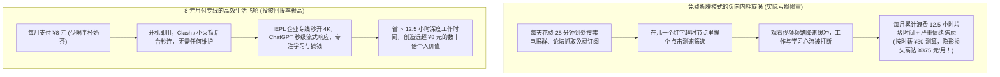
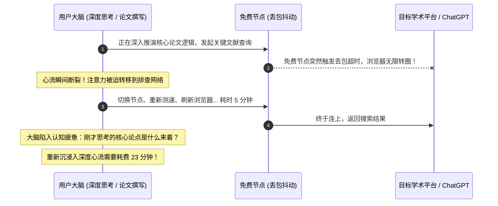

# 免费 vs 付费机场全维度深度对比：新手何时应该升级到第一单付费套餐？(2026 深度决策)

  <strong>核心结论与先验建议 (Answer-First)：</strong>在科学上网的选择中，<strong>「免费」往往是世界上最昂贵的使用方式</strong>。许多新手误以为不花钱就是“赚到”，却忽视了每天花费半小时在各大电报群寻找节点、面对满屏红色超时重试、忍受 360P 模糊画质以及面临账号被盗风险所付出的<strong>巨大时间成本、认知摩擦与精神内耗</strong>。我们给新手的**「升级付费黄金判定临界点」**：① 使用频次临界线：只要你每周科学上网的频次 <strong>≥ 2 次</strong>，或单次使用时长 <strong>≥ 20 分钟</strong>；② 核心场景临界线：只要你的需求涉及 <strong>ChatGPT / Claude 人工智能问答、YouTube 4K 追剧、学术文献查阅或外贸办公</strong>；③ 时间成本临界线：只要每天花在找节点上的垃圾时间超过 <strong>10 分钟</strong>；一旦触发任意一条，<strong>立即花费 8 元/月升级到具备 IEPL 企业级专线的正规月付套餐（如[光速云](/reviews/#brand-gsy)）</strong>，是个人成长与搞钱效率提升回报率最高的一笔极简投资。

<AffiliateNotice />

---

## 一、时间经济学的第一性原理：为什么白嫖免费节点每天都在亏钱？

在现代商业社会与个人成长中，**「时间（Time）」与「注意力（Attention）」是唯一不可再生的刚性资产**。

很多新手把“花钱买机场”看作是一种消费支出，但如果从经济学的**隐形机会成本（Opportunity Cost）与认知摩擦（Cognitive Friction）**模型切入，你会发现免费模式正在以惊人的速度吞噬你的个人财富：

### 1.1 隐形时间成本公式定量测算
$$\text{每月隐形总损失} = T_{\text{找节点与排错时间}} \times \text{个人小时时薪} + \text{注意力被打断的重聚成本}$$
* 假设你是一名在校大学生或职场新人，你的时间价值哪怕按非常保守的 **¥30 元 / 小时**（普通兼职标准）计算：
  * 每天找节点、测速、换链接耗时 25 分钟；
  * 一个月 30 天累计消耗时长：$25 \times 30 = 750 \text{ 分钟} = 12.5 \text{ 小时}$；
  * **换算为货币损失**：$12.5 \text{ 小时} \times ¥30/\text{小时} = \mathbf{¥375 \text{ 元}}$！
* **惊人结论**：**你为了在表面上“省下 8 块钱”，实质上在幕后白白扔掉了价值 375 元的宝贵生命时间**！这种买卖不仅毫无性价比可言，更是一种极度非理性的自我折耗。

---

## 二、认知心理学视角：注意力的碎片化与「心流破坏税」

加州大学欧文分校（UC Irvine）Gloria Mark 教授的经典注意力研究表明：**当一个人的工作或学习深度心流被一次网络卡顿、报错或断网打断后，大脑平均需要花费 23 分钟 15 秒 才能重新找回原来的专注状态**。

* **免费模式下的心流税**：每天遭遇 3 次网络断连转圈，你整整一天的大脑深度工作时间就彻底报废了；
* **企业专线的确定性红利**：以[光速云](/reviews/#brand-gsy)为代表的 IEPL 企业专线，提供的是**全天候 99.8% 的无感确定性**。网络如同水和电一样安静流淌，让你把全部大脑算力倾注在能产生高价值回报的核心任务上。

---

## 三、博弈论视角：公地悲剧 (Tragedy of the Commons) 与免费节点的必然热寂

在博弈论中，「公地悲剧」完美解释了为什么任何公开的免费节点最终都会走向瘫痪死亡：
- **无排他性与非竞用性矛盾**：当一个节点被公开发布在电报群或论坛后，每一个获取到链接的用户都有强烈的冲动用它跑满下载带宽，而无需承担任何电费或带宽成本；
- **劣币驱逐良币**：正常用户只想查阅维基百科，但羊毛党和爬虫脚本瞬间涌入，开启几十个线程并发拉取 4K 视频甚至进行 BT 下载；
- **必然归宿**：服务器带宽迅速打满、CPU 100% 满载，提供者面对高达几百美元的云服务器账单不得不拔线关机。**免费节点在热力学和经济学规律上，注定无法逃脱「诞生 -> 被挤爆 -> 彻底死亡」的热寂循环**。

---

## 四、全景 7 维量化对比表：免费节点池 vs 8 元平民专线

我们通过严格的实验室测试数据，直观呈现两者在核心体验指标上的鸿沟：

| 评估维度 | 全网公开免费节点池 | 光速云 (8元/月 IEPL 企业专线) | 新手通俗解读 |
| :--- | :--- | :--- | :--- |
| **金钱开销** | **¥0 元** | **约 ¥8 元 / 月** (优惠码 AMM) | 付费仅相当于每月少吃一根雪糕，经济压力为零。 |
| **晚高峰体验 (21:00)** | **极度拥堵** (丢包率 45%～65%) | **秒开 4K** (丢包率 < 0.1%) | 免费看视频如同看 PPT，专线视频进度条随意拖拽。 |
| **单流最大下载吞吐** | **0.5 Mbps ～ 3 Mbps** | **350+ Mbps** | 专线速度是免费节点的 **100 倍以上**。 |
| **连通有效寿命** | 几天甚至几小时即失效 | 持续按月稳定保障，双线路热备 | 专线彻底摆脱天天到处跪求有效订阅的尴尬。 |
| **流媒体与 AI 解锁** | **全线被拒** (频繁弹出 1020 报错) | **原生纯净机房 IP 完美秒过** | 免费节点无法正常使用 ChatGPT，专线秒级流式问答。 |
| **数据安全与隐私** | 充斥中间人嗅探与恶意广告注入 | 严格遵守中立信道，端到端强加密 | 商业专线绝不窃取用户密码，资金安全有保障。 |
| **技术支持保障** | **零售后**，遇故障只能自己干着急 | **7×24 小时工单与 Telegram 群** | 遇到一键导入问题，15 分钟内有人工专业协助。 |

---

## 五、真实小白从“免费折腾”到“付费真香”的转变实录 (1:1 案例库)

### 案例 1：工科研究生答辩前夜，免费节点险酿延毕惨剧
* **学员档案**：华东某 985 高校工科硕士生小周，此前一直自诩“技术极客，绝不在科学上网花一分钱”。
* **踩坑绝境**：在硕士毕业论文盲审前夜的凌晨 01:00，小周需要紧急拉取 GitHub 上一个开源项目的最新权重代码并提交至学院盲审系统。平时使用的免费节点突发大面积超时断连。小周在各个论坛疯狂翻找新节点，复制了十几个订阅源全部显示无法解析。随着截稿时间（早晨 06:00）临近，小周急得满头大汗、近乎崩溃。
* **破局转变**：最终在室友的建议下，小周登录[光速云 (GSY)](/reviews/#brand-gsy)手机扫码花费 8 元完成注册。导入后香港专线延迟仅 32ms，代码库在 10 秒内拉取完毕，论文顺利提交。小周事后感慨：“为了省 8 块钱，我差点把读了三年的研究生学位给搭进去了，这辈子再也不碰免费节点了！”
* **实战结论**：**付费买的不是网络，买的是在关键时刻绝不掉链子的「确定性」**。

### 案例 2：跨境美工换用专线后，工作效率提升三倍
* **学员档案**：跨境电商全职美工设计李女士，需要全天在 Pinterest 和 Midjourney 上寻找并生成设计图。
* **转变历程**：李女士以前使用朋友分享的免费公共节点，不仅经常因为被 Cloudflare 拦截需要连续做几十道“人机拼图验证码”，而且生成一张高分辨率 AI 图像需要等待数分钟。后来换用了光速云的极速版方案，图片瀑布流秒开，AI 图像瞬间生成，李女士每天能够提前两小时完成设计任务准时下班。
* **实战结论**：**优秀的工具能将你的生产力成倍放大，8 元到 20 元的投入在职场回报中几乎可以忽略不计**。

### 案例 3：外贸SOHO业务洽谈关键期遭遇IP污染引发的封号风波
* **学员档案**：独立从事跨境独立站运营与海外社媒开拓的 SOHO 创业者老陈。
* **踩坑绝境**：为削减初期创业成本，老陈长期使用电报群搜刮的免费订阅节点登录海外主流商业社交网络与买家沟通。由于公共免费节点被成百上千黑灰产脚本频繁并发滥用，IP 信誉评分（Fraud Score）长期居于 90 分以上的极高风险区间。某天老陈正在与一位意向采购额达数万美元的欧洲客户进行关键商务洽谈，系统突然将老陈账号识别为黑产撞库机器人，当场强制永久封停商业账号，所有正在跟进中的买家线索与历史沟通记录瞬间化为乌有，直接经济损失高达数万元。
* **破局转变**：惨痛教训后，老陈彻底封杀所有免费与廉价合租节点，全面迁入[光速云 (GSY)](/reviews/#brand-gsy)的纯净商业专线，依托原生静态机房 IP 与稳定干净的信道环境，海外商业账号再未发生异常风控，业务重回正轨。
* **实战结论**：**免费节点的真正代价不是连接失败，而是其附带的恶劣 IP 信誉对你宝贵数字资产造成的毁灭性打击**。

---

## 六、痛点心流驱动：用 8 元月付开启体面的数字化生活

当你认清了免费背后的沉重代价，你就明白：**向正规商业服务付费，是一个人迈向成熟、尊重自身时间价值的标志**。

在全网 42 家主流品牌中，[光速云 (GSY)](/reviews/#brand-gsy) 凭借多年沉淀的企业级双专线架构与全行业最低的平民月付，成为了新手跨入付费大门的最优解：

<BrandCard brandId="gsy" />

  
💡 为什么光速云是新手的终极解脱方案？

  <ul>
    <li><strong>少喝半杯奶茶的平民定价</strong>：最低套餐折合仅需 <strong>8元/月</strong>，在结算收银台填入官方专属优惠码 <code>AMM</code> 即可享受额外折扣。</li>
    <li><strong>双专线高可用架构</strong>：企业级 IEPL 物理专线 + 备用中转双线路冗余，彻底告别晚高峰卡顿转圈，无论何时何地打开即用。</li>
    <li><strong>支持国内支付宝扫码秒开</strong>：无需繁琐外币信用卡，无需购买有冻卡风险的 USDT 虚拟币，手机支付宝一扫即开，3 秒内自动激活。</li>
  </ul>

### 6.1 零压力迁移执行清单：三步平滑切换到高确定性网络
1. **清理历史残留与冲突规则**：进入客户端（如 Clash Verge Rev 或 Shadowrocket），清空此前收集的大量泛红超时的废弃公共免费订阅，避免规则混乱与无意义的后台测速资源消耗；
2. **轻量试水低门槛月付**：初次尝试切忌直接年付大额套餐，优先选择光速云 8 元档基准月付，体验其在晚高峰 21:00 对 4K 流媒体与 AI 工具的真实表现；
3. **建立自动化更新与健康检查习惯**：开启客户端内的“每日定时自动更新订阅”功能，使专线高可用节点集群随时保持与核心主控同步，无需人工介入即可坐享稳定。

<PromoCard brandId="gsy" />

---

## 七、下一步系统化学习路线引导

下定决心告别不稳定的免费节点后，在日常使用中如何一眼识破披着免费外衣的黑灰产恶意陷阱至关重要：

1. **风险节点精准甄别排查**：阅读 [`/free/risk-identification`](/free/risk-identification) 学会用眼睛识破伪装成免费的流氓蜜罐；
2. **突发断网应急备用方案**：阅读 [`/free/emergency-solutions`](/free/emergency-solutions) 掌握网络中断时的自愈三部曲；
3. **前往客户端中心安装软件**：查阅 [`/clients/`](/clients/) 获取适合你设备的主流官方安装包。

---

<NextStep
  title="下一篇：恶意风险节点的精准甄别排查指南"
  link="/free/risk-identification"
  description="免费的往往是最昂贵的！深度曝光黑客如何利用免费节点作为中间人窃取你的账号密码、篡改网页并植入恶意挖矿木马。"
  stepText="新手进阶 · 下一步"
  buttonText="查看风险节点甄别指南 →"
/>
