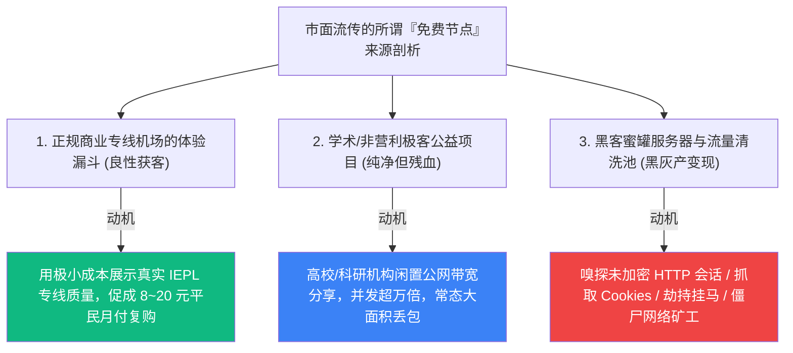
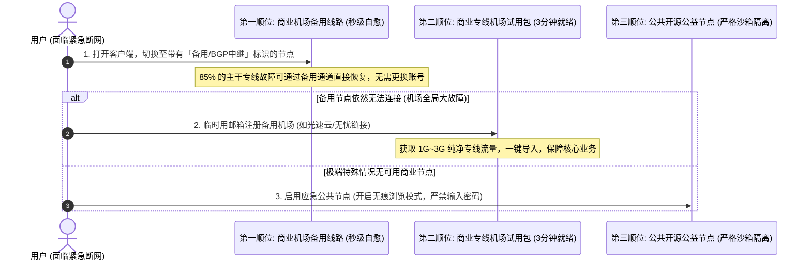

# 免费机场与应急资源：新手如何安全白嫖与零风险体验 (2026 深度指南)

  <strong>核心结论与先验建议 (Answer-First)：</strong>在计算机网络世界中有一条不可动摇的底层公理：<strong>「当你不需要为一项互联网通信基础设施付费时，你本人、你的个人隐私以及你的网络设备，就是商家用来变现的真正商品」</strong>。
    
  对于零基础新手而言，免费资源并非完全不能碰，但必须严格区分<strong>「良性免费」</strong>与<strong>「恶性陷阱」</strong>：
  <ul>
    <li><strong>唯一推荐的良性安全免费</strong>：正规老牌商业专线机场（如<strong>[光速云](/reviews/#gsy)</strong>）为了降低新手顾虑而提供的<strong>注册体验额度（1G～5G）或平民级试水月付（8元/月）</strong>。这类资源走的是真正的企业级物理内网专线，数据端到端加密，不存在任何流量篡改与窃听风险。</li>
    <li><strong>坚决拉黑的恶性黑灰产陷阱</strong>：各大网站爬虫抓取的公共节点池、号称永久免费但要求下载闭源单文件的所谓“翻墙神器”。这类节点 90% 以上充当了黑客的蜜罐服务器（Honeypot），专门嗅探个人登录凭证或将你的电脑劫持为僵尸网络出口。</li>
  </ul>

<AffiliateNotice />

---

## 一、物理成本的第一性原理：全网流传的免费节点到底是谁在买单？

很多刚接触科学上网的小白常常感到好奇：“既然国际专线和海外服务器每个月都需要几千上万元的硬成本，为什么网上、Telegram 频道里每天都有人免费分享几千甚至上万个免费节点？他们图什么？难道真的是为了慈善公益？”

从计算机网络基础设施的**资本支出（CAPEX）**与**运营支出（OPEX）**来看，没有任何一家云厂商（无论是 AWS、Google Cloud、微软 Azure 还是各国民用机房）会向公众提供免费的无限制跨国网络流量。市面上流传的免费节点，其底层资金流向与运作动机主要分为三大派系：

### 1.1 派系 1：正规商业专线机场的获客试水包（推荐指数：★★★★★）
* **商业逻辑**：像[光速云](/reviews/#gsy)这样的老牌专线服务商，在骨干网上租用了上百吉比特（Gbps）的宽带容量。为新注册用户分配 1GB～3GB 的试用流量，其边际带宽成本不足 ¥0.1 元。但只要用户亲身体验到“晚高峰 4K 秒开、延迟仅 30ms”的极致丝滑，便会自然转化为单月 8 元的长期稳定用户。
* **安全定性**：**绝对安全**。试用账号与付费正式账号使用的是同一套具备 TLS 1.3 端到端强加密的物理网关，无任何后门与嗅探。

### 1.2 派系 2：非营利公益学术节点（推荐指数：★★☆☆☆）
* **运作逻辑**：部分境外高校或开源基金会维护的公开中继，旨在为落后地区提供基础的维基百科查阅。
* **致命短板**：全网数以万计的人同时挤在一条百兆公网线路上。晚高峰时段丢包率常年高达 **50%～80%**，文字加载尚且频繁断流，看视频更是天方夜谭。

### 1.3 派系 3：黑灰产“蜜罐服务器”与流量寄生（危险指数：★★★★★ 极度致命！）
* **运作内幕**：黑客租用廉价的公网 VPS，将其配置为无需认证的开放代理节点，随后通过自动化脚本发布到各大论坛和电报频道。
* **黑客变现链条**：
  1. **会话嗅探与中间人攻击（MITM）**：在节点服务器后台运行流量抓取分析程序，专门嗅探未加密协议的登录账号与会话 Token（如邮箱、论坛账号）；
  2. **DNS 劫持与恶意广告注入**：当你访问普通网页时，恶意节点会篡改 DNS 返回结果，强制在你的浏览器界面插入弹窗广告或虚假加密货币投资钓鱼页面；
  3. **客户端反向代理劫持**：诱导小白下载“内置免费节点的绿色单文件软件”，暗中在本地后台运行 P2P 代理守护进程，将你的电脑宽带作为黑客进行网络爬虫或 DDoS 攻击的“替死鬼肉鸡”。

---

## 二、免费节点 vs 付费专线机场全维度深度对比矩阵

通过以下 7 项核心指标的量化对比，你能彻底看清“免费白嫖”背后所付出的隐形时间成本与安全代价：

| 评估维度 | 公共免费/爬虫节点池 | 正规试用/平民月付专线 (如光速云) | 深度技术机理与小白通俗解读 |
| :--- | :--- | :--- | :--- |
| **金钱支出** | **¥0 元** | **约 ¥8 ～ ¥20 / 月** | 付费仅相当于每月少喝半杯奶茶，但换来的是百分之百的安心。 |
| **晚高峰可用性 (21:00)** | **基本瘫痪** (丢包率 40%～70%) | **秒开 4K** (丢包率 < 0.8%) | 免费节点晚高峰看视频是无休止的转圈，专线视频进度条随意拖拽。 |
| **平均连通有效寿命** | **数小时至 1~2 天** | **数月至数年稳定长青** | 免费节点每天都要在几十个频道到处复制新链接，耗时费力。 |
| **流媒体与 AI 解锁** | **几乎 100% 报 1020 阻断** | **原生机房与纯净商业 IP** | 免费 IP 属于公认的机房脏池，登录 ChatGPT 或 Netflix 极易封号。 |
| **单月流量限制** | 极少 (通常 500M～2G 限制) | 充沛 (69GB ～ 500GB+) | 免费流量看半小时视频即告枯竭，专线流量满足整月重度需求。 |
| **数据加密与隐私** | 存在中间人监听与劫持风险 | 严格 TLS 1.3 / VLESS 强加密 | 专线全程内网隔离传输，杜绝任何第三方嗅探可能性。 |
| **技术支持与故障自愈** | **零售后**，坏了只能自认倒霉 | **7×24 小时工单与 Telegram 群** | 遇到一键导入或系统权限问题，15 分钟内有人工协助解答。 |

---

## 三、真实小白使用免费节点翻车案例实录 (1:1 案例库)

### 案例 1：沉迷“白嫖全网每日免费节点”，Steam 游戏库存被盗洗劫
* **学员档案**：大二学生小李，重度 PC 游戏玩家，为了登录外服 Steam 查看打折信息，在某贴吧寻找所谓的“免费 v2ray 节点订阅池”。
* **惨痛教训**：小李导入了一个包含 300 多个免费节点的公开订阅，并直接用该节点登录了 Steam 与绑定邮箱。一周后，小李发现自己的 Steam 账户无法登录，密码与绑定手机号被篡改，价值近 4,000 元的《反恐精英》武器箱饰品全部被转移至境外陌生账户，网易个人邮箱被设置了恶意自动转发规则。
* **深层根源分析**：该公开免费节点正是黑客搭建的中间人蜜罐。虽然现代 HTTPS 具备传输加密，但当用户在受到 DNS 劫持的环境下，黑客通过伪造中间证书与嗅探本地明文会话，截获了重置邮件的验证 Token。
* **安全铁律**：**切勿在任何公共免费节点下登录任何包含资金、核心社交与重要资产的主账号！** 详见：[`/free/security-risks`](/free/security-risks)。

### 案例 2：外贸专员理智选择商业试用，应急签约拿下重要订单
* **学员档案**：外贸业务专员赵女士，因家里主用宽带突发故障，但海外客户正急于等待一份涉及 8 万美元的电子合同签署邮件。
* **避坑历程**：赵女士没有盲目去搜索引擎下载来历不明的免费软件，而是按照本站指南，迅速在[光速云 (GSY)](/reviews/#gsy)使用邮箱注册了一个新账号，利用系统赠送的 1GB 免费体验专线流量，在手机端一键唤起小火箭，在 3 分钟内顺利进入企业海外邮箱与客户完成确认，避免了重大商业违约。事后赵女士直接花费 8 元开通了全月套餐作为主力工具。
* **实战结论**：**将正规商业机场的试用额度作为应急安全锁，是专业人士最体面的选择**。

---

## 四、真实提供靠谱试用与极低门槛的标杆品牌

如果你希望在正式付费前先全面验证自己的本地网络（电信/联通/移动/校园网）与客户端兼容性，以下品牌提供了最纯净、无套路的体验方案：

### 4.1 综合体验首选：光速云 (GSY) —— 极简试用与 8 元平民月付

<BrandCard brandId="gsy" />

  
💡 为什么光速云是试用体验最让人踏实的服务商？

  <ul>
    <li><strong>零门槛透明体验</strong>：仅需常规邮箱注册即可开启体验，无需绑定个人手机号，绝无任何自动扣款套路。</li>
    <li><strong>试用线路与主力专线同源同质</strong>：绝不搞“阴阳节点池”偷梁换柱，体验期连接的正是核心的企业级 IEPL 物理专线，所见即所得。</li>
    <li><strong>平民级起步月付</strong>：试用期满意后，最低档套餐仅需 <strong>8元/月</strong>，输入官方优惠码更享折上折，试错成本接近于零。</li>
  </ul>

<PromoCard brandId="gsy" />

---

### 4.2 极简轻量备选：无忧链接 (WuYou) —— 2025 新锐纯净方案

<BrandCard brandId="wuyou" />

* **核心优势**：主打 6 元/月轻量套餐，专为查阅文献与日常轻度社交设计，后台提供免转换订阅接口，支持极简试用。

---

## 五、突发断网应急响应指南 (三级安全顺位 SOP)

当你在重要关头遇到主力网络突发中断，而手头又有极其紧迫的外网查阅需求（如需立刻登录 GitHub 提交学术作业、查阅海外学术文献或参加远程视频）时，请按照以下标准化安全顺位逐步排查：

### 应急三步法详细操作守则：
1. **第一顺位：优先切换机场的“备用中转通道”**
   正规专线机场（如光速云）通常在节点列表中预留了“华东中转备用”、“华南 BGP 备用”等容灾节点。遇到主专线光缆物理检修时，在客户端中手动勾选备用节点，即可在 5 秒内恢复通信。
2. **第二顺位：临时注册一家新专线机场获取 1GB 免费体验**
   若主机场突遭极端不可抗力，切勿病急乱投医去下载网盘木马软件。使用随身手机流量打开[光速云后台](/reviews/#gsy)，花费 30 秒注册一个新账号获取体验流量，足以应对 2 小时的高清视频会议与文件传输。
3. **第三顺位：在严格隔离环境下使用公益节点**
   若被迫只能使用公共爬虫节点，请务必遵守**「隔离三要素」**：
   - 必须使用 Chrome / Edge 的**「无痕隐身窗口（Incognito）」**；
   - **绝对禁止输入任何账号、密码、验证码**（仅用于查看公开的网页、技术文档或只读文献）；
   - 用完后立即在客户端中将该公共订阅彻底删除，并清空本地 DNS 缓存。

---

## 六、下一步系统化学习路线引导

为了构筑完整的免费避坑知识体系，建议按照以下顺序深入研读本栏目的子专题：

1. **免费节点来源真相**：阅读 [`/free/node-sources`](/free/node-sources) 探究爬虫节点池背后的真实黑产链条；
2. **真实试用机场盘点**：查阅 [`/free/trial-airports`](/free/trial-airports) 获取最新支持免绑卡试用的正规品牌；
3. **免费资源的性能物理极限**：阅读 [`/free/free-limitations`](/free/free-limitations) 了解带宽限速与连接数限制；
4. **安全与隐私风险红线**：阅读 [`/free/security-risks`](/free/security-risks) 筑牢个人信息安全防线。

---

<NextStep
  title="下一篇：免费节点的主要来源真相与黑产链条揭秘"
  link="/free/node-sources"
  description="网上泛滥的『万级免费节点』究竟从何而来？深度揭秘网络爬虫自动化扫描、云厂商试用漏洞榨取与黑客蜜罐钓鱼的底层真相。"
  stepText="新手进阶 · 下一步"
  buttonText="查看免费节点来源真相 →"
/>
