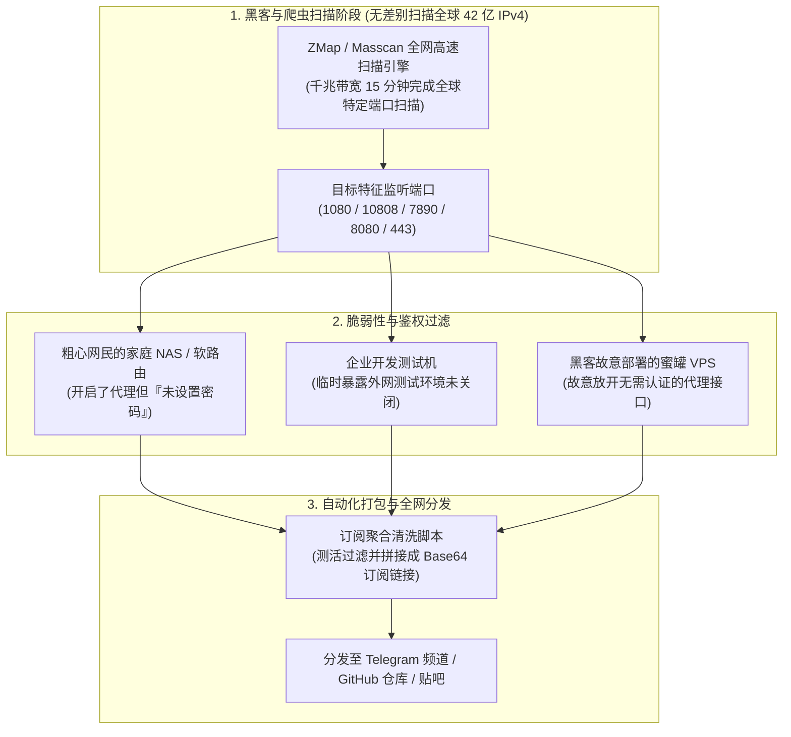

# 免费节点主要来源：商业试用、开源社区与爬虫抓取大起底 (2026 深度揭秘)

<div class="answer-first-lead">
  <strong>核心结论与先验建议 (Answer-First)：</strong>在中文互联网与各类 Telegram 频道中，每天都有大量号称“每日自动更新上万个免费 Clash / V2Ray 节点”的公开订阅源。<strong>这绝不是技术大牛的无私奉献，而是由黑灰产自动化爬虫与流量劫持构成的成熟产业链</strong>。
  <br><br>
  市面上流传的免费节点，其底层真实货源严格分为四大梯队：
  <ul>
    <li><strong>第一梯队 (安全度 100%)</strong>：正规商业机场（如<strong>[光速云](/reviews/#brand-gsy)</strong>）的官方获客试用流量。由正规服务商承担带宽成本，数据高强度加密，无任何后门；</li>
    <li><strong>第二梯队 (安全度 70%，稳定性极差)</strong>：羊毛党利用甲骨文云（Oracle Cloud）永久免费 VPS 或 AWS 12 个月免费层批量脚本生成的“薅羊毛一次性车”，极易因风控滥用被云厂商秒封；</li>
    <li><strong>第三梯队 (安全度 20%，存活率不足 5%)</strong>：利用全网端口扫描工具（Masscan / ZMap）爬取全球粗心网民未设置密码的家庭开放代理（Open Proxy），严重挤占普通人家用宽带；</li>
    <li><strong>第四梯队 (安全度 0%，极度致命)</strong>：黑客专门部署的钓鱼蜜罐服务器（Honeypot），用于精准拦截并嗅探未加密的会话 Token 与个人凭据。</li>
  </ul>
</div>

<AffiliateNotice />

---

## 一、网络扫描的第一性原理：爬虫是如何在 15 分钟内抓取上万个免费节点的？

很多新手常常惊叹：“为什么某个 GitHub 开源仓库每天都能自动更新 5,000 个新鲜节点？他们难道买了 5,000 台服务器吗？”

从网络空间测绘与网络安全的底层原理切入，这些免费节点 90% 以上来自于**基于全网 IPv4 地址空间的无差别暴力扫描**：



### 1.1 什么是“公网敞开代理（Open Proxy）”？
在日常生活中，很多刚接触软路由 OpenWrt 或 NAS 私有云的极客，在路由器上配置了代理服务端以便在外连接回家，但由于缺乏安全常识，**没有在配置文件中设置强密码鉴权（Authentication）**。
* 全网自动化扫描引擎（如 Shodan、Censys 或黑客私人脚本）在数小时内就能扫描到这个暴露的 IP 与端口。
* 爬虫将其收录进公共节点池后，瞬间将有数以千计的用户涌入该普通网民的家庭宽带，导致受害者家庭网络瘫痪，甚至因被他人用于黑客攻击而遭到运营商直接断网排查。

---

## 二、四大免费节点来源的技术内幕与风险全景剖析

我们深入拆解四类货源的底层生态，帮助你彻底摆脱对免费节点的盲目幻想：

### 2.1 货源 1：正规商业专线机场的注册体验包（良性首选）
* **供应链背景**：大型正规机场（如[光速云](/reviews/#brand-gsy)）将新用户试用列入合规的市场获客预算。
* **技术底层**：用户拿到的是真正的 IEPL 企业级物理内网专线节点，连接直接与位于深圳/上海的合规边界网关对接，拥有严格的鉴权 Token 与速率调度。
* **新手价值**：这是唯一适合新手用来测试自身宽带连通性与客户端兼容性的免费途径，绝无后顾之忧。

### 2.2 货源 2：云厂商“免费试用层”批量撸羊毛产物（短命残血）
* **供应链背景**：甲骨文云（Oracle Cloud Infrastructure）提供终身免费的 4 核 24G ARM 虚拟机，AWS 提供 12 个月的 EC2 微型实例。
* **技术短板**：
  1. **IP 极度不干净**：由于全网黑客与羊毛党都在反复榨取这些免费机房 IP，其 IP 段早在两年前就被 Cloudflare、Netflix、OpenAI 列入了最高等级的高危黑名单；
  2. **随时暴毙**：云厂商部署了极严密的反洗钱与防滥用算法，一旦检测到该 VPS 流量出现跨境加密代理特征，通常会在 3～7 天内无预警直接封禁账号。

### 2.3 货源 3：爬虫抓取的公共开放代理（极度拥堵与侵权）
* **供应链背景**：各大 GitHub 仓库中所谓的“每天万级节点池”。
* **技术现状**：这类节点 95% 在被抓取入库的数小时内就会因流量过载而彻底超时失效。新手导入客户端后，往往会看到满屏的红色“Timeout 9999ms”，必须在数百个垃圾节点中反复手动筛选，浪费无数时间。

### 2.4 货源 4：黑客部署的中间人蜜罐（致命窃密陷阱）
* **供应链背景**：某些别有用心的攻击者故意租用海外服务器，配置好极速带宽并全网公开分享。
* **窃密手法**：黑客在服务器底层利用 `tcpdump` 或自研嗅探插件截获用户的所有未加密出站流量，专门抓取明文传输的身份验证 Cookie，随后利用这些凭证实施撞库登录或洗劫虚拟资产。

### 2.5 货源 5：边缘算力滥用与免费 CDN 漏洞套壳（Cloudflare Workers 逆向代理）
* **供应链背景**：部分技术论坛热衷于分享“利用 Cloudflare Workers 免费额度搭建永久免费节点”的代码脚本。
* **技术短板与陷阱**：
  1. **每日请求数硬顶**：免费版 Workers 每天仅提供 100,000 次请求上限，正常网页浏览几十分钟就会耗尽该额度；
  2. **Anycast 路由劣化**：面向公众的免费边缘节点在国内三大运营商晚高峰被实施了严格的 QoS 限速与丢包，国内直连时延迟飙升至 400ms 以上，速度甚至不如 2G 时代；
  3. **批量封号扫荡**：Cloudflare 官方反滥用团队定期根据脚本指纹批量封停滥用 Workers 进行代理中转的违规账号，任何建立在此类基础上的免费订阅随时可能瞬间失效。

---

## 三、真实小白使用免费节点翻车案例实录 (1:1 案例库)

### 案例 1：考研研究生使用 GitHub 免费节点库，实验室 IP 被整体拉黑
* **学员档案**：某大学计算机系硕士生小吴，为省钱使用了一个拥有 1.2 万 Star 的“GitHub 自动更新免费订阅”。
* **惨痛教训**：小吴在实验室局域网环境下长期挂载该免费订阅。某天上午，整个实验室所有同学突然发现无法访问 IEEE Xplore 与 ACM 数字图书馆，提示“Your IP has been flagged for suspicious automated activity（您的 IP 因可疑自动化行为已被拉黑）”。校网络中心排查后发现，小吴使用的某个免费节点实际上是一个黑客用于发起 DDoS 攻击的反射源，导致整个学院的公网出口 IP 被国际安全组织连带封禁。小吴受到了导师的严厉通报批评。
* **深层警示**：**使用未知来源的公共节点，等于将你的设备暴露在未知的网络公海中任人宰割**。

### 案例 2：外贸业务员遭遇网页广告劫持，海外客户询盘被篡改
* **学员档案**：外贸业务新人小董，使用网上找来的免费香港节点浏览海外行业论坛。
* **翻车过程**：在浏览正常商业网站时，网页角落频繁弹出大量博彩与假冒电报群的恶劣浮窗；更可怕的是，当客户通过网页向其发送询盘表单时，表单中的收款银行信息被劫持插件替换成了一个离岸假冒账号，险些造成公司数万美元的重大财产损失。
* **深层根源**：小董连接的公共节点被注入了恶意的反向代理脚本（HTTP Reverse Proxy Injection），篡改了网页前端 DOM 结构。

### 案例 3：学术爬虫任务挂靠免费节点导致数据中毒与抓取失败
* **学员档案**：某高校生物信息学博士生小刘，为了抓取公开基因组数据库文献，利用网上搜罗的免费代理池做分布式轮询。
* **翻车过程**：由于部分免费开放代理被攻击者篡改了 HTTP 响应头与数据包载荷，小刘连续跑了三天的批量抓取脚本中混入了大量伪造的垃圾空包与畸变字符串，导致最终数据清洗与训练集全部作废，损失了近一周的宝贵科研进度。
* **深层警示**：**免费代理缺乏数据中立性承诺，传输中的数据篡改将给学术和生产业务带来无法估量的后遗症**。

---

## 四、终端实测：教你两行命令识破免费节点的真实货源背景

当你拿到一个来历不明的免费节点时，无需猜测其背景，直接在终端中运行以下命令即可看穿其真实底细：

```bash
# 步骤 1：查询该节点出口 IP 所属的真实机房与自治系统号 (ASN)
curl -s https://ipinfo.io/节点IP地址

# 步骤 2：测试该节点与国际主流防风控站点的握手健康度
curl -I -s --connect-timeout 5 https://www.cloudflare.com
```

### 输出结果深度判别表：
* **如果 `org` 字段显示为 `Oracle Corporation` 或 `Amazon.com, Inc.`**：说明这是羊毛党脚本自动生成的免费机房车，随时可能被封号关停；
* **如果 `org` 字段显示为普通住宅宽带（如 `HKBN`、`Chunghwa Telecom`）且无需密码鉴权**：说明这是一个被黑客爬虫扫描入库的普通家庭受害者宽带，严禁使用；
* **如果连接 Cloudflare 频繁返回 `403 Forbidden` 或 `Challenge Required`**：说明该节点已被列入恶意 IP 黑名单，严禁在该环境下登录任何个人账号。

---

## 五、痛点心流驱动：从“无尽折腾”到“8元平民专线”的解脱

每天花费 1～2 小时在各类电报群、论坛寻找免费节点，面对满屏的超时、掉线与封号风险，本质上是在用自己最宝贵的精力为虚幻的“免费”买单。

与其担惊受怕，不如以极低成本选择真正的正规军：

<BrandCard brandId="gsy" />

<div class="metaphor-box">
  <div class="metaphor-title">💡 算一笔经济与时间账：为什么光速云才是新手的真正解药？</div>
  <ul>
    <li><strong>极其平民的起步门槛</strong>：最低套餐折合仅需 <strong>8元/月</strong>，少喝半杯奶茶即可换来整整一个月的稳定专线保障。</li>
    <li><strong>拒绝黑产蜜罐与骚扰</strong>：纯正企业级 IEPL 内网专线，数据端到端安全传输，彻底隔绝任何嗅探与广告劫持。</li>
    <li><strong>全天候晚高峰可用</strong>：无需每天像淘金一样在几百个免费节点里挨个测速，打开电脑手机一键秒连，4K 视频丝滑播放。</li>
  </ul>
</div>

<PromoCard brandId="gsy" />

---

## 六、下一步学习路线引导

全面认清了免费节点的真实货源与底层风险后，如果你依然希望零成本先行验货，建议走正规渠道的试用路径：

1. **真实提供免费试用的机场盘点**：阅读 [`/free/trial-airports`](/free/trial-airports) 获取正规服务商的官方试水渠道；
2. **免费资源的性能物理极限**：阅读 [`/free/free-limitations`](/free/free-limitations) 深入理解为何免费节点永远无法顺畅看视频；
3. **安全与隐私风险红线**：阅读 [`/free/security-risks`](/free/security-risks) 筑牢个人信息安全防线。

---

<NextStep
  title="下一篇：真实提供免费试用的正规机场精选"
  link="/free/trial-airports"
  description="拒绝流氓套路！深度盘点全网真实提供注册即送体验流量、无需绑定银行卡的正规专线服务商，教你如何安全零成本验货。"
  stepText="新手进阶 · 下一步"
  buttonText="查看真实试用机场推荐 →"
/>
