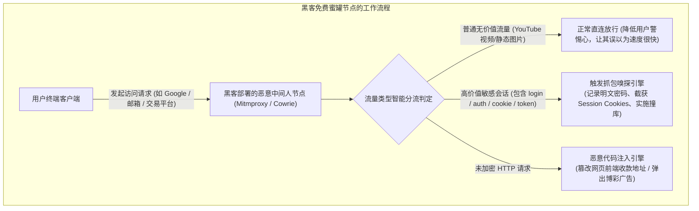

# 免费节点风险识别排查指南：如何一眼揪出钓鱼蜜罐与虚假营销群？(2026 深度排雷)

<div class="answer-first-lead">
  <strong>核心结论与先验建议 (Answer-First)：</strong>在鱼龙混杂的免费节点生态中，<strong>「学会甄别危险」是每一位新手保卫个人隐私与财产安全的必修课</strong>。
  <br><br>
  钓鱼蜜罐与黑灰产节点通常具备四大极其鲜明的**「高危体征」**：
  <ul>
    <li><strong>零鉴权裸奔节点</strong>：不需要任何账号密码、不需要 UUID 密钥认证，任何人复制即可直连的公网 HTTP / Socks5 代理（99% 属于黑客蜜罐或被全网扫描抓取的家庭被入侵受害者设备）；</li>
    <li><strong>诱导安装系统级根证书</strong>：要求在 Windows、Mac 或 iPhone 上安装不明自签名证书或企业描述文件（100% 准备实施全流量中间人解密监听）；</li>
    <li><strong>社交群引流裂变套路</strong>：声称“永久免费”，但要求必须“转发至 5 个群截图给客服领取”，或强制必须加私人微信转账激活；</li>
    <li><strong>出口 IP 恶意漂移与广告弹窗</strong>：正常浏览网页时频繁弹出与网站无关的博彩、加密货币虚假理财浮窗。</li>
  </ul>
  一旦发现上述任意征兆，<strong>立即在客户端中彻底删除该订阅源，并使用杀毒软件进行全盘扫描</strong>。对于需要日常稳定通信的用户，切勿将核心业务建立在危险的免费节点上，应选择具备商业信誉背书的合规专线（如<strong>[光速云](/reviews/#brand-gsy)</strong>）。
</div>

<AffiliateNotice />

---

## 一、网络诱捕的第一性原理：黑客是如何利用蜜罐（Honeypot）钓鱼的？

在网络安全攻防中，**蜜罐（Honeypot）**原本是安全专家用于诱捕黑客攻击行为的防御系统；但在黑灰产圈子里，这一技术被黑客反向利用，用来**专门诱捕毫无防备的普通网民**：



### 1.1 蜜罐的“放长线钓大鱼”心理战术
很多新手以为黑客搭建的节点一定很卡，其实恰恰相反！
* **黑客的障眼法**：为了骗取用户的信任，黑客往往会专门为该节点租用带宽较好的海外服务器，甚至故意放行 YouTube 等流媒体请求，让小白产生“这个免费节点又快又好用”的错觉。
* **致命杀招**：在后台，黑客的过滤脚本时刻在监听敏感关键词（如 `login`、`password`、`token`、`api_key`）。一旦你在该网络环境下登录了没有开启强校验的论坛、邮箱或海外账户，你的身份凭据就会在毫秒内被黑客提取存库。

### 1.2 DNS 投毒与选择性 SNI 嗅探的黑产变现手法
黑客利用恶意节点实施收割的核心手段并不止于全流量解密，更常见的是利用更隐蔽的协议层欺骗：
1. **虚假上游 DNS 解析（DNS Hijacking）**：当你在浏览器输入海外金融平台或数字钱包地址时，节点本地的 DNS 代理服务故意不向上游权威 DNS 查询真实 IP，而是返回攻击者伪造的高仿钓鱼网站 IP，界面与真站 100% 相同，一旦输入密码便直接沦陷；
2. **选择性 SNI 阻断与降级**：攻击者利用 TLS 握手中的 Client Hello 明文 Server Name Indication（SNI），识别出你正在访问高敏感业务，随后故意发送错误的 TCP RST 中断正常通信，诱导用户点击网页上的“证书修复程序”或“加速修复补丁”，从而彻底沦落为肉鸡。

---

## 二、识破三大典型社交媒体“虚假免费群”诈骗套路

除了技术层面的中间人嗅探，在各类社交平台（微信群、QQ群、贴吧、Telegram 频道）中，还活跃着大量依靠免费节点幌子进行诈骗的团伙：

### 2.1 诈骗套路 1：“裂变引流，转发 5 个群领永久节点”
* **套路还原**：在知乎、小红书发布“自建专线永久免费分享，进群自取”。进群后，机器人自动提示：“请将下方海报转发至 5 个 100 人以上的微信群，截图发给管理员即可获取永久节点链接”。
* **真相揭秘**：当你辛苦转发并发送截图后，所谓的管理员根本不会给你任何可用节点，或者发给你一个早已超时的失效链接；随后群主会将群名称更改为“XX兼职刷单赚钱群”或“XX内部投资交流群”，开始实施电信诈骗。

### 2.2 诈骗套路 2：“免费试用 3 天，激活需交 20 元押金防刷”
* **套路还原**：声称节点免费使用，但由于“近期服务器遭受恶意攻击，为了验证真实用户，需要先微信扫码支付 19.9 元押金，使用满一个月全额退还”。
* **真相揭秘**：只要你扫码付款，对方立刻将你踢出群聊并拉黑。这是专门针对小白贪便宜心理设计的极小额无追索诈骗。

### 2.3 诈骗套路 3：“Telegram 假冒官方管理员主动私聊发安装包”
* **套路还原**：你在某公开电报群询问“有没有好用的免费节点”，不到 1 分钟就有昵称带有“官方客服 / 运维人员”的账号主动私聊你，发给你一个名为 `Free_Fast_Proxy.exe` 或 `.apk` 的单文件安装包。
* **真相揭秘**：该文件 100% 捆绑了键盘记录木马或勒索病毒。正规官方客服绝对不会以任何形式主动私聊任何用户发送二进制可执行文件！

---

## 三、真实小白识别与翻车案例实录 (1:1 案例库)

### 案例 1：外贸新人小陈用终端指令当场识破“假香港专线”
* **学员档案**：外贸公司助理小陈，在某免费分享网站获取了一个标明为“香港 IEPL 极速专线”的免费订阅。
* **排查过程**：小陈学习了本站的终端排查命令后，并没有盲目连接，而是在 Windows 终端中运行了路由追踪指令。结果震惊地发现：该节点的数据包根本没有走深圳直达香港的内网专线，而是先绕道到了位于罗马尼亚的一台廉价 VPS 机房，且所有 HTTP 请求都被强制经过了一个未知的代理网关端口。
* **实战结论**：小陈果断删除了该节点，避免了公司外贸商业客户邮件在海外机房被截获的重大风险。

### 案例 2：小白轻信微信私聊转账，被骗 50 元直接拉黑
* **学员档案**：在读大一学生小孙，在贴吧遇到自称“大学学长低价转让自建永久专线”的网友。
* **踩坑过程**：对方通过微信发来多张虚假的 1000M 测速截图，并承诺“只需 50 元买断终身使用”。小孙通过微信个人转账付了 50 元后，对方发来一串乱码字符便再无音信，十分钟后小孙发现自己已被对方拉黑。
* **深层警示**：**任何脱离正规官网收银台、要求私聊个人转账的交易，100% 是诈骗**。

### 案例 3：Web3 投资者使用公共免费节点，钱包助记词被剪贴板木马窃取
* **学员档案**：区块链个人投资者阿杰，在咖啡厅临时使用某 Telegram 群公开分享的免费节点查阅行情。
* **翻车惨剧**：阿杰在导入钱包助记词时，该免费节点捆绑的注入代码激活了浏览器的静默恶意扩展，在后台监控阿杰的操作。虽然阿杰输入助记词时十分谨慎，但攻击者通过节点注入的 WebRTC 探针直接获取了阿杰的局域网内网信息，并在下一次非 HTTPS 请求中植入了剪贴板替换脚本，导致阿杰转账时收款地址被静默替换，损失了价值数千美元的代币。
* **深层警示**：**涉及真实财产与数字钱包的操作，严禁在任何公共免费或共享节点环境下进行**。

---

## 四、终端排查实操：三行指令秒辨恶意蜜罐节点

当你导入了一个免费节点，在正式开启代理前，请在终端（Windows CMD / PowerShell 或 Mac Terminal）中执行以下三行标准排查命令：

```bash
# 指令 1：检测节点真实物理出口 IP，核实是否发生恶意漂移
curl -x socks5://127.0.0.1:7890 https://api.myip.com

# 指令 2：校验目标网站的 SSL 证书指纹 (检测是否存在 SSL 降级或自签名中间人劫持)
# 以连接 google.com 为例，验证其证书发行方是否为 Google Trust Services
curl -v -x socks5://127.0.0.1:7890 https://www.google.com 2>&1 | grep "issuer"

# 指令 3：测试是否存在未授权的 DNS 投毒劫持 (查询知名银行/加密货币域名是否返回虚假 IP)
nslookup www.paypal.com 127.0.0.1
```

### 诊断排错准则：
1. **如果指令 2 中 `issuer` 显示为未知个人名或出现 `Untrusted / Self-signed`**：说明该节点正在对你的 HTTPS 加密流量实施中间人解密劫持，必须**立刻断开并删除！**
2. **如果指令 1 返回的国家地区与节点名称严重不符**（例如标称是香港节点，查出来却是俄罗斯或尼日利亚的廉价 IDC 机房）：说明该节点使用了虚假的广播 IP 包装欺诈，其网络路由极度不稳定且存在高危风控风险。

### 4.2 客户端日志实时审查清单（Clash / Clash Verge 联动防御）
在开启代理后，建议保持客户端的「日志（Logs）」窗口开启 30 秒，关注是否有异常红字告警：
* **`certificate verify failed`**：表明客户端与目标站点的握手证书未通过校验，上游节点大概率存在自签名伪造拦截行为；
* **`DNS query hijacked` 或异常私有 IP 返回**：说明当前节点配置了恶意 Fake-IP 回环劫持，正在篡改你的域名解析；
* **高频外联非预期端口（如 445 / 3389 / 135）**：代表后台节点正在尝试扫描你的内网脆弱端口，应立即强制终止进程并断网。

---

## 五、痛点心流驱动：把精力留给生活，选择透明正规专线

每天花费大量精力去鉴别节点陷阱，稍有不慎还会搭进个人资产。对于理性的用户而言，每个月投入 **8 元人民币**，直接选择一家连续运营多年、口碑清白、拥有真实企业级 IEPL 专线的正规品牌（如[光速云](/reviews/#brand-gsy)），才是终结一切焦虑的终极良方：

<BrandCard brandId="gsy" />

<div class="metaphor-box">
  <div class="metaphor-title">💡 为什么光速云能彻底杜绝一切黑客风险？</div>
  <ul>
    <li><strong>明码标价的合法商业契约</strong>：作为长期稳定运营的知名服务商，其商业模式建立在用户按月付费的良性循环之上，绝无任何窥探或贩卖用户隐私的动机。</li>
    <li><strong>严格的中立传输信道</strong>：底层采用企业级 IEPL 物理专线与标准的 TLS 1.3 密码学协议，数据全程隔离传输，绝不修改、解密或注入任何第三方脚本。</li>
    <li><strong>极低门槛的平民消费</strong>：最低档套餐折合仅需 <strong>8元/月</strong>，支持国内支付宝原生安全扫码秒开，让你以极小代价换取无忧无虑的纯净网络体验。</li>
  </ul>
</div>

<PromoCard brandId="gsy" />

---

## 六、下一步系统化学习路线引导

掌握了风险节点的识别技术后，如果在实际使用中你的主力网络突发中断，如何用正规手段进行 2 分钟安全应急？请继续研读：

1. **突发断网应急备用方案**：阅读 [`/free/emergency-solutions`](/free/emergency-solutions) 掌握网络中断时的自愈三部曲；
2. **全网 42 家机场深度评测**：查阅 [`/reviews/`](/reviews/) 查看各大品牌的真实测速图与流媒体解锁矩阵；
3. **安全下载官方纯净客户端**：阅读 [`/clients/safe-download`](/clients/safe-download) 远离第三方网盘木马包。

---

<NextStep
  title="下一篇：突发断网应急备用方案与自愈指南"
  link="/free/emergency-solutions"
  description="遇到关键时刻主力机场突发维护断网？手把手教你如何用正规安全的方式在 2 分钟内快速恢复网络连接，拒绝抓瞎。"
  stepText="新手进阶 · 下一步"
  buttonText="查看突发断网应急指南 →"
/>
