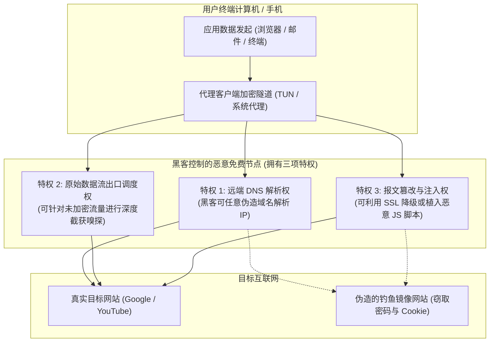

# 免费资源安全隐患：中间人攻击、明文嗅探与广告劫持 (2026 深度排雷)

<div class="answer-first-lead">
  <strong>核心结论与先验建议 (Answer-First)：</strong>在网络安全领域，<strong>「把流量交由未知的免费服务器转发，等于将你电脑的网线直接插在黑客的机房里」</strong>。
  <br><br>
  很多新手存在一个严重的认知误区：“现在全网都是 HTTPS 加密了，就算节点是黑客搭建的，他也解密不了我的密码，所以我可以放心白嫖免费节点。”这种想法极其致命！
  <br><br>
  在网络代理环境下，代理服务器拥有**域名解析控制权（Remote DNS）**与**数据包重定向特权**。黑客完全可以通过<strong>「SSL 降级攻击（SSL Stripping）」、「恶意根证书静默诱导注入」以及「DNS 投毒钓鱼」</strong>轻松穿透现代加密防护，窃取你的登录凭据、修改网页前端收款地址甚至劫持你的设备。综合安全评估，<strong>坚决不在任何免费公开节点登录网银、电商与主邮箱</strong>，敏感业务必须依赖具备严格信道中立承诺的商业专线（如<strong>[光速云](/reviews/#brand-gsy)</strong>）。
</div>

<AffiliateNotice />

---

## 一、网络特权的第一性原理：代理服务器究竟对你的电脑拥有多大权力？

当你使用 VPN 或代理客户端（如 Clash、v2rayN、小火箭）连接到一个远程节点时，从操作系统内核与网络协议栈的视角来看，你实际上赋予了该节点以下**三项最高网络控制特权**：



### 1.1 特权 1：远端 DNS 解析劫持（DNS Spoofing）
为了防止国内本地的 DNS 污染，绝大多数代理客户端在默认情况下会将域名的解析请求（DNS Query）委托给海外节点代为执行（即远端解析）。
* **黑客的攻击手段**：当你在浏览器输入 `www.paypal.com` 或某个加密货币交易所域名时，恶意节点不会向官方 DNS 查询真实 IP，而是直接返回黑客搭建的高仿钓鱼镜像站 IP。
* **致命后果**：你在外观一模一样的钓鱼网页中输入账号密码，凭据立刻被黑客在后台记录。

### 1.2 特权 2：SSL 降级攻击（SSL Stripping / Downgrade）
黑客通过在节点服务端运行类似 `Mitmproxy` 或自研嗅探程序，在你的客户端与目标网站握手时，拦截服务器发回的 `HTTPS` 强制跳转（301/302 Redirect），强制将你的后续网页访问降级为**明文的 `HTTP` 协议**。
* 在明文 HTTP 协议下，你在网页表单里填写的个人邮箱、账号密码、手机验证码，在黑客的服务器抓包日志里一览无余！

### 1.3 密码学协议视角的零信任：为什么 VLESS-Reality 架构能从物理上杜绝中间人劫持？
很多新手不理解为什么现代高级专线（如光速云）要全面推广 **VLESS-Reality** 协议体系。从现代密码学第一性原理出发，传统代理协议（如 Shadowsocks、旧版 VMess）在没有严格证书鉴权体系下，极易遭遇黑客的主动重放探测与双向中间人伪造：
1. **真实公钥握手认证（Public Key Authentication）**：Reality 协议放弃了传统的自签名或免费 Let's Encrypt 证书模式，直接“借用”大型合规跨国企业（如微软、苹果或 Cloudflare）的合法 SNI，并在客户端内置服务端的 ED25519 椭圆曲线公钥；
2. **拒绝非法解密与拦截**：当客户端与专线节点建立隧道时，任何中间人黑客如果尝试拦截并解密通信报文，由于其不可能拥有专线服务端的真实私钥，握手将在第一毫秒内因无法通过椭圆曲线签名校验而直接断开连接；
3. **消除特征向量**：在传输层完全消除了固定长度与特定魔数（Magic Number），在外部安全审计设备的视角下，这只是一段完全符合标准 TLS 1.3 规范的普通跨国 HTTPS 访问，从而在底层彻底根除了流量被嗅探与篡改的理论可能。

---

## 二、黑产变现的三大经典攻击链条深度拆解

在公开流传的免费节点池中，黑客的变现手法早已形成流水线作业：

### 2.1 攻击链条 1：恶意根证书诱导注入（Root Certificate Injection）
* **攻击手法**：很多所谓“免翻墙一键客户端”在安装过程中，会弹出一个 Windows UAC 提示或 iOS 描述文件安装提示，诱导小白用户点击“信任并安装根证书（Root CA）”。
* **技术实质**：一旦该根证书被写入系统的**受信任根证书颁发机构（Trusted Root Certification Authorities）**，该黑客节点就可以**动态伪造全球任何银行与互联网巨头的合法 SSL 证书**！你的浏览器即使显示“安全锁标志”，但其传输的所有经过端到端加密的 HTTPS 数据，都会被黑客在节点处实时解密还原为明文！

### 2.2 攻击链条 2：网页前端 DOM 脚本篡改与虚拟资产洗劫
* **攻击手法**：针对未启用严格 HSTS（HTTP 严格传输安全）的网站，恶意节点在下发 HTML 网页源码时，在底部悄悄注入一段恶意 JavaScript 脚本。
* **实施盗窃**：当你登录电商平台或区块链钱包发起转账时，该脚本会自动将你填写的收款银行账户或钱包地址，替换成黑客预设的洗钱账户。普通用户在确认时稍有不慎，巨额资金便瞬间化为乌有。

### 2.3 攻击链条 3：反向代理后门将你的电脑变成“网络肉鸡”
* **攻击手法**：某些第三方分发的免费免翻 App，表面上是一个代理工具，实质上在后台静默开启了一个监听本地端口的 Socks5 服务端，并通过动态反向代理穿透你的家用宽带。
* **可怕后果**：境外黑客组织利用你的家庭宽带作为跳板，向境内外机构发起网络暴力破解、撞库或违法信息发布。当警方网安大队通过 IP 溯源找到你家门口时，你甚至都不知道自己的电脑何时成了黑客的帮凶。

---

## 三、真实小白使用免费节点安全翻车实录 (1:1 案例库)

### 案例 1：跨境电商合伙人使用免费节点，亚马逊店铺 1.2 万美元被盗
* **学员档案**：外贸创业者张先生，在某 Telegram 频道下载了一款号称“永久免费、极速畅连”的香港节点用于日常打理店铺。
* **惨痛教训**：使用该节点登录亚马逊欧洲站卖家后台三天后，张先生的手机突然收到异地绑定提现银行卡变更的短信通知。由于该免费节点实施了会话 Cookie 劫持，黑客直接利用提取到的有效 Session 绕过了两步验证（2FA），并在半小时内将账户内积累的 12,400 欧元（约合人民币 9.6 万元）销售回款全部提现至境外虚拟银行账户。张先生虽向亚马逊官方申诉，但因操作显示为合法凭证登录，损失至今无法追回。
* **深层警示**：**商业与资金往来必须坚决运行在绝对纯净合规的专用信道之上，免费节点的试错成本是普通人根本承受不起的**。

### 案例 2：大学生加密货币钱包助记词被剪贴板木马窃取
* **学员档案**：大三学生小刘，平时喜欢研究 Web3 与数字货币，在某非官方网盘下载了“免费版 Clash 客户端”。
* **踩坑实录**：该客户端被黑客植入了恶意剪贴板监听程序（Clipboard Hijacker）。当小刘在本地备份自己的以太坊钱包 12 个助记词并复制时，木马程序立刻拦截并上传至黑客服务器。不到两小时，钱包内价值约 8,000 元的代币被自动智能合约全部清空。
* **实战结论**：**网络安全中永远没有侥幸心理，官方开源工具与正规商业服务是唯一的避风港**。

### 案例 3：高校科研团队依赖公共节点同步 GitHub 私有仓库，源码遭镜像窃取
* **学员档案**：某工科重点实验室博士生小郑，负责维护课题组与海外企业联合开发的闭源算法工程。
* **踩坑惨剧**：为了在寝室加速拉取代码，小郑挂载了网上搜到的“免费公共代理”。由于其使用的旧版 Git 客户端未开启严格的 SSL 证书指纹绑定（SSL Pinning），该节点通过自建的反向代理截获了包含 Personal Access Token 的 HTTP 授权头，不仅在数小时内将整个私有核心代码库完全镜像脱库，还向代码主分支内静默提交了一个带有后门逻辑的 Commit。所幸在导师例行代码审查时被及时发现，险些造成严重的知识产权侵权违约诉讼。
* **深层警示**：**高价值生产代码与商业机密，绝对不能经由缺乏法律约束与实体信誉的公共免费节点传输**。

---

## 四、安全自检 SOP：教你自查电脑是否已被恶意证书劫持

如果你此前曾使用过来历不明的免费代理客户端，建议立刻按照以下步骤排查系统安全状态：

```powershell
# 在 Windows PowerShell (管理员权限) 下执行以下命令，导出所有受信任的第三方根证书：
Get-ChildItem -Path Cert:\LocalMachine\Root | Select-Object Subject, Issuer, NotAfter | Format-Table -AutoSize
```

### 异常证书判别法：
1. **查看证书签发机构（Issuer）**：正规的根证书发行方通常为 `DigiCert`、`Let's Encrypt`、`GlobalSign`、`VeriSign` 或微软官方；
2. **发现可疑自签名证书**：如果你发现某个证书的 `Issuer` 是诸如 `Proxy Root CA`、`Charles Proxy`、`Mitmproxy` 或包含不明汉字拼音的代码，说明你的系统曾被恶意嗅探工具植入过伪造根证书！
3. **紧急清理修复**：在 Windows 搜索栏输入 `certmgr.msc` 打开证书管理器，在“受信任的根证书颁发机构”中找到该异常证书，直接右键点击“删除”，并立即重启计算机。

### 4.2 移动端 (iOS / Android) 恶意描述文件与 CA 证书排查清理指南
如果你在手机端也曾为了使用免费节点而配置过未知网络描述文件，必须立即按以下步骤进行彻底排毒：
* **iOS 设备排查流程**：打开「设置」→「通用」→「VPN 与设备管理」。检查是否存在不明名称的“配置描述文件”。如有任何非企业 MDM 托管的可疑描述文件，立即点击“移除描述文件”；接着进入「设置」→「通用」→「关于本机」→「证书信任设置」，确保关闭所有针对自建 CA 根证书的完全信任开关；
* **Android 设备排查流程**：打开「设置」→「安全」或「密码与安全」→「系统安全」→「凭据存储」→「信任的凭据」或「用户凭据」。审查“用户”标签页下是否存在任何第三方证书。普通正常使用无需在“用户”下安装任何证书，若有发现，立即点击并选择“删除所有凭据”。

---

## 五、痛点心流驱动：把安全风险关进笼子，拥抱平民专线

为了省下几块钱的订阅费，每天把自己最核心的银行账户、社交密码与个人隐私暴露在黑客的显微镜下，这种“收益与风险完全不对等”的赌博行为毫无理性可言。

正规老牌专线机场（如[光速云](/reviews/#brand-gsy)）采用**企业级 IEPL 内网专线 + 纯净 VLESS-Reality 协议**：

<BrandCard brandId="gsy" />

<div class="metaphor-box">
  <div class="metaphor-title">💡 为什么商业专线能给你的隐私提供 100% 护航？</div>
  <ul>
    <li><strong>严格的中立物理传输信道</strong>：作为具备长跑信誉的商业实体，服务商严守信道中立底线，绝无任何数据包抓包、篡改或脚本注入行为。</li>
    <li><strong>现代端到端强加密协议</strong>：全面基于标准的 TLS 1.3 密码学协议构建，数据在离开你的设备瞬间即被强力加密，即使是机房网络管理员也无法解密你的传输内容。</li>
    <li><strong>平民化超低资费</strong>：起步仅需 <strong>8元/月</strong>，支持国内支付宝原生安全扫码，用最微小的成本彻底买断一切被黑客钓鱼的后顾之忧。</li>
  </ul>
</div>

<PromoCard brandId="gsy" />

---

## 六、下一步系统化学习路线引导

建立了扎实的安全防御意识之后，建议继续深入理解民间公益赞助节点的生存现状：

1. **公益机场与节点现状真相**：阅读 [`/free/public-welfare-status`](/free/public-welfare-status) 了解民间开源公益项目为何难以长久；
2. **注册送流量活动深度盘点**：查阅 [`/free/signup-bonus-traffic`](/free/signup-bonus-traffic) 掌握正规白嫖体验技巧；
3. **安全下载官方纯净客户端**：阅读 [`/clients/safe-download`](/clients/safe-download) 远离第三方网盘木马包。

---

<NextStep
  title="下一篇：民间公益机场与开源节点的生存现状大揭秘"
  link="/free/public-welfare-status"
  description="民间技术极客自费赞助的公益机场究竟能撑多久？深入剖析公益节点在资金断裂、恶性滥用与上游清退下的生存死局。"
  stepText="新手进阶 · 下一步"
  buttonText="查看公益机场现状剖析 →"
/>
