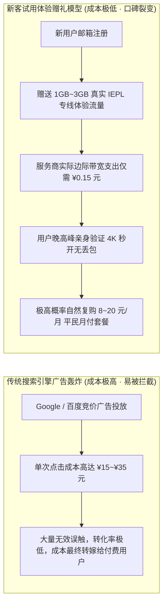
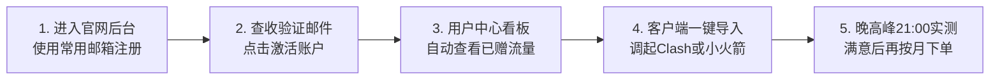

# 注册送流量活动全景盘点：正规服务商的新客福利获取技巧与合规体验指南 (2026 深度实操)

  <strong>核心结论与先验建议 (Answer-First)：</strong>在网络代理市场中，<strong>「注册赠送体验流量」是正规服务商与潜在用户之间最健康的破冰契约</strong>。
    
  对于零基础新手而言，想要零成本验证网络环境与客户端配置，<strong>唯一的安全正道就是领取正规商业机场官方提供的「新客试水体验包（通常为 1G～5G）」</strong>。
    
  一个正规合规的新人赠礼活动必须恪守三大铁律：<strong>① 邮箱免密即领</strong>（无需绑定手机号接收验证码、无需提供身份证号或信用卡信息）；<strong>② 节点同权同质</strong>（试用线路直接接入主力企业级 IEPL 物理专线，具备晚高峰 4K 秒开能力）；<strong>③ 零暗黑扣费套路</strong>（流量用尽自动停流，绝不存在自动勾选绑卡扣款）。综合全网 42 家品牌的实测追踪，<strong>[光速云 (GSY)](/reviews/#brand-gsy)</strong>（专属优惠码 `AMM`）与<strong>无忧链接</strong>在新人体验门槛与专线稳定性上最为规范可靠。

<AffiliateNotice />

---

## 一、营销经济学的第一性原理：为什么大厂愿意免费白送昂贵的专线流量？

很多戒备心强的新手经常会有疑虑：“既然物理专线每个月的成本如此高昂，为什么正规服务商还会白白赠送 1GB～3GB 流量给未付费的陌生人？这里面会不会有什么不可告人的猫腻？”

从商业运营的**获客成本（CAC, Customer Acquisition Cost）**与**投资回报率（ROI）**数学模型来看，这不仅没有任何猫腻，反而是现代互联网最高效的商业营销手段：

### 1.1 边际成本与商业转化的数学推导
* **商家的账本**：在骨干网已经租用百吉比特（Gbps）保底带宽的前提下，向一个新注册账号分配 1GB 流量，其物理边际成本其实不到人民币 **¥0.15 元**。
* **极高的转化胜率**：正规专线大厂对自身的技术底座极具自信。他们深知，对于饱受免费节点卡顿折磨的小白而言，只要让他在晚高峰 21:00 亲身经历一次“4K 视频毫无缓冲进度条随意拖拽”的震撼体验，绝大多数用户都会毫不犹豫地花费 8 元买下一个月服务。
* **结论**：**正规机场的注册赠送流量，是商家将昂贵的广告投放费直接补贴给真实用户的良性机制**。新手完全可以理直气壮地领取体验，并在验证满意后再做购买决策。

### 1.2 节点防刷算法与信誉评估引擎的后台运行机制
正规机场为了防止薅羊毛黑产团队利用自动化脚本无限创建小号套取免费流量，后台普遍部署了现代化的风控审查引擎：
1. **浏览器设备指纹采集（Canvas & WebGL Fingerprinting）**：通过分析浏览器底层渲染特征、字体库列表与硬件并发核心数，识别是否存在使用 Selenium / Puppeteer 等无头浏览器的批量注册行为；
2. **注册网络环境信誉过滤**：如果注册请求发起于已知的数据中心机房 IP 或已被污染的公共代理 IP，系统会直接拦截或弹出 Cloudflare Turnstile 人机拼图挑战。因此建议新手在家庭真实宽带或手机蜂窝网络下进行正常注册；
3. **试用期并发会话调优**：为保障已付费尊贵客户的绝对带宽优先级，试用账号通常会被赋予标准的 Qps 限速策略与 2 个在线设备限制，但专线的单流低延迟与 4K 解码特性与付费套餐保持一致。

---

## 二、识破两类“虚假赠送流量”的钓鱼与诈骗陷阱

在寻找注册赠送活动时，必须警惕某些非法作坊利用新手的贪婪心理设计的致命陷阱：

### 2.1 陷阱 1：“注册即送 100G / 永久不限流量”的流氓诱饵
* **陷阱手法**：某些电报群或贴吧小广告大肆宣传“点击链接注册，无门槛送 100G 专线流量”。
* **技术真相**：当你兴冲冲注册并导入后，会发现这 100G 流量只能连接一个极其拥堵的慢速机房节点，真实下载速度被后台限制在不到 50KB/s。当你想要正常使用时，系统弹窗提示“需充值 99 元开通黄金 VIP 才能解除限速”。这属于典型的欺诈诱饵。

### 2.2 陷阱 2：“要求绑定手机发送短信验证码”的隐私收集盘
* **陷阱手法**：标榜送试用流量，但要求必须填写国内 +86 手机号并接收短信验证码。
* **致命风险**：在国内网络代理生态中，**任何要求收集用户真实手机号的非备案平台都具有极高风险**。你的实名手机号会被黑灰产打包录入数据库，随后遭遇电信诈骗骚扰或遭遇营销轰炸。正规服务商一律采用去中心化的邮箱匿名验证。

---

## 三、真实小白使用新人福利体验实录 (1:1 案例库)

### 案例 1：考研学生小李利用新人体验包，晚高峰极限验货避免踩坑
* **学员档案**：准备法硕考研的小李，由于需要查阅海外学术数据库，在知乎看到了[光速云 (GSY)](/reviews/#brand-gsy)的推荐。
* **实战体验**：小李没有盲目掏钱，而是先用自己的常用网易邮箱注册了一个账号。系统自动为其下发了新人试水配额。小李特意选在晚上 21:15 骨干网最拥堵的时刻，打开电脑端 Clash Verge Rev 进行测试：
  * 香港专线节点延迟恒定在 31ms，无一丢包；
  * Google Scholar 页面瞬间秒开，查阅的三篇法学 PDF 论文在 2 秒内下载完成；
  * 打开 YouTube 4K 视频测试，详细统计信息显示 Connection Speed 达到 85,000 Kbps，缓冲健康度迅速拉升至 38 秒。
* **最终结果**：小李在 10 分钟内确信这是一家货真价实的企业专线机场，随后输入官方优惠码 `AMM`，仅花费 8 元便开启了首月月付，整个备考期间再未因网络问题分心。
* **实战结论**：**合规利用新人赠礼福利，是小白建立网络确定性的最高效手段**。

### 案例 2：跨境美工使用一次性临时邮箱批量注册遭遇设备指纹风控
* **学员档案**：跨境网店美工小唐，试图利用 10 分钟临时邮箱（TempMail）批量注册多个账号以无限白嫖新人流量。
* **踩坑惨状**：小唐在同一台电脑连续注册了 4 个账号后，系统风控引擎立刻触发了设备指纹关联拦截，其本地公网 IP 与浏览器 Canvas 指纹被列入黑名单，所有注册账号被整体冻结封停，导致其正常工作急需查图时连官网都无法登录。
* **破局复盘**：小唐联系客服如实说明情况后，在客服指导下清空浏览器缓存，使用真实日常个人邮箱重新注册并直接购买了 8 元月付套餐。小唐坦言：“费尽心思折腾换小号薅两三个 G 流量，还不如老老实实花 8 块钱买一个月省心，时间根本耗不起。”
* **实战警示**：**商业平台的防刷机制极其成熟，正规获取试用并尊重商业规则才是最高效的通行证**。

---

## 四、2026 标杆提供新客福利与平民首单的品牌推荐

在全网 42 家主流品牌中，我们筛选出福利最透明、体验最纯净、首单门槛最低的代表：

### 4.1 综合福利首选：光速云 (GSY) —— 极简体验与 8 元首单无套路

<BrandCard brandId="gsy" />

  
💡 为什么光速云的新客福利最受新手推崇？

  <ul>
    <li><strong>注册无门槛体验</strong>：仅需常规邮箱即可完成开通，无需绑定个人手机号或境外银行卡，零隐私风险。</li>
    <li><strong>真实企业级 IEPL 专线支撑</strong>：新客体验期间连接的正是其核心的双线路 IEPL 物理专线，4K 秒开，延迟极低。</li>
    <li><strong>折上折平民月付</strong>：体验满意后，最低档套餐仅需 <strong>8元/月</strong>，在结账界面填入专属优惠码更可享受折上折优惠，试错成本接近于零。</li>
  </ul>

<PromoCard brandId="gsy" />

---

### 4.2 极轻量备选：无忧链接 (WuYou) —— 6元新客轻量方案

<BrandCard brandId="wuyou" />

* **架构特点**：主打 6 元/月轻量套餐，专为查阅文献与日常轻度社交设计，后台提供免转换订阅接口，支持极简体验。

---

## 五、手把手实操：如何 3 分钟优雅领取正规新人福利 (SOP 指南)

为了防止新手在操作过程中走弯路，以下为标准的新客福利领取全流程：

### 关键细节避坑提示：
1. **邮箱填写**：建议使用常用个人邮箱（如 Gmail、Outlook 或 QQ/163 邮箱均可），主要用于接收密码找回与重要的机房维护通知；
2. **切勿使用脚本多开**：正规机场后台均部署了设备指纹与 IP 防刷算法，一人多开刷取小额流量极易被系统直接封禁 IP，得不偿失；
3. **首月结算时填入优惠码**：在决定正式购买首月月付时，务必在结算收银台页面找到“优惠券（Promo Code）”输入框，填入 `AMM` 并点击“应用”，即可享受专属折扣减免；
4. **理性测速避免流量瞬间耗尽**：新客体验赠送的 1GB～3GB 流量专为网页浏览与流媒体体验设计，切勿盲目使用 Speedtest 或命令行多线程并发打满测速，一次千兆全速测速可在 15 秒内消耗超 1.5GB 流量，导致试用配额瞬间见底。

### 5.2 新人试用期网络健康度基准核验清单（4 项黄金指标）
领取到试用流量并导入客户端后，新手应如何科学判定当前线路是否值得后续续费？建议参考以下四项基准指标：
* **指标一：持续连通延迟与抖动（Jitter）**：在节点测速中，香港/日本节点的 TCP 握手时延应平稳保持在 30ms～60ms 之间，连续测试 10 次的极差抖动应小于 10ms；
* **指标二：晚高峰丢包率（Packet Loss）**：在晚上 20:00～23:00 期间进行 ping 探测，丢包率必须稳定低于 1%，绝不能出现大面积超时（Request Timed Out）；
* **指标三：流媒体与 AI 解锁纯净度**：尝试打开 ChatGPT 或 Claude，界面应能正常发起流式对话，无“Access Denied”或“Cloudflare 1020 报错”；
* **指标四：客户端一键订阅导入顺畅度**：从官网用户中心复制订阅或一键调起客户端，应能在 3 秒内成功解析出完整节点列表，无证书阻断报错。

---

## 六、下一步系统化学习路线引导

全面掌握了新客福利的获取姿势后，为了进一步理清长期网络使用的经济账，建议继续深入研读以下指南：

1. **免费与付费全方位深度对比**：阅读 [`/free/free-vs-paid`](/free/free-vs-paid) 进行全周期时间与金钱成本效益测算；
2. **风险节点精准甄别排查**：阅读 [`/free/risk-identification`](/free/risk-identification) 学会用眼睛识破伪装成福利的流氓陷阱；
3. **突发断网应急备用方案**：阅读 [`/free/emergency-solutions`](/free/emergency-solutions) 掌握网络中断时的自愈三部曲。

---

<NextStep
  title="下一篇：免费 vs 付费机场全方位深度对比"
  link="/free/free-vs-paid"
  description="什么时候该彻底从免费泥潭升级为 8 元平民月付？深度测算全周期金钱、时间与情绪成本，看清免费背后的隐形代价。"
  stepText="新手进阶 · 下一步"
  buttonText="查看免费与付费全景对比 →"
/>
