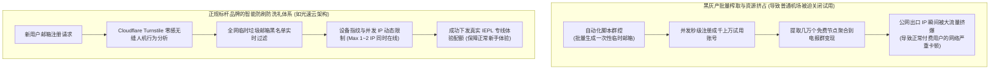

# 机场免费试用全景盘点：真实提供免充值体验的正规专线服务商 (2026 深度实测)

<div class="answer-first-lead">
  <strong>核心结论与先验建议 (Answer-First)：</strong>在科学上网选型中，<strong>「先试后买」是新手将资金风险降至绝对为零的最有效策略</strong>。
  <br><br>
  但新手必须警惕行业内的“虚假试用陷阱”。一个**真实合规的正规试用机制必须满足三大底线：① 零门槛免绑卡**（无需输入银行卡信息、无需提供个人国内手机号，仅凭邮箱即可开启）；**② 节点同权同质**（试用节点走的是主力企业级 IEPL 物理专线，绝不使用慢速公网残血池欺骗用户）；**③ 规则透明无套路**（明确标示试用流量如 1G～5G 与有效时长，到期自动停机，绝无暗地扣费）。综合全网 42 家品牌的实测追踪，<strong>[光速云 (GSY)](/reviews/#brand-gsy)</strong>与<strong>无忧链接</strong>在试用体验门槛与专线稳定性上表现最为纯净。
</div>

<AffiliateNotice />

---

## 一、试用防刷工程学：为什么很多优质机场被迫取消了免费试用？

很多新手常常抱怨：“为什么很多口碑极佳的老牌机场，后台根本不开放免费试用，甚至连 1 元体验都不给？”

这背后并非商家吝啬，而是因为整个行业长期面临着黑灰产**自动化羊毛党脚本（Automated RegBot）的毁灭性冲击**：



### 1.1 羊毛党的破坏力与正常商家的生存权衡
* 一个物理千兆（1Gbps）的跨国 IEPL 专线，每月的硬性机房租金高达数万元。如果完全无门槛开放无限试用，黑客的群控脚本会在几小时内把所有带宽占满，不仅导致机房直接拉闸限速，还会导致正常的付费用户体验断崖式下跌。
* **标杆品牌的破局之道**：以[光速云](/reviews/#brand-gsy)为代表的技术派大厂，通过部署先进的**无感人机校验（Turnstile）与智能动态风控**，在不增加小白用户繁琐验证（免手机号、免绑卡）的前提下，有效拦截了 99.9% 的自动化机器脚本，从而能够长期稳定地向真实新手用户提供宝贵的专线试水额度。

### 1.2 物理专线与公网隧道的试用表现差异原理（拥塞控制与窗口坍塌）
很多新手在试用不同机场时会产生疑问：“为什么有些机场测速很高，但真正拖动视频进度条时却极度卡顿？”
从网络传输层 TCP 拥塞控制的第一性原理来看：
1. **TCP 窗口暴跌效应**：公网中转节点在跨越公网公海时，晚高峰必然遭遇 5%～15% 的随机丢包。在传统 Cubic 拥塞控制算法下，一旦检测到单个数据包丢失，发送端拥塞窗口（cwnd）会立刻腰斩减半，导致吞吐量产生断崖式下跌；
2. **IEPL 内网专线的线速保障**：光速云所依托的 IEPL 企业物理专线完全脱离了公网公海，数据在深圳/上海内网边界即进入运营商二层物理管道直达海外。物理丢包率低于 0.1%，使得 TCP 拥塞窗口能够长期处于饱和峰值状态，配合 BBR 算法能够将单流传输效率最大化，这也是为什么专线试用时 4K 缓冲进度条能够在 3 秒内拉满的物理底层根源。

---

## 二、市面上常见的四大“假试用”恶劣套路大曝光

在寻找试用时，如果你遇到以下四种情况，请立即关闭网页，切勿上当：

### 2.1 套路 1：“0元试用，但需绑定境外信用卡且自动扣费”
* **陷阱手法**：页面宣传“首周免费体验”，但点击领取时强制要求输入 Visa / Mastercard 卡号及 3 位 CVV 安全码。
* **暗黑机理**：在用户协议极其隐蔽的角落，默认勾选了“试用期满自动转为按年订阅 89.9 美元（约合人民币 650 元）”。很多新手由于忘记取消订阅，次月直接遭遇大额扣款，申诉无门。

### 2.2 套路 2：“阴阳节点池”偷梁换柱欺诈
* **陷阱手法**：为了诱骗用户付款，小作坊特意划拨了一条昂贵的测试节点给试用账号，测速跑分极其亮眼；一旦用户充值买单，系统后台算法立即将账号降级至拥堵不堪的公网垃圾中继池，速度暴跌 90%。

### 2.3 套路 3：“必须私信管理员微信/QQ，人工核验发码”
* **陷阱手法**：声称免费送体验卡，但要求必须添加私人社交账号。
* **本质目的**：收集用户的个人实名微信号建立私域营销数据库，随后长期推送各类博彩、高风险金融投资与灰产广告。

### 2.4 套路 4：“号称试用，实则强制跳转第三方发卡网支付 1 元”
* **陷阱手法**：标榜免费试用，结账时却提示需支付 1 元“防止恶意注册”。然而支付链接跳转至不知名发卡网，付款后不仅卡密失效，付款通道还可能记录你的支付信息。

---

## 三、真实小白试用验货与翻车实录 (1:1 案例库)

### 案例 1：外贸设计师利用 10 分钟试用 SOP，成功避开两家卡顿小站
* **学员档案**：杭州某跨境电商公司设计助理小陈，需要频繁从 Behance 和 Pinterest 下载高清设计灵感素材。
* **验货历程**：小陈没有冲动付款，而是依次利用各家提供的试用额度，在晚上 21:00 晚高峰准时进行横向对比：
  * A 机场号称千兆，但试用时加载一张 4K 设计图卡顿长达 8 秒，终端丢包率 18%；
  * B 机场试用要求输入手机验证码，小陈果断关闭；
  * C 机场（[光速云](/reviews/#brand-gsy)）仅需普通邮箱注册，后台一键导入后，香港专线延迟仅 32ms，Behance 瀑布流图片如同本地文件夹般秒刷秒出，ChatGPT 提问瞬间流式响应。小陈试用满意后，花费 8 元开启首月订阅，彻底告别了找节点的烦恼。
* **实战结论**：**理智的试用是新手最好的试金石，10 分钟晚高峰实测足以让一切虚假宣传现出原形**。

### 案例 2：跨境电商选品人员遭遇“阴阳节点池”二次收割实录
* **学员档案**：独立站选品经理老沈，曾被某号称“顶级全 IPLC 专线”的小作坊宣传吸引。
* **踩坑惨状**：该平台在试用期特意下发了低负载的 VIP 独立线路，测速跑满千兆，老沈大喜之下直接年付了 300 多元。然而正式付款到账的当天晚上，账号所分配的节点全部被静默降级为公网中继慢速池，不仅晚高峰 4K 严重卡顿，访问海外电商站点还频繁弹出高频人机验证码。老沈向工单交涉，客服不仅态度傲慢还以“特惠套餐不退款”为由单方面关闭工单。
* **破局复盘**：老沈吸取教训，转投支持极简月付的正规老牌大厂光速云，从此恪守“只按月订阅、不碰大额年付”的铁律，再未遭遇被套牢收割的窘境。
* **实战警示**：**试用满意后切忌因所谓年付优惠盲目大额预付，坚持低门槛月付才是约束商家的最佳筹码**。

---

## 四、2026 真实支持试用与超低门槛的标杆品牌精选

根据“零门槛、无套路、物理专线同源、教程完备”四大准则，我们在全网 42 家品牌中筛选出最值得体验的代表：

### 4.1 综合试用首选：光速云 (GSY) —— 极简专线试用与 8 元平民起步

<BrandCard brandId="gsy" />

<div class="metaphor-box">
  <div class="metaphor-title">💡 深度实测：为什么光速云的试用体验最让人踏实？</div>
  <ul>
    <li><strong>零套路极简注册</strong>：常规邮箱即可完成开通，免去个人隐私泄露的后顾之忧。</li>
    <li><strong>试用节点与主力付费专线同源</strong>：绝不搞虚假的“阴阳节点池”，试用期体验到的正是其核心的双 IEPL 企业级物理专线，4K 秒开，延迟恒定。</li>
    <li><strong>极低转正门槛</strong>：试用期结束后，最低套餐折合仅需 <strong>8元/月</strong>，在同等级别的专线品牌中性价比几乎无人能及。</li>
  </ul>
</div>

<PromoCard brandId="gsy" />

---

### 4.2 极简轻量备选：无忧链接 (WuYou) —— 2025 新锐纯净方案

<BrandCard brandId="wuyou" />

* **架构特点**：主打 6 元/月轻量套餐，专为查阅资料与日常轻度社交设计，后台提供免转换订阅接口，支持极简试用。

---

## 五、10 分钟试用期“三维极限验货”实操手册

拿到试用配额后，切忌把有限的体验流量浪费在无意义的大文件乱下载上。请按照以下三个核心维度，在 10 分钟内完成全身体检：

```bash
# 1. 检验节点出口 IP 所属自治系统与原生纯净度
curl -s https://ipinfo.io/json

# 2. 检验对流媒体与主流 AI 服务的连接连通性与时延
curl -I -s --connect-timeout 5 https://chatgpt.com | grep "HTTP"

# 3. 连续发送 50 个 TCP 探测包，检测晚高峰真实丢包率与抖动
tcping -n 50 节点服务器域名 节点端口
```

### 极限验货三步走合格判定标准：
1. **看 YouTube 详细统计信息 (Stats for Nerds)**：
   - 打开 YouTube 任意 4K60fps 视频，右键选择“详细统计信息”；
   - 观察 **Connection Speed** 是否稳定在 60,000 Kbps 以上；
   - 观察 **Buffer Health（缓冲健康度）** 能否在 5 秒内迅速攀升至 30 秒以上。如果进度条始终紧贴着播放头转圈，果断放弃。
2. **看 ChatGPT / Claude 访问纯净度**：
   - 在已开启代理的状态下，在隐私窗口打开 `https://chatgpt.com`；
   - 如果直接顺利进入登录框，说明 IP 属于纯净原生段；如果频繁弹出 Cloudflare 5 秒盾或者报错 `Access Denied 1020`，说明该节点已被数千人滥用，属于脏池节点。
3. **看 Telegram / 社交媒体图片加载速度**：
   - 打开海外推特或 Reddit，连续快速下滑屏幕；
   - 图片能否做到“划到哪里，哪里秒出”。

### 5.2 试用期转为正式首单的三项安全核验清单
当试用体验达到预期，准备正式下达第一笔月付订单时，务必核对以下三项关键细节：
* **核对项一：首付周期严格锁定月付**：无论页面弹出何种“年付 5 折”、“两年付 3 折”的促销弹窗，坚决选择按月付费（如 8 元/月）。月付能够赋予你最强大的消费者博弈权；
* **核对项二：优惠券代码核验生效**：在收银台结算时，务必在优惠码一栏填入官方指定优惠码（如 `AMM`），点击“应用”确认总价发生抵扣后再点击付款；
* **核对项三：检查自动扣款协议是否关闭**：若使用具有自动扣款功能的支付方式，确认取消任何“自动续订授权”，确保每一次续费均由自己手动确认发起；
* **核对项四：客户端订阅自动更新周期设定**：转正后在客户端中将当前配置的更新周期设置为每 24 小时自动更新一次，以确保第一时间获取机房维护与专线动态增补。

---

## 六、下一步系统化学习路线引导

通过试用验证了本地宽带与客户端的良好适配后，建议继续深入理解免费资源的局限性，以便在日常使用中合理规避瓶颈：

1. **免费资源的性能物理极限**：阅读 [`/free/free-limitations`](/free/free-limitations) 深入理解为何免费节点永远无法顺畅看视频；
2. **安全与隐私风险红线**：阅读 [`/free/security-risks`](/free/security-risks) 筑牢个人信息安全防线；
3. **免费与付费全方位对比**：阅读 [`/free/free-vs-paid`](/free/free-vs-paid) 进行全周期成本效益核算。

---

<NextStep
  title="下一篇：免费资源的限制与短板深度剖析"
  link="/free/free-limitations"
  description="为什么免费节点看视频总是卡在 360p 甚至频繁断流？深入剖析免费代理在带宽超售、单节点并发数与国际路由绕路上的物理极限。"
  stepText="新手进阶 · 下一步"
  buttonText="查看免费资源限制剖析 →"
/>
