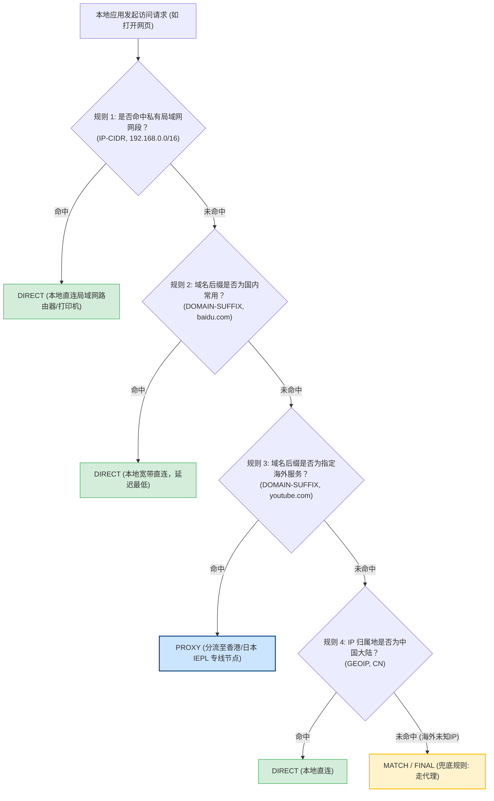
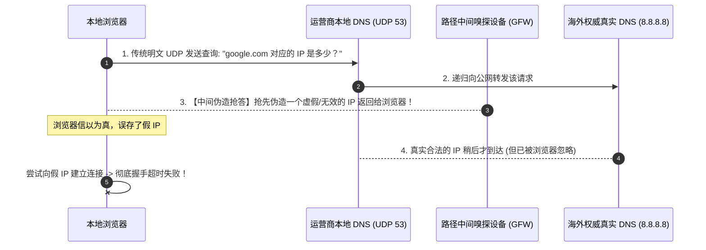
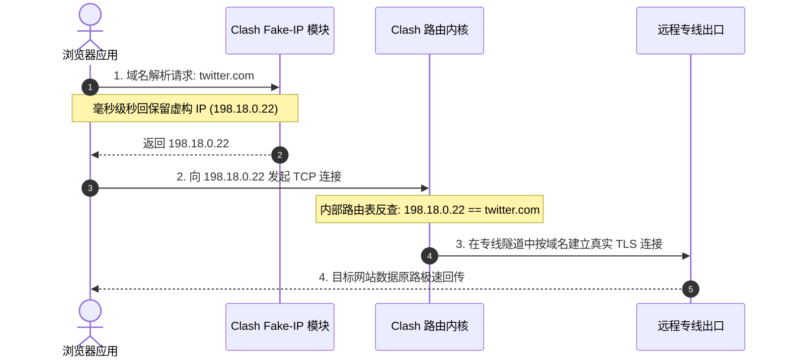
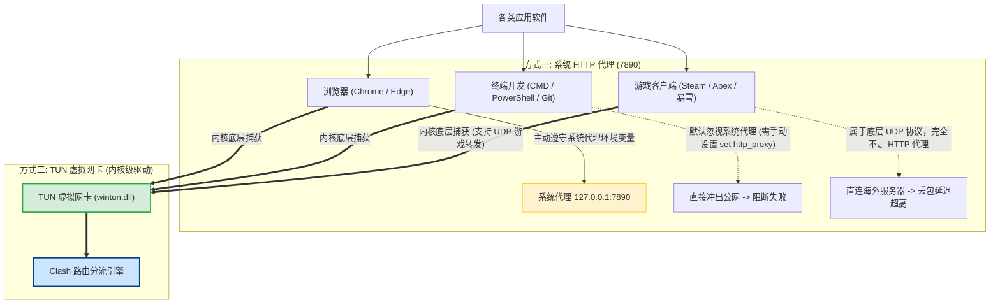
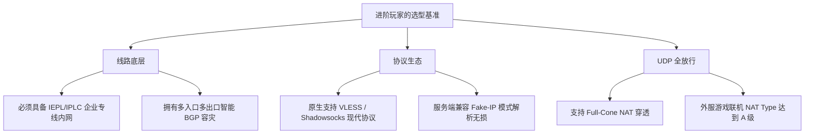

# 进阶前的基础：掌握分流规则、DNS 防污染与端口原理

  <strong>核心结论与进阶认知跃迁：</strong>绝大多数新手停留在「安装软件、点开开关、能用就行」的被动阶段；而真正掌握网络自主权的高阶玩家，懂得<strong>如何利用底层路由规则、防污染 DNS 架构以及 TUN 虚拟网卡，让网络完全契合自己的工作与娱乐需求</strong>。本文将为你彻底拆解三大核心底层构件：<strong>① 智能分流规则的「自上而下瀑布流」匹配逻辑；② 传统 DNS 污染原理与 Fake-IP 毫秒级解析黑科技；③ TUN 虚拟网卡如何从操作系统内核层实现对所有非代理软件（终端、游戏、IDE）的全局无感加速。</strong>

<AffiliateNotice />

---

## 一、智能分流规则引擎深度解构 (第一部分)

为什么开启代理后，访问国内的微信、百度能够直接以百兆光纤直连，而访问 Google、GitHub 却能自动无缝切换到海外专线？核心秘密就在于客户端内置的**智能分流规则引擎**。

### 1.1 自上而下的「瀑布流匹配」原则 (Waterfall Logic)
规则匹配遵循极度严格的**顺序优先权**：
1. **首个命中即退出**：请求从第一条规则自上而下逐条比对，**一旦命中某一条规则，立即执行该规则指定的动作（DIRECT 直连 / PROXY 代理 / REJECT 拦截），不再向下继续遍历！**
2. **规则编写顺序至关重要**：范围越狭窄、越精确的规则必须写在上方；范围越宽泛、越模糊的规则必须写在下方；
3. **兜底规则 (MATCH / FINAL)**：写在规则文件最末尾的一行。所有未能被前面任何规则捕获的「漏网之鱼」，全部执行最后的默认策略（通常为走默认代理组）。

### 1.2 常用分流规则语法与实战范例

在 Clash / Mihomo 配置文件中，最常见的五种语法如下：

| 规则类型 (Type) | 语法示例 | 实际匹配行为 | 常见应用场景 |
| :--- | :--- | :--- | :--- |
| **DOMAIN-SUFFIX** | `DOMAIN-SUFFIX,github.com,PROXY` | 匹配包含该后缀的所有子域名（如 `api.github.com`、`raw.github.com`） | 主流海外站点、独立云服务 |
| **DOMAIN-KEYWORD** | `DOMAIN-KEYWORD,google,PROXY` | 网址只要包含 `google` 六个字母即命中 | 跨国大厂旗下庞大的域名集群 |
| **IP-CIDR** | `IP-CIDR,10.0.0.0/8,DIRECT` | 匹配特定的内网 IPv4 无类网段 | 局域网打印机、公司内网资产 |
| **GEOIP** | `GEOIP,CN,DIRECT` | 读取离线 GeoIP 数据库，识别目标 IP 是否属于中国大陆 IP 池 | 绝大多数国内未知域名的精准直连 |
| **PROCESS-NAME** | `PROCESS-NAME,steam.exe,PROXY` | 根据发起请求的操作系统进程名称进行分流 | 游戏加速、指定特定软件出网路线 |

### 1.3 ACL4SSR 与开源规则集生态
你无需手动手写几万行规则。全球中文社区的开源先驱维护了极其完备的规则集：
- **ACL4SSR 规则集**：国内使用最广泛的分流规则库，细分为「极简版」「去广告版」「多国家节点智能分流版」；
- **LoyalSoldier / GeoSite 规则集**：现代客户端普遍采用的二进制编译规则集，加载速度提升 10 倍，占用内存缩减 80%。

---

## 二、DNS 架构与防污染第一性原理 (第二部分)

新手常遇到一个奇怪的现象：「为什么我 ping 某个被封锁的网站，返回的 IP 是一个奇怪的国内地址（比如 `127.0.0.1` 或某个偏远机房的 IP）？」这就是典型的 **DNS 抢答污染 (DNS Cache Poisoning)**。

### 2.1 传统 UDP 53 为什么脆弱？
传统的域名解析使用 UDP 协议在 `53` 端口明文传输，没有经过任何身份鉴权和加密。网络路径上的任何路由器或审查节点都能看懂你在查哪个网址，并利用 UDP 协议无状态的弱点，在真实服务器回应之前，抢先一步向你的电脑发送一个伪造的错误 IP。

### 2.2 现代防污染核心救星：DoH / DoT 与 Fake-IP 原理

现代代理工具采用两项革命性技术彻底终结了 DNS 污染：

#### 技术 1：加密 DNS (DoH: DNS-over-HTTPS)
将原本明文的 DNS 查询请求，封装在经过标准 TLS 加密的 HTTPS 协议中（使用 `443` 端口）。中间网络审查设备只能看到你在与海外服务器进行常规的加密网页通信，完全无法识别你正在解析哪一个具体域名，从根源上杜绝了中间人抢答篡改。

#### 技术 2：Clash 独创的 Fake-IP 模式 (解析耗时 0 毫秒)

- **Fake-IP 的核心价值**：
  - **极致速度**：本地电脑完全不需要等待漫长的跨国 DNS 查询往返（通常需要 200ms），本地内核直接秒回一个保留段的假 IP，浏览器瞬间发起连接；
  - **100% 防泄漏**：真正的 DNS 解析移交给远端海外专线服务器处理，你本地的真实网络中**从未发生过任何对被封域名的明文 DNS 询问**，彻底杜绝 DNS 污染与隐私泄露。

---

## 三、传输层与端口基础知识 (第三部分)

### 3.1 认识核心网络端口 (Ports)
计算机网络用「IP 地址」定位哪一台服务器，用「端口号 (Port)」定位该服务器上的哪一个具体应用程序：
- **`80`**：传统未加密 HTTP 网页浏览服务；
- **`443`**：标准 HTTPS 加密服务（所有优质专线机场伪装的首选端口）；
- **`53`**：传统 DNS 明文查询；
- **`853`**：DNS-over-TLS (DoT) 加密解析；
- **`7890`**：Clash 系列客户端默认开放给本地系统代理的监听混合端口 (Mixed Port)。

### 3.2 系统代理 (System Proxy) vs TUN 虚拟网卡深度对比

很多新手问：「为什么我在浏览器里能看 YouTube，但在 Windows 终端跑 `curl`、用 Git 下载代码、或者玩外服 Steam 游戏时，却依然连不上？」

- **系统代理 (System Proxy)**：仅向操作系统注册一个 HTTP/SOCKS5 端口。只有主动读取系统代理设置的软件（如浏览器）才会将流量交由客户端；
- **TUN 虚拟网卡模式**：在操作系统安装一个虚拟网卡驱动（如 Windows 的 `wintun`）。系统将所有出网流量当成网卡数据帧直接喂给代理内核，**无视任何软件的代理设置，实现 100% 真正的全系统全局接管**。

---

## 四、高级排障实战：读懂客户端连接日志

当遇到网络异常时，高级玩家不会盲目重装软件，而是通过「连接 (Connections)」和「日志 (Logs)」面板精准定位瓶颈：

| 日志报错关键字 | 底层发生的原因 | 针对性修复方案 |
| :--- | :--- | :--- |
| **`context deadline exceeded`** | 连接到海外节点握手超时（通常超过 5 秒未响应） | 检查本地网络是否断开；节点 IP 被封或线路维护，切换其他节点 |
| **`i/o timeout`** | 数据读写超时，通常发生在突发网络抖动或丢包时 | 切换到具备更高质量保障的企业级 IEPL 专线节点 |
| **`remote closed / EOF`** | 远端服务器主动强行切断了当前 TCP 握手连接 | 目标网站实施了反爬虫拦截，或节点 IP 被目标服务（如 Netflix）风控封禁 |
| **`handshake failed: certificate verified failed`** | TLS 证书链校验失败，通常由时间误差或杀毒软件解密引起 | 检查本地系统时间与北京时间是否对齐；临时关闭安全软件的 HTTPS 扫描 |
| **`match DomainKeyword(...) -> DIRECT`** | 流量命中直连规则，未走代理通道 | 检查规则集是否有误将目标域名归类为直连 |

---

## 五、进阶基础设施支撑与专线推荐

无论你的分流规则写得多么精细、TUN 网卡调优得多么极致，**物理传输层依然受制于机场底座的硬实力**：

以行业标杆品牌 [光速云 (GSY)](/reviews/#brand-gsy) 为例，其双线路 IEPL 架构在底层完整支持标准 443 TLS 隧道封装、Full-Cone NAT 穿透与现代 Fake-IP 解析，月付折合约 8 元起即可提供进阶玩家所需的高稳定性与低抖动率；使用优惠券 `AMM` 更能享受新手专属首单减免。

---

## 六、本章小结与新手学习全景闭环

恭喜你！通过通读《新手科学上网入门指南》的全部核心篇章，你不仅掌握了：
- **第一阶段（原理认知）**：理解了机场、节点、订阅与专线的物理本质；
- **第二阶段（实操避坑）**：跑通了从零注册、导入订阅到规则分流的 5 步标准闭环，掌握了多设备共享与网络环境穿透策略；
- **第三阶段（进阶内功）**：看透了智能规则匹配、DNS 污染防范与 TUN 虚拟网卡的深层底层机制。

**纸上得来终觉浅，绝知此事要躬行。** 现在，是时候为你手头的设备下载安装官方正版客户端，开启全新的网络冲浪之旅了！

<NextStep
  title="前往第三站：客户端中心下载软件"
  link="/clients/"
  description="获取 Clash Verge Rev、v2rayNG、Shadowrocket 的官方正版下载渠道与安全防毒指引。"
  stepText="新手核心学习主线 · 第 3 站"
  buttonText="进入客户端中心下载软件 →"
/>
