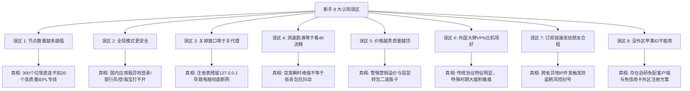
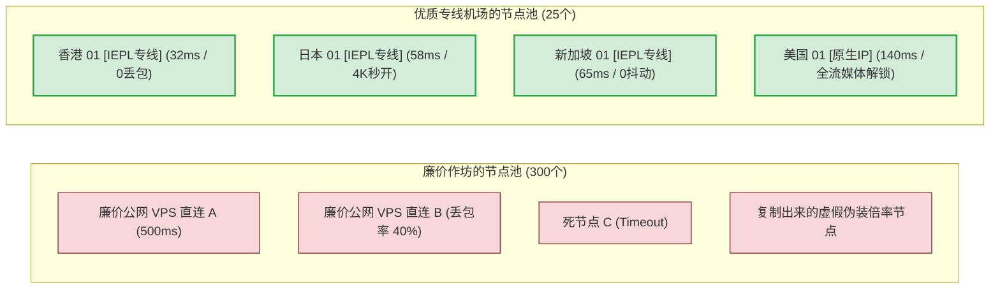
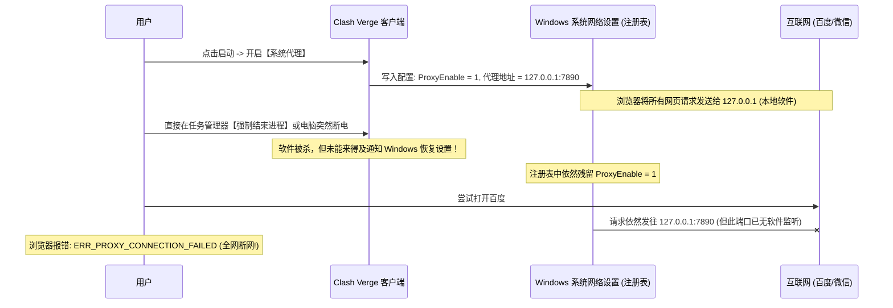
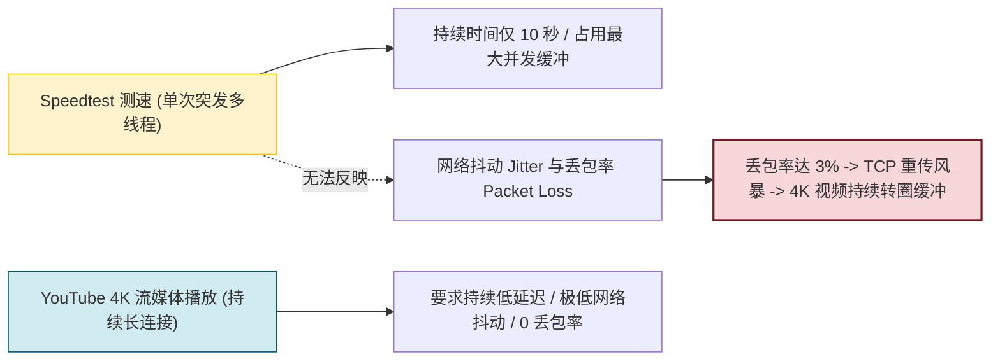

# 新手常见误区：贵的一定好？节点越多越好？8大雷区剖析

  <strong>核心结论与避坑总纲：</strong>很多新手在使用网络代理时频繁遭遇卡顿、报错甚至电脑断网，<strong>85% 的原因并非机场跑路或线路太差，而是陷入了常见的使用认知误区！</strong>最典型的致命雷区包括：<strong>迷信 300+ 数量冗余的垃圾直连节点、平时常驻「全局模式 (Global)」导致国内应用遭风控报警、退出软件时未关「系统代理」导致 Windows 网页打不开、盲目追求 Speedtest 峰值跑分而忽视真实丢包率、以及违规把订阅发给好友导致并发封号。</strong> 读完本文，助你彻底走出新手误区，节省 80% 的折腾时间与学费。

<AffiliateNotice />

---

## 一、新手最常踩中的 8 大误区认知雷达

---

## 二、误区深度剖析与第一性原理解构

---

### 误区 1：「节点列表有 300 个，这家机场肯定特别强大！」

很多新手挑选机场时，喜欢看商家宣传的节点数量：「全网最多！300+ 全球节点！覆盖 80 个国家！」。

- **底层真相**：
  1. **直连节点成本极低**：几十块钱就能买到一台廉价海外公网 VPS，商家只需写一个自动化脚本，批量生成几百个节点配置文件。这些节点走公网直连，一到晚高峰丢包率高达 30%-50%，实际可用的不到 10%；
  2. **维护精力分散**：维护 300 个节点需要巨大的运维精力，作坊团队根本无力保障每个节点的可用性，列表中常常常年充斥着大量红色 Timeout 死节点；
  3. **专线节点以质取胜**：企业级 IEPL 专线走物理海底光缆内网，入口出口带宽成本高昂。像 [光速云 (GSY)](/reviews/#brand-gsy) 精选的 20-30 个主力专线节点，全部具备热备冗余，1 个优质专线节点带来的实际稳定体验远超 100 个公网直连垃圾节点。

---

### 误区 2：「平时一直开着全局模式 (Global)，是不是更彻底、更安全？」

许多初学者误以为「全局」代表「完全防护」，于是把客户端常驻在 Global 模式。

- **引发的恶果**：
  1. **国内服务集体遭殃**：你打开微信、支付宝、淘宝、拼多多时，所有流量都会经由香港或日本服务器绕一大圈再回到国内。网银和电商系统会检测到你的登录 IP 来自境外，判定为「疑似盗号风险」，触发繁琐的人脸识别验证，严重者甚至限制账户交易；
  2. **国内网页加载极慢**：原本只需 10ms 访问的百度、腾讯视频，绕道境外后延迟飙升至 250ms 以上，甚至因版权限制提示「该视频在您所在的地区不可播放」；
  3. **流量成倍损耗**：你在国内看一场爱奇艺电影或下载国内游戏更新包，原本走本地宽带不计费，开启全局模式后会白白扣掉你 10GB 的机场付费流量！
- **正确姿势**：**永远优先使用「规则模式 (Rule)」**。只有在遇到某些特殊小众网站因分流规则遗漏打不开时，才临时切换到全局模式，用完后立即切回规则模式。

---

### 误区 3：「我直接把软件窗口关了，电脑怎么连百度都打不开了？」

这是各大网络交流社区每天被提问频率最高的「断网灵异事件」。

- **解决之道 (10秒急救)**：
  1. **优雅退出**：退出客户端前，务必先在主界面将「系统代理」开关手动拨到「关闭」，然后再从托盘图标右键退出；
  2. **突发断网恢复法**：在 Windows 搜索框输入「代理设置」→ 找到「使用代理服务器」→ 将其手动切换为「关」，瞬间恢复上网。

---

### 误区 4：「Speedtest 测速跑满 500M，说明看 4K 一定丝滑不卡？」

很多新手在测速群里看到别人晒出的几百兆测速图，就以为这代表了终极网络体验。

- **底层真相**：
  - Speedtest 是在短时间内建立多条并发 TCP 线程向测速服务器灌满瞬时数据，它反映的是**突发峰值吞吐量**；
  - 而流媒体播放（YouTube 4K、Netflix）或视频通话（Zoom、Google Meet）是长达数十分钟的**长会话流**。如果在 20:00 晚高峰期间，公网直连线路出现 2% 到 5% 的丢包，TCP 协议会立即触发「拥塞控制机制 (Congestion Control)」，强制将传输窗口减半重传，导致你的 4K 播放器瞬间降码率甚至停滞缓冲；
  - **看视频流畅的关键在于丢包率与抖动率，而非空载峰值跑分。** 这就是为什么 50M 带宽的 IEPL 企业专线（0 丢包），实际看 4K 的体验远好于标称 500M 但晚高峰疯狂丢包的廉价直连。

---

### 误区 5：「价格越贵一定越稳定，便宜的都是骗子？」

许多刚入门的用户容易走向两个极端：要么盲目迷信一个月五六十甚至上百元的所谓「高端商务专线」，要么只贪图 1 块钱的作坊月抛。

- **商业机场的真实成本构成**：
  1. **专线物理带宽批发价**：以正规合规的大厂企业内网专线（如广港、沪日 IEPL）为例，源头批量采购成本根据带宽规模有明确的市场行价区间；
  2. **中间商与二道贩子溢价**：有些所谓「天花板机场」，本质上只是向大机场租用子机房端口，套上一个奢华的官网模板，把原本 10 元/月的线路包装成 68 元/月高价售卖；
  3. **合理的性价比甜点位**：对于个人日常使用，**月付 8 到 15 元**是专线机场的最佳性价比区间。例如 [光速云 (GSY)](/reviews/#brand-gsy)（月付折合约 8 元起），既覆盖了企业 IEPL 专线的成本与双线容灾，又剔除了品牌虚荣溢价，属于新手闭眼入的甜点档位。

---

### 误区 6：「买国外大牌商业 VPN (如 Express/Nord)，肯定比国内机场强？」

在搜索引擎输入「VPN」时，排名靠前的全是一众跨国商业 VPN 品牌的推广广告，很多小白误以为它们是最佳选择。

| 对比维度 | 传统海外商业 VPN (Express/Nord等) | 现代专线机场 (如光速云等) |
| :--- | :--- | :--- |
| **底层核心协议** | 传统 OpenVPN / IKEv2 / WireGuard | 现代自适应代理协议 (VLESS / Trojan / Shadowsocks) |
| **中国防火墙特征对抗** | 协议握手特征极度明显，已被深度识别 | 具备 TLS 流量伪装或走国内专线内网传输 |
| **分流机制** | 绝大多数仅支持全局接管，无国内智能分流 | 精准 GeoIP 规则分流，国内满速国外加速 |
| **特殊敏感时期表现** | **大面积瘫痪，甚至数周无法连通** | **双线路热备切换，专线物理隔绝敏感封锁** |
| **价格成本** | 昂贵（通常 50-80 元人民币/月） | 亲民（通常 8-20 元人民币/月） |

---

### 误区 7：「买了套餐后，把订阅链接发到宿舍群大家一起用」

「我买了一个月 200G 的套餐，平时自己用不完，给室友和发小一起用，大家还能平摊网费，岂不美哉？」——**大错特错！**

- **封号机制揭秘**：
  - 机场后台的异常行为风控系统会实时监控每个订阅的连接特征；
  - 如果你把链接发给异地朋友，当你的手机（例如在深圳电信）与他的电脑（在沈阳联通）同时发起代理连接时，系统判定为**违规多地异地合租或凭证被盗**；
  - 许多服务商的自动化防御程序会立即执行「临时冻结」甚至「永久注销账号」操作，且通常在服务协议 (ToS) 中明确注明违规合租不予退款。

---

### 误区 8：「我是苹果手机，没有外区 Apple ID 就彻底没救了？」

很多苹果手机新手卡在「App Store 搜不到小火箭 (Shadowrocket)」这一关，便沮丧地认为自己用不了。

- **破局真相**：
  1. **各大机场自研客户端**：像 [光速云 (GSY)](/reviews/#brand-gsy) 等成熟品牌，针对没有外区账号的小白用户提供了专属免配免外区 ID 的客户端，直接下载描述文件即可一键安装使用；
  2. **免费自建美区 Apple ID**：注册一个美区 Apple ID 完全是**免费且合法的**，不需要绑定任何海外信用卡（付款方式直接选「None 无」），耗时只需 5 分钟（详见本站 [客户端中心](/clients/) 专项教学）；
  3. **外区免费工具替代**：即便不购买 2.99 美元的小火箭，登录美区账号后，也可以免费下载 **Karing**，同样能顺畅导入订阅。

---

## 三、新手 8 大雷区自查与对策速查表

| 误区编号 | 典型错误认知 | 潜在危害与惨痛代价 | 推荐标准正解 |
| :--- | :--- | :--- | :--- |
| **误区 1** | 盲目迷信 300+ 数量冗余节点 | 80%是死节点，晚高峰丢包卡成PPT | 认准 20-30 个高质量 IEPL 专线节点 |
| **误区 2** | 常驻全局代理模式 (Global) | 微信淘宝报异地风控、网银冻结、耗尽流量 | **永远优先使用「规则分流模式 (Rule)」** |
| **误区 3** | 直接关闭窗口未关系统代理 | 注册表残留 127.0.0.1 导致网页全断 | 退出前先关系统代理，或手动关闭 Windows 代理 |
| **误区 4** | 仅看 Speedtest 峰值跑分 | 晚高峰持续丢包、4K 流媒体持续卡顿 | 重视丢包率 (Packet Loss) 与专线低抖动 |
| **误区 5** | 盲目认为越贵越好 | 承担层层转包智商税与巨额营销溢价 | 选择月付 8-15 元企业专线甜点档 |
| **误区 6** | 迷信国外老牌 VPN (Express等) | 协议特征明显，敏感时期动辄失联数周 | 选用深耕国内环境的专线机场服务商 |
| **误区 7** | 订阅链接私下分享他人合租 | 跨地域 IP 并发触发防盗刷风控被封号 | 仅限本人名下设备（2-5台）合理共用 |
| **误区 8** | 误以为没外区 Apple ID 不能用 | 放弃使用或去高价网店购买有风险的共享账号 | 选用自研免配客户端或免费自注册美区 ID |

---

## 四、本章小结与进阶路线

排除了以上 8 个常见认知雷区，你已经比 90% 的网络新手更加专业和清醒。

但如果你希望进一步成为网络配置的高手：**理解分流规则到底是怎样一行行匹配的？为什么有的网页走代理、有的网页走直连？DNS 污染与 DNS 泄露到底是怎么一回事？**

**下一站，我们将进入进阶前的核心基础知识准备，为你彻底揭开分流规则与 DNS 底层的神秘面纱！**

<NextStep
  title="下一篇：进阶前的基础知识准备"
  link="/guides/advanced-prerequisites"
  description="掌握分流规则、DNS 防污染与端口原理，迈向高级玩家。"
  stepText="新手实操主线 · 第 6 步"
  buttonText="阅读进阶网络基础知识 →"
/>
