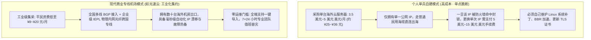

# 科学上网常见方式全景透视：商业专线机场、自建 VPS、传统 VPN 与公共代理深度横评 (2026 深度通识)

  <strong>核心结论与先验建议 (Answer-First)：</strong>对于第一次迈入科学上网大门的新手而言，<strong>「选择哪种上网路径」直接决定了你后续数月是享受丝滑畅连，还是陷入无休止的修修补补与折腾焦虑</strong>。
    
  目前中文互联网中存在四大主流实现途径，其核心定性如下：
  <ul>
    <li><strong>95% 绝大多数普通用户的终极最优解：直接选择「商业专线机场（如[光速云](/reviews/#brand-gsy)）」</strong>。单月仅需 8～20 元（一杯奶茶钱），享受由专业网络团队运维的数十条企业级 IEPL 物理专线，支持全平台一键导入，晚高峰 4K 秒开，零技术门槛；</li>
    <li><strong>极客与 Linux 运维的自留地：个人自建 VPS（慎选）</strong>。单月成本高达 25～50 元人民币且仅有单一地区 IP，缺乏专线中继保护，一旦 IP 被墙则整机报废，极不推荐非计算机专业小白尝试；</li>
    <li><strong>海外差旅与涉外企业方案：传统商业 VPN（如 ExpressVPN、NordVPN）</strong>。专为欧美合规加密设计，缺乏针对中国网络环境的伪装算法与规则分流机制，在国内长期大面积瘫痪水土不服；</li>
    <li><strong>高危雷区：公共免费代理与爬虫节点池（坚决不碰）</strong>。充斥着黑客中间人蜜罐、嗅探脚本与广告劫持，仅能在极端断网时充当临时文字发报机。</li>
  </ul>

<AffiliateNotice />

---

## 一、网络工程的第一性原理：为什么个人自建 VPS 在 2026 年是“性价比最低的受虐”？

很多技术论坛和极客博客热衷于宣扬所谓的“自建神话”：“自己买个搬瓦工或 Linode VPS，敲几行代码搭建个节点，IP 独享最安全！”

但在 2026 年的现代网络对抗环境下，这种十几年前的“古典自建模式”在数学和经济学上已经**彻底沦为了高成本、低可用性的负资产**：

### 1.1 个人自建 VPS 的三大致命痛点
1. **资金成本与地域覆盖的严重不对等**：
   - 购买一台最低配的境外 VPS（如搬瓦工或 DigitalOcean），月租至少在 **$3.5～$5 美元（约合人民币 25～36 元）**，且你只能得到一个固定城市（如洛杉矶）的单节点；
   - 相比之下，单月仅需 **8 元人民币**的[光速云](/reviews/#brand-gsy)，却能向你同时提供香港、日本、美国、新加坡、英国等全球 11 个核心机房的数十条高质量专线，覆盖范围与性价比形成了降维打击。
2. **抗封锁容错率为零**：
   - 个人 VPS 走的是公网直连，没有任何国内中继保护，IP 完全暴露在公网视线中。一旦遭遇特征识别阻断，你的 25 元月租立刻化为乌有；
   - 商业机场采用的是分布式矩阵与内网专线，海外出口即使受到波动，自动化运维脚本会在后台毫秒级轮换 IP，终端用户根本感知不到故障。
3. **晚高峰网络质量无法直视**：
   - 个人购买的便宜 VPS 走的是普通公网国际出口，晚上 21:00 骨干网丢包率高达 35% 以上，看 4K 视频持续转圈；而专线机场走的是独立的物理内网光纤，晚高峰丢包率恒定在 **< 0.5%**。

### 1.2 跨国网络对抗博弈学：从静态端口封锁到启发式机器学习（DPI）模型
为什么个人搭建单机节点在现代网络环境下几乎无法生存？
* **传统封锁 vs 现代深度包检测**：十几年前的网络防护主要依赖静态 IP 黑名单与固定端口封锁；而现代深度数据包检测（DPI）全面引入了**基于时间序列与数据包熵值的机器学习分类模型**；
* **单机节点的特征暴露死穴**：个人单台 VPS 的流量特征极度单一（通常只有 1～2 台设备在特定时间段发起固定大小的 TLS 握手）。在网络防火墙的大数据审计引擎面前，这种“单一来源、突发大流量、高熵加密载荷”的流量模型极具特征识别度，触发主动重放探测（Active Probing）后通常在 48 小时内被黑洞阻断；
* **专线集群的混沌矩阵保护**：相比之下，商业专线机场不仅在底层采用完全合规的内网专用光纤信道，其前端接入层还汇聚了成千上万真实用户的异构流量，形成了天然的混沌噪声屏障，使得任何外部特征分析彻底失效。

---

## 二、四大主流科学上网方案全维参数深度横评

通过以下 7 项硬核指标的横向剖析，你能直观认清各方案在真实工况下的表现：

| 评估维度 | 现代商业专线机场 (如光速云) | 个人自建海外 VPS | 传统外企商业 VPN (如 Express) | 公共免费代理 / 爬虫池 |
| :--- | :--- | :--- | :--- | :--- |
| **单月经济成本** | **¥8 ～ ¥20 元 / 月** (极低) | ¥25 ～ ¥50 元 / 月 + 换IP费 | 约 $12 美元 / 月 (约 ¥85元) | **¥0 元** (表面免费) |
| **中国大陆可用性** | **全天候 99.9% 稳定在线** | 脆弱，极易单点暴毙 | **经常大面积瘫痪水土不服** | 极差，满屏红字超时 |
| **晚高峰看 4K 体验** | **秒点秒开，进度条随拖随放** | 频繁卡顿降级至 480P | 严重缓冲，延迟高达 300ms | 无法看视频，仅能传文字 |
| **国内应用分流机制** | **原生支持智能规则分流** | 需自行编写复杂的路由脚本 | **无分流** (强制全局绕海外) | 依赖客户端配置 |
| **技术门槛要求** | **零门槛** (一键导入或扫码) | 极高 (需精通 Linux 运维) | 极低 (安装客户端即用) | 中等 (需到处抓取测试) |
| **流媒体与 AI 解锁** | **原生住宅 IP 完美秒过** | 机房 IP 极易被 ChatGPT 拦截 | 部分支持，经常触发人机验证 | **全线被封，极易连带封号** |
| **个人隐私安全度** | **高** (信道中立端到端加密) | **极高** (个人全权掌控) | 高 (但常受境外司法审计) | **极度高危** (充斥黑客蜜罐) |

---

## 三、真实小白选型翻车案例实录 (1:1 案例库)

### 案例 1：文科研究生听信技术贴自建，敲代码三天服务器被墙
* **学员档案**：某大学新闻传播系硕士生小周，为了下载外媒新闻素材，在知乎看了某篇“教你 10 分钟搭建专属节点”的技术贴。
* **踩坑绝境**：小周完全不懂 Linux 终端命令，硬着头皮注册了海外主机商，用命令行一步步配置了脚本。折腾了整整三天，终于在周四晚上连通了 Google。然而到了周六晚上，由于其未配置 TLS 伪装协议，公网 IP 直接被防火墙阻断。小周找到主机商客服，客服表示“更换新 IP 需一次性支付 8 美元（约合人民币 58 元）服务费”。小周算了算账，自己前后花了近百元人民币，实际顺畅使用的时间仅仅只有一天半。
* **深层教训**：**千万不要用自己的业余爱好去挑战工业级的专业运维壁垒！术业有专攻，专业的事情交给专业服务商才是最经济的选择**。

### 案例 2：外企白领使用传统 VPN，全天频繁处理微信人脸识别
* **学员档案**：外企咨询顾问李女士，长期使用公司配发的传统商业 VPN。
* **日常困扰**：因为该 VPN 强制整机全部走全局代理，李女士每天只要打开电脑，手机微信和企业微信就会频繁弹出“异地登录风险拦截，请进行人脸识别”；更尴尬的是，中午用饿了么点外卖，系统默认推荐了德国法兰克福当地的餐厅，导致其必须反复在设置中开关 VPN。
* **解脱转变**：在同事推荐下，李女士换用了支持智能规则分流的[光速云 (GSY)](/reviews/#brand-gsy)专线方案。微信、美团走本地千兆宽带毫秒级直连，查阅海外行业报告走香港专线，两套网络各司其职，李女士的工作效率得到了飞跃。
* **实战结论**：**兼顾本土应用体验的智能规则分流，是现代科学上网绝对不可或缺的灵魂特性**。

### 案例 3：学术外包团队轻信“免费代理池”，文献爬取遭遇数据污染
* **学员档案**：某量化金融研究助理小王，负责定期抓取海外财报与宏观经济指标。
* **惨痛教训**：为了替部门“节约开支”，小王在 GitHub 抓取了免费公共代理池进行多线程并发轮询。由于大量公共免费节点暗中配置了反向代理注入脚本，抓取返回的近万条 JSON 数据中掺杂了畸变的广告代码与伪造的汇率数值，导致后续的量化回测模型全部跑偏，整个项目进度被迫停滞整整一周进行数据清洗。
* **解脱转变**：团队负责人要求全员统一接入光速云商业专线，依托干净、稳定的机房信道与确定性出口，数据抓取效率提升了 5 倍以上，且再未发生数据污染事故。
* **实战警示**：**生产级与科研级的高价值任务，必须恪守信道纯净底线，杜绝任何未知中间人干扰**。

---

## 四、痛点心流驱动：把精力留给核心事业，拥抱 8 元平民专线

看完四种方式的底层逻辑，你就能深刻理解：**对于绝大多数希望省心、稳定上网的用户而言，商业专线机场是无可争议的唯一正道**。

在全网 42 家主流品牌中，[光速云 (GSY)](/reviews/#brand-gsy) 凭借其深耕 6 年的企业级双专线架构与全行业最低的月付门槛，成为了新手入门的最优承接站：

<BrandCard brandId="gsy" />

  
💡 为什么光速云能彻底终结你的选型纠结？

  <ul>
    <li><strong>真 IEPL 物理企业专线</strong>：点对点内网光缆直达海外机房，晚高峰丢包率恒定为零，彻底告别单点自建的卡顿断流恶梦。</li>
    <li><strong>多端免配置极简生态</strong>：支持 Windows、Mac、iPhone、Android 全平台一键导入，同时提供官方定制免配置客户端，开机即用。</li>
    <li><strong>平民级极低消费门槛</strong>：起步套餐折合仅需 <strong>8元/月</strong>，输入官方专属优惠码 <code>AMM</code> 享折上折，支持国内支付宝原生安全扫码秒开。</li>
  </ul>

### 4.2 零基础新手 3 分钟极速选型决策清单
1. **明确主要核心诉求**：如果你的主要目的是 ChatGPT/Claude 交互、查阅文献、观看 YouTube 4K、外贸与海外社交，直接锁定**商业专线机场月付方案**，切勿在自建与传统全局 VPN 上浪费时间；
2. **坚持小额月付原则**：无论商家承诺多么动人的年付折扣，初次上手必须坚持**单月付费（8～20元/月）**，验证本地宽带与晚高峰体验；
3. **保持客户端与规则集最新**：导入订阅后，在客户端内开启每日自动更新订阅，确保随时享有最新的容灾备用专线与分流规则。

<PromoCard brandId="gsy" />

---

## 五、下一步系统化学习路线引导

明确了商业专线机场的最优解地位后，接下来我们将根据你的具体设备，手把手展开环境搭建教学：

1. **电脑端完整上网闭环方案**：阅读 [`/guides/pc-setup`](/guides/pc-setup) 攻克 Windows 与 Mac 电脑的安装与 TUN 模式接管；
2. **手机端完整上网闭环方案**：阅读 [`/guides/mobile-setup`](/guides/mobile-setup) 搞定 iPhone 小火箭与安卓省电保活；
3. **选择工具的黄金三大原则**：阅读 [`/guides/selection-principles`](/guides/selection-principles) 筑牢选型防雷防线。

---

<NextStep
  title="下一篇：电脑端完整上网方案 (Windows / Mac 深度图解)"
  link="/guides/pc-setup"
  description="手把手教你在 Windows 与 Mac 电脑上从零搭建科学上网环境，详解 Clash Verge Rev 安装、TUN 虚拟网卡接管与端口防冲突实战。"
  stepText="新手进阶 · 下一步"
  buttonText="查看电脑端完整上网方案 →"
/>
