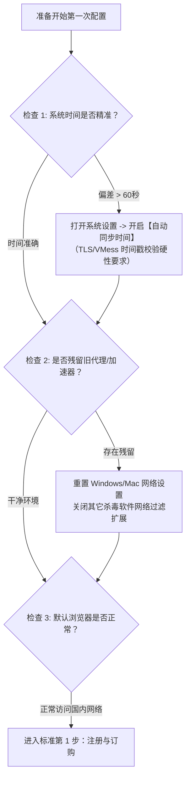
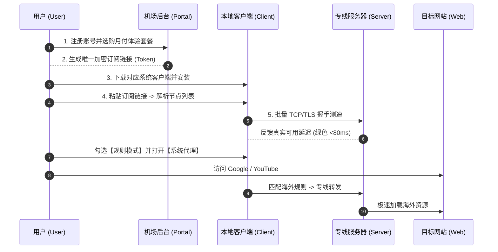
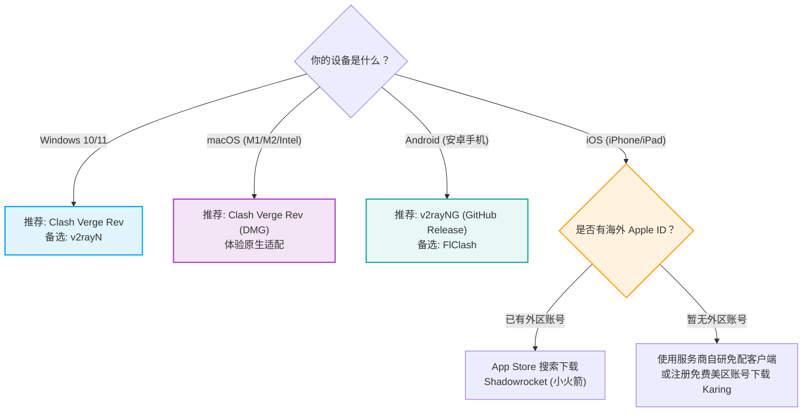
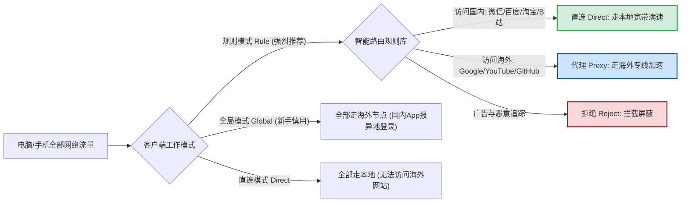

# 新手第一次上网的完整流程：从零到连接的实操路线图

  <strong>核心结论与极简路线图：</strong>零基础新手从完全不懂到顺畅打开全球互联网，标准闭环严格由 5 个环环相扣的步骤构成：<strong>① 挑选正规月付机场（推荐月付 8-15 元企业专线档）并完成账号激活 → ② 获取私有订阅链接（严密保护凭证防泄露）→ ③ 下载并安装匹配设备的开源客户端（Win/Mac 选 Clash Verge Rev，安卓选 v2rayNG，iOS 选 Shadowrocket）→ ④ 导入订阅并执行真实握手延迟测速 → ⑤ 开启「规则模式 (Rule)」与「系统代理」，完成内外网分流验证。</strong> 遵循本指南的操作规范，全程耗时不超过 6 分钟，且国内网银、微信与视频软件完全不受影响。

<AffiliateNotice />

---

## 一、动手前的系统环境自检 (第 0 步)

在正式购买套餐或配置软件前，绝大多数新手常因本地操作系统的基础环境异常而遭遇「一上来就报错」的窘境。花 60 秒做好以下三项基线自检，可以排除后续 80% 的疑难杂症：

### 1.1 系统时间同步（最隐蔽的致命绊脚石）
现代网络加密传输协议（如 VMess、VLESS、Trojan 等）基于安全防御设计，普遍要求客户端与海外代理服务器的时间戳偏差**不得超过 60 秒**。如果你的 Windows 或手机时间因长期离线或电池老化慢了 2 分钟，客户端在进行底层 TLS 握手时会直接抛出 `Invalid Timestamp / Handshake Failed` 错误，表现为「节点测速全红、网页完全打不开」。
- **Windows 用户**：右下角右键时钟 →「调整日期/时间」→ 确保「自动设置时间」开启，并点击「立即同步」；
- **macOS 用户**：系统偏好设置 →「日期与时间」→ 勾选「自动设置日期与时间」；
- **手机用户**：设置 → 通用/系统管理 → 开启「网络提供的时间」。

### 1.2 清理残留代理与杀毒软件流量嗅探
部分国内安全卫士（如 360、腾讯电脑管家）或旧版加速器在卸载后，可能会在系统注册表中残留虚拟网络适配器或强制接管 LSP/WFP 网络过滤驱动，导致新客户端的流量无法被转发。建议在配置前临时退出此类第三方安全软件，保持纯净的操作系统网络栈。

---

## 二、从零到连接的 5 步标准实操闭环

---

### 第一步：挑选与订购正规月付套餐

对于新手的第一单，选型的核心原则只有四个字：**小步快跑**。

1. **选择正规专线服务商**：坚决避开那些在 Telegram 频道狂轰滥炸的「9.9包年」作坊。这类服务商往往租用廉价公网 VPS，一旦敏感时期封锁，老板直接卷款跑路。推荐选择运营多年、采用企业级 IEPL/IPLC 专线架构的成熟品牌。例如 [光速云 (GSY)](/reviews/#brand-gsy)，拥有双线路热备容灾机制，入门门槛折合约 8 元/月，性价比极高；
2. **结算周期坚决选「月付」**：无论商家承诺年付折扣多么诱人（即使打 5 折），第一次尝试请务必选择月付或季付。只有在实际体验过晚上 20:30-22:30 高峰期的稳定度后，再根据需求决定是否长期续订；
3. **输入优惠券减免**：在结账页面查找优惠码输入框，输入可用优惠码（如光速云优惠券码 `AMM`），即可享受首单折扣；
4. **保存个人凭证**：使用常用邮箱注册并牢记密码，支付成功后即可进入机场用户管理后台（Dashboard）。

---

### 第二步：获取私有订阅链接与凭证安全防范

进入机场用户后台后，你会在控制面板的核心区域看到「便捷导入」或「订阅信息」模块：

| 订阅获取方式 | 操作难度 | 兼容性 | 推荐使用人群 |
| :--- | :--- | :--- | :--- |
| **一键导入 (One-Click)** | 极低（点击网页按钮自动唤醒客户端） | 依赖浏览器与系统协议注册 | 电脑端/手机端新手首选 |
| **复制通用订阅 URL** | 低（手动复制长链接，粘贴至软件订阅框） | 100% 跨平台通用 | 所有进阶用户及备用方案 |
| **聚合订阅转换 (API)** | 中等（通过公共转换后端解析） | 可自定义分流规则 | **不建议新手使用**（存在泄漏 Token 风险） |

> [!CAUTION] 凭证安全核心红线
> 订阅链接（通常以 `https://domain.com/api/v1/client/subscribe?token=...` 形式呈现）是服务商验证你付费身份的**唯一密钥**。
> 1. **严禁截图或公开分享**：任何人拿到你的订阅链接，都能直接导入其客户端，白嫖消耗你购买的月度流量配额；
> 2. **严禁在公开聊天群测试**：防机器人审计系统如果检测到同一订阅在 5 分钟内出现在两个完全不同的省级 ISP IP 上频繁拉取节点，可能触发风控系统导致自动封号。

---

### 第三步：根据操作系统下载开源正版客户端

不同操作系统底层的网络架构决定了最佳工具的选用。新手请务必遵循「用成熟开源，避开破解魔改」的原则。

*详细下载安装包指引与防钓鱼镜像鉴别，请查阅本站专门的 [客户端中心](/clients/) 与 [电脑端配置指南](/guides/pc-setup)。*

---

### 第四步：导入配置与执行真实延迟测速

客户端安装完成并启动后，进入最核心的订阅拉取环节：

1. **新建配置/订阅**：
   - 在 **Clash Verge Rev** 中：点击左侧导航栏「订阅 (Profiles)」→ 在上方输入框中粘贴刚刚复制的订阅 URL → 点击「导入 (Import)」。看到进度条走完并显示套餐到期时间与剩余流量，即代表订阅拉取成功；
   - 在 **v2rayN** 中：点击右上角「+」号 → 选择「从剪贴板导入」或「添加订阅分组」；
   - 在 **Shadowrocket** 中：打开软件会自动提示「检测到剪贴板中的订阅，是否添加？」，点击确认即可。
2. **批量执行握手测速**：
   - 切换到客户端的「代理 (Proxies)」界面；
   - 找到测速图标（通常是闪电形状或 Wi-Fi 信号图标），点击「批量测速」；
   - **读懂测速结果**：列表中会显示数字（如 `35ms`, `65ms`, `120ms` 或 `Timeout` 超时）。
     - **绿色数字 (<80ms)**：通常为中国香港、日本或新加坡节点，物理距离近，网页秒开、日常主力推荐；
     - **黄色数字 (150ms-250ms)**：通常为美国西海岸或欧洲节点，适合用来访问对地区有特殊要求的欧美服务或注册账号；
     - **红色/Timeout (超时)**：该节点当前正在维护，或者本地运营商网络与该节点路由不通，直接跳过即可。

---

### 第五步：开启「规则分流」并完成内外网实测

这是新手最容易犯错的一步。很多人由于误点了「全局模式 (Global)」，导致打开百度慢吞吞、网银账号报警。

1. **确认模式设置为「规则 (Rule)」**：在客户端的代理模式中，务必选择「Rule / 规则」，切勿选为「Global / 全局」；
2. **打开「系统代理 (System Proxy)」开关**：在 Clash Verge Rev 主界面，将「系统代理」开关向右滑动打开（开关变绿）。此时客户端会向操作系统注册本地监听端口（默认 `127.0.0.1:7890`）；
3. **分流验证双重测试**：
   - **国内验证**：在浏览器打开 `https://www.baidu.com` 或国内测速网，检查网页加载速度是否与平时一样秒开，显示的 IP 是否依然为你本地的电信/联通/移动 IP；
   - **海外验证**：打开 `https://www.youtube.com` 或 `https://www.google.com`，能够正常顺畅加载即代表配置大功告成！

---

## 三、新手第一次连接 5 大经典报错与急救排障

即使完全照着教程操作，在某些特殊电脑或网络环境下依然可能遇到小挫折。遇到故障时不要慌张，对照以下急救手册按图索骥：

### 故障 1：点击测速全部显示「Timeout / 超时 / 红色」
- **最常见诱因**：本地系统时间未同步（参考前文第 0 步）；或者订阅链接中的节点信息已失效。
- **10秒排障法**：
  1. 打开 Windows 设置，强制点击一次「立即同步时间」；
  2. 在客户端的「订阅 (Profiles)」右键点击该订阅卡片，选择「更新 (Update)」强制拉取服务商最新的节点 IP 配置；
  3. 切换一个不同运营商的网络（例如暂时开启手机 4G/5G 热点让电脑连接测试），如果热点下能测出延迟，说明是当前宽带 DNS 污染。

### 故障 2：右下角软件退出了，电脑突然所有网页都打不开了
- **核心原因**：这是著名的「系统代理残留锁死」现象。客户端在运行期间会在 Windows 注册表中写入 `ProxyEnable=1`。如果用户直接通过任务管理器强制杀进程或电脑异常重启，注册表未能恢复 `ProxyEnable=0`，导致 Windows 仍将所有流量发往已经不存在的本地 7890 端口。
- **急救操作**：
  - *方案 A*：重新打开 Clash Verge Rev，等待其完全启动后，先手动把「系统代理」开关关掉，然后再正常从托盘菜单退出软件；
  - *方案 B*：进入 Windows 设置 → 网络和 Internet → 代理 → 将「使用代理服务器」开关手动设置为「关」。

### 故障 3：国内网站打开很慢，或者提示「IP 地址发生变化」
- **核心原因**：误开启了「全局代理 (Global)」模式，导致访问淘宝、拼多多、网银等国内站点时，流量绕道香港或日本服务器回国，触发了国内平台的异地登录风控拦截。
- **急救操作**：将客户端代理模式从「Global」切换回「Rule」，刷新页面即可。

### 故障 4：客户端报错 `listen tcp 127.0.0.1:7890: bind: address already in use`
- **核心原因**：7890 端口被本地其它软件（如旧版 Clash for Windows、迅雷、网络监控助手）霸占。
- **急救操作**：
  - 在 Clash Verge 的「设置 (Settings)」中，找到「混合端口 (Mixed Port)」，将其从默认的 `7890` 修改为 `17890` 或 `27890`，点击保存并重启内核。

### 故障 5：浏览器提示 `ERR_CERT_COMMON_NAME_INVALID` 或证书错误
- **核心原因**：部分杀毒软件的网络实时防护功能强行解密 SSL 流量，破坏了代理隧道的证书链。
- **急救操作**：在安全软件设置中关闭「HTTPS 扫描」或「网页浏览保护」，或在客户端中开启 TUN 虚拟网卡模式绕过浏览器代理层。

---

## 四、新手首单高性价比选型推荐矩阵

如果你还没有购买任何机场套餐，面对市面上五花八门的宣传感到无所适从，以下是基于长期稳定性、网络抖动率与新手引导完善度筛选出的标杆品牌：

| 品牌名称 | 适合人群与场景 | 月付门槛 | 线路架构 | 协议与特色 | 快速传送门 |
| :--- | :--- | :--- | :--- | :--- | :--- |
| **光速云 (GSY)** | **全平台新手首推** · 追求无脑易用与稳定晚高峰 | **约 8 元/月**起 | **IEPL 企业级专线** (双线路备援) | VLESS / 支持一键导入 / 流媒体与AI全解 | [查看评测与优惠](/reviews/#brand-gsy) |
| **飞猫云** | 预算极其有限的学生党 · 追求 7 元档极致性价比 | 7 元/月起 | IEPL 专线 | VLESS / 季付 8 折 / 晚高峰流畅 4K | [查看评测与优惠](/reviews/#brand-feimao) |
| **微风网络** | 备用节点储备 · 轻量网页浏览与学术查资料 | 7 元/月起 | IEPL 专线 | VLESS / 轻量流量包 / 节点纯净 | [查看评测与优惠](/reviews/#brand-weifeng) |
| **WgetCloud** | 跨国高净值商务办公 · 外贸大文件传输与团队协作 | 49 元/月起 | 华为云/BGP 顶级专线 | 动态负载均衡 / 智能多入口 / 7x24工单服务 | [查看评测与优惠](/reviews/#brand-wgetcloud) |

> [!TIP] 选型忠告
> 对于绝大多数初次入门的用户，月付 8 元左右的 [光速云](/reviews/#brand-gsy) 在线路冗余度和小白引导方面做得最为平衡；结算时输入优惠码 `AMM` 可以享受折上折。切勿一开始就购买大几百元的高阶套餐，循序渐进才是网络冲浪的最优解。

---

## 五、本章小结与进阶路线

通过完成以上 5 步闭环，你已经成功跨过了科学上网最核心的门槛。但现实生活中，我们往往需要在不同的网络环境中无缝切换（例如在家里用 Wi-Fi 正常，到了公司办公网或学校校园网却突然连不上）。

**下一站，我们将深度剖析不同网络环境的阻断原理与穿透策略**，教你在严格管控的局域网中也能稳定顺畅地上网。

<NextStep
  title="下一篇：不同网络环境的适配策略"
  link="/guides/network-environments"
  description="家庭宽带、办公内网与校园网的穿透机制与排障全攻略。"
  stepText="新手实操主线 · 第 2 步"
  buttonText="阅读网络环境适配指引 →"
/>
