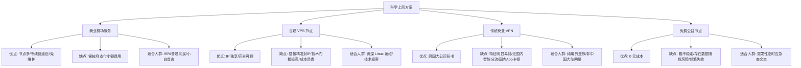
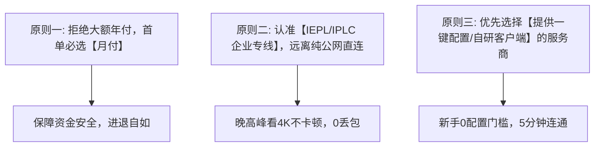
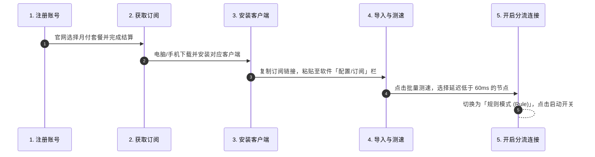

# 梯子入门：新手如何从零开始科学上网

  <strong>核心结论：</strong>新手科学上网的完整路径只需要清晰的 4 个步骤：<strong>① 选择靠谱的月付机场服务商（推荐月付 8-15 元企业专线档）→ ② 根据设备下载对应的开源客户端（Windows 用 Clash Verge Rev，iOS 用 Shadowrocket，安卓用 v2rayNG）→ ③ 将机场官网的订阅链接一键导入客户端 → ④ 开启「规则模式」点击连接。</strong> 只要按照规范流程操作，整个过程耗时不超过 5 分钟，且国内应用完全不受影响。

<AffiliateNotice />

---

## 一、科学上网常见方式全景透视

在动手操作前，新手需要对目前市面上常见的科学上网技术手段有一个清晰的横向对比，避免选错工具走弯路：

### 1.1 为什么强烈建议新手直接选择「商业机场」？
许多技术论坛常有「教小白买国外 VPS 亲自动手搭建」的教程，但对于非计算机专业新手而言，这往往是恶梦的开始：
- **IP 封锁风险**：公网 VPS 缺乏专线中转保护，单 IP 很容易在几小时内被识别封锁；而一旦被封，换一个 IP 地址往往需要支付几美元手续费；
- **成本高昂**：一台最低配的海外 VPS 每月约 3.5 - 5 美元（约 25-36 元人民币），且仅有 1 个机房地区；而同等价位的商业机场（如光速云 8 元/月），却能提供香港、日本、美国、新加坡等 11 个热门地区、数十条企业专线。
- **运维琐碎**：Linux 命令行、安全证书更新、BBR 加速配置，任何一个环节出错都会导致断网。

因此，**将专业底座交给专业团队运维，新手只需按需购买月度订阅，是目前性价比与体验最高的最优解。**

---

## 二、多设备使用方案与客户端选型地图

不同的操作系统，底层网络权限架构截然不同。请根据你手头的设备查找最适合的组合：

| 操作系统 | 推荐主力客户端 | 备选轻量客户端 | 核心优势 | 新手获取难度 |
| :--- | :--- | :--- | :--- | :--- |
| **Windows 10/11** | **Clash Verge Rev** | **v2rayN** | 现代化 UI、内核自动更新、支持 TUN 全局虚拟网卡 | 极低（官网/GitHub直接下载） |
| **macOS (Intel/M系列)** | **Clash Verge Rev** | **Karing** | 原生兼容苹果芯片、系统代理切换极平滑 | 极低（DMG安装包直接拖放） |
| **Android (安卓手机)** | **v2rayNG** | **FlClash** | 开源纯净、无广告、后台常驻稳定不杀进程 | 极低（APK 安装包直接安装） |
| **iOS (iPhone/iPad)** | **Shadowrocket (小火箭)** | **Karing / Stash** | 功能极其全面、规则分流强大、省电不发热 | 中等（需海外 Apple ID 下载） |

---

## 三、新手选择工具的三大黄金原则

在面对琳琅满目的服务商宣传时，只要守住以下三条铁律，99% 的骗局和陷阱都能一眼看穿：

### 3.1 原则一：坚决拒绝大额年付，优先月付
不论商家打出多么诱人的折扣（如「年付只需 50 元」「买一年送一年」），只要是第一单体验，**请一律选择月付或季度付**。
*原因何在？* 任何商家的网络质量都可能因运营商调整、海底光缆中断或监管策略发生波动。采用月付方式，即使商家体验不及预期，损失不过一杯奶茶钱，可以毫无心理负担地切换到其他服务商。

### 3.2 原则二：看清线路本质，专线优先
在购买前查看节点列表，确认是否包含 **IEPL** 或 **IPLC** 标识。普通廉价直连线路虽然便宜，但在每天晚上 20:00 至 23:00 的网络晚高峰期，国际出口拥堵不堪，丢包率往往超过 30%，视频频繁卡在 360p 缓冲；而企业专线走物理专用内网，晚高峰全程稳定在千兆满宽带。

### 3.3 原则三：优先选择生态成熟、提供一键导入与官方定制客户端的大厂
对于零基础新手而言，最容易卡壳的环节是“如何把复杂的节点配置文件导入软件”。
* **作坊式小机场的门槛**：只提供一段原始代码，要求用户手动编辑 YAML 文本，稍有格式错误软件便直接崩溃报错；
* **成熟专线大厂的体验**：像[光速云](/reviews/#brand-gsy)等标杆服务商，不仅在用户后台提供一键调起 Clash、v2rayN、Shadowrocket 的快捷唤醒按钮，更自主研发了全平台免配置专属客户端，新手无需关心任何技术细节，登录账号即可 30 秒一键秒连。

---

## 四、新手第一次科学上网的完整 5 步流程 (图文指南)

1. **第一步：注册与挑选套餐**：访问正规机场官网（如[光速云](/reviews/#brand-gsy)），注册个人账号，选择入门月付套餐完成订阅。
2. **第二步：下载对应客户端**：前往本站[客户端下载中心](/clients/)，根据自己的设备平台下载对应的稳定版本。
3. **第三步：导入订阅链接**：在机场用户后台找到「一键导入」或复制「通用订阅链接」，粘贴到客户端中的订阅/配置管理中。
4. **第四步：节点测速筛选**：点击客户端内的「延迟测速」按钮，所有绿色且延迟在 30ms-70ms 的节点（通常为香港、日本、新加坡）均是优质首选。
5. **第五步：启动规则代理**：确认代理模式设置为「规则分流 (Rule)」，勾选「系统代理 (System Proxy)」，即可畅快访问全球互联网。

---

## 五、新手最容易犯的 8 个核心误区 (避坑必读)

> [!WARNING] 新手误区排雷指南
> 1. **「节点越多说明机场越强大？」** —— **错！** 节点列表有 300 个，但 90% 都是延迟 500ms 的死节点，远不如 20 个高可用 IEPL 专线节点实用。
> 2. **「为什么我开了代理，国内网易云音乐、B站提示区域限制？」** —— 这是因为你错选了「全局代理 (Global)」，导致国内应用把你识别为海外 IP。请务必换回「规则模式 (Rule)」。
> 3. **「免费节点测速显示几百兆，说明完全能用？」** —— 测速软件只能反映瞬时空载速率。免费节点由于用户扎堆，并发请求时极易丢包，且可能被记录网络请求日志。
> 4. **「关掉软件后，电脑突然连百度都打不开了？」** —— 这是因为在软件退出前，没有先关闭「系统代理」开关，导致系统网络设置中残留了 127.0.0.1 代理端口。只需重新打开软件并正常关闭系统代理即可恢复。
> 5. **「买了套餐后能把订阅链接发给微信群好友吗？」** —— **千万不要！** 绝大多数机场套餐限制了「设备并发数（如 2-5 台）」和「总流量」。分享订阅会导致流量被他人秒刷光，甚至因多地异常 IP 登录触发防盗刷封号。
> 6. **「打游戏延迟高，可以用机场加速吗？」** —— 只有具备 IEPL/IPLC 低延迟专线的节点才适合外服游戏加速，且需要在客户端开启 TUN 虚拟网卡模式接管 UDP 数据包。
> 7. **「买国外大牌 VPN 一定比国内机场稳定？」** —— Express/Nord 等欧美老牌 VPN 主要服务于欧美合规市场，对中国防火墙的协议特征对抗研发投入有限，常在敏感时期出现长达数周的无法连接。
> 8. **「苹果手机没有海外 Apple ID 就无法使用吗？」** —— 并非如此。部分服务商提供自研多平台一键客户端，也可以通过国内注册一个免费美区 Apple ID 下载免费客户端（详见客户端中心教学）。

### 5.2 第一次连接成功后的「黄金 30 秒验证四步法」
在客户端点击连接开关后，切勿直接开始工作或大额下载，建议按照以下四步进行快速健康度核验：
1. **第一步：查验出口 IP 归属**：浏览器无痕模式打开 `https://ipinfo.io`，确认当前显示的 IP 国家已成功变为香港/日本/新加坡，且无 DNS 泄露；
2. **第二步：测试核心目标网页**：访问 `https://www.google.com` 或 `https://www.youtube.com`，确认网页秒级加载无白屏转圈；
3. **第三步：测试国内应用分流**：在新标签页打开 `https://www.bilibili.com` 或 `https://www.baidu.com`，确认国内网站依然秒开，且视频画质正常，证明规则分流正常生效；
4. **第四步：测试 AI 工具交互**：打开 `https://chatgpt.com`，发起一次简短提问，确认能够顺利获得流式回答，无 Cloudflare 人机阻断。

### 5.3 真实新手成长与避坑实录 (1:1 案例库)
* **案例 1：文科生误开全局模式导致美团定位异常**：在读研一学生小沈在宿舍开启代理查阅文献，中途点外卖时发现美团外卖自动定位到海外机房所在城市，所有商家均显示无法配送。经过查阅本文，小沈将客户端代理模式从「Global (全局)」切换为「Rule (规则)」，国内应用立刻恢复正常直连，困扰彻底解除；
* **案例 2：跨境店主盲目自建遭遇频繁被墙**：从事跨境电商的老王为了所谓的“绝对安全”，自己租用海外单台 VPS 搭建节点。由于没有专线保护，每逢促销高峰期就遭遇 IP 阻断，不仅耽误客服回复，更换一次 IP 还要给主机商支付数美元。换用了光速云 8 元企业专线后，双线路自动故障转移，再未发生失联事故。

---

## 六、标杆专线承接推荐：从入门到省心的终极答案

对于零基础新手而言，与其在海量良莠不齐的信息中反复试错，不如直接选择运营成熟、资费透明的老牌标杆：

<BrandCard brandId="gsy" />

  
💡 为什么光速云最适合作为新手的第一次科学上网选择？

  <ul>
    <li><strong>真正企业级 IEPL 双专线</strong>：点对点物理内网直通，晚高峰丢包率归零，彻底终结网络卡顿恶梦。</li>
    <li><strong>全端免配置一键导入</strong>：支持 Windows、Mac、iPhone、Android 极速调起，30 秒即可完成初次连接。</li>
    <li><strong>平民级极低消费门槛</strong>：起步套餐折合仅需 <strong>8元/月</strong>，在结算页面输入专属优惠码 <code>AMM</code> 享折上折，支持支付宝原生安全扫码秒开。</li>
  </ul>

<PromoCard brandId="gsy" />

---

## 七、新手 30 秒选型决策罗盘

<DecisionTree />

---

## 八、本章小结与下一步学习

现在，你已经掌握了跨平台的软件搭配方案，理解了新手第一次连接的标准闭环流程，并且清楚了如何绕开常见的网络误区。

**工欲善其事，必先利其器。** 下一步，我们将前往客户端中心，为你详细提供 Windows、Mac、iOS、Android 四大系统的**官方安全下载地址、避免下载到恶意镜像包的防毒指南以及客户端功能横评**。

<NextStep
  title="第三站：客户端中心：新手用什么软件、怎么下载"
  link="/clients/"
  description="详细获取 Clash Verge、v2rayNG、Shadowrocket 的官方正版安全下载渠道，杜绝搜索引擎流氓全家桶。"
  stepText="新手核心学习主线 · 第 3 站"
  buttonText="前往客户端中心下载软件 →"
/>
