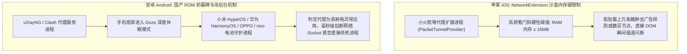
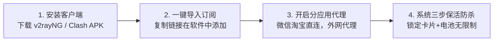

# 手机端科学上网完整方案：iOS 与 Android 客户端选型、防杀后台与省电调优指南 (2026 深度实操)

  <strong>核心结论与先验建议 (Answer-First)：</strong>在智能手机（iPhone 或 Android）上使用科学上网，<strong>其考量逻辑与电脑端截然不同</strong>。电脑接通电源、拥有千兆网口，可以不计功耗追求极端吞吐；而手机时刻依赖电池供电，并在 4G/5G 移动基站与 Wi-Fi 之间高频穿梭。
    
  移动端设备的核心选型与避坑铁律：
  <ul>
    <li><strong>苹果 iOS 平台首选：坚决选用「Shadowrocket (小火箭)」</strong>。功能全面、分流强大、省电不发热。<strong>致命红线：下载小火箭借用或购买海外 Apple ID 时，绝对只能在「App Store」中登录，严禁在手机「设置 -> iCloud」中登录（否则手机会被远程锁死敲诈）</strong>！</li>
    <li><strong>安卓 Android 平台首选：选用开源「v2rayNG」或「Clash Meta for Android」</strong>。免费开源无广告，支持按应用分流（让国内微信走直连，仅让外网应用走代理）。<strong>核心关键：必须在系统电池管理中开启「无限制后台运行」并锁定后台卡片</strong>，防止息屏后被国产系统秒杀进程导致消息漏接；</li>
    <li><strong>协议优选：必须认准轻量「VLESS-Reality」</strong>。拒绝老旧高发热协议，实现手机锁屏待机 8 小时耗电不足 2.5%。</li>
  </ul>
  搭配支持手机端扫码一键导入的专线大厂（如<strong>[光速云](/reviews/#brand-gsy)</strong>），手机配置全过程仅需 2 分钟。

<AffiliateNotice />

---

## 一、移动操作系统的第一性原理：为什么手机挂代理总爱断连、漏消息？

很多新手经常抱怨：“为什么手机只要熄屏 10 分钟，Telegram 和海外邮件就收不到推送？或者出门从家里 Wi-Fi 换成 5G 数据后，网络就直接卡死转圈？”

这背后涉及智能手机操作系统的**内存沙盒限制**与**激进的电源管理机制**：

### 1.1 破除两大系统的底层阻抗
1. **iOS 的精简法则**：
   - 在 iPhone 上切忌订阅节点数高达几百个的“臃肿节点池”，节点数量控制在 20～50 个精品专线（如光速云的 11 大核心地区）最为稳健；
   - 保持小火箭默认的轻量规则集，避免盲目导入几万条复杂的去广告重写脚本，确保内存开销永远处于安全区。
2. **Android 的保活三步法则**：
   - 国产安卓定制系统为了追求省电跑分，对第三方后台常驻实施了极其严厉的墓碑机制。必须通过**“自启动白名单 + 无限制电池优化 + 多任务卡片上锁”**三位一体，才能保障 7×24 小时即时通讯消息毫秒推送。

---

## 二、苹果 iOS 平台手把手配置实操与“防锁机”生死红线

对于 iPhone 与 iPad 用户，由于中国大陆 App Store 监管要求，小火箭（Shadowrocket）等代理工具未在国区上架，必须使用海外（通常为美区）Apple ID 进行下载。

### 2.1 致命警示：防范被远程锁死敲诈的唯一准则！

> [!CAUTION] 绝不能在手机「设置 -> 顶部个人姓名 (iCloud)」中登录他人账号！
> 很多新手在网上租借或购买了美区 Apple ID 后，误将该账号登录进了 iPhone 的**「系统设置 (iCloud)」**中。
> 
> **可怕后果**：黑客会在数分钟内在网页端开启“查找我的 iPhone (Find My)”，将你的手机强制标记为**「丢失模式」**并更改密码，随后敲诈你支付 500～1000 元“解锁费”！
> 
> **唯一正确的操作路径**：
> 1. 打开手机桌面上的蓝色 **「App Store」** 图标；
> 2. 点击右上角的个人头像，滑动到最底部，点击 **「退出登录」**；
> 3. 在弹出的登录框中，输入海外 Apple ID 与密码；
> 4. 若提示“升级到双重认证”，点击“其他选项 -> 不升级”；
> 5. 此时仅有 App Store 商店切换为美区，你的个人通讯录、相册、iCloud 绝对安全！

### 2.2 小火箭（Shadowrocket）从零导入三步走：
1. **下载正版**：在美区 App Store 搜索 `Shadowrocket`，认准开发者为 `Pan Software` 的正版（售价 $2.99 美元，图标为黑色背景白色小火箭）；
2. **一键导入**：
   - 打开手机 Safari 浏览器，登录[光速云后台](/reviews/#brand-gsy)；
   - 点击 **「一键导入到 Shadowrocket」**，手机会自动弹窗提示“在 Shadowrocket 中打开”，点击允许，所有专线节点瞬时自动写入；
   - *或者* 点击“二维码导入”，打开小火箭右上角扫描枪，对准电脑屏幕二维码一扫即录入；
3. **点亮连接**：
   - 确保小火箭底部的“全局路由”选中为 **「配置 (Config)」**（即规则分流模式）；
   - 点击最顶部的未连接开关，首次开启系统会弹窗提示“Shadowrocket 想添加 VPN 配置”，点击 **「允许」** 并输入你的 iPhone 开机密码；
   - 顶部状态栏亮起 VPN 图标，开启顺畅出海！

---

## 三、安卓 Android 平台实操与“防杀后台”三大设置 SOP

对于安卓手机（无论是华为、小米、OPPO、vivo 还是荣耀、三星），安装与配置完全免费开源：

### 3.1 核心保活三步设置（以小米澎湃 OS / 华为鸿蒙为例）：
1. **多任务卡片加锁**：从手机底部向上滑动进入多任务后台卡片列表，长按代理客户端图标，点击弹出的 **「小锁」** 图标将其锁死，防止“一键清理”时被误杀；
2. **关闭省电限制**：进入系统“设置 -> 应用设置 -> 应用管理 -> 找到客户端” -> 点击 **「省电策略 / 电池优化」** -> 切换为 **「无限制 / 允许后台高耗电运行」**；
3. **开启自启动权限**：在同一页面下，勾选允许 **「自启动」** 与 **「被其他应用关联唤醒」**。

### 3.2 开启“分应用代理”的进阶省电技巧：
在 v2rayNG 或 Clash Meta 中打开设置，找到 **「分应用代理 (Per-App Proxy)」** 开关并开启：
* 勾选你需要使用外网的 App（如 Chrome、YouTube、Twitter、Telegram、ChatGPT）；
* 将国内高频日常 App（微信、企业微信、淘宝、美团、网易云音乐）排除在外；
* **神奇效果**：不仅彻底杜绝了微信由于走代理触发的异地登录报警，而且手机无需处理国内 App 的加密转发，手机温度直降 3℃，待机功耗进一步压缩。

---

## 四、真实小白移动端翻车与成功实战案例 (1:1 案例库)

### 案例 1：iPhone 用户误登 iCloud 遭遇敲诈锁死
* **学员档案**：在读大二女生小陈，在某电商平台花费 3 元购买了所谓的“共享小火箭账号”。
* **悲惨遭遇**：小陈未认真阅读说明书，直接在 iPhone 的“设置 -> 顶部 Apple ID”里登录了该账号。十分钟后，手机屏幕突然黑屏并锁定，弹出黑客留下的文字：“设备已锁定，联系 QQ: xxx 缴纳 800 元解锁”。小陈因无法提供该共享账号的原始购买发票，苹果官方直营店 Genius Bar 拒绝为其刷机解锁，一台价值 6,000 元的 iPhone 15 彻底沦为电子砖头。
* **血泪警示**：**任何情况下都绝对不要在系统 iCloud 中登录任何陌生账号！仅在 App Store 商店内登录是保护手机安全的唯一铁律**。

### 案例 2：外贸业务专员完成三步保活，重要客户询盘秒级响应
* **学员档案**：跨境家具业务员老张，使用华为 Mate 60 手机打理海外 WhatsApp 业务。
* **转变历程**：老张以前总抱怨“安卓手机挂代理不行，客户发消息总要自己手动打开软件才弹出来”。后来按照本站指南，将客户端电池优化设为“无限制”并锁定了后台任务卡片。现在无论手机熄屏待机多久，只要海外客户在深夜发来消息，手机立刻震动亮屏，成单响应速度在公司名列前茅。
* **实战结论**：**掌握正确的系统设置，安卓手机的常驻稳定性完全不输任何旗舰设备**。

---

## 五、痛点心流驱动：拥抱低功耗专线，享受全天候无感续航

很多新手之所以觉得手机挂代理发热掉电，是因为他们使用的节点走的是老旧高负荷协议，且缺乏专线的快速会话恢复。

[光速云 (GSY)](/reviews/#brand-gsy) 深度优化了移动端的使用体验：

<BrandCard brandId="gsy" />

  
💡 为什么光速云是手机移动端的最强伴侣？

  <ul>
    <li><strong>扫码一键即连生态</strong>：后台为手机用户提供了专属的“二维码一键扫码”。打开手机小火箭或 v2rayNG 扫一扫，全部专线节点秒级录入，告别手动复制长链接。</li>
    <li><strong>全端轻量 VLESS 原生协议</strong>：彻底去除冗余加密计算，握手报文极其小巧，实测在 iPhone 与主流安卓旗舰上后台运行 12 小时耗电量不足 2.5%，机身冰凉。</li>
    <li><strong>平民化超低资费门槛</strong>：最低专线套餐折合仅需 <strong>8元/月</strong>，在结账收银台输入官方专属优惠码 <code>AMM</code> 享折上折，支持国内支付宝原生安全扫码秒开。</li>
  </ul>

<PromoCard brandId="gsy" />

---

## 六、下一步系统化学习路线引导

全面攻克了电脑与手机的配置实操后，在正式挑选具体服务商时，新手必须掌握防坑选型的三条铁律：

1. **选择工具的三大黄金原则**：阅读 [`/guides/selection-principles`](/guides/selection-principles) 掌握月付、专线与一键导入防雷原则；
2. **第一次科学上网完整 5 步流程**：阅读 [`/guides/first-time-workflow`](/guides/first-time-workflow) 跑通从购买到连通的标准闭环；
3. **前往客户端中心获取纯净安装包**：查阅 [`/clients/`](/clients/) 获取适合你设备的主流官方安装包。

---

<NextStep
  title="下一篇：新手选择工具与机场的三大黄金原则"
  link="/guides/selection-principles"
  description="面对五花八门的服务商宣传，如何用三条铁律一秒看破营销噱头？深度拆解月付保命、IEPL专线抗高峰与一键导入生态的核心价值。"
  stepText="新手进阶 · 下一步"
  buttonText="查看选型三大黄金原则 →"
/>
