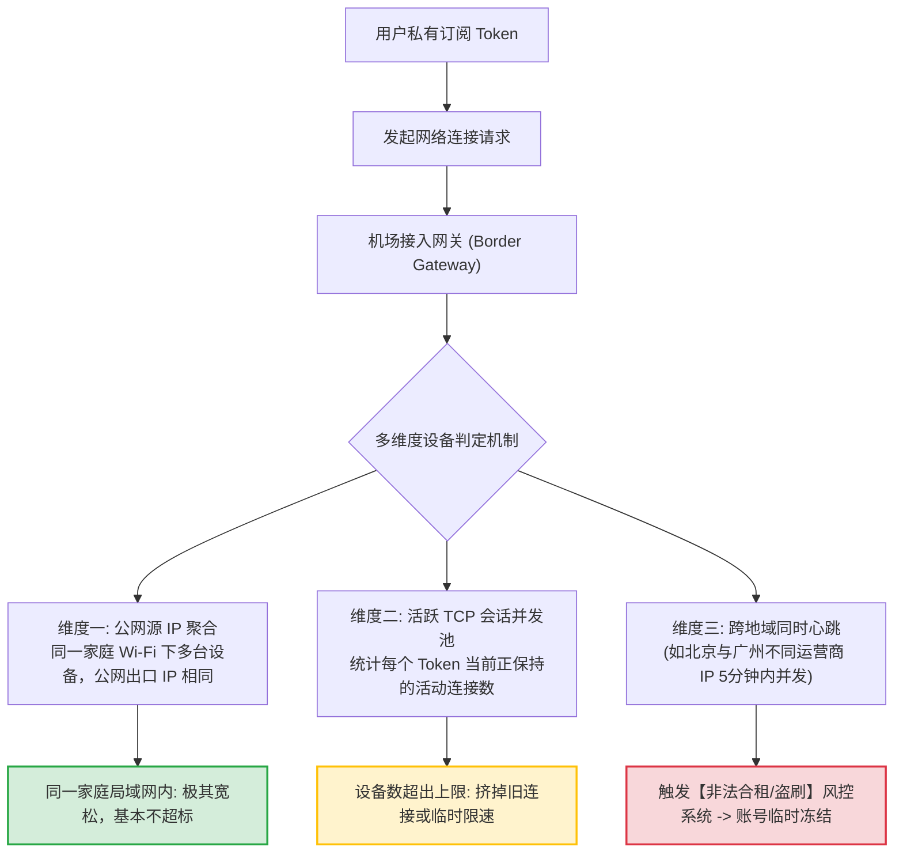
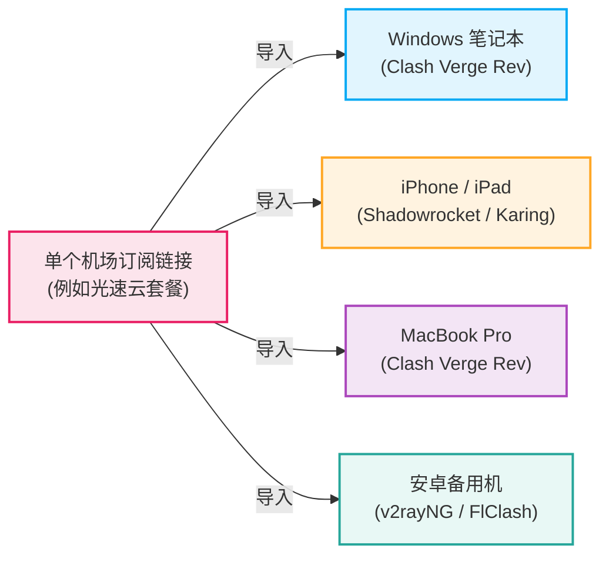
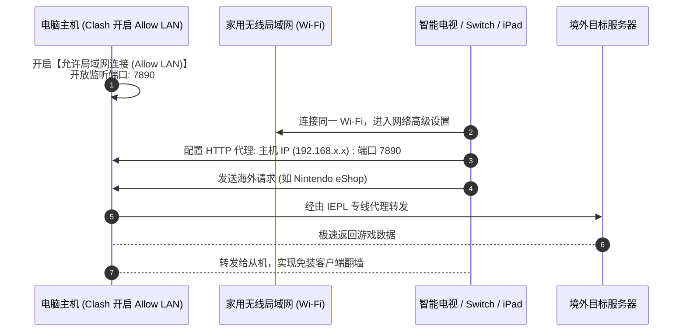
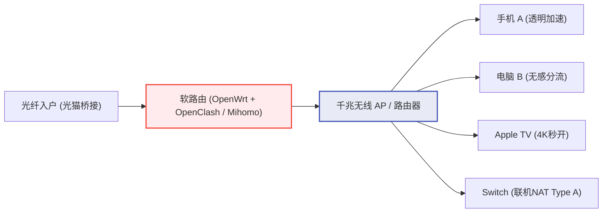

# 多设备使用方案：手机、电脑与平板共享订阅指引

  <strong>核心结论与多端复用策略：</strong>一个人拥有 iPhone、安卓备用机、Windows 笔记本、iPad 和家用电视盒子，<strong>绝不需要为每台设备单独购买多份套餐！</strong>绝大多数主流商业机场均支持 <strong>2 到 5 台设备同时并发在线</strong>。最推荐的做法是：<strong>在各设备分别安装对应的官方客户端，直接导入同一个订阅链接即可，全平台共享该套餐的总流量池。</strong> 对于游戏主机 (Switch/PS5) 或无法安装客户端的智能电视，只需在电脑客户端开启「允许局域网连接 (Allow LAN)」，即可秒变内网代理热点。

<AffiliateNotice />

---

## 一、机场服务端如何统计与限制「设备数量」？

很多新手常有疑虑：「为什么有的机场写着限制 3 台设备，但我把订阅发给 4 台手机都能连上？」「到底什么情况下会触发封号？」理解服务端的底层监控逻辑，能让你在多设备协同中游刃有余。

### 1.1 公网源 IP 判定 vs 独立物理设备
- **家庭 Wi-Fi 场景**：当你的电脑、手机和平板都连在家里的同一个无线路由器上时，在机场服务端眼中，这些请求全部来自你家宽带的**同一个公网出口 IP 地址**。因此在某些宽松的机场后端，这类同 IP 连接甚至只被归类为「单 IP 活跃」，极少触发设备数报警；
- **移动基站场景**：当你的电脑用着星巴克 Wi-Fi，而手机用着中国移动 5G 基站网络，两台设备具有完全不同的公网 IP。如果并发访问海外节点，机场后台会精准计入 2 台活跃设备。

### 1.2 为什么严禁跨省份/与陌生人「拼车合租」？
许多新手为了省钱，在贴吧或群里找陌生人「AA 拼车买套餐」。现代机场的审计系统（如 Xboard、SSPanel、V2Board）均部署了实时异常行为分析：
> **如果检测到同一个订阅 Token，在同一分钟内既有来自上海电信的 IP 在看 4K YouTube，又有来自成都联通的 IP 在刷推特，系统会直接判定该凭证遭到泄露或违规转售，从而触发自动化封禁（Ban），且无法退款！**

因此，多设备共享的铁律是：**仅限个人所属设备或同住家庭局域网内共享，切勿公开外传。**

---

## 二、方案一：全设备独立安装客户端 (最推荐普通用户)

这是兼容性最高、容灾能力最强、体验最极致的方案。任何一台设备断开或重启，均不影响其他设备的正常运行。

### 2.1 实操落地步骤
1. **统一获取订阅**：在机场用户后台，复制通用订阅 URL 格式（Clash /通用格式）；
2. **多端依次导入**：
   - 电脑端打开 **Clash Verge Rev**，添加并导入；
   - 手机端通过微信传输助手或备忘录将链接发送给自己，导入 **Shadowrocket** 或 **v2rayNG**；
   - 平板端重复上述操作；
3. **独立选择节点**：各客户端可以根据当前任务自由选择不同的节点。例如：
   - 电脑端选择「日本节点」用于极速查阅学术文献与代码仓库；
   - 手机端选择「香港节点」用于低延迟刷社交媒体与即时通信；
   - 两台设备互不干扰，流量从套餐总额度（如每月 150GB）中按实际消耗实时扣减。

---

## 三、方案二：电脑客户端开启局域网共享 (免装客户端利器)

家里的 Nintendo Switch、PlayStation 5、Apple TV 或小度智能音箱无法安装 Clash 客户端，但有时需要更新系统、下载外服数字版游戏或观看海外流媒体。此时，只需让处于同一 Wi-Fi 下的电脑化身「代理中转站」：

### 3.1 详细图文配置指引 (以 Windows + Clash Verge 为例)

#### 步骤 1：主机端开启局域网共享
1. 打开电脑上的 **Clash Verge Rev**；
2. 进入左侧「设置 (Settings)」；
3. 找到 **「允许局域网连接 (Allow LAN)」** 选项，将其开关滑动打开；
4. 记下下方的 **混合端口 (Mixed Port)**，默认通常为 `7890`。

#### 步骤 2：获取电脑主机的局域网内网 IP
1. 在电脑键盘上按下快捷键 `Win + R`，输入 `cmd` 并回车；
2. 在黑底白字窗口中输入 `ipconfig` 并回车；
3. 找到你当前连接的「无线局域网适配器 Wi-Fi」，查看其 **IPv4 地址**（通常为 `192.168.1.15` 或 `192.168.0.108` 类似格式），将其记录下来。

#### 步骤 3：在从机（Switch / 电视 / 手机）上配置代理
1. 打开从机（例如 Nintendo Switch）的「系统设置」→「互联网」→「互联网设置」；
2. 选择你当前连接的同一个 Wi-Fi 名称，点击「更改设置」；
3. 找到「代理服务器设置」，将其由「关闭」改为 **「开启」**；
4. **服务器 (Server)**：输入刚刚记录的电脑 IP（如 `192.168.1.15`）；
5. **端口 (Port)**：输入 `7890`；
6. 保存设置并测试连接，此时游戏机即可畅快以满速下载游戏。

> [!WARNING] 注意事项
> 采用此方案时，**电脑主机必须保持开机且不能进入休眠状态**。一旦电脑关机或休眠，从机的代理链路将立即中断导致断网。

---

## 四、方案三：全屋软路由透明代理 (极客全屋生态)

如果你对网络体验有极致追求，且家庭网络设备超过 15 台（包括全屋智能家居、多台电脑、手机），可以考虑部署硬件级软路由（如工控机软路由、GL.iNet 路由器，刷入 OpenWrt / iStoreOS 系统）：

### 优缺点深度客观对比

| 评估维度 | 方案一：各设备独立客户端 | 方案二：电脑局域网共享 | 方案三：全屋软路由透明代理 |
| :--- | :--- | :--- | :--- |
| **硬件投入成本** | **0 元** (利用现有设备) | **0 元** (利用现有电脑) | **300元 - 1500元** (购买软路由主机) |
| **配置技术门槛** | 极低（点几下屏幕导入即可） | 极低（改一下 IP 和端口） | 较高（需掌握 Linux 网络、DHCP、防火墙规则） |
| **设备便携性** | **极高**（带出门在外随时可用） | 仅限家庭同一个 Wi-Fi 内部 | 仅限家庭局域网，出门仍需独立客户端 |
| **设备数限制风险** | 占用真实并发连接数 | 仅占用 1 个内网出口连接 | 全家设备在服务端看来**仅算 1 台设备** |
| **故障影响面** | 单机单治，互不波及 | 电脑一关机从机断网 | **软路由一旦死机，全家断网** |

---

## 五、多设备使用核心避坑指南 (避免流量爆表与封号)

### 避坑 1：苹果 iCloud 照片与 Windows 自动更新偷跑流量
在多设备导入同一个订阅后，最容易发生的事情是「明明没怎么看视频，几十G流量一夜之间蒸发了」。
- **排查根源**：手机拍摄了大量 4K 视频，在夜晚充电连接 Wi-Fi 时，iCloud 会在后台全自动同步备份；如果你的客户端分流规则未完善，iCloud 数据被分流到了代理专线节点，就会造成海量流量消耗。
- **对策**：在手机 Shadowrocket 的规则中，确保包含 `Apple.list`，并将苹果云存储服务强制设置为 `DIRECT (直连)`。

### 避坑 2：多设备并发套餐选型推荐
不同机场对于多设备并发的支持策略差异很大：

| 品牌名称 | 允许同时在线设备数 | 流量充裕度 | 节点专线品质 | 适合多设备场景 | 详细档案 |
| :--- | :--- | :--- | :--- | :--- | :--- |
| **[光速云 (GSY)](/reviews/#brand-gsy)** | **多设备并发支持** | 基础档 100G 起，大流量包可选 | **IEPL 双线路企业专线** | **首选推荐** · 手机+电脑+iPad 多开无压力 | [直达评测与折扣](/reviews/#brand-gsy) |
| **[飞猫云](/reviews/#brand-feimao)** | 2-3 台常用并发 | 7 元档高性价 | IEPL 专线 | 适合单人双机（手机+笔记本）轻量组合 | [直达评测与折扣](/reviews/#brand-feimao) |
| **[大佬云](/reviews/#brand-dalaoyun)** | 多设备并发宽松 | 5.6 元起步超低门槛 | IEPL 专线 | 预算极度吃紧备用机共享首选 | [直达评测与折扣](/reviews/#brand-dalaoyun) |
| **[WgetCloud](/reviews/#brand-wgetcloud)** | 商务级多终端支持 | 商务团队大带宽配额 | 顶级华为云 BGP 专线 | 跨国商务、大流量团队协同与工作室首选 | [直达评测与折扣](/reviews/#brand-wgetcloud) |

> [!TIP] 选型小结
> 对于绝大多数拥有「手机 + 电脑 + 平板」三件套的普通用户，月付 8 元档的 [光速云 (GSY)](/reviews/#brand-gsy) 不仅在连接数方面非常宽容，而且具备企业级 IEPL 专线晚高峰保障，是多设备同时连网不卡顿的标杆之选；结账输入优惠码 `AMM` 还可享受首单特惠。

---

## 六、本章小结与进阶路线

现在你已经掌握了如何在多台手机、电脑甚至游戏机之间合理分配同一个订阅，并知晓了规避多端流量偷跑与合租封禁的安全红线。

但在动手实操时，新手往往会面临另一个选择困难症：**Windows、Mac、iOS、Android 平台上各种工具琳琅满目，Clash Verge Rev、v2rayN、Shadowrocket、Sing-box 到底各自有什么优缺点？哪一款最适合你？**

**下一站，我们将进入全平台主流代理工具的横向测评与选型终极指南。**

<NextStep
  title="下一篇：入门工具深度对比"
  link="/guides/tool-comparison"
  description="Clash Verge vs v2rayNG vs Shadowrocket vs Sing-box 跨平台全景测评。"
  stepText="新手实操主线 · 第 4 步"
  buttonText="阅读主流工具横评指南 →"
/>
