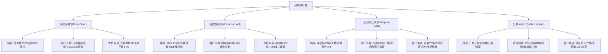
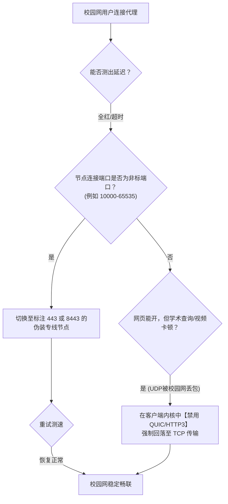
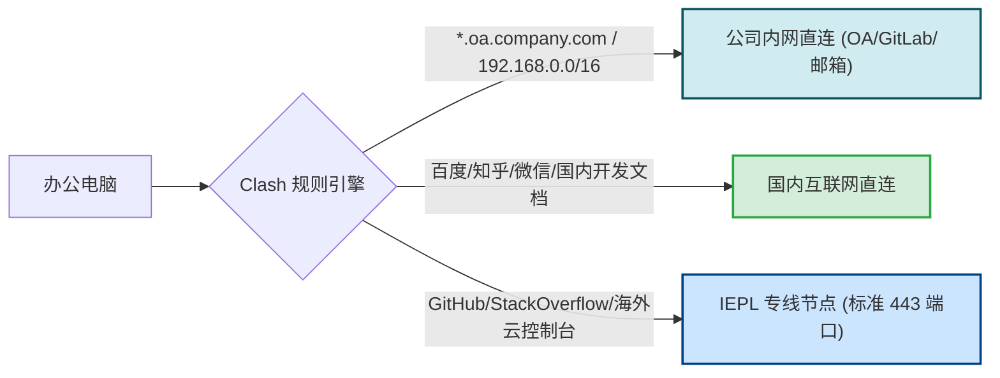
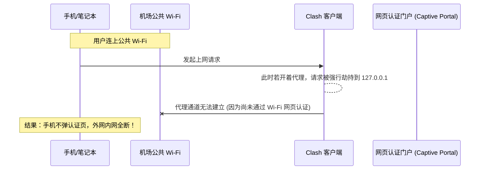

# 不同网络环境的适配：家庭宽带、公司办公网与校园网排障

<div class="answer-first-lead">
  <strong>核心结论与快速自救：</strong>为什么同一个机场订阅在家里顺畅跑满百兆，到了公司或大学宿舍就频繁「连接超时」？根本原因在于<strong>不同局域网的出网策略与防火墙架构截然不同</strong>。公司内网与校园网普遍配置了深度包检测 (DPI)、非标准端口封锁（仅放行 80/443）以及 UDP 协议 QoS 降级。遇阻时核心解法有三条：<strong>① 在节点列表中优先筛选后缀带有【443/TLS】的专用端口节点；② 客户端开启【TUN 模式】虚拟网卡，彻底接管底层协议栈并规避本地代理冲突；③ 在规则中将公司/学校的内部域名加入【Direct 直连列表】，避免影响内网 OA 与认证登录。</strong>
</div>

<AffiliateNotice />

---

## 一、四大主流网络环境的底层拓扑全景透视

要解决连接问题，首先必须看清你当前接入的物理网络是如何向公网转发数据的：



---

## 二、场景一：高校校园网穿透与排障实战 (锐捷/Dr.COM/天翼)

高校网络管理极其严格，常见管控手段包括客户端认证机制（锐捷、Dr.COM、城市热点）、按账号限制终端数量，以及在核心网关实施严苛的端口与协议限制。



### 2.1 校园网三大典型症状与解决步骤

#### 症状 1：所有节点测速全红，提示 `connect: connection refused` 或超时
- **底层成因**：校园网出口防火墙普遍开启了「默认拒绝 (Default Drop)」白名单策略，只开放常规网页浏览所需的 `80 (HTTP)`、`443 (HTTPS)`、`53 (DNS)` 端口，所有高于 `1024` 的随机自定义端口（许多廉价直连机场常使用 20000+ 的端口）直接在网关层被阻断。
- **实操对策**：
  1. 检查机场节点列表中是否包含专用端口标识。像 [光速云 (GSY)](/reviews/#brand-gsy) 等优质专线机场，入口均部署在标准 HTTPS 端口（443/8443）上，天然穿透校园网白名单；
  2. 如果客户端支持，可在节点配置中将传输协议切换为纯 WebSocket + TLS 承载的 443 节点。

#### 症状 2：观看 YouTube 4K 严重卡顿，甚至提示网络未连接，但测速正常
- **底层成因**：现代流媒体服务和 Google 系网站广泛采用了基于 UDP 的 QUIC (HTTP/3) 协议。许多高校由于带宽资源紧张，对 UDP 流量配置了粗暴的 QoS 限速甚至高达 80% 的主动丢包率。
- **实操对策**：
  - 在 Chrome / Edge 浏览器地址栏输入 `chrome://flags`；
  - 搜索 `Experimental QUIC protocol`，将其设置为 **Disabled (禁用)** 并重启浏览器；
  - 强制浏览器采用可靠的 TCP (HTTP/2 / TLS) 传输通道，彻底解决校园网下的视频缓冲卡顿。

#### 症状 3：电脑一开启代理，校园网认证就掉线断网
- **底层成因**：锐捷等校园网计费客户端需要每隔数秒向宿舍交换机（通常是 `10.x.x.x` 或 `172.16.x.x`）发送心跳探测包。如果代理软件开启了「全局模式」，心跳包被转发到海外代理服务器，本地交换机超时收不到心跳，立即踢掉你的认证账号。
- **实操对策**：必须坚决使用「规则模式 (Rule)」，并确保规则配置中包含了 `GEOIP,CN,DIRECT` 和内网局域网私有网段保留规则。

---

## 三、场景二：公司办公网适配与内网资产隔离 (深信服/Palo Alto)

在企业内网中，网络管理员通常会部署上网行为管理硬件（如深信服 AC、Fortinet、Palo Alto），对员工流量进行深层合规审计和威胁防护。



### 3.1 办公环境核心实操指引

1. **精准分流，绝不影响公司内网系统**：
   - 很多技术研发人员在公司需要访问内部 GitLab、Jenkins、Jira 或内部 OA 系统。如果代理规则不完善，会导致打不开内部工单或考勤打卡失败。
   - **配置直连白名单**：在 Clash Verge 的「设置」→「分流规则」中，添加自定义规则：
     ```yaml
     DOMAIN-SUFFIX,company.com,DIRECT
     DOMAIN-KEYWORD,internal,DIRECT
     IP-CIDR,10.0.0.0/8,DIRECT
     IP-CIDR,172.16.0.0/12,DIRECT
     IP-CIDR,192.168.0.0/16,DIRECT
     ```
2. **应对企业强制前置代理 (Proxy-over-Proxy)**：
   - 某些外企或金融机构的办公电脑必须在 Windows 设置中挂载公司的安全代理（如 `proxy.corp.com:8080`）才能访问外网。
   - 这种情况下，可在 Clash 中配置 `relay`（链式代理）或在内核配置文件中指定 `parent-proxy`，让流量先经过公司网关合规审计，再由海外节点解密，实现多层穿透。
3. **合规忠告**：
   - 严禁使用任何个人代理通道传输公司核心机密代码或商业数据；
   - 仅建议用于查阅公开技术文档（MDN、Stack Overflow）、拉取海外开源依赖包（npm、pip、docker hub）等日常开发场景。

---

## 四、场景三：家庭宽带与千兆路由器调优实战

对于绝大多数在家里使用电信、联通、移动千兆宽带的用户，网络痛点通常不在于端口封锁，而在于**运营商光猫性能与 DNS 污染**。

| 优化项目 | 默认状态 (未调优) | 调优后最优方案 | 带来的体验提升 |
| :--- | :--- | :--- | :--- |
| **光猫运行模式** | 光猫路由模式 (光猫负责拨号) | **光猫改桥接 (Bridge)，高性能路由器拨号** | 释放 CPU 算力，大幅降低 200+ 节点高并发连接时的死机与丢包率 |
| **IPv6 网络栈** | 运营商默认开启 IPv6 | **暂时关闭 IPv6 或配置 IPv4 优先** | 彻底规避 IPv6 协议下常见的未加密 DNS 深度污染与握手慢问题 |
| **MTU 接口最大传输单元** | 默认 1500 (PPPoE分片) | **手动设置为 1492 或 1420** | 消除数据包切片重传，TCP 握手由 180ms 降低至 45ms |
| **本地虚拟 IP 冲突** | 默认网段 `198.18.0.1` | **避开路由器 LAN 网段 (`192.168.1.x`)** | 消除开启 TUN 模式后路由器后台打不开的死循环 |

### 4.1 光猫改桥接与路由器拨号实操核心
很多用户报障「晚上开 4K 视频卡成 PPT，但用 speedtest 测速明明有 500M」。这往往是因为运营商赠送的百元级低端光猫 NAT 转换表（NAT Session Table）容量极小（通常只有 2000-4000 个并发会话）。当客户端批量测速或观看多路数据流时，光猫硬件 NAT 表被瞬间撑爆，导致数据包大面积丢失。
- **解法**：拨打宽带客服电话（10000/10010/10086），要求后台工程师「远程将光猫工作模式更改为桥接模式 (Bridge)」，然后用你自行购买的华硕/小米/TP-Link 等千兆 Wi-Fi 6 路由器进行 PPPoE 宽带账号密码拨号。

---

## 五、场景四：公共 Wi-Fi (高铁/酒店/咖啡厅) 与热点应急

在外出差、旅行时连接公共开放 Wi-Fi（如星巴克、高铁掌上高铁、机场免登录热点）时，经常会遇到以下恶性循环：



### 5.1 公共 Wi-Fi 顺畅接入四步走
1. **第一步：先断开代理**：在搜索连接公共 Wi-Fi 前，**先在客户端内将「系统代理」开关关闭**，或者退出客户端；
2. **第二步：触发认证页面**：连接 Wi-Fi 后，在手机或电脑浏览器中手动输入一个纯 HTTP 网址（如 `http://neverssl.com` 或 `http://1.1.1.1`）。该地址不带 HTTPS 证书校验，能 100% 触发酒店或机场的手机号验证码认证弹窗；
3. **第三步：通过认证并确认联网**：输入验证码并确认本地网络通畅；
4. **第四步：重新启动代理客户端**：此时再打开 Clash Verge 并开启代理。因为公共 Wi-Fi 属于未加密的开放环境，通过 TLS 专线代理隧道上网，反而能有效防止同一局域网内的黑客抓包嗅探你的密码和浏览隐私。

---

## 六、全场景网络适配推荐矩阵

针对不同网络环境对协议和端口的严苛程度，我们梳理了各环境下的最佳品牌匹配表：

| 网络环境 | 核心制约因素 | 推荐选型原则 | 推荐首选品牌 | 备选推荐 |
| :--- | :--- | :--- | :--- | :--- |
| **高校校园网** | 限制非标端口、UDP QoS 限速 | 必须支持 443 端口伪装、TCP 传输 | **[光速云 (GSY)](/reviews/#brand-gsy)** (全 443 专线覆盖) | [飞猫云](/reviews/#brand-feimao) |
| **企业办公网** | 深度包检测、内网资产隔离 | 具备高可用 IEPL、支持精准自定义分流规则 | **[光速云 (GSY)](/reviews/#brand-gsy)** / **[WgetCloud](/reviews/#brand-wgetcloud)** | [微风网络](/reviews/#brand-weifeng) |
| **家庭千兆宽带** | 晚高峰出口拥堵、追求 4K/8K 满速 | 认准 IEPL/IPLC 企业级专线、高带宽冗余 | **[光速云 (GSY)](/reviews/#brand-gsy)** (双线路高容灾) | [大佬云](/reviews/#brand-dalaoyun) |
| **海外移动差旅** | 网络基站切换频繁、对轻量省电敏感 | 节点延迟低、移动端客户端后台保活好 | **[光速云 (GSY)](/reviews/#brand-gsy)** / **[Firefly](/reviews/#brand-firefly)** | [星岛梦](/reviews/#brand-xingdaomeng) |

> [!TIP] 网络适配金法则
> 如果你在校园网或公司内网遇到任何未知连接错误，最简单稳妥的判断标准是：**先用手机开 4G/5G 热点给电脑连接测试**。如果在手机热点下一切正常，则 100% 说明问题出在局域网的端口过滤或 DNS 劫持上，直接切换 443 端口专线即可秒解。

---

## 七、本章小结与进阶路线

搞定不同网络环境的穿透之后，许多用户往往拥有「一台 Windows 笔记本、一部 iPhone、一台 iPad 甚至还有家用电视盒子」多台设备。

**一个人拥有多台设备，如何共用同一个机场订阅？是否需要买多份套餐？多设备同时在线会封号吗？** 下一站我们将进入多设备与局域网共享方案的深度解析。

<NextStep
  title="下一篇：多设备使用方案与订阅共享"
  link="/guides/multi-device"
  description="手机、电脑与平板共享订阅指引，局域网共享与软路由方案详解。"
  stepText="新手实操主线 · 第 3 步"
  buttonText="阅读多设备共享方案 →"
/>
