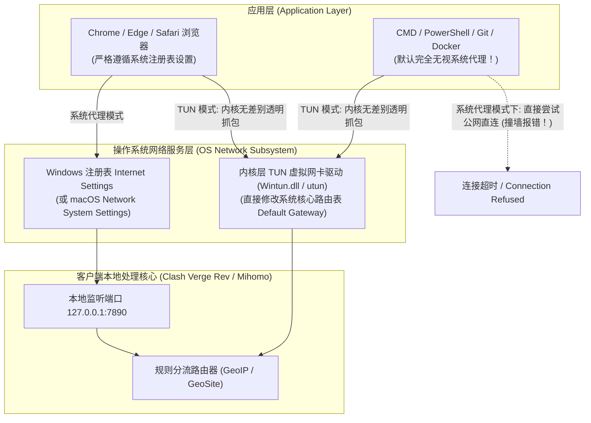

# 电脑端科学上网完整方案：Windows 与 macOS 客户端选型、TUN 模式与系统级防冲突实战 (2026 深度图解)

  <strong>核心结论与先验建议 (Answer-First)：</strong>在电脑桌面端（Windows 或 macOS）配置科学上网，<strong>其技术关键在于搞定「操作系统的底层网络接管权限」</strong>。
    
  对于零基础电脑用户，2026 年最稳健、最省心的装机黄金组合：
  <ul>
    <li><strong>主力客户端首选：坚决选用开源正版「Clash Verge Rev」</strong>。基于现代高效的 Mihomo (Clash Meta) 内核构建，拥有全中文现代沉浸式界面，原生完美支持 Windows 11 以及苹果 M1/M2/M3/M4 系列 Apple Silicon 芯片；</li>
    <li><strong>模式配置铁律</strong>：普通看网页、刷推特、看 YouTube 视频，仅需开启<strong>「系统代理（System Proxy）」+「规则模式（Rule）」</strong>即可；如果涉及 Git 代码拉取、Docker 镜像构建、终端命令行、外服游戏加速或远程桌面，必须在设置中一键开启<strong>「TUN 虚拟网卡模式（TUN Mode）」</strong>；</li>
    <li><strong>绝对不要在百度等普通搜索引擎中随意下载打着“Clash 中文网”旗号的竞价广告安装包</strong>（99% 带有捆绑木马或流氓弹窗）！必须认准官方 GitHub Release 纯净渠道。</li>
  </ul>
  搭配具备多端一键导入生态的企业级专线机场（如<strong>[光速云](/reviews/#brand-gsy)</strong>），从零到成功连通整个过程不超过 3 分钟。

<AffiliateNotice />

---

## 一、操作系统接管的第一性原理：客户端是如何在电脑上截获网络流量的？

当你双击打开浏览器输入网址时，数据从应用程序流向网线接口，在操作系统底层经历了严格的**网络协议栈分层传递**。

理解两种核心代理模式的技术边界，能帮你彻底解决 99% 的电脑端网络疑难杂症：

### 1.1 系统代理模式：轻巧但有盲区
* **技术实现**：客户端在系统的“代理服务器设置”中填入 `127.0.0.1:7890`。普通图形界面软件（如 Edge、Chrome 浏览器）在发起网络请求前，会主动读取该注册表，并将数据发给客户端。
* **局限性**：由于控制台终端（CMD / PowerShell / Terminal）和许多外服游戏设计初衷是追求极致低延迟，它们在底层**默认完全不读取系统代理注册表**，从而导致你在浏览器里看油管飞快，但在终端执行 `git clone` 却持续报错超时。

### 1.2 TUN 模式：整机透明代理的终极解法
* **技术实现**：客户端在操作系统网络层生成一块专属的**虚拟网卡（Virtual Network Adapter）**。
* **终极威力**：由于它直接工作在网卡驱动层，操作系统的路由表会将整机流出的所有数据包（不管是浏览器、终端、Python 脚本、游戏还是后台更新服务）统统无差别吸入该管道，真正实现**“整台电脑 100% 透明出海”**。

---

## 二、Windows 与 macOS 双平台客户端深度横评与选型地图

针对两大主力桌面操作系统，我们梳理出最适合新手的选型方案：

| 操作系统平台 | 首选推荐客户端 (新手首选) | 备选全能极客客户端 | 架构包选择要点 | 新手推荐指数 |
| :--- | :--- | :--- | :--- | :--- |
| **Windows 10 / 11** | **Clash Verge Rev** | **v2rayN** | 64 位系统下载 `x64-setup.exe`；ARM 掌机下载 `arm64`。 | ⭐⭐⭐⭐⭐ (首选标准) |
| **macOS (M1/M2/M3/M4)** | **Clash Verge Rev Mac** | **Surge for Mac** (收费高昂) | 必须选择 `aarch64.dmg` 原生架构包，杜绝 Rosetta 转译发热。 | ⭐⭐⭐⭐⭐ (体验极佳) |
| **macOS (Intel 旧机型)** | **Clash Verge Rev Mac** | **Clash Nyanpasu Mac** | 必须选择 `x64.dmg` 安装包，避免架构不兼容报错。 | ⭐⭐⭐⭐ (稳定老牌) |

> [!CAUTION] 绝不相信任何搜索引擎竞价广告！
> 在百度、必应等搜索引擎搜索“Clash 下载”时，排在最前面的几个搜索结果通常是某些黑灰产搭建的**假冒山寨钓鱼网站**（如所谓“Clash 中文网”、“Clash 官网”）。这些网站打包的安装包被植入了后门木马、甚至锁死了自家的劣质付费机场。**必须从官方正规开源托管渠道下载纯净原版！** 详细安全防毒指引请查阅：[`/clients/safe-download`](/clients/safe-download)。

---

## 三、手把手实操：电脑端从零搭建 4 步标准 SOP (以 Clash Verge Rev 为例)

为了让新手能在 3 分钟内完成配置，请跟随以下标准化步骤图解操作：

### 3.1 步骤 1：安装并启动软件
1. 双击运行下载好的安装包（Windows 运行 `.exe`，Mac 拖动 `.app` 至 Applications 文件夹）；
2. 首次启动如果 Windows Defender 弹出“Windows 已保护你的电脑”提示，点击“更多信息” -> “仍要运行”即可（开源软件未向微软购买数万元的企业签名，属正常误报）；
3. 打开软件后，点击左侧菜单栏底部的 **「Settings (设置)」** -> 在 **「Language」** 下拉框中切换为 **「简体中文」**。

### 3.2 步骤 2：导入机场专属订阅链接
1. 打开并登录你购买的机场后台（如[光速云后台](/reviews/#brand-gsy)）；
2. 找到并点击 **「一键导入到 Clash」**（浏览器会自动弹出窗口唤醒你电脑上的客户端完成自动写入）；
3. *若自动导入未响应*：点击“复制通用订阅链接” -> 回到客户端的 **「订阅 (Profiles)」** 界面 -> 在顶部地址栏粘贴该 URL -> 点击右侧的 **「保存并更新」** 按钮；
4. 看到界面出现绿色的套餐名称与剩余流量看板，即代表节点数据拉取成功！

### 3.3 步骤 3：筛选节点并点亮连接开关
1. 点击左侧菜单栏的 **「代理 (Proxies)」**，进入节点选择大厅；
2. 确保顶部模式选中的是 **「规则 (Rule)」** 模式；
3. 点击右下角的“闪电 / 测速”图标，节点列表会自动测速，选择一个延迟在 30ms～60ms 的绿色节点（如香港 IEPL 或日本专线）；
4. 回到客户端右上角，将 **「系统代理 (System Proxy)」** 开关向右滑动点亮！
5. 打开本地浏览器访问 `https://www.google.com`，秒开即告大功告成！

---

## 四、真实小白电脑端翻车案例实录 (1:1 案例库)

### 案例 1：卸载软件后电脑突发全面断网，连百度都打不开
* **学员档案**：外贸业务专员小陈，在测试完某代理软件后直接在控制面板里将其卸载。
* **灾难现场**：卸载完成后，小陈打开浏览器准备查阅国内新闻，发现所有网页全部提示 `无法连接到代理服务器 (ERR_PROXY_CONNECTION_FAILED)`，不仅外网打不开，连百度、淘宝甚至微信电脑版也无法联网。小陈以为电脑网卡损坏，重装了三次网卡驱动依然无济于事。
* **深层根源分析**：**这是电脑端最高频发生的“经典非正常关机残留问题”**。小陈在卸载软件之前，没有先手动关闭客户端界面上的“系统代理”开关。导致软件虽然被删除了，但 Windows 注册表里依然顽固地保留着“把所有流量发往 127.0.0.1:7890 端口”的指令。由于该端口背后的软件已经不存在，所有网络请求瞬间撞墙死锁。
* **一键自救指南**：
  1. 打开 Windows 设置 -> 点击 **「网络和 Internet」** -> 点击左侧的 **「代理」**；
  2. 在右侧找到“手动设置代理”下面的 **「使用代理服务器」**；
  3. 将该开关从“开”手动拨回 **「关」**，并点击保存；电脑网络瞬间 100% 满血复活！

### 案例 2：苹果 M3 芯片 MacBook 错装 x86 版本，风扇狂转电池崩塌
* **学员档案**：数码设计师李女士，刚购置了一台搭载苹果 M3 Pro 芯片的 MacBook Pro。
* **翻车教训**：李女士在下载客户端时没有注意区分芯片架构，随手下载了针对旧款 Intel 芯片的 `x64.dmg` 安装包。由于系统在底层必须通过 Rosetta 2 进行复杂的二进制指令动态转译，导致软件常驻后台时 CPU 占用率长期居高不下（高达 120%），笔记本机身发烫，电池续航从原本的 18 小时断崖式暴跌至 4 小时。
* **解决方案**：卸载后重新下载官方针对 Apple Silicon 原生编译的 `aarch64.dmg` 安装包。安装后软件以 ARM64 原生指令集极速执行，CPU 占用率稳定在 0.2% 以下，机身冰凉，续航恢复如初。
* **实战结论**：**Mac 用户必须认准自身的芯片架构包（M 系列认准 aarch64 / arm64）**。

---

## 五、痛点心流驱动：拥抱大带宽与全端免配置专线

电脑端作为重度生产力工具，承载着数倍于手机的巨量并发流量与严肃任务。因此，选择一家不仅支持大带宽专线、更能完美提供电脑端免配置支持的服务商至关重要。

[光速云 (GSY)](/reviews/#brand-gsy) 深度优化了桌面端的使用体验：

<BrandCard brandId="gsy" />

  
💡 为什么光速云是电脑桌面端最踏实的伴侣？

  <ul>
    <li><strong>完美支持千兆单流高吞吐</strong>：底层部署 IEPL 企业级物理内网专线，单线程实测可跑满 350Mbps～500Mbps，满足 4K 视频批量上传、Git 代码拉取等重度生产力需求。</li>
    <li><strong>官方直连定制客户端免除折腾</strong>：后台不仅支持 Clash Verge Rev 一键唤醒导入，还专门提供了针对 Windows 与 Mac 原生架构的官方定制直连软件，登录即连。</li>
    <li><strong>平民化超低资费门槛</strong>：最低专线套餐折合仅需 <strong>8元/月</strong>，在结账收银台输入官方专属优惠码 <code>AMM</code> 享折上折，支持国内支付宝原生安全扫码秒开。</li>
  </ul>

<PromoCard brandId="gsy" />

---

## 六、下一步系统化学习路线引导

顺利完成了电脑端的配置后，如果你经常需要在智能手机（iPhone 或安卓手机）上随时随地查看外网信息，请继续研读移动端方案：

1. **手机端完整上网闭环方案**：阅读 [`/guides/mobile-setup`](/guides/mobile-setup) 攻克 iPhone 美区小火箭与安卓防杀后台；
2. **选择工具的黄金三大原则**：阅读 [`/guides/selection-principles`](/guides/selection-principles) 掌握选型防雷防线；
3. **前往客户端中心获取安装包**：查阅 [`/clients/`](/clients/) 获取适合你设备的主流官方安装包。

---

<NextStep
  title="下一篇：手机端完整上网方案 (iOS / Android 深度实操)"
  link="/guides/mobile-setup"
  description="iPhone 没有美区 Apple ID 怎么办？安卓手机后台总被系统杀掉怎么破？手把手教你搞定移动端配置与续航省电优化。"
  stepText="新手进阶 · 下一步"
  buttonText="查看手机端完整上网方案 →"
/>
