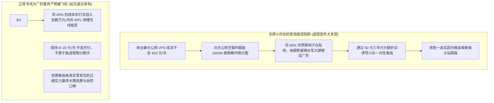
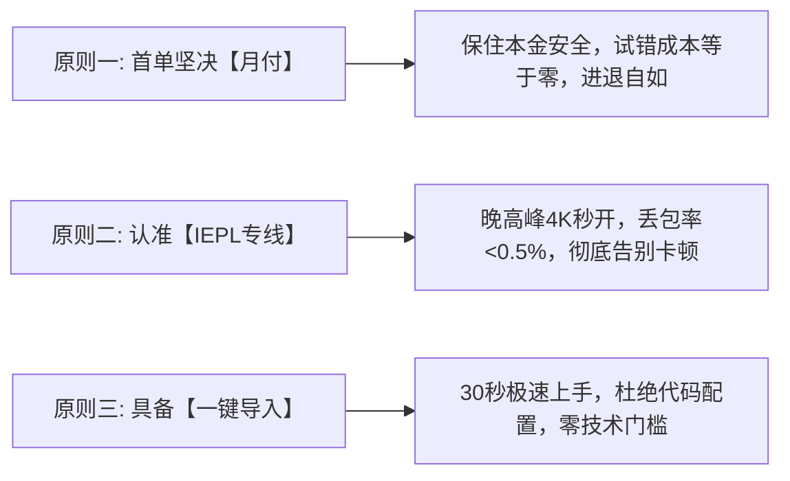

# 新手选择工具与机场的三大黄金原则：稳定、安全与易用的权衡法则 (2026 深度决策)

  <strong>核心结论与先验建议 (Answer-First)：</strong>在网络代理的商业市场中，<strong>「会选」比「到处测试」重要一百倍</strong>。许多新手之所以频繁踩雷、钱花了不少却依然每天面对满屏红字断网，根本原因在于被不良商家的虚假跑分与夸张宣传牵着鼻子走。
    
  对于零基础小白而言，在掏出手机扫码付款前，只要牢牢守住以下**「三大黄金选型铁律」**，全网 99% 的套路与跑路陷阱都将被瞬间过滤：
  <ul>
    <li><strong>原则一（资金生命线）：首单坚决选择「小额按月付费（8～20元/月）」</strong>。拒绝任何形式的大额年付诱惑，将试错成本牢牢锁死在一杯奶茶钱以内，进退自如；</li>
    <li><strong>原则二（性能生命线）：线路认准「IEPL / IPLC 企业级物理专线」</strong>。远离纯公网直连与单线中继，确保在晚高峰 20:00～23:00 骨干网大拥堵时，丢包率依然低于 0.5%，4K 视频秒开不卡顿；</li>
    <li><strong>原则三（体验生命线）：优先选择具备「一键导入生态 / 官方定制客户端」的服务商</strong>。拒绝那些缺乏教程、丢给用户几百行代码让其手动修改 JSON 的极客小站。</li>
  </ul>
  综合全网 42 家主流品牌的长期横测，<strong>[光速云 (GSY)](/reviews/#brand-gsy)</strong>是同时完美契合上述三大原则的标杆代表。

<AffiliateNotice />

---

## 一、信息不对称的第一性原理：为什么劣质小作坊的广告往往吹得最响？

很多新手常常疑惑：“为什么网上某些不知名的小机场，测速图看起来高达 1000Mbps，博主吹得天花乱坠，买回来却发现根本不能用？”

这触及了经济学中著名的 **“阿克洛夫柠檬市场（The Market for Lemons，次品市场）”** 逆向淘汰规律：

### 1.1 新手必须认清的“三大反向欺诈指标”
不良商家最善于利用新手的认知盲区设置烟雾弹，请学会逆向识别：
1. **反向指标 1：只晒白天测速跑分，对“晚高峰丢包率”闭口不提**：
   - 任何廉价公网服务器在清晨 6 点都能跑出几百兆的速度。真正检验一家服务商成色的，只有**每天晚上 21:00～22:30 的真实丢包率（Packet Loss）与延迟抖动**。敢于展示晚高峰丢包率 < 1% 的，才是真正具备物理专线的正规军；
2. **反向指标 2：盲目鼓吹“拥有全球 100 个国家节点”**：
   - 节点数量是全行业最廉价的营销数字游戏。廉价小作坊通过低价广播 IP 包装出几十个根本无法使用的虚假机房；而正规大厂深知，**精心维护好香港、日本、美国、新加坡 4 个核心地区的专线网络，就能解决用户 99% 的真实需求**；
3. **反向指标 3：故意隐藏月付选项，强推超长周期**：
   - 凡是在支付界面看不到月付、或者月付标价 50 元而年付只要 60 元的平台，100% 是准备短期内套现跑路的资金盘。

---

## 二、选型三大黄金原则深度拆解

为了让你在每次选型时都有法可依，我们深入剖析这三大铁律背后的底层支撑：

### 2.1 原则一：首单坚决月付，拒绝长期套牢
* **核心心法**：**不论客服给出多么诱人的折扣，第一单坚决只买 1 个月**！
* **底层逻辑**：代理服务的质量不仅取决于机场本身，还与你所在小区的本地宽带（电信/联通/移动/校园网）、当地运营商的 QoS 策略密切相关。用 8～20 元买一个月，先在自己的真实生活场景中跑满 30 天。只有经历了敏感时期与晚高峰大考后，且本地匹配完美，才考虑续订更长周期。

### 2.2 原则二：认准 IEPL / IPLC 专线，拒绝纯公网直连
* **核心心法**：**看清节点名称是否标注「IEPL」或「IPLC」**。
* **底层逻辑**：普通公网直连走的是拥挤不堪的民用公网国际出口，晚高峰丢包率高达 30%～60%；而 IEPL 专线走的是电信运营商点对点跨国内网物理光纤，不经过公网出口审查，晚高峰独享千兆满带宽。

### 2.3 原则三：优先选择一键导入生态完备的品牌
* **核心心法**：**新手的核心需求是“快速连上”，而不是“成为网络工程师”**。
* **底层逻辑**：优秀的服务商后台会为 Windows（Clash Verge）、iOS（小火箭）、Android（v2rayNG）提供专属的“一键调起导入”功能，甚至提供专属免配置定制客户端。拒绝那些只提供一长串未转译代码、让小白手动修改 YAML 语法缩进的极客小站。

---

## 三、真实小白选型翻车与理性决策实录 (1:1 案例库)

### 案例 1：被“1000M 测速截图”欺骗，冲动购买三年付遭跑路
* **学员档案**：外贸业务专员小张，需要定期上外网收发客户邮件。
* **踩坑绝境**：在某推特博主的极力推荐下，小张看到一张跑满 1000M 宽带的测速图，并附带专属优惠“三年付仅需 99 元，限量 100 名”。小张毫不犹豫付款下单。结果当天晚上 21:00，小张准备向欧洲客户发送样品图集时，节点大面积泛红超时，视频连 360P 都缓冲不出。小张在电报群里询问客服，客服直接将其禁言并踢出群聊，两周后该机场域名彻底无法解析。
* **深层教训**：**空载测速图毫无意义，违反“月付原则”与“专线原则”的冲动消费，最终都会沦为黑心商家的盘中餐**。

### 案例 2：坚守三大铁律，8 元开启丝滑学术办公之路
* **学员档案**：准备考研法硕的小李，需要频繁访问海外法律文献数据库。
* **成功实战**：小李在深入学习本站指南后，坚决排除了各类低价年付小站，严格遵循三大原则，选择了支持平民月付的[光速云 (GSY)](/reviews/#brand-gsy)。首次下单实付仅 **8 元**，通过支付宝当面付扫码秒开。后台点击一键导入，电脑端 Clash Verge 瞬间载入香港专线。晚高峰无论何时点击查阅文献，PDF 秒点秒开。小李表示：“守住月付底线，让我没有任何心理负担；而专线的稳定表现，让我省下了每天找节点的宝贵复习时间。”
* **实战结论**：**遵守原则不是保守，而是用最低的成本换取最高确定性的智慧**。

### 案例 3：设计助理盲目跟风极客小站，因 YAML 语法缩进错误卡壳三天
* **学员档案**：电商设计助理小何，在某个极客技术交流论坛被推销了一个所谓的“硬核极客自建节点站”。
* **踩坑惨状**：该平台没有任何图形化导入支持，后台只给了一长串未转译的 YAML 代码块。小何由于不熟悉代码规范，在复制粘贴到本地客户端时不小心删除了一个空格缩进（Indentation），导致软件启动时直接报 `yaml: line 14: mapping values are not allowed in this context` 语法错误并闪退。小何在群里求助，不仅未得到耐心理会，反而遭到老极客的言语嘲讽。
* **破局复盘**：小何在学习本站指南后意识到，普通打工人和新手最宝贵的是时间，坚决转投具备一键导入与官方免配置客户端的光速云，30 秒扫码导入，彻底告别了代码折磨。
* **实战警示**：**易用性与新手友好度不是锦上添花，而是决定工具能否真正转化为生产力的核心硬指标**。

---

## 四、新手选型量化评估打分表 (Scorecard Matrix)

在考察一家新的服务商时，你可以对照下表进行快速打分（满分 100 分，80 分以上方可考虑入手）：

| 评估维度 | 考察指标与权重 | 优质正规大厂 (如光速云: 95分) | 劣质小作坊 / 跑路盘 (不足 40分) |
| :--- | :--- | :--- | :--- |
| **计费灵活性 (25分)** | 是否提供 ≤ 20 元平民月付？ | **满分 (提供 8元/月起步月付)** | 0分 (强制年付/三年付，隐藏月付) |
| **线路硬件 (30分)** | 是否具备真实的 IEPL 企业专线？ | **满分 (主用 IEPL + 备用中转双线路)** | 5分 (廉价公网直连，晚高峰大面积丢包) |
| **易用生态 (20分)** | 是否支持一键唤醒导入 / 定制端？ | **满分 (全平台一键唤醒 + 官方直连端)** | 5分 (仅给一长串代码让小白手动手敲) |
| **支付安全 (15分)** | 是否支持支付宝/微信原生扫码？ | **满分 (官方聚合收银台秒级自动入账)** | 0分 (私聊微信转账、发卡网或强推虚拟币) |
| **运营资历 (10分)** | 是否稳定连续运营 2 年以上？ | **满分 (自 2020 年稳定运营 6 年以上)** | 2分 (域名注册不足半年，缺乏历史口碑) |

### 4.2 考察一家服务商的「反套路 5 分钟背调 SOP」
在决定付款前，只需花费 5 分钟执行以下三项快速背景审查，便能将风险降到最低：
1. **核验域名运营资历（Whois 查询）**：通过在线工具查询该机场域名的初次注册时间。连续稳定运行 2～3 年以上的老域名，其抗风险能力与长期信誉远超刚刚注册不到 3 个月的新站；
2. **审查 Telegram 官方公告历史**：进入其官方公开频道，倒序翻阅 6 个月前的历史公告。如果发现频繁在敏感时期连续断网数周且无备用线路容灾，说明其上游资源极其脆弱；
3. **核对支付收银台合规度**：进入最后的付款结算页面，查看是否支持正规国内手机扫码通道。凡是强制要求购买 USDT 虚拟币或私聊发卡网的，一律视为高危风险平台。

---

## 五、痛点心流驱动：拥抱三大原则的集大成者

选型不用猜，数据见真章。

在全网 42 家主流品牌中，[光速云 (GSY)](/reviews/#brand-gsy) 是行业内少有的**将“平民月付、双专线架构、全端极简导入”贯彻得最彻底的标杆典范**：

<BrandCard brandId="gsy" />

  
💡 为什么光速云能完美斩获选型打分表 95 分高分？

  <ul>
    <li><strong>严守平民低门槛月付（原则一）</strong>：起步套餐折合仅需 <strong>8元/月</strong>，输入官方专属优惠码 <code>AMM</code> 享折上折，支持国内支付宝原生安全扫码秒开。</li>
    <li><strong>真 IEPL 企业物理专线（原则二）</strong>：底层打通深圳/上海点对点物理光缆直达海外，晚高峰丢包率恒定在 0.5% 以下，4K 秒开。</li>
    <li><strong>全端免配置一键导入（原则三）</strong>：后台提供全平台客户端的一键配置支持，同时提供官方定制免配置客户端，登录即连。</li>
  </ul>

<PromoCard brandId="gsy" />

---

## 六、下一步系统化学习路线引导

牢固掌握了选型三大原则后，接下来让我们正式进入实操，手把手跑通第一次科学上网的完整闭环：

1. **第一次上网完整 5 步流程**：阅读 [`/guides/first-time-workflow`](/guides/first-time-workflow) 跑通从购买、导入到测速连通的标准闭环；
2. **不同网络环境适配策略**：阅读 [`/guides/network-environments`](/guides/network-environments) 攻克校园网、公司内网与家庭宽带；
3. **前往客户端中心获取安装包**：查阅 [`/clients/`](/clients/) 获取适合你设备的主流官方安装包。

---

<NextStep
  title="下一篇：新手第一次科学上网的完整 5 步流程 (保姆级闭环指南)"
  link="/guides/first-time-workflow"
  description="从官网购买、客户端下载、订阅导入到测速连通，手把手带你 5 分钟跑通第一个完整的上网操作闭环。"
  stepText="新手进阶 · 下一步"
  buttonText="查看第一次上网完整闭环流程 →"
/>
