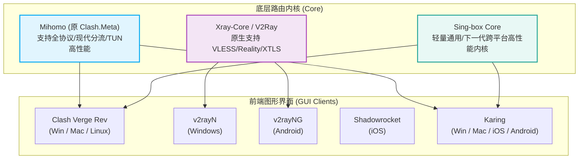
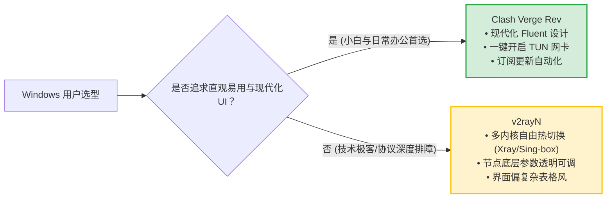
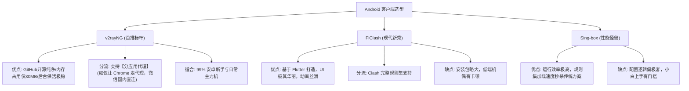
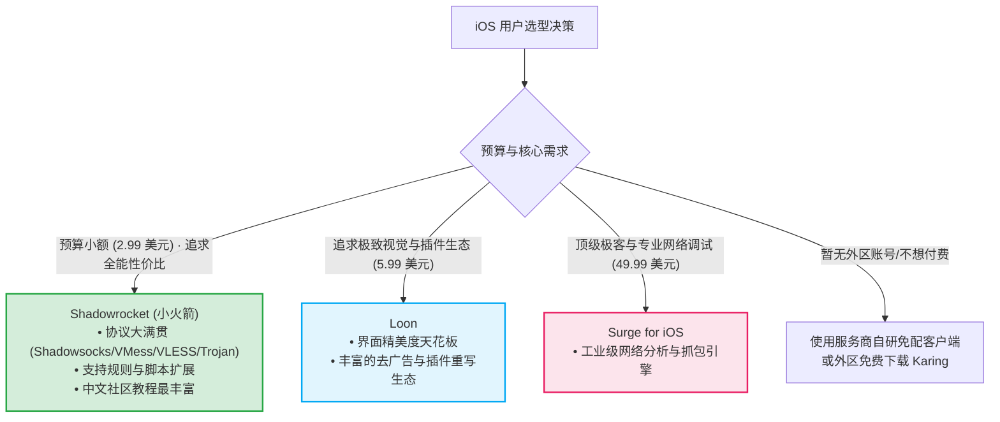
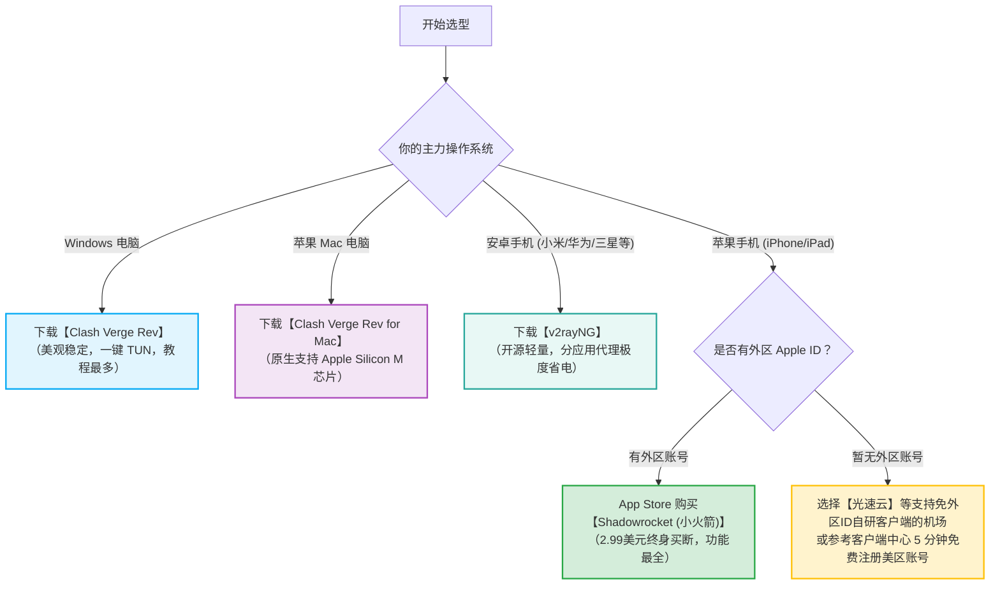

# 入门工具对比：主流客户端优缺点与上手难度测评

  <strong>核心结论与极简选型决策：</strong>面对琳琅满目的网络工具，新手无需陷入选择困难。综合考虑<strong>界面易用性、协议兼容度、中文支持与内核维护活跃度</strong>，全平台黄金组合如下：<strong>Windows 与 macOS 平台闭眼选【Clash Verge Rev】（现代 UI + 内置 TUN 虚拟网卡）；Android 安卓手机首选【v2rayNG】（开源纯净无广告、后台保活稳健）；iOS 苹果手机首选【Shadowrocket (小火箭)】（功能全包、协议大满贯且价格亲民）。</strong> 其他专业级工具（如 Surge、Quantumult X）适合进阶网络工匠或有深层网络抓包需求的技术极客。

<AffiliateNotice />

---

## 一、主流客户端生态演进与底层内核图谱

在对比各款软件前，先了解底层内核（Core）与前端图形界面（GUI）的关系，能帮你避开「以为换了软件就能提速」的认知盲区：

*本质上：GUI 客户端只是负责给用户提供美观的操作界面与系统代理注册，底层的流量转发速度 90% 取决于机场专线服务器的物理带宽与线路质量，10% 取决于内核的并发调度能力。*

---

## 二、Windows 平台主力客户端深度横评

Windows 是新手使用频率最高的桌面系统，主流可选工具有 Clash 系与 v2rayN 系两大阵营：

### 1. Clash Verge Rev (当前 Windows 绝对王者)
- **内核支撑**：原生集成 Mihomo (Clash.Meta) 内核；
- **核心优点**：
  - **现代化 UI**：基于 Tauri 框架打造，内存占用远低于旧版 Electron 开发的 Clash for Windows，界面美观符合现代 Windows 11 视觉规范；
  - **TUN 虚拟网卡一键开关**：无需繁琐配置 TAP 驱动，一键接管系统所有应用（包括 UWP 应用、命令行 cmd、终端 Git、外服游戏客户端）的网络流量；
  - **多语言与规则热重载**：内置完备简体中文，订阅解析容错率高。
- **缺点/不足**：配置扩展脚本需要具备一定的 YAML 基础（普通用户使用默认规则即可无视）。
- **新手上手指数**：★★★★★（极度推荐）

### 2. v2rayN (经典全能瑞士军刀)
- **内核支撑**：支持 Xray-core、Sing-box、Mihomo 多内核自由切换；
- **核心优点**：更新迭代极度迅速，对新型底层协议（如 VLESS-Reality、TUIC、Hysteria2）的跟进速度通常为全网最快；支持极其细致的节点参数微调与路由分流表；
- **缺点/不足**：界面沿用传统的 Windows Forms 表格风格，对于非技术专业新手而言，密密麻麻的参数输入框容易产生畏难情绪。
- **新手上手指数**：★★★☆☆（适合进阶排障）

---

## 三、macOS 平台客户端深度横评

macOS 系统对应用权限与后台守护机制控制极为严格，目前主要分为轻量开源与专业商业两大流派：

| 客户端名称 | 芯片架构适配 | 价格模型 | 核心优势 | 适合人群 |
| :--- | :--- | :--- | :--- | :--- |
| **Clash Verge Rev for Mac** | Apple Silicon (M系列) / Intel 原生双架构 | **完全免费开源** | 跨平台体验一致、M系列芯片极低能耗、状态栏小巧实用 | **95% 普通 Mac 用户首选** |
| **Surge for Mac** | 原生 Universal Binary | **商业授权 ($49.99 起)** | 抓包利器、MITM 解密、网络异常可视化诊断、极致稳定 | 高净值极客、网络工程师、前端开发 |
| **Karing for Mac** | 原生双架构 | **免费** | 极简新手风格、全协议自动解析 | 寻求极简免折腾的用户 |

---

## 四、Android 移动端主力工具深度横评

Android 系统的开放性赋予了客户端极大的自由度，但也是流氓后台和耗电大户的重灾区：

### 1. v2rayNG (安卓生态的首选常青树)
- **核心优势**：
  1. **极低资源消耗**：日常在后台静默运行，内存占用仅 30-50MB，对手机电量消耗几乎可以忽略不计；
  2. **应用分流 (Per-App Proxy)**：支持在设置中一键勾选「分应用代理」，你可以指定只让推特、Telegram、YouTube 走代理，而微信、抖音、拼多多完全绕过软件，从底层杜绝任何隐私与耗电担忧；
  3. **获取简单**：直接从 GitHub Release 免费下载 APK 安装包，无需依赖 Google Play 商店。

---

## 五、iOS (iPhone / iPad) 平台客户端矩阵深度剖析

受制于苹果 App Store 的严格审核机制，中国大陆区 Apple ID 无法上架网络代理类工具，必须使用海外（如美区、日区、港区）Apple ID 进行下载。

### 1. Shadowrocket (小火箭，iOS 新手绝对无可撼动的第一名)
- **价格**：2.99 美元（约 21 元人民币，一次性买断，终身升级）；
- **为什么它是新手首选？**
  - **协议全包**：几乎兼容市面上 100% 的机场协议（VLESS、VMess、Trojan、Shadowsocks、Hysteria2 等）；
  - **一键导入体验丝滑**：支持剪贴板自动识别、二维码极速扫描导入；
  - **省电策略卓越**：深度适配 iOS 的 Network Extension 框架，待机一整天耗电量通常低于 2%。

---

## 六、全平台主流工具 7 维度综合对比大表

| 客户端名称 | 适配平台 | 核心内核 | 协议兼容度 | 新手上手机难度 | 系统代理/TUN | 开源/收费状态 |
| :--- | :--- | :--- | :--- | :--- | :--- | :--- |
| **Clash Verge Rev** | Win / Mac / Linux | Mihomo | 极高 (含新特性) | ★☆☆☆☆ (极易) | 内置原生一键开启 | **开源免费** |
| **v2rayN** | Windows | Xray / Sing-box | 顶级 (全协议) | ★★★☆☆ (中等) | 支持 (需配置网卡) | **开源免费** |
| **v2rayNG** | Android | Xray-core | 极高 (常用协议) | ★☆☆☆☆ (极易) | 原生 VpnService | **开源免费** |
| **FlClash** | 全平台 (多端) | Mihomo | 极高 | ★★☆☆☆ (容易) | 支持 TUN | **开源免费** |
| **Shadowrocket** | iOS / iPadOS | 自研多内核 | 顶级 (全协议) | ★☆☆☆☆ (极易) | 原生 Network Extension | **买断制 ($2.99)** |
| **Loon** | iOS / iPadOS | 自研内核 | 极高 | ★★☆☆☆ (容易) | 原生 Network Extension | **买断制 ($5.99)** |
| **Surge** | iOS / macOS | 自研工匠级 | 高 (专注标准协议) | ★★★★☆ (复杂) | 顶级虚拟网卡引擎 | **商业昂贵 ($49.99+)** |
| **Karing** | 全平台 (全能) | 自研/通用 | 极高 | ★☆☆☆☆ (极易) | 支持系统级接管 | **免费** |

---

## 七、新手到底该怎么选？三秒决策罗盘

> [!TIP] 选型深度心得
> 工具本身不产生流量，也不决定速度。一款好工具的价值在于**安静稳定地在后台工作，不报错、不卡顿、不抢占 CPU**。搭配一条优质的 [光速云 (GSY)](/reviews/#brand-gsy) 企业级专线，使用最基础的 Clash Verge 或 v2rayNG，就能轻松实现 4K 视频秒开与低延迟游戏体验。

---

## 八、本章小结与进阶路线

选好了心仪的客户端，准备大显身手？别急！在网络代理领域，**许多新手常因各种看似符合常理、实则是误区的错误习惯，导致账号被封、网络卡顿甚至电脑断网**。

**「为什么买贵的机场不如买专线？」「为什么节点有 300 个反而是坑？」「为什么退出软件后电脑突然上不了网？」** 下一站，我们将深度剖析新手最容易踩中的 8 大误区！

<NextStep
  title="下一篇：新手常见 8 大误区排雷"
  link="/guides/beginner-misconceptions"
  description="深度揭露节点数量陷阱、全局代理风暴、系统代理残留锁死等常见雷区。"
  stepText="新手实操主线 · 第 5 步"
  buttonText="阅读新手误区排雷指南 →"
/>
