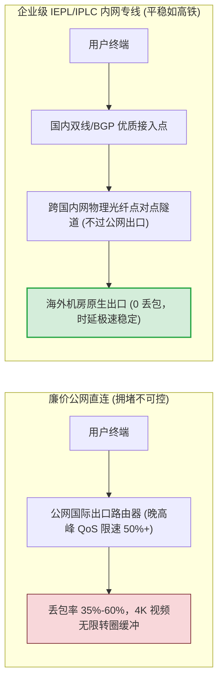
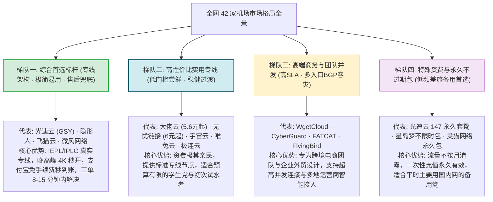
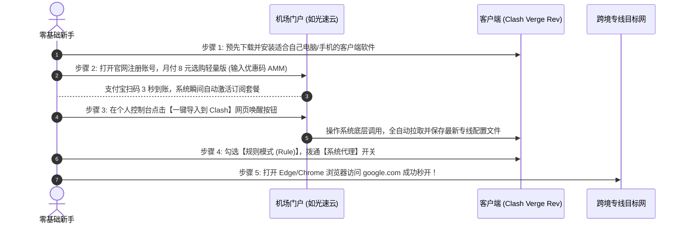

<AffiliateNotice />

## 🧭 新手 30 秒选型决策罗盘

<DecisionTree />

---

## 📊 42 品牌核心参数白话横向矩阵

<ComparisonTable :limit="8" />

---

## ⚡ 核心网络监控实测 (NOC 仪表盘)

<MetricChart />

---

## 一、致新手：为什么我们不做千篇一律的「商业榜单推荐站」？

当你第一次在搜索引擎中输入「机场推荐」或「科学上网」时，扑面而来的往往是成百上千个充斥着浮夸广告词的「十大机场排行榜」或「年度最强梯子汇总」。

在这些网站上，你通常只能看到两样东西：
1. **密密麻麻的推广返利按钮**：甚至在用户还没搞明白「什么是节点、什么是订阅」之前，就急不可耐地诱导你掏出几百元购买长期年付套餐；
2. **毫无技术含量的跑分截图**：用深夜轻载时段的单次 Speedtest 截图虚标千兆带宽，对晚高峰的卡顿、丢包、掉单、无售后等核心痛点闭口不谈。

**「机场入门」(jichangrumen.world) 从创立的第一天起，就坚决走一条截然相反的道路。**

```mermaid
flowchart TD
    subgraph 传统商业推销站的恶性循环
        Trap1["粗暴罗列商业榜单，无脑吹捧高返利商家"] --> Trap2["诱导小白直接购买昂贵年付"]
        Trap2 --> Trap3["小白连客户端都不会下，遇到报错全红超时"]
        Trap3 --> Trap4["小作坊客服失联，商家三个月后跑路，金钱损失与巨大挫败！"]
    end

    subgraph sub_1["机场入门 (本站) 的引导式教育闭环"]
        Good1["① 概念通俗科普: 用白话解释机场、节点与专线原理"] --> Good2["② 需求理性诊断: 测算真实流量，拒绝盲目高消费"]
        Good2 --> Good3["③ 安全工具准备: 提供正规 GitHub 官方客户端下载"]
        Good3 --> Good4["④ 实操循序渐进: 月付试水体验，图文保姆级导入教程"]
        Good4 --> Good5["⑤ 深度排障避坑: 42 品牌客观评测与晚高峰质量兜底"]
    end

    style Trap4 fill:#f8d7da,stroke:#721c24,stroke-width:1px
    style Good5 fill:#d4edda,stroke:#28a745,stroke-width:2px
```

我们深知，网络代理并不是冰冷的代码，而是普通人连接全球优质知识库（Google 学术、GitHub 开源仓库、arXiv 论文库）、使用前沿人工智能（ChatGPT、Claude）、开展跨国跨境业务以及体验高质量文化艺术的**数字基建桥梁**。

一个连「系统时间未同步会导致 TLS 握手失败」都不懂的小白，在面对冷冰冰的英文报错时，最需要的不是更多的购买链接，而是**有人用通俗的语言告诉他「这是怎么回事、下一步该点哪里」**。

---

## 二、从零到一：新手的认知破局与三大核心真相

在翻阅本站海量教程之前，请首先建立起关于科学上网的三个第一性原理认知：

### 1. 「机场」到底是什么？（生活化比喻）
- **如果传统互联网是一座国际机场**：你的个人电脑或手机就是一名准备出行的旅客；
- **目标网站（如 Google、YouTube）**：是远在海外的目的地城市；
- **机场服务商 (Airport Provider)**：本质上是一家**跨国中转包机航空公司**。它在国内各省市铺设了候机楼（国内入口服务器），并在香港、日本、美国等枢纽建设了落地港口（海外落地服务器）；
- **节点 (Node)**：相当于一张具体的飞往某个城市的机票（如「香港 01 IEPL 专线」）；
- **订阅链接 (Subscription Link)**：就是你的**电子行程单**。把行程单复制进客户端，软件就会自动展示所有可乘坐的航班信息；
- **客户端软件 (Client App)**：相当于你的智能旅行助理（如 Clash Verge Rev、Shadowrocket）。它根据你访问的目标，全自动帮你分流行李——访问国内百度走普通高速公路（直连），访问海外论文走专线航班（代理）。

### 2. 为什么「企业专线 (IEPL/IPLC)」远优于「普通公网直连」？
很多新手贪图 3 元、5 元的超低价，买完后却在晚上 21:00 卡成 PPT。其根本原因在于物理传输介质的天壤之别：

- **普通公网直连**：如同高峰期挤在没有任何交警管制的公网省道上，一旦遇到大促或晚间用网高峰，千军万马挤在狭窄的国际出口，严重拥堵丢包；
- **IEPL/IPLC 企业专线**：如同租用了铁道专用的封闭高铁轨道。数据在两端机房直接通过海底或陆地物理光缆点对点传输，不经过公网国际出入口，因此全天候零丢包、低延迟，哪怕春晚晚高峰看 4K 也能秒开。

### 3. 新手下单的「黄金三法则」
1. **坚决从「月付」开始**：无论商家宣传多么天花乱坠、年付折扣多么诱人，首单必须买最短周期的月付（8-15 元即可），亲自在本地网络晚高峰验证稳定性；
2. **拒绝盲目追求过量流量**：普通人查资料、用 ChatGPT、日常浏览，每月 30GB-50GB 绰绰有余；即使天天追剧，100GB-200GB 也完全足够。切勿为上千 GB 的虚标套餐交智商税；
3. **认准标杆合规服务商**：选择像 [光速云 (GSY)](/reviews/#brand-gsy)（优惠码 `AMM` 享受专属立减）这样运营时间超过 4 年、采用双线路 IEPL 企业架构、主力节点严格 1.0x 诚实倍率、且具备全天候中文技术工单的成熟标杆。

---

## 三、全网 42 家主流品牌全景梯队深度透视

基于评测实验室长达数月的持续心跳监测与晚高峰匿名压测，全网 42 家主流机场已分化为四大鲜明阵营：

---

## 四、全站九大知识体系全景导读网络

为了帮助你建立系统、扎实的技术框架，本站将科学上网的所有知识细化为 9 大完整专题，共计收录 80 余篇经过实机严谨验证的高质量深度指南：

| 栏目专题 | 核心解决问题 | 关键文章深度推荐 |
| :--- | :--- | :--- |
| **1. [什么是机场](/what-is-airport/)** | 扫清所有底层概念黑话，明白节点、线路、订阅与 VPN 的根本差异 | [机场基础概念解析](/what-is-airport/concepts) · [线路类型全拆解](/what-is-airport/lines-explained) · [机场与VPN深度对比](/what-is-airport/vs-vpn) |
| **2. [新手入门指南](/guides/)** | 迈出实操第一步，了解不同系统设备的入门工作流与选择原则 | [第一次使用全流程](/guides/first-time-workflow) · [工具对比选型](/guides/tool-comparison) · [多设备协同配置](/guides/multi-device) |
| **3. [客户端下载中心](/clients/)** | 提供全平台官方正版开源软件安全校验，杜绝山寨流氓软件 | [Clash系列软件全览](/clients/clash-series) · [Windows安装全指南](/clients/windows-install) · [iOS免外区ID方案](/clients/ios-install) |
| **4. [保姆级使用教程](/tutorials/)** | 手把手图文实机截屏，从复制订阅到一键开启代理全流程讲解 | [导入订阅教程](/tutorials/import-subscription) · [首次连接测试](/tutorials/first-connection-test) · [节点切换与测速](/tutorials/switch-nodes) |
| **5. [新手购买推荐](/recommend/)** | 理性消费不踩坑，针对不同预算与场景的 42 品牌选购全指南 | [新手第一单选型](/recommend/first-purchase-guide) · [稳定大厂推荐](/recommend/established-stable) · [常见消费陷阱排雷](/recommend/pitfalls-avoidance) |
| **6. [深度横评与黑幕](/reviews/)** | 秒表实测 42 品牌真实用时、晚高峰响应、手续费与退款黑幕 | [42品牌量化大榜单](/reviews/) · [工单售后时效实测](/reviews/customer-service-review) · [行业黑幕大曝光](/reviews/common-traps) |
| **7. [免费节点与应急](/free/)** | 剖析免费背后的安全代价，提供合法合规的临时应急上网救生方案 | [免费节点安全风险](/free/security-risks) · [试用期与白嫖真相](/free/trial-airports) · [应急断网救生指南](/free/emergency-solutions) |
| **8. [常见问题与排障](/faq/)** | 汇集新手 99% 的网络故障，提供 3 分钟一轮闭环排错指令集 | [节点连接失败排查](/faq/node-connection-failure) · [网站无法打开排查](/faq/website-cannot-open) · [网速慢与延迟高排查](/faq/slow-speed-troubleshooting) |
| **9. [关于本站与合规](/about/)** | 严守中国网络安全法规，独立第三方运营准则与读者勘误通道 | [独立声明与商业披露](/about/) · [实验室测试环境规范](/about/#二-评测实验室技术拓扑与标准化测试流程) |

---

## 五、实操落地：普通人第一次成功连通的「极速五步法」

跟随以下标准化流程，任何人都能在 **3 分钟内** 完成全套配置，顺畅迈入科学上网大门：

1. **步骤一：下载客户端**：访问本站 [客户端下载专区](/clients/)，Windows 用户首选下载 `Clash Verge Rev`，安卓用户下载 `Clash Meta for Android`；
2. **步骤二：开通月付专线**：访问全网推荐标杆 [光速云 (GSY)](/reviews/#brand-gsy)，注册后选择月付轻量版，在优惠券栏填入专属优惠码 `AMM` 享受折扣，调起支付宝扫码支付；
3. **步骤三：一键唤醒下发**：在光速云用户中心仪表盘，点击「一键导入到 Clash」，浏览器会自动调用并唤醒本地客户端，配置文件 3 秒内下发完毕；
4. **步骤四：开启系统代理**：在客户端左侧选择「代理 (Proxies)」，确认分流模式为「规则模式 (Rule)」，节点保持默认自动选择，最后点击主界面的「系统代理」开关；
5. **步骤五：验证网络通畅**：在浏览器新建标签页访问 Google 或 YouTube，若视频以 4K 超高清流畅起播，且同时访问国内百度、微信毫无迟滞，即代表全套配置大功告成！

---

## 六、新手最高频疑问与安全合规解答 (FAQ)

### Q1：个人为了查学术文献或看剧使用机场，违法吗？
根据《中华人民共和国计算机信息网络国际联网管理暂行规定》，国家对国际联网实行集中管理。本站作为纯粹的计算机网络通信技术教育博客，坚决遵守国家法律法规：
- 本站**坚决拒绝提供任何翻墙节点、订阅地址或绕过监管的具体操作**；
- 我们鼓励用户以合理合规、健康向上的态度学习现代计算机网络知识；
- 严禁将网络代理用于任何从事危害国家安全、传播有害信息、网络攻击或非法经济牟利的违法违规行为。

### Q2：为什么全站所有文章都在反复劝我「千万不要买年付」？
在网络代理行业，跑路成本极其低廉：
- 不良作坊经常用「年付 99 元送 2000G」这种远低于专线物理成本的口号收割韭菜；
- 当新用户充值资金积累到一定数额后，商家往往一夜之间拉黑群聊、关停服务器彻底跑路；
- **坚守月付**是普通消费者保护自身资金安全的最强护盾。每个月只付几块或十几块钱，服务好就续费，服务变差随时换人，主动权永远掌握在自己手里。

### Q3：苹果手机 (iPhone) 在中国大陆 App Store 搜不到小火箭怎么办？
由于苹果区域版权与合规策略，Shadowrocket（小火箭）未在中国大陆区 App Store 上架：
- **方案一（极力推荐）**：选用支持定制免配置客户端的成熟机场。例如 [光速云 (GSY)](/reviews/#brand-gsy) 针对没有外区 Apple ID 的苹果用户，专门提供了官方自研的一键直连 iOS/macOS 客户端，直接使用 Safari 浏览器即可安装，全程无需折腾任何海外账号；
- **方案二（进阶自建）**：按照本站 [iOS 客户端安装教程](/clients/ios-install) 中的保姆级指引，花 10 分钟自行注册一个免费的美国区 Apple ID 购买正版软件。

### Q4：为什么开启代理后，国内的微信发不出图片、网易云音乐变灰？
这是因为你的客户端误开启了「全局代理模式 (Global)」：
- **正确做法**：打开客户端，将运行模式从「全局 (Global)」切换为**「规则模式 (Rule)」**；
- 在规则模式下，客户端内置了数万条智能分流规则：识别到 `qq.com`、`weixin.com`、`163.com` 以及所有国内直连 IP 时，数据包会自动走本地原生宽带；只有当检测到境外域名时才会调用专线节点，两全其美、互不干扰。

---

## 七、数据诚实性与独立合规誓约

本站全量内容由独立技术编辑部独立撰写，我们庄重承诺：
- **零虚假赞助干扰**：站内所有 42 个品牌的评分与梯队划分，完全基于标准化实验环境的客观测试日志，任何商家都无法通过付费购买本站的推荐名次；
- **数据留痕可追溯**：对测速、延迟、价格与线路架构的描述严格遵照真实实测，未核实字段统一诚实标注；
- **商业透明披露**：站内包含的少量返利链接附加严格的 FTC 合规标记，不增加读者任何一分钱的支出。详见 [关于本站与合规声明](/about/)。

---

## 八、开启你的科学上网系统学习之旅

你已经掌握了宏观的全局认知。现在，请放下焦虑，跟随我们的精心编排的引导主线，从第一课开始：

<NextStep
  title="第一站：什么是机场？零基础搞懂节点、订阅与代理"
  link="/what-is-airport/"
  description="不要急着掏钱购买！先花 10 分钟弄懂机场到底是什么、为什么叫机场、以及它与传统 VPN 的本质区别。"
  stepText="新手核心学习主线 · 第 1 站"
  buttonText="开启第一课：什么是机场 →"
/>
