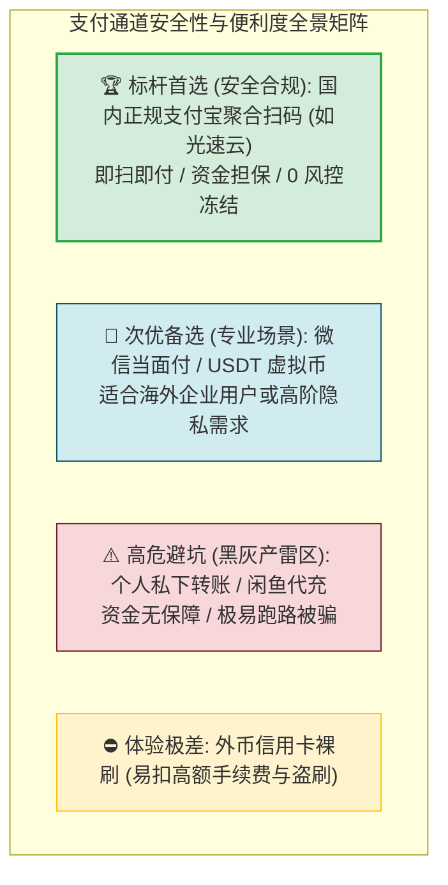
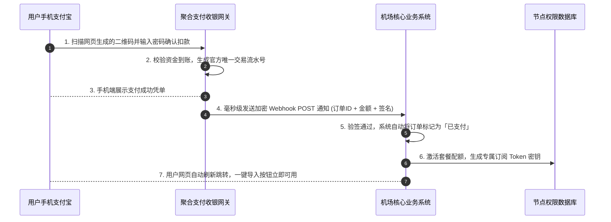

# 支持支付宝便捷支付的机场推荐：国内支付渠道与资金安全全景指引 (2026 深度实测)

<div class="answer-first-lead">
  <strong>核心结论与先验建议 (Answer-First)：</strong>对于中国大陆绝大多数新手用户而言，<strong>是否原生支持支付宝扫码结算，是衡量一家机场上手容易度与基础运营实力的分水岭</strong>。
  <br><br>
  新手在购买机场时，<strong>坚决不要碰任何需要购买 USDT 虚拟货币或通过第三方发卡网私人代充的平台</strong>（极易触发银行反洗钱断卡风控或遭遇卡密欺诈）。一家正规的机场应当接入合规的聚合支付网关，用户使用手机支付宝扫码后，系统应在 <strong>3 秒内通过异步 Webhook 自动入账并激活订阅</strong>。综合 2026 年实测，<strong>[光速云 (GSY)](/reviews/#brand-gsy)</strong>、<strong>飞猫云</strong>与<strong>大佬云</strong>拥有全网最顺畅、零掉单的支付宝扫码支付体验。
</div>

<AffiliateNotice />

---

## 一、跨境代理支付的第一性原理：为什么支付宝是新手的最安全护城河？

在网络代理生态中，支付渠道不仅关乎“方便”，更直接决定了用户的**资金安全与法律风险边界**。

### 1.1 常见四种支付结算通道的安全性与门槛对比



### 1.2 为什么强烈反对新手使用 USDT 虚拟币买机场？
很多极客博主鼓吹“虚拟币匿名安全”，但对中国大陆普通小白而言，使用 USDT 购买代理是**风险最高的自杀式操作**：
1. **“断卡行动”司法风控风险**：国内买 U 必须在欧易（OKX）或币安（Binance）的 C2C 市场通过个人银行卡转账购买。这些交易池中混杂着电信诈骗与灰产资金，新手极大概率遭遇“涉案黑钱转账”，导致名下所有银行卡被异地公安机关司法冻结 6 个月甚至更久；
2. **高昂的手续费磨损**：波场 TRON 链转账一次需要消耗约 13～27 TRX（折合人民币约 15～30 元），买一个 8 元的月付套餐，手续费比套餐本身还要贵出数倍！
3. **结论**：**新手必须认准原生支持支付宝或微信收银台的正规品牌**。

---

## 二、聚合支付收银台的技术流向：付款后是如何实现秒级开通的？

正规机场的支付宝付款并非人工转账，而是基于现代电子商务标准的 **API 异步回调（Asynchronous Webhook）** 技术实现的：



### 2.1 账单展示与隐私保护机制
很多新手担心：“使用支付宝付款，账单明细里会不会显示‘翻墙’或‘机场’等字样？”
* **答案是：绝对不会**。
* 正规服务商均接入了第三方数字科技公司或电商技术服务商的聚合通道。在你的手机支付宝账单中，交易对手方通常显示为诸如 `xx数码科技有限公司`、`xx网络技术服务部` 或 `云服务软件订阅` 等标准常规企业名称，商品名称也显示为通用技术服务代码，充分保护个人账单隐私与合规性。

### 2.2 现代聚合网关的幂等设计与防掉单保障
为什么在光速云等正规大厂下单时极少发生掉单？
* **分布式消息队列与幂等（Idempotency）保障**：现代聚合支付网关采用基于 Redis / RabbitMQ 的可靠消息投递系统。当用户付款完毕时，网关会下发带有唯一交易 Hash 的签名通知。即使遭遇跨境公网瞬时丢包，网关会在第 15 秒、第 1 分钟、第 5 分钟实施指数退避重试（Exponential Backoff Retry），直到机场核心业务系统确认应答；
* **防重复扣款与事务一致性**：后台数据库在收到 Webhook 时使用分布式行锁（Row-level Lock）严格核验订单状态，确保即使由于用户多频刷新，系统也只会精准扣款激活一次，绝不会发生重复扣费或配额错乱。

---

## 三、真实小白支付翻车案例实录 (1:1 案例库)

### 案例 1：在第三方发卡网购买卡密，付款后网页崩溃卡密失效
* **学员档案**：大三学生小孙，在某个推特帖子里看到某机场宣传“特价 5 折”，但官网不能直接付款，必须跳转到一个陌生的发卡网。
* **翻车过程**：小孙在发卡网用微信支付了 45 元购买了所谓的“卡密兑换码”。付款完成后页面突发 502 错误，刷新后订单记录全无。小孙联系发卡网客服没有任何回复，再去联系机场 Telegram 客服，机场客服表示“发卡网非官方授权，概不负责”。最终钱货两空。
* **深层教训**：**必须直接在机场官网的用户后台收银台完成付款！严禁跳转到任何未经官方认证的第三方个人发卡平台**。

### 案例 2：使用正规支付宝直连，8 元开启丝滑体验
* **学员档案**：外贸业务员小陈，需要定期使用海外 LinkedIn 拓展客户。
* **实战体验**：在对比了多家品牌后，选择了支持支付宝原生扫码的[光速云 (GSY)](/reviews/#brand-gsy)。进入后台勾选 8 元/月套餐，点击“支付宝支付”，屏幕瞬间弹出动态收款二维码。手机一扫、指纹确认，电脑网页在 1.5 秒内自动刷新并显示“套餐已激活，剩余流量 69GB”。全程与在京东、淘宝购物毫无二致，极具安全感。
* **实战结论**：**流畅的原生支付体现了一家服务商在技术开发与商户合规上的扎实积累**。

### 案例 3：留学生轻信二手平台代充，信用卡遭遇异地盗刷风波
* **学员档案**：在日留学生小孙，在某二手交易网站看到“八折代充各类海外节点与专线”的广告。
* **踩坑惨状**：小孙把自己的机场账号密码发给所谓的“代充卖家”，并私下微信转账了 80 元。三天后，服务商后台突然提示其账号被强制冻结，原因是“涉嫌利用被盗信用卡（黑卡 Carding）恶意刷单”。原来该卖家利用网上购买的黑灰产信用卡信息给小孙代充，真正的持卡人向银行发起拒付（Chargeback）后，小孙的账号不仅被永久封禁，还险些被列入反欺诈信誉黑名单。
* **实战警示**：**坚决杜绝任何非官方的第三方个人代充！通过官网合规收银台使用自有支付宝支付是守护个人资产信誉的唯一正道**。

---

## 四、2026 标杆支持支付宝扫码结算的优质品牌推荐

在全网 42 家品牌中，我们筛选出收银系统最稳定、到账响应最迅捷的代表：

### 4.1 综合支付体验第一首选：光速云 (GSY) —— 支付宝原生秒级入账

<BrandCard brandId="gsy" />

<div class="metaphor-box">
  <div class="metaphor-title">💡 为什么光速云的支付结算体验最让新手放心？</div>
  <ul>
    <li><strong>官方直连聚合收银台</strong>：全程在官网加密通道（HTTPS）下完成结算，绝无任何恶意弹窗或不明重定向。</li>
    <li><strong>双重主流渠道覆盖</strong>：同时支持手机支付宝与微信扫码结算，无论是单月 8 元试水还是升级大流量套餐，均可轻松搞定。</li>
    <li><strong>智能自动补单系统</strong>：即使遇到极端本地网络抖动导致浏览器意外关闭，系统底层 Webhook 仍能保障在 5 秒内静默激活配额，彻底告别掉单烦恼。</li>
  </ul>
</div>

<PromoCard brandId="gsy" />

---

### 4.2 极高性价比备选：飞猫云 (FlyCat) —— 7元超低门槛，支付宝秒开

<BrandCard brandId="feimao" />

* **架构特点**：主打 7 元/月平民方案，支付宝扫码秒付，适合轻量办公与社交用户。

<PromoCard brandId="feimao" />

---

### 4.3 极低尝鲜备选：大佬云 (DaLaoYun) —— 5.6元极简结算

<BrandCard brandId="dalaoyun" />

* **架构特点**：拥有全行业少见的 5.6 元极低月付，全面支持支付宝快捷扫码，零资金压力。

---

## 五、支付排障指南：遇到“付款成功但未到账”如何 1 分钟解决？

由于本地浏览器广告拦截插件（如 AdBlocker）或网络抖动，偶发情况下可能出现支付宝扣款成功但网页未跳转的情况。无需惊慌，按照以下标准 SOP 即可轻松秒解：

```bash
# 遇到掉单时，切勿重复扫码付款！按照以下两步提取官方凭单证据：
# 1. 打开手机支付宝 -> 点击右下角「我的」 -> 「账单」
# 2. 点击刚刚那笔扣款记录，进入详情页，复制两串核心代码：
#    - 【商家订单号】 (通常以 GSY_ 或 ORD_ 开头)
#    - 【支付宝交易号】 (长达 28 位的纯数字串)
```

### 极速补单流程：
1. 回到机场官网后台，点击左侧菜单栏的 **「工单系统 (Ticket)」** 或 **「支持中心」**；
2. 标题填写：`【充值未到账求助】已扣款未激活`；
3. 正文粘贴上述两串订单号，并附上一张支付宝账单详情截图；
4. 正规老牌机场（如光速云）的技术人员通常会在 **10～15 分钟内**通过后台数据库比对流水，一键为你完成手动补单入账。

### 5.2 移动端支付宝 App 内扫码防欺诈三大准则
在手机端完成聚合支付扫码时，建议快速扫一眼界面，牢记以下三点防骗规范：
1. **核验商户类型与名称属性**：正规的聚合支付通道在支付宝收银台中显示为“特约商户 / 某某网络科技公司”字样，并具备标准的商户单号，绝对不会显示为“向个人账户转账”；
2. **严禁接受任何个人收款码或微信口令红包代付**：凡是在购买过程中提示“官网接口维护，请加微信转账购买”的，100% 为假冒钓鱼客服；
3. **完成支付后留存电子回单**：支付完成后建议截图保存支付宝官方电子交易凭证，以便在极端网络异步延迟时作为快速查证依据。

---

## 六、下一步学习路线引导

顺利完成付款并激活了你的第一款套餐后，在使用过程中如果遇到节点异常或客户端报错，如何与客服高效沟通是关键：

1. **客服支持与交流群实操**：阅读 [`/recommend/customer-support`](/recommend/customer-support) 掌握 Telegram 群与工单的提问礼仪；
2. **新手买机场避坑总览**：阅读 [`/recommend/pitfalls-avoidance`](/recommend/pitfalls-avoidance) 巩固防坑知识库；
3. **开始初次连接实操**：前往 [`/tutorials/import-subscription`](/tutorials/import-subscription) 开始一键导入节点。

---

<NextStep
  title="下一篇：具备人工客服与活跃交流群的机场推荐"
  link="/recommend/customer-support"
  description="遇到连不上、节点超时找不到真人解答？了解哪些机场提供了真人技术工单支持以及气氛活跃的官方 Telegram 用户交流群。"
  stepText="新手进阶 · 下一步"
  buttonText="查看客服支持机场指南 →"
/>
