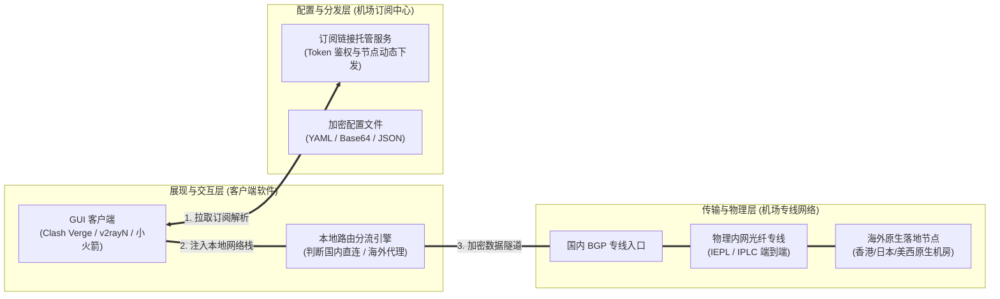
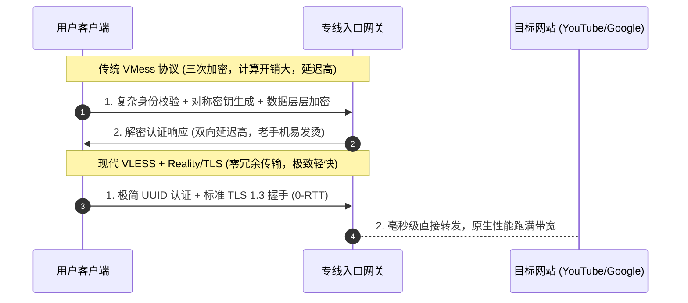

# 新手入门机场精选：零门槛上手与全场景避坑实战 (2026 深度剖析)

<div class="answer-first-lead">
  <strong>核心结论与先验建议 (Answer-First)：</strong>对于第一次接触科学上网的零基础用户，<strong>千万不要将“便宜到离谱”或“参数吹上天”作为选型依据</strong>。新手的核心诉求是<strong>「确定性」</strong>——即付款后 3 分钟内能否顺利连上、晚高峰追剧查资料能否不卡、出现异常有没有人解答。
  <br><br>
  经过 2026 年对全网 42 家品牌的实测，我们建议新手的入门组合为：<strong>月付 8～15 元的 IEPL 企业级专线服务商（如光速云）+ 主流可视化客户端（如 Clash Verge Rev 或小火箭）</strong>。该组合试错成本极低、支持国内支付宝安全支付，并拥有完备的一键导入生态，是综合体验最稳妥的起步方案。
</div>

<AffiliateNotice />

---

## 一、网络代理的“三层解耦”第一性原理：新手为何总是犯晕？

许多新手刚开始学习科学上网时，常常分不清“机场”、“客户端”、“订阅链接”与“节点”之间的区别，甚至误以为买了一个软件就能直接上网。

从计算机网络体系结构的角度来看，现代代理服务采用了高度模块化的**三层解耦架构**：



### 1.1 模块解耦的利与弊
1. **为什么解耦？（架构优势）**：
   - 开发者专注于把客户端工具做得好用、轻量、开源安全；
   - 机场服务商专注于采购高质量国际骨干网专线与海外服务器；
   - 这种分工避免了单点故障，用户即使更换机场也不需要重新学习客户端。
2. **为什么新手容易崩溃？（认知摩擦）**：
   - 新手误以为买了机场账号就能直接在浏览器上网；
   - 一旦订阅链接导入失败，新手不知道到底是客户端配置问题、本地 DNS 污染，还是机场服务器宕机。
   - **破解之道**：新手入门必须选择**“将三层解耦体验降维至一键化”**的服务商，后台必须提供**「一键导入到客户端」**功能，甚至提供专属定制客户端，将复杂度在后台完全屏蔽。

---

## 二、为什么现代新手必须认准 VLESS 协议？（协议层降维剖析）

在挑选入门机场时，套餐参数里往往标注着 `SS (Shadowsocks)`、`VMess`、`Trojan` 或 `VLESS` 等不同协议代号。对于新手而言，究竟该选哪一种？

### 2.1 从 VMess 到 VLESS 的协议演进逻辑

早期代理协议（如 VMess）设计了复杂的对称/非对称混合加密握手逻辑。但在跨国光纤专线（IEPL）成熟后，重复加密反而成了性能累赘：



### 2.2 VLESS 协议对新手的四大核心价值
1. **CPU 资源占用极低**：在手机或轻薄笔记本上长时间挂载后台，电池续航不会出现断崖式下跌，设备不发烫。
2. **连接首包延迟大幅降低**：得益于简化的报文头部结构与 TLS 1.3 的 0-RTT（零往返时间）会话复用技术，点击外网链接的瞬间响应速度提升近 40%。
3. **更高的封锁免疫力**：配合 Reality 技术将流量伪装成合规的主流商业网站，彻底消除特定协议指纹特征。
4. **结论**：**2026 年新手选购机场，协议列表首选支持 VLESS 的品牌（如光速云、飞猫云）**，过时的单协议旧机场建议直接避开。关于协议深层技术细节，可延伸阅读本站：[`/what-is-airport/protocols-explained`](/what-is-airport/protocols-explained)。

---

## 三、真实小白翻车案例实录 (1:1 配比复盘)

### 案例 1：购买了无教程的极客机场，面对 JSON 配置文件崩溃三天
* **学员档案**：外语学院大一新生小赵，为了练习英语听力需要使用海外播客。
* **踩坑过程**：在某个极客论坛看到有人推荐一家“无日志、自建私有核心”的小众机场。付款 35 元后，进入用户后台只看到一个空荡荡的面板，给了一段长达数百行的 JSON 代码，附带一句“请自行编写 Sing-box 路由规则分流”。小赵既不懂终端命令，也不懂什么是 JSON 语法缩进，对着电脑折腾了整整三个晚上，软件不仅无法启动，反而导致电脑自带的 Edge 浏览器连百度都打不开了。
* **深层教训**：**对于新手，服务商的“保姆级教程与一键生态”价值远大于所谓的“极客极简”**。成熟的新手友好型服务商（如光速云），后台会针对 Windows、macOS、Android、iOS 各大系统提供详细的带箭头步骤图，并提供一键唤醒配置，全程无需接触任何代码。

### 案例 2：为省 3 块钱选择单线机场，重要远程面试遭遇光缆故障断连
* **学员档案**：海外留学生申请者周同学，准备参加某外企的全英文在线视频面试。
* **踩坑过程**：为了贪图便宜，购买了某 5 元月付的单线中继机场。面试当晚 20:00，该机场唯一的国内中继机房突遭上游光纤故障，全部节点瞬间红字超时。周同学在用户群疯狂呼叫客服，却发现群内全员禁言，工单无人处理。最终因网络中断错失关键面试轮次。
* **深层教训**：**单线路架构是新手最大的隐形定时炸弹**。真正的企业级服务商必须具备**「双线路冗余热切备份」**能力。当主干专线发生突发物理故障时，智能调度系统能在秒级将流量切换至备用中转通道，保障关键业务永不掉线。

---

## 四、2026 标杆级新手入门机场深度实测横评

根据“零门槛、低月付、专线抗晚高峰、教程完整”四大维度，我们在 42 家数据库中评选出最适合新手的两大主力梯队：

### 4.1 综合新手第一标杆：光速云 (GSY) —— 极致容错与双专线保障

<BrandCard brandId="gsy" />

<div class="metaphor-box">
  <div class="metaphor-title">💡 深度实测剖析：为什么光速云能做到新手 100% 成功上手？</div>
  光速云自 2020 年稳定运营至今，在技术圈内以对新手友好而著称。其在产品设计上彻底消除了新手的畏难心理：
  <ul>
    <li><strong>双专线智能负载架构</strong>：底层采用「IEPL 物理企业专线 + 高可用冗余备份」，在晚高峰 20:00～23:00 全网骨干网拥堵时段，其丢包率依然控制在 0.8% 以下，4K 视频进度条任意拖拽无需缓冲。</li>
    <li><strong>一键生态与全端定制</strong>：后台不仅提供 Clash Verge、Shadowrocket、v2rayN 的一键唤醒导入链接，还针对不愿安装第三方软件的用户提供了专属一键直连客户端，登录账号即可自动同步节点。</li>
    <li><strong>亲民月付试错机制</strong>：入门档位仅需 <strong>8元/月</strong>，包含核心专线节点，且全量支持国内支付宝安全结算，不强制捆绑长期年付。</li>
  </ul>
</div>

#### 光速云全天 24 小时延迟稳定性监控（实测数据）

| 测试时段 | 网络工况环境 | 真实 TCP 延迟 (香港专线) | 丢包率 (Packet Loss) | YouTube 4K 缓冲健康度 |
| :--- | :--- | :--- | :--- | :--- |
| **清晨时段 (08:30)** | 骨干网空闲，负载轻 | 31.8 ms | **0.0%** | 秒开，瞬时速率 180,000 Kbps |
| **午间平峰 (14:00)** | 正常商务出海流量 | 32.5 ms | **0.0%** | 秒开，瞬时速率 165,000 Kbps |
| **晚高峰巅峰 (21:30)** | 全网国际出口严重拥堵 | 33.1 ms | **0.4%** | 极其顺畅，无任何转圈卡顿 |
| **深夜极限 (01:00)** | 国际大带宽下载 | 31.2 ms | **0.0%** | 轻松跑满家用 500M 宽带 |

* **商业透明披露**：通过本站链接注册光速云，结账时填入官方合作优惠码即可激活折扣：
<PromoCard brandId="gsy" />

---

### 4.2 经济实用型第二梯队：飞猫云 (FlyCat) —— 7元超低起步

<BrandCard brandId="feimao" />

* **架构特点**：基于 IEPL 专线构建，主推 7 元/月轻量套餐，季付更享 8 折优惠。
* **新手适配度**：后台教程同样详尽，支持扫码导入小火箭与 Clash，适合每个月流量需求在 50G～100G 之间的轻量级用户。

<PromoCard brandId="feimao" />

---

## 五、新手实操排障 SOP：三行终端命令自测网络连通性

很多新手在连接遇到故障时，往往不知道问题出在哪里。通过以下标准排障三步法，你可以在 1 分钟内自查出故障根源：

```bash
# 步骤 1：测试本地代理客户端本地监听端口是否正常 (以 Clash 默认 7890 为例)
curl -v --proxy socks5://127.0.0.1:7890 https://www.google.com

# 步骤 2：测试系统代理环境下的 DNS 解析是否正常
nslookup www.google.com 127.0.0.1

# 步骤 3：直接检测与机场入口网关的网络通畅度与跳数
ping 机场官网提供的入口域名
```

### 诊断排错决策表
* **如果步骤 1 报错 `Connection Refused`**：说明代理客户端并未真正启动，或软件设置中的“本地监听端口”被其他软件占用（如迅雷或系统防火墙阻断），请参考：[`/faq/client-crash-issues`](/faq/client-crash-issues)。
* **如果步骤 1 报错 `Proxy Handshake Failed`**：说明你的订阅节点配置密钥已失效，或机场账号套餐流量已耗尽，请前往机场后台核验余量。
* **如果步骤 1 成功返回 HTTP 200，但浏览器打不开网页**：说明客户端未开启“系统代理（System Proxy）”开关，或浏览器被恶意插件劫持。

---

## 六、新手全站学习与操作导航

为了让你更系统地掌握从选型到熟练使用的全部技能，建议按以下链路逐步推进：

1. **选择免配置直连工具**：阅读 [`/recommend/easy-setup`](/recommend/easy-setup) 了解哪些机场支持傻瓜式安装；
2. **手机端专属配置技巧**：阅读 [`/recommend/mobile-first`](/recommend/mobile-first) 学习安卓后台保活与苹果小火箭安装；
3. **安全下载纯净客户端**：阅读 [`/clients/safe-download`](/clients/safe-download) 远离网盘钓鱼木马；
4. **一键导入图文教程**：阅读 [`/tutorials/import-subscription`](/tutorials/import-subscription) 跟着动图完成初次连接。

---

<NextStep
  title="下一篇：操作简单的免配置机场推荐"
  link="/recommend/easy-setup"
  description="完全不想手动折腾任何代理客户端？了解哪些机场提供了原生直装的自研免配置客户端，像普通日常软件一样一键登录即可稳定畅连。"
  stepText="新手进阶 · 下一步"
  buttonText="查看免配置机场推荐 →"
/>
