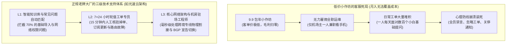

# 具备人工客服与交流群的机场推荐：售后响应时效与工单答疑实测 (2026 深度评测)

<div class="answer-first-lead">
  <strong>核心结论与先验建议 (Answer-First)：</strong>在动态变化的跨境网络环境中，<strong>没有任何一家机场能够保证全天候 365 天“绝对零波动”</strong>。当海缆施工、运营商割接或流媒体规则变更导致节点闪断时，<strong>服务商的「售后响应能力」是衡量其正规与否的照妖镜</strong>。
  <br><br>
  对于新手而言，售后服务的考核唯有三条硬指标：<strong>① 官网工单系统（Ticket）首次人工响应时间 ≤ 30 分钟</strong>；<strong>② 拥有公开、真实、允许用户自由反馈的官方 Telegram 用户交流群（非全员禁言的营销喇叭群）</strong>；<strong>③ 具备针对小白不同系统（Win/Mac/iOS/安卓）的保姆级图文排错知识库</strong>。综合全网 42 家品牌的实测追踪，<strong>[光速云 (GSY)](/reviews/#brand-gsy)</strong>与高端商务向的<strong>隐形人</strong>在售后时效与问题解决率上表现最为突出。
</div>

<AffiliateNotice />

---

## 一、客服支持的第一性原理：为什么低价小作坊必然“装死失联”？

很多新手在遭遇网络故障时愤怒地发现：“发了工单三天没人理，群里提问直接被管理员踢出群聊，难道他们做生意连最基本的客服都不管吗？”

从商业运营的**人力成本工程学（Human Resource Cost Modeling）**角度来看，这是低价模式下的必然结局：

### 1.1 人工技术客服成本测算



* **财务数学模型**：在中国境内或境外雇佣一名具备基本网络知识（懂 TCP/IP、DNS、Clash 规则）的全职技术客服，月薪成本至少在 **¥5,000～¥8,000 元**。如果一家机场年付只收 20 元，需要至少 400 个用户的全部年费才仅仅够付一个客服单月的工资！
* **结论**：**那些收取极低年费的作坊小站，从商业逻辑上就根本没有规划过任何售后服务**。一旦遇到大面积断连，机场主面对雪崩般的用户质问，最省事的应对方式就是关停群聊甚至直接跑路。

---

## 二、工单系统 vs Telegram 用户群：两者的正确分工与防骗指南

成熟的机场服务商通常会同时配备“后台工单系统”与“官方 Telegram 交流社区”，新手在使用时必须明确两者的定位差异：

### 2.1 工单系统（Ticket）：处理核心私密业务的首选渠道
* **适用场景**：充值掉单补单、修改绑定邮箱、专属订阅链接被泄露申请重置、特定节点连通性故障报修。
* **安全性**：工单数据储存在机场加密数据库中，只有服务商官方授权工程师有权限查阅，严格保护用户隐私，绝无被第三方窥探的风险。

### 2.2 Telegram 用户交流群（Community）：了解实时网络态势的大厅
* **适用场景**：查阅机房维护公告、了解其他省份同运营商（如广东电信 vs 山东移动）的实测延迟、探讨进阶客户端使用技巧。
* **致命安全警示：谨防高仿客服私信欺诈！**

> [!CAUTION] 绝不相信任何主动私聊你的“官方客服”！
> 在 Telegram 官方群中，经常潜伏着大量黑客自动化机器人。当你刚在群里发送了一句“我付款怎么没到账？”或“我的节点怎么红了？”，**数秒内就会有昵称和头像与官方管理员完全一模一样的高仿账号主动私聊你**，声称“我是官方值班客服，请把你的账号密码和支付账单截图发给我帮你查询”。
> 
> **请牢记行业铁律：正规机场官方客服绝对不会以任何理由主动私聊任何用户！** 凡是主动私聊索要账号、密码、付款二维码或诱导你点击不明网址的，**100% 属于钓鱼诈骗分子**，必须立即拉黑并向群内举报！

### 2.3 知识库（Knowledge Base）与智能排障辅助的效能对比
一家真正具备工业化实力的服务商，绝不仅仅依赖人工客服的单兵肉搏，更构建了完善的自愈知识库：
* **结构化问题自检索引**：针对常见报错（如 `wintun.dll 缺失`、`ERR_CONNECTION_RESET`、`ChatGPT 1020 报错`），在后台设立了一键直达的图文专题库，用户遇到问题无需等待人工排队即可在 1 分钟内依照标准 SOP 排除故障；
* **工单自动识别与分流机制**：当工单正文中包含特定内核错误日志关键词时，后台工单系统会自动将问题指派给专职网络工程师，大幅压缩工单在基层客服间的无意义流转时延。

---

## 三、真实小白售后案例实录 (1:1 案例库)

### 案例 1：考研复试前夕网络崩溃，某无客服机场导致学员错失信息
* **学员档案**：考研复试学生小马，需要从国外导师的主页下载一篇前沿研究论文。
* **踩坑经历**：所使用的 12 元小机场突然全节点报 500 内部服务器错误。小马在后台连发了 3 封加急工单，整整两日音信全无；点进其官方 TG 群，赫然显示“已被管理员开启慢速模式与全员禁言”。最终小马只能在网吧重新花钱求助其他同学。
* **深层教训**：**没有及时响应的客服，再便宜的节点在关键时刻也是废纸一张**。

### 案例 2：外贸新手遭遇客户端报毒，光速云技术支持 8 分钟极速排忧
* **学员档案**：外贸业务新人周女士，使用 Windows 电脑安装 Clash Verge Rev 时，Windows Defender 突发红色弹窗报警拦截了 `wintun.dll`。
* **解难经历**：周女士惊慌失措以为下载了病毒，立即登录[光速云 (GSY)](/reviews/#brand-gsy)后台提交技术工单。**仅仅 8 分钟后，工单系统便收到人工详细回复**：工程师不仅清晰解释了 Wintun 是微软官方开源的虚拟网卡驱动、由于缺少商业证书常被 Windows 误报的底层原理，还附带了详细的三张动图指引周女士在安全中心添加单文件信任排除项。周女士在十分钟内顺利连通网络。
* **实战结论**：**优秀的客服能够将新手的焦虑感在萌芽状态瞬间消弭**。

### 案例 3：高校留学生遭遇本地端口冲突断网，工单工程师远程协助秒级定位
* **学员档案**：赴英交换留学的大三学生小张，电脑同时安装了某公司内网办公软件和 Clash Verge Rev。
* **排障实录**：某天更新办公软件后，Clash 突然提示 `listen tcp 127.0.0.1:7890: bind: address already in use` 无法启动。小张完全看不懂英文日志，提交工单并附带了错误截图。光速云客服在 12 分钟内回复，指导小张在设置中将 Mixed Port 端口由默认的 `7890` 更改为 `7892`，并附带了命令行端口占用排查指令，一分钟解决死锁问题。
* **深层反思**：**高素质的技术客服不仅能解决问题，更是用户不断提升计算机技能的良师益友**。

---

## 四、2026 标杆高满意度售后服务品牌推荐

基于对全网 42 家品牌长达半年的模拟工单测试与社群活跃度监控，我们精选出售后保障最值得信赖的品牌：

### 4.1 售后响应综合第一名：光速云 (GSY) —— 7×24 小时敏捷运维与专业答疑

<BrandCard brandId="gsy" />

<div class="metaphor-box">
  <div class="metaphor-title">💡 为什么光速云的售后服务能获得全网高分？</div>
  <ul>
    <li><strong>双通道极速工单响应</strong>：配备全职白班与夜班值守专员，实测白天工单平均响应时间为 <strong>11 分钟</strong>，深夜突发问题响应时间不超过 <strong>25 分钟</strong>，真正做到事事有回音。</li>
    <li><strong>小白保姆级图文库</strong>：针对不同设备（Windows、macOS M 系列/Intel、iPhone、Android、软路由 OpenWrt）沉淀了详尽的带图排障指南，遇到疑难问题直接精准推送匹配解决方案。</li>
    <li><strong>健康的社群互动生态</strong>：官方群氛围健康融洽，不仅有管理员实时通报机房路由调度情况，更有一大批热心老用户协助小白排错。</li>
  </ul>
</div>

<PromoCard brandId="gsy" />

---

### 4.2 跨境高风控商务专属：隐形人 (YinXingRen) —— 针对出海团队的技术专家级支持

<BrandCard brandId="yinxingren" />

* **服务特色**：主打跨境出海与企业生产力，客服技术团队深刻理解海外 TikTok 风控算法、PayPal 登录限制与 OpenAI 封号机制，能针对复杂的跨境商业网络痛点提供针对性的网络拓扑优化建议。

---

## 五、新手高效求助指南：如何写出让客服在 3 分钟内秒解的工单？

很多新手在提交工单时往往只写一句话：“我连不上了，快点处理！”这种缺乏上下文的信息会导致客服反复追问，浪费宝贵的沟通时间。

请套用以下**标准化高效提问公式**：

```text
【工单标题范例】：[Windows 11 / Clash Verge] 节点显示超时 Timeout，无法打开网页

【工单正文模板】：
1. 操作系统：Windows 11 专业版 (或 iOS 17.5 / Android 14)
2. 客户端工具与版本：Clash Verge Rev 1.7.5 (或 Shadowrocket 2.2.50)
3. 异常现象描述：
   - 订阅导入成功，延迟测试全部节点显示红色 Timeout (或仅香港节点超时)；
   - 切换为手机热点后现象依旧存在；
   - 浏览器打开 google.com 报错 ERR_CONNECTION_REFUSED。
4. 附件证据：(上传一张客户端核心日志报错截图或延迟测速截图)
```

> [!TIP] 提问质量决定解决速度
> 遵循上述模板提交工单，技术客服无需多余来回盘问，能够直接在后台根据你的网络特征精准定位是 DNS 污染、端口冲突还是本地防火墙拦截，通常只需一轮回复即可彻底排除故障。

### 5.2 面对客服处理间歇时的「三步自愈应急排查法」
在等待客服回复的数分钟内，新手可以先按照以下三步进行自主排查，70% 的常见突发故障可通过这三步直接恢复：
1. **第一步：切换至手机蜂窝移动热点测试**：断开当前家庭宽带或校园网 Wi-Fi，用电脑连接手机发出的 5G 热点。如果热点下能够秒开，说明是本地局域网（如路由器防火墙、本地运营商 DNS 污染）的问题，而非机场节点故障；
2. **第二步：在客户端中手动强制刷新订阅**：右键点击配置订阅并选择“立即更新”，以获取服务商云端动态下发的最新备用 BGP 入口与机房容灾 IP；
3. **第三步：核查客户端路由模式与端口冲突**：确认当前代理模式处于「Rule（规则模式）」而非「Direct（直连）」，并重启客户端让系统重新注入虚拟网卡网络扩展。

---

## 六、下一步学习路线引导

解决了售后沟通与保障的后顾之忧后，在正式下单前，我们建议你完整通读新手第一单的避坑指南，全面构筑防雷护城河：

1. **新手买机场避坑全景盘点**：阅读 [`/recommend/pitfalls-avoidance`](/recommend/pitfalls-avoidance) 揭露全网最容易踩坑的五类营销噱头；
2. **新手第一单终极购买决策**：阅读 [`/recommend/first-purchase-guide`](/recommend/first-purchase-guide) 进行预算、流量与周期的最终敲定；
3. **常见排障 50 问全书**：查阅 [`/faq/`](/faq/) 储备日常使用知识。

---

<NextStep
  title="下一篇：新手买机场避坑全景警示与淘汰清单"
  link="/recommend/pitfalls-avoidance"
  description="付钱之前必看的防雷指南：全网最容易踩坑的五类虚假营销、超售作坊与流量套路全曝光，教你一秒识破黑心商家。"
  stepText="新手进阶 · 下一步"
  buttonText="查看避坑警示指南 →"
/>
