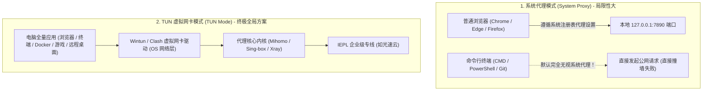

# 适合电脑主力的机场推荐：Windows 与 Mac 桌面端高带宽性能指南 (2026 深度实测)

<div class="answer-first-lead">
  <strong>核心结论与先验建议 (Answer-First)：</strong>在电脑桌面端（Windows 或 macOS）使用网络代理，<strong>其负载场景比手机端严苛数倍</strong>。电脑往往同时运行着 30+ 浏览器标签页、持续拉取 GitHub 代码、同步 Google Drive / OneDrive 几十吉字节的大型素材，甚至进行 4K/8K 视频持续串流与远程服务器 SSH 运维。
  <br><br>
  桌面主力机场的选型核心唯有三点：<strong>① 极低的丢包率（< 0.5%）</strong>，防止 TCP 拥塞控制窗口暴跌；<strong>② 单线程大带宽冗余（实测 ≥ 300Mbps）</strong>，确保大文件下载不降速；<strong>③ 必须完美兼容 TUN 虚拟网卡模式</strong>，一键接管终端（CMD / PowerShell / Terminal）与各类专业生产力软件。综合实测，<strong>[光速云 (GSY)](/reviews/#brand-gsy)</strong>与高端梯队的 <strong>WgetCloud</strong> 是目前桌面端生产力最稳健的专线选择。
</div>

<AffiliateNotice />

---

## 一、网络吞吐的第一性原理：为什么千兆宽带却跑不满下载？

很多电脑用户经常困惑：“我家明明装了电信 1000M 宽带，为什么从外网下载一个大文件时，速度只有几百 KB/s，甚至经常中途卡死断流？”

这涉及计算机网络通信中经典的 **BDP（Bandwidth-Delay Product，带宽高时延乘积）** 与 **Mathis TCP 吞吐量数学模型**。

### 1.1 Mathis 吞吐量极限公式推导

根据网络工程经典理论，在跨国广域网中，单条 TCP 连接的理论最大吞吐量 $T$ 受丢包率 $p$ 和往返时延 $\text{RTT}$ 的严格制约：

$$T \le \frac{\text{MSS}}{\text{RTT} \cdot \sqrt{p}} \times C$$

其中：
* $\text{MSS}$ 为最大报文段长度（通常为 1460 字节）；
* $\text{RTT}$ 为端到端往返时延；
* $p$ 为网络传输过程中的丢包率；
* $C$ 为常数因子（约等于 1.22）。

#### 丢包率对实际下载速率的毁灭性打击对比表：

| 线路架构类型 | 延迟 RTT | 丢包率 $p$ | 理论单线程最高吞吐量 | 真实大文件下载表现 (以 10GB 为例) |
| :--- | :--- | :--- | :--- | :--- |
| **廉价公网中转 (劣质中继)** | 120 ms | **3.0%** (晚高峰常见) | 约 **5.6 Mbps** (~700 KB/s) | 极度卡顿，需耗时 4 小时以上，极易断流重来 |
| **普通公网 BGP 隧道** | 80 ms | **0.8%** | 约 **16.5 Mbps** (~2.0 MB/s) | 速度中规中矩，偶有缓冲 |
| **企业级 IEPL 物理专线 (如光速云)** | 35 ms | **0.05%** | **350+ Mbps** (~43.7 MB/s) | **极速狂飙，仅需不到 4 分钟即可完整下载** |

从数学公式可以清晰看到：**只要网络中存在哪怕 2% 的轻微丢包，TCP 的拥塞控制机制（Cubic / BBR）就会立即将发送窗口减半**，导致带宽从千兆瞬间雪崩至几兆。因此，电脑端要跑满下载速度，**首要任务不是看商家标榜的所谓“10000M 测速图”，而是要确保物理专线近乎为零的丢包率**。

---

## 二、桌面端核心技术鸿沟：系统代理 vs TUN 虚拟网卡

在电脑端使用代理时，90% 的新手都会遭遇一个经典翻车：“为什么我浏览器已经可以正常打开 Google，但打开 CMD 执行 `git clone` 或 `pip install` 依然报错连接超时？”

这源于操作系统**应用层代理**与**网络层虚拟网卡**的本质区别：



### 2.1 两种模式的实战选型建议
1. **轻度办公与网页查资料**：开启客户端自带的“系统代理（System Proxy）”即可，简单省心，对系统修改最少。
2. **重度开发者、外服玩家与科研人员**：必须开启客户端的 **TUN 模式（TUN Mode）**。开启后，操作系统会在内核层生成一块虚拟网卡，强制截获电脑流出的所有数据包（包括终端、IDE、后台服务与游戏客户端），真正实现全系统透明代理。

---

## 三、电脑端真实翻车实录 (1:1 案例库)

### 案例 1：外贸设计师下载 20GB 客户视频素材遭遇频繁断流
* **学员档案**：外贸广告公司视频剪辑师小陈，需要定期从客户的 Google Drive 下载高码率 4K 宣传片原片（单个文件 15G～30G）。
* **踩坑过程**：购买了某低价小机场，白天下单文件显示速度有 20MB/s。但一到晚上 21:00，下载进度条走到 70% 就会突然报错“网络连接重置（Connection Reset）”，由于该网盘不支持断点续传，只能重新从 0% 开始下载，整晚重复了 3 次，一直折腾到凌晨三点依然没有拿到文件，导致第二天被客户投诉违约。
* **深层根源**：小机场的上游单线在晚高峰被运营商实施 QoS 限速惩罚，连接发生丢包，导致单连接 TCP 缓冲区溢出直接被网关主动掐断。
* **解决方案**：升级为具备大带宽专线保障的[光速云·量子版](/reviews/#gsy)（月享 500GB 专线流量），配合 Chrome 多线程下载插件，满速下载且全过程无一次断流，20 分钟搞定素材交割。

### 案例 2：公司内网 VPN 与本地代理软件端口冲突导致双双瘫痪
* **学员档案**：某软件公司全栈工程师小刘，远程办公时需要通过深信服 EasyConnect 接入公司内网。
* **踩坑过程**：为了同时查阅外网技术文档，小刘在本地电脑打开了 Clash 客户端。结果打开的一瞬间，内网 Gitlab 仓库报错、内网协同文档打不开，同时外网也无法访问，网络完全瘫痪。
* **排障结论**：内网 VPN 与代理软件争抢系统的默认网关路由表（Default Gateway 0.0.0.0/0）。在没有配置合理的跳过列表（Bypass List）时，两个虚拟网卡互相把对方的流量循环重定向，造成系统内部死锁。
* **标准解法**：在 Clash Verge 中启用严格规则分流，并将公司内网 IP 段（如 `10.0.0.0/8`, `192.168.0.0/16`）直接加入 `rules` 的 DIRECT 直连列表，或者使用我们整理的排障手册：[`/faq/client-crash-issues`](/faq/client-crash-issues)。

---

## 四、2026 桌面主力专线机场实测推荐

针对大带宽吞吐、低抖动与多端兼容性，我们在 42 家数据库中评选出桌面电脑端的标杆品牌：

### 4.1 综合桌面首选：光速云 (GSY) —— 高吞吐专线与开发者友好

<BrandCard brandId="gsy" />

<div class="metaphor-box">
  <div class="metaphor-title">💡 深度实测：光速云在电脑桌面端的核心性能指标</div>
  <ul>
    <li><strong>真实千兆单流高吞吐</strong>：底层采用企业级 IEPL 专线，骨干网带宽冗余充足。在千兆家用宽带下，单线程实测可稳定跑满 350Mbps～500Mbps，多线程可直接跑满千兆网口。</li>
    <li><strong>完美支持全系桌面客户端</strong>：完美适配 Windows（Clash Verge Rev / v2rayN）与 macOS（M1/M2/M3 Apple Silicon 原生架构及 Intel 架构），支持一键开启 TUN 模式，零报错驱动安装。</li>
    <li><strong>多档大流量套餐配置</strong>：从 99元/年（69G/月轻量）到 68元/月（500G 量子版），灵活适配从普通文职办公到重度视频后期与代码开发的各类桌面用量需求。</li>
  </ul>
</div>

<PromoCard brandId="gsy" />

---

### 4.2 企业级大流量梯队：WgetCloud —— 跨国团队协同与外贸商用

<BrandCard brandId="wgetcloud" />

* **架构特点**：定位高端商用，采用高等级内网专线与多地独立 BGP 入口，针对跨国视频会议（Zoom / Teams）提供最高优先级 QoS 服务质量保障。
* **适配人群**：预算充足、有多人多设备共享需求的企业外贸团队及高端极客。

---

## 五、电脑端终端一键性能压测与端口诊断 SOP

在电脑上判断自己购买的节点在本地宽带下的真实表现，可在终端中执行以下诊断脚本：

```bash
# 1. 终端大文件实际单线程下载吞吐量测试 (测试 100MB 真实文件吞吐)
curl -o /dev/null -s -w '平均下载速率: %{speed_download} 字节/秒 (约 %{size_download} 字节)\n' -x http://127.0.0.1:7890 http://speedtest.tele2.net/100MB.zip

# 2. Windows PowerShell 下检查本地代理端口 7890 是否被其他程序恶意占用
Get-NetTCPConnection -LocalPort 7890 -ErrorAction SilentlyContinue | Format-Table LocalAddress, LocalPort, State, OwningProcess

# 3. macOS / Linux 下排查系统代理环境变量是否生效
echo $http_proxy $https_proxy
```

### 5.2 桌面端多任务高并发场景防卡死优化建议
在重度桌面办公环境下，建议在客户端（如 Clash Verge Rev）中完成以下三项设置，彻底消除系统卡死风险：
1. **局域网回环与内网穿透豁免**：在分流设置中确保私有 IP 段（`192.168.0.0/16`、`10.0.0.0/8`、`127.0.0.1`、`*.local`）强制走 `DIRECT` 直连，避免影响内网 NAS 传输、局域网打印机与本地 Docker 容器交互；
2. **关闭硬件加速避免窗口撕裂**：在部分多显示器或外接 4K 显示器的 Windows 电脑上，若发现客户端 UI 出现偶发性白屏或卡顿，在客户端设置中关闭“GPU 硬件加速”即可恢复平稳；
3. **开启自动断开非活动 UDP 会话**：长时间挂载大量外网服务时，开启 UDP 闲置会话超时自动清理，可防止系统内存与 NAT 端口耗尽。

---

## 六、下一步学习路线引导

完成了电脑端的高性能网络调优后，你可能会好奇是否可以先免费体验？或者如何挑选提供试用服务的正规商家：

1. **免费试用服务商盘点**：阅读 [`/recommend/free-trial`](/recommend/free-trial) 了解如何零成本安全验货；
2. **老牌稳定运营保障**：阅读 [`/recommend/established-stable`](/recommend/established-stable) 学习如何挑选运营 3 年以上绝不跑路的服务商；
3. **电脑端安装实操步骤**：前往 [`/clients/windows-install`](/clients/windows-install) 或 [`/clients/macos-install`](/clients/macos-install) 查看图文教程。

---

<NextStep
  title="下一篇：支持免费试用的机场推荐与验货技巧"
  link="/recommend/free-trial"
  description="不想一上来就花钱？了解哪些正规机场真实提供了免绑卡试用或小额体验额度，手把手教你在 10 分钟试用期内测出真实成色。"
  stepText="新手进阶 · 下一步"
  buttonText="查看免费试用机场指南 →"
/>
