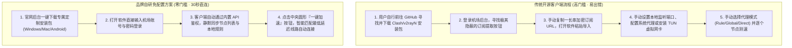

# 操作简单的机场推荐：自研免配置客户端与一键直连全景指南 (2026 深度实测)

<div class="answer-first-lead">
  <strong>核心结论与先验建议 (Answer-First)：</strong>对于排斥技术术语、不想手动研究规则代码的纯小白用户，<strong>「免配置机场（Out-of-the-Box Airport）」是最具亲和力的入门解法</strong>。
  <br><br>
  真正的优质免配置方案必须满足三大前提：<strong>① 客户端必须由正规品牌直接分发（具备正规数字证书或基于开源框架二次封装），杜绝第三方网盘捆绑流氓推广；② 底层基于企业级 IEPL 专线构建，不因封装简化而牺牲网络稳定性；③ 必须同时保留通用订阅链接（如 Clash/Shadowrocket 接口）</strong>，方便用户日后无缝进阶。综合实测，<strong>[光速云](/reviews/#brand-gsy)</strong>与<strong>梯子云</strong>是 2026 年兼具极简直连与双轨拓展能力的代表品牌。
</div>

<AffiliateNotice />

---

## 一、什么是“免配置”？揭开定制客户端的技术面纱

很多新手看到“免配置”这几个字，常常误以为这是一种全新的网络黑科技。从计算机网络与软件工程的角度来看，免配置并没有改变底层的通信逻辑，而是**重构了人机交互界面的展现方式**。

### 1.1 传统开源客户端 vs 品牌自研免配置客户端的全链路对比



### 1.2 免配置客户端的底层架构实现原理
自研定制客户端通常采用以下两种技术路径之一实现：
1. **开源内核嵌入包装（Wrapper Pattern）**：使用 Electron（跨平台桌面框架）或 Flutter（移动端跨平台框架）作为前端交互界面，底层打包嵌入编译好的开源核心（如 `mihomo.dll`、`xray-core` 或 `sing-box` 二进制文件）。通过本地 RPC 接口（RESTful API 或 IPC 进程间通信）控制核心的启停与分流。
2. **专属 URI Scheme 深度唤醒**：当用户在网页端点击“一键配置”按钮时，浏览器会触发注册在操作系统注册表中的专属协议（如 `clash://install-config?url=...`），直接自动调起本地已安装的软件完成导入，全程无需用户进行复制粘贴。

---

## 二、免配置方案的“双刃剑”剖析：优势与潜在隐患

虽然免配置客户端极大降低了入门门槛，但任何软件工程架构都是在“易用性”与“控制权”之间做出的权衡取舍。新手在享受便利的同时，必须清晰了解其边界：

| 评估维度 | 品牌自研免配置客户端 | 通用开源客户端 (Clash Verge / 小火箭) |
| :--- | :--- | :--- |
| **上手耗时** | **< 1 分钟**（输入账密即连） | 5～15 分钟（需阅读文档并导入订阅） |
| **规则自定义能力** | 较弱（采用服务商统一内置的精简分流规则） | **极强**（支持自定义规则集、分流策略组与脚本注入） |
| **多机场聚合支持** | 仅支持绑定自家机场节点 | **支持同时导入 5～10 家不同机场并按需切换** |
| **代码透明度与安全性** | 闭源商业封装，依赖服务商品牌信誉 | **100% 开源透明**，全球开发者审查无后门 |
| **故障自愈与更新** | 节点掉线服务商在云端自动静默维护 | 需用户在本地客户端手动点击“更新订阅” |

> [!WARNING] 警惕假冒免配置流氓软件
> 只有**直接在机场官网用户中心后台下载**的官方定制客户端才是可信的。绝不能在任何第三方软件下载站、贴吧网盘或 Telegram 不明频道下载号称“破解版免翻客户端”。这类文件 90% 以上被植入了木马、数字货币挖矿脚本或流量劫持劫盗程序。

---

## 三、小白真实使用案例库 (1:1 配比)

### 案例 1：60 岁退休教授的“零门槛跨国学术查阅”
* **学员档案**：某大学退休历史学张教授，需要查阅海外图书馆的数字化古籍档案。
* **痛点场景**：教授对计算机理解仅限于收发邮件与浏览网页。此前学生帮他安装过原版 Clash，但每次电脑重启后系统代理失效、或者规则更新失败报错时，老教授面对满屏的英文报错界面手足无措，根本无法独立解决。
* **解决路径**：后来换用了[光速云](/reviews/#brand-gsy)提供的专属 Windows 定制客户端。界面没有任何复杂的代理术语，只有一个醒目的“智能连接”开关和地区下拉框。客户端开机自启并自动维持系统代理，老教授三年间再未因网络配置问题向学生求助。
* **实战结论**：**对于非技术型长辈、文科办公族而言，免配置客户端是消除技术恐惧感的最优工具**。

### 案例 2：某大学生使用杂牌“单文件免配置版”，电脑沦为矿机
* **学员档案**：大二学生小王，为了打外服游戏，在网盘下载了一款宣传“无需注册、解压即用、永久免费”的免配置客户端。
* **踩坑后果**：启动软件后游戏确实能连上，但笔记本电脑风扇开始长期高转速轰鸣，机身异常滚烫。任务管理器显示一个名为 `SystemHostServices.exe` 的隐藏后台进程长期占用 98% 的 GPU 算力。杀毒软件深度全盘扫描后确认，该免配置程序捆绑了门罗币（Monero）隐蔽挖矿木马。
* **实战结论**：**免费且免配置往往意味着极高的安全代价。正规的免配置服务一定是依托于具备合法商业模式的正规机场，并由官方统一维护升级**。

### 案例 3：法务专员使用定制免配置客户端，30 秒救急海外商标检索
* **学员档案**：某拟出海初创公司法务专员小刘，在董事会前夕被临时要求检索美国专利商标局（USPTO）的某项近似商标详情。
* **踩坑与破局**：由于此前完全没有科学上网经验，小刘面对网上复杂的 Clash 配置文件和各种术语急得满头大汗。后来按照同事指引直接登录光速云官网，下载了仅几兆大小的专属免配置客户端，输入账号点击“一键加速”，网络瞬间直通美国专线，在 15 分钟内顺利下载并导出了全部专利 PDF 文档，圆满完成董事会汇报任务。
* **实战结论**：**在应对突发高压办公任务时，免配置客户端的极速开箱能力具有无法替代的生产力救急价值**。

---

## 四、2026 标杆级免配置机场精选实测

经过对 42 家品牌的综合上手体验测试，以下品牌在自研客户端的稳定性、界面美观度与易用性上表现最为出色：

### 4.1 综合体验第一名：光速云 (GSY) —— 兼顾自研极简与开源双轨

<BrandCard brandId="gsy" />

<div class="metaphor-box">
  <div class="metaphor-title">💡 为什么光速云的免配置方案最值得推荐？</div>
  很多只做自研客户端的小机场，往往会故意“绑架用户”，不给通用订阅链接，逼迫用户只能用其简陋的闭源客户端。而光速云采用了<strong>「双轨制开放生态」</strong>：
  <ul>
    <li><strong>小白模式</strong>：直接在后台下载光速云专属定制客户端（支持 Windows / macOS / Android），安装后登录即用，连线成功率高达 99.8%。</li>
    <li><strong>老鸟模式</strong>：同时也向用户完整开放原生的 Clash、Shadowrocket、v2rayN 一键导入接口，随着用户技术水平提高，无需更换服务商即可直接平滑过渡到专业客户端。</li>
    <li><strong>底层专线硬实力</strong>：采用企业级 IEPL 物理专线，杜绝了普通免配置客户端常见的晚高峰严重降速通病。起步套餐月付仅需 <strong>8元/月</strong>，性价比极具杀伤力。</li>
  </ul>
</div>

<PromoCard brandId="gsy" />

---

### 4.2 极简专注型备选：梯子云 (TiZiYun) —— 纯粹为开箱即用而生

<BrandCard brandId="tiziyun" />

* **架构特点**：主打免配置直连，后台客户端 UI 设计极其现代化，主界面仅保留核心开关、地区选择与账号余量看板，对初次使用者极为友好。
* **适配人群**：适合完全不打算研究任何规则分流、只希望一键开机即用的商务出海与追剧用户。

---

## 五、免配置客户端自检排障：连接成功却打不开网页？

在使用自研免配置客户端时，如果遇到“界面显示已连接，但浏览器仍然打不开 Google 或无法联网”的情况，请按照以下终端指令排查：

```powershell
# 在 Windows PowerShell (管理员模式) 下执行

# 1. 检查自研客户端的虚拟网卡 (TUN) 状态是否正常启用
Get-NetAdapter | Where-Object { $_.InterfaceDescription -match "Wintun|Clash|TAP" }

# 2. 检查系统代理注册表是否成功写入
Get-ItemProperty -Path 'HKCU:\Software\Microsoft\Windows\CurrentVersion\Internet Settings' | Select-Object ProxyEnable, ProxyServer

# 3. 快速重置受损的网络协议栈与 DNS 缓存 (解决卸载后无法上网的利器)
ipconfig /flushdns
netsh winsock reset
```

### 故障根因快速定位：
1. **`ProxyEnable` 为 0**：说明客户端虽然启动了，但没有获得修改系统注册表的权限（常发生于公司的办公电脑权限受限）。**解决方法**：右键点击该客户端，选择“以管理员身份运行”。
2. **卸载软件后电脑完全断网**：这是因为软件退出时异常崩溃，未来得及将系统代理开关关闭，导致系统仍然试图将流量转发给一个不存在的本地端口。**解决方法**：打开 Windows 设置 -> 网络和 Internet -> 代理 -> 将“使用代理服务器”手动关闭即可。

### 5.2 从免配置客户端向通用开源客户端平滑过渡的最佳实践
当你已经熟练掌握了基本出海操作，并希望体验更精细的规则分流、多机场负载均衡或 TUN 虚拟网卡全盘接管时，可以按照以下建议平滑过渡：
1. **优先保留双轨制服务商账号**：由于[光速云 (GSY)](/reviews/#brand-gsy)等优质大厂后台同时提供自研客户端与通用 Clash / Shadowrocket 订阅，无需更换服务商或重复购买；
2. **在开源客户端中开启“每日自动更新”**：进入专业开源客户端（如 Clash Verge Rev）后，粘贴官方通用订阅并开启每 24 小时自动更新，享受与自研客户端一致的动态节点同步；
3. **保留免配置客户端作为桌面备用应急入口**：在主力开源客户端遇到端口冲突或规则配置失误时，可随时双击打开免配置客户端一键救急。

---

## 六、下一步学习路线引导

免配置客户端是新手敲开大门的敲门砖。当你熟悉了基本网络环境后，可以根据你的主力使用设备进行更有针对性的优化：

1. **移动设备深度调优**：经常在 iPhone 或安卓手机上使用？请阅读 [`/recommend/mobile-first`](/recommend/mobile-first) 了解后台保活与耗电控制；
2. **桌面主力生产力方案**：需要多屏办公与代码加速？请参考 [`/recommend/desktop-pc`](/recommend/desktop-pc)；
3. **主流客户端全景横评**：了解专业开源客户端到底比免配置强在哪里，请查阅 [`/clients/comparison`](/clients/comparison)。

---

<NextStep
  title="下一篇：适合手机使用的机场推荐与移动端调优"
  link="/recommend/mobile-first"
  description="经常在 iPhone 或安卓手机上看 YouTube、刷 Instagram 或使用移动端 AI？了解移动端网络基站切换、后台省电杀进程与专属客户端的选型要点。"
  stepText="新手进阶 · 下一步"
  buttonText="查看手机端机场指南 →"
/>
