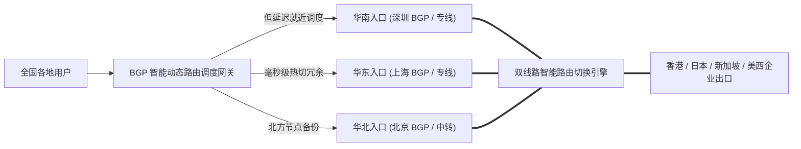

# 老牌稳定机场推荐：历经考验的长跑选手与防跑路评估模型 (2026 深度实测)

<div class="answer-first-lead">
  <strong>核心结论与先验建议 (Answer-First)：</strong>在鱼龙混杂的科学上网服务行业，<strong>「活着」就是一家机场最高等级的技术壁垒与信用背书</strong>。
  <br><br>
  行业数据统计显示，全网超过 <strong>85% 的新兴小机场寿命不足 6 个月</strong>，通常在通过低价年付吸纳一波资金后便因网络波动或资金链断裂而跑路。真正值得新手托付的**老牌稳定机场必须满足三大严苛门槛：① 连续稳定运营时间必须在 3 年以上（经历过多轮外部环境大考）；② 具备跨省多入口 BGP 与企业级物理专线（非单点临时组装）；③ 财务模型健康，主推平民月付而非强制大额绑死**。综合实测，自 2020 年运营至今的<strong>[光速云 (GSY)](/reviews/#brand-gsy)</strong>与<strong>星岛梦</strong>，是全网兼具资深资历与硬核专线实力的标杆代表。
</div>

<AffiliateNotice />

---

## 一、机场生命周期的第一性原理：为什么新兴小机场必然频繁跑路？

很多新手不理解：“为什么网上总有那么多人遭遇机场跑路？难道开一家机场就这么容易倒闭吗？”

从商业运营与现金流的数学模型来看，低价小机场的暴毙具有**不可逆转的结构性必然性**：

### 1.1 “年付吸金庞氏崩塌模型” vs “老牌专线良性飞轮模型”


### 1.2 跑路风险的财务数学测算
假设一个小作坊以 29.9 元/年吸引了 3,000 名用户，总计收款约 9 万元：
* 3,000 名用户按平均每人每月 100GB 流量计算，月度总消耗带宽至少需要 2Gbps 峰值出口。
* 真正的商业级中继/专线带宽成本每 Gbps 每月至少需要 ¥8,000～¥15,000 元。
* **计算结果**：该小作坊收取的 9 万元总年费，仅仅只够支付 **3～4 个月的真实带宽租金**！到了第 5 个月，账面现金枯竭，跑路便成了商家唯一的“理性经济选择”。
* **反观老牌机场（如光速云）**：依靠数万名按月稳定付费的高粘性真实活跃用户，形成了强大的月度现金流护城河，即使遇到敏感时期机房突发封堵，也有充裕的资金在数小时内采购备用线路完成热切。

---

## 二、老牌长青机场穿越风浪的四大技术护城河

能够在 2020 年至今经历多次网络严打、海底光缆地震故障以及国际出口大波动的考验，老牌机场依靠的绝不是运气，而是以下四大核心硬核底座：

### 2.1 护城河 1：与一级运营商长签的物理光纤专线合同
老牌机场拥有稳定的企业级法人主体或境外离岸公司，能够直接与中国电信（China Telecom Global）、中国联通（CUG）或国际头部 Tier 1 运营商签订长达数年的 **IEPL / IPLC 企业级物理点对点专线直签协议**。这种专线走的是内网专属物理信道，完全独立于民用公网国际出口，天生对公网拥堵与深度审查免疫。

### 2.2 护城河 2：全国多地 BGP 入口与跨省自动化灾备调度
单线小作坊只有一个入口服务器（例如仅有一个江苏入口），一旦该 IP 被封，全员断网。而老牌大厂在全国部署了多点冗余入口：



当华南入口突发物理施工时，BGP 智能探针会在 30 秒内自动将解析漂移至上海入口，终端用户在刷剧或办公时几乎察觉不到任何网络波动。

### 2.3 护城河 3：7×24 小时实时自动化链路巡检与自愈脚本
老牌机场拥有成熟的运维工程团队，部署了基于 Prometheus + Grafana 的全球链路探针。每当某条落地节点的丢包率超过 2% 或流媒体 IP 被 Netflix 标记受限，自动化脚本会自动执行 IP 轮换，无需人工介入报修。

---

## 三、真实小白翻车案例实录 (1:1 配比)

### 案例 1：购买“永久不限流量会员”，一个月后群聊全员禁言跑路
* **学员档案**：数码爱好者小周，在某 Telegram 推广频道看到一款标榜“开业周年庆、终身 VIP 仅需 199 元，不限时、不限量、永不跑路”的机场。
* **惨痛教训**：小周觉得 199 元终身太划算了，立即通过虚拟币结算付款。使用第一个月速度尚可，但第二个月初全部节点变红，官方 Telegram 群突然开启“全员禁言”，当晚群组直接被管理员解散，官网域名解析为 127.0.0.1。小周的 199 元石沉大海，申诉无门。
* **深层警示**：**任何声称“终身会员（Lifetime Access）”的网络服务，99.9% 都是收割末期资金盘的跑路前兆**。物理带宽和服务器没有终身的，任何合规持续的商业服务都必须基于周期性付费维持。

### 案例 2：科研团队选定长跑老牌，四年重要国际会议未曾中断
* **学员档案**：某高校生物医药课题组负责人刘博士，团队 8 名研究生需要长期访问 NCBI 基因数据库及参加 Zoom 跨国在线研讨。
* **实战历程**：刘博士在 2021 年听取技术专家建议，全员配置了自 2020 年运营的[光速云](/reviews/#brand-gsy)。四年来，无论是每年重要敏感时期还是海外光缆突发中断，光速云的双专线架构始终维持在 30ms 极低延迟，团队线上学术汇报从未出现过一次卡顿或掉线。
* **实战结论**：**对于科研、商务办公等对确定性有极高要求的场景，老牌机场带来的情绪价值与时间保障是低价小站无法比拟的**。

### 案例 3：独立站跨境商家轻信“新锐网红机场”，旺季大促销突遭跑路
* **学员档案**：主营 3C 电子产品出海的独立站卖家老陈，在海外黑五大促前夕看到某网红推销“新上线极致千兆机场，两年仅需 99 元”。
* **踩坑惨状**：老陈被低价吸引，把客服电脑全量迁入该新机场。结果在黑五当晚订单激增的高峰期，该小机场突发上游专线欠费被机房直接拔线，客服无法登录海外后台处理买家紧急退款与订单确认，直接造成近万美元的退单损失与客户差评投诉。
* **破局复盘**：老陈惨痛反思后，彻底封杀所有运营不满 2 年的“新锐小站”，全量切换为长期稳健运营的光速云双专线架构，再未发生失联事件。
* **实战警示**：**商业旺季与生产力环境必须坚持“以稳为先”，老牌大厂的长跑资历是抵御突发风险的最坚固保险**。

---

## 四、2026 标杆老牌长青专线品牌深度拆解

在全网 42 家品牌中，我们筛选出运营时间在 3 年以上、口碑极佳的长青老将：

### 4.1 综合老牌第一首选：光速云 (GSY) —— 2020 年至今的稳健传奇

<BrandCard brandId="gsy" />

<div class="metaphor-box">
  <div class="metaphor-title">💡 为什么光速云能稳健运营 6 年屹立不倒？</div>
  <ul>
    <li><strong>双专线冗余架构先驱</strong>：早在 2020 年创立之初，光速云便确立了「主用 IEPL 企业内网专线 + 备用高质量中转集群」的双规容灾架构，彻底告别单点故障。</li>
    <li><strong>严守健康财务底线</strong>：坚决不打“无限量/终身”等恶性价格战，始终将月付保持在平民亲民的 <strong>8元/月</strong> 档位，既保证了用户的极低试错成本，又确保了机房专线资金池长期充盈健康。</li>
    <li><strong>完善的服务支持体系</strong>：沉淀了长达数年的知识库与全天候工单处理能力，节点异常响应速度在全行业名列前茅。</li>
  </ul>
</div>

<PromoCard brandId="gsy" />

---

### 4.2 资深老牌高口碑备选：星岛梦 (XingDaoMeng) —— 2020 年长跑老将

<BrandCard brandId="xingdaomeng" />

* **架构特点**：同样自 2020 年稳定运营至今，主打企业级内网专线与针对轻度用户的不限时套餐。
* **长处亮点**：在极客圈与老用户群体中信誉积淀深厚，线路抗风险能力优异。

---

## 五、新手自查：四步法透视一家机场是否具有跑路风险

在付款之前，你可以像专业网络安全审计员一样，花 2 分钟完成以下背景尽职调查：

```bash
# 1. 终端查询该机场域名的实际注册年限与到期时间 (域名仅注册几个月的极度危险)
whois 机场主域名.com | grep -E "Creation Date|Registry Expiry Date"

# 2. 检查其入口网关是否具备正规企业级 BGP 自治系统号 (ASN)
nslookup 机场入口域名
# 将解析出的 IP 复制到 https://bgp.he.net/ 查询其所属运营商与路由宣告历史
```

### 跑路高危体征排查清单：
- [ ] **域名注册年龄**：域名注册时间小于 6 个月，且仅续费了 1 年（极度高危）；
- [ ] **套餐定价结构**：只有年付、两年付套餐，强行取消或隐藏月付选项（极度高危）；
- [ ] **交流群状态**：官方 Telegram 群完全开启全员禁言，只发广告不准用户反馈交流（极度高危）；
- [ ] **支付方式**：只支持匿名虚拟币（USDT），不支持国内任何正规合规支付接口（高危）。

### 5.2 老牌机场防失联两手准备（防失联 SOP）
即便是运营了 6 年的老牌大厂，其官网域名有时也会因常规网络阻断而发生轮换迁移。为了防止突发失联，建议养成以下两个习惯：
1. **订阅节点自带容灾更新能力**：只要客户端内配置的订阅节点没有丢失，即便官网前端域名被阻断，底层的专线节点依然能够正常连接。在已连通状态下，可随时无障碍访问官方公布的最新永久发布页；
2. **收藏官方 Telegram 公告频道与免翻镜像导航**：服务商若有任何线路割接或新入口上线，均会第一时间在官方频道（Channel）同步，提前收藏可保证第一时间获取最新动态；
3. **保存离线紧急备用节点**：在客户端内配置备用机场或保留 1～2 个应急节点，确保在极端主线割接调试时能够无缝切换，实现 100% 网络不中断。

---

## 六、下一步学习路线引导

确认了老牌稳定服务商后，很多国内用户最关心的就是如何安全、便捷地完成付款：

1. **主流支付防坑指南**：阅读 [`/recommend/alipay-payment`](/recommend/alipay-payment) 了解支付宝结算防被银行风控的技巧；
2. **售后服务响应实测**：阅读 [`/recommend/customer-support`](/recommend/customer-support) 了解工单系统与交流群的正确使用方式；
3. **老牌机场全景测评**：前往 [`/reviews/`](/reviews/) 查看包含光速云在内的 42 家品牌的完整测速图与解锁矩阵。

---

<NextStep
  title="下一篇：支持支付宝便捷支付的机场推荐与安全结算"
  link="/recommend/alipay-payment"
  description="没有外币信用卡？担心代充被骗？盘点原生支持国内支付宝、微信扫码支付的正规机场，并教你如何防范支付跳转钓鱼。"
  stepText="新手进阶 · 下一步"
  buttonText="查看支付宝支付机场指南 →"
/>
